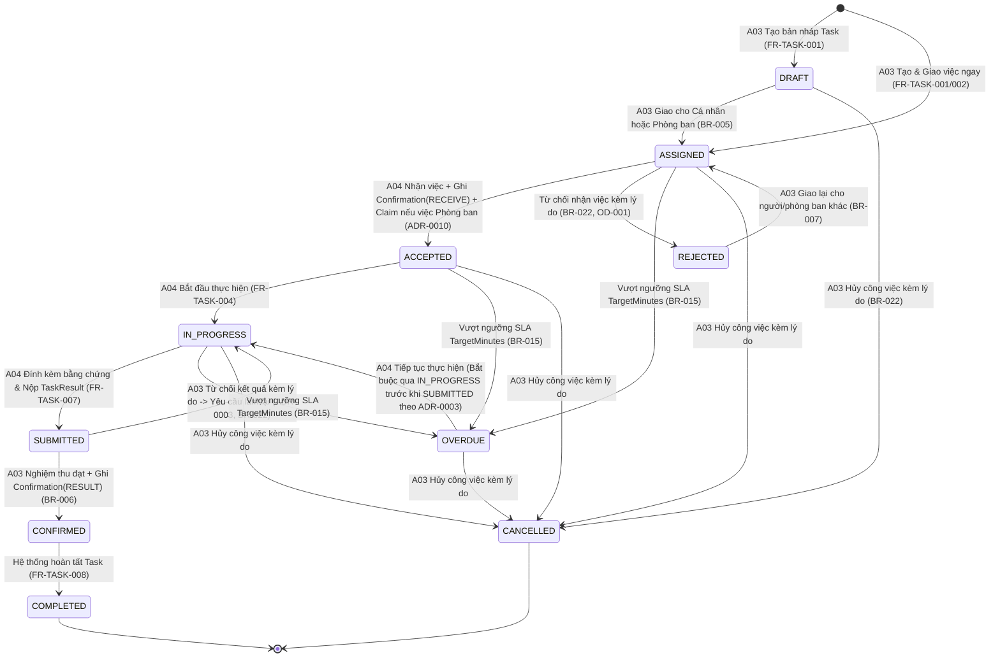
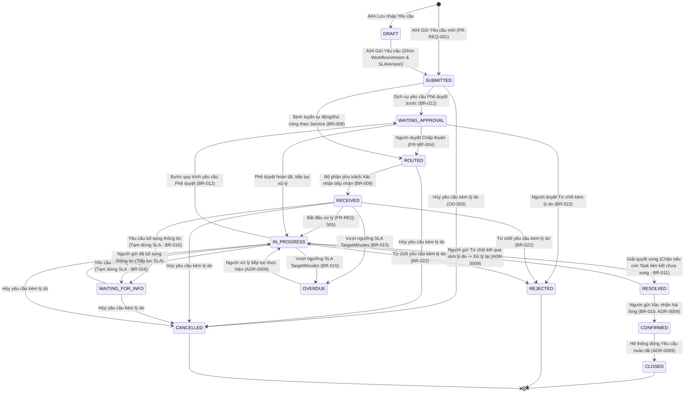
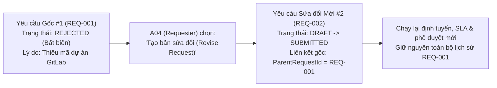
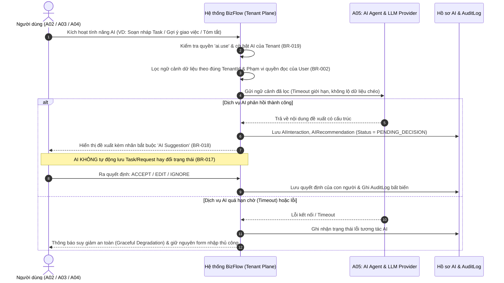
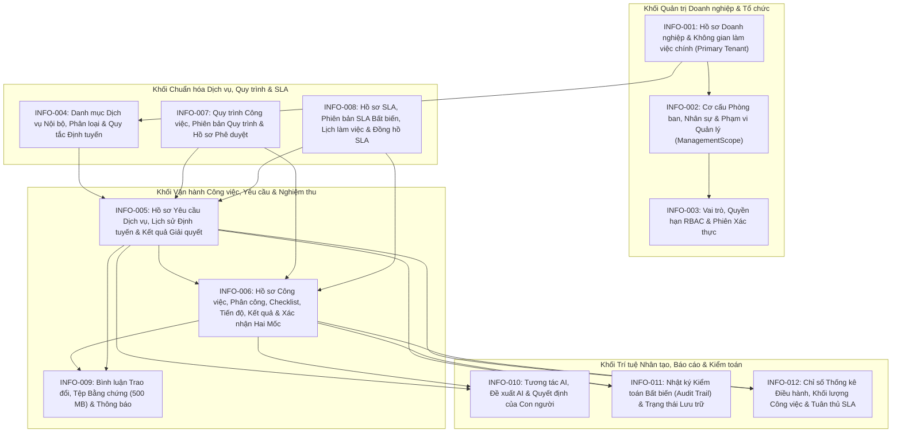

# ĐẶC TẢ ĐỊNH NGHĨA YÊU CẦU (REQUIREMENTS DEFINITION SPECIFICATION — RDS)
## Dự án: Nền tảng Điều phối Công việc và Yêu cầu Nội bộ Hỗ trợ bởi AI (AI-Assisted BizFlow Platform)

---

## 0. Kiểm soát Tài liệu (Document Control)

| Thuộc tính | Giá trị |
|---|---|
| **Tên dự án** | AI-Assisted BizFlow Platform |
| **Tên tài liệu** | Requirements Definition Specification (RDS — Đặc tả Định nghĩa Yêu cầu) |
| **Mã tài liệu** | `BIZFLOW-RDS-v1.1` |
| **Phiên bản** | `1.1-DRAFT` |
| **Ngày phát hành** | `2026-10-19` |
| **Trạng thái tài liệu** | `DRAFT — EVIDENCE-BASED REQUIREMENTS BASELINE (UPDATED FOR ONBOARDING & PROVISIONING REVIEW)` |
| **Định nghĩa viết tắt bắt buộc** | **RDS = Requirements Definition Specification** (Tuyệt đối **không** phải là Relational Database Specification) |
| **Tác giả / Nhóm biên soạn** | Senior Requirements Engineering & Business Analysis Group (Lead BA, Senior RE, Product Requirements Analyst, Senior System Analyst, Requirements Quality Engineer, Business Process Analyst, Senior QA/Test Analyst, Technical Documentation Engineer) |
| **Tham chiếu phương pháp luận** | Vận dụng các nguyên tắc Kỹ nghệ Yêu cầu của **ISO/IEC/IEEE 29148:2018** (Phân cấp StRS/RDS $\rightarrow$ SRS $\rightarrow$ SSS; tính nguyên tử, khả kiểm thử, không mơ hồ, truy vết hai chiều) |
| **Tài liệu đi kèm trong bộ RDS** | [REQUIREMENTS_CATALOG.csv](./REQUIREMENTS_CATALOG.csv), [USE_CASES.md](./USE_CASES.md), [REQUIREMENTS_TRACEABILITY.md](./REQUIREMENTS_TRACEABILITY.md), [OPEN_DECISIONS.md](./OPEN_DECISIONS.md), [SOURCE_REGISTER.md](./SOURCE_REGISTER.md), [RDS_REVIEW_REPORT.md](./RDS_REVIEW_REPORT.md) |
| **Tài liệu kỹ thuật liên kết xuôi** | [SRS_v1.0_DRAFT.md](../srs/SRS_v1.0_DRAFT.md) (`Software Requirements Specification`), [SSS_v1.0_DRAFT.md](../../specifications/sss/SSS_v1.0_DRAFT.md) (`Software System Specification`) |

### Lịch sử Phiên bản (Revision History)

| Phiên bản | Ngày | Tác giả | Mô tả thay đổi |
|---|---|---|---|
| `0.1-DISCOVERY` | `2026-10-18` | Nhóm Phân tích Nghiệp vụ & Yêu cầu | Khảo sát toàn bộ repository, đối chiếu `documents/SRS/SRS.md`, `documents/SSS/SSS.md`, `docs/00-analysis/*`, `docs/01-decisions/ADR-0001..0012`, `docs/02-traceability/*` và hiện trạng mã nguồn. |
| `1.0-DRAFT` | `2026-10-18` | Nhóm Phân tích Nghiệp vụ & Yêu cầu | Phát hành bản RDS v1.0 hoàn chỉnh gồm 21 chương mục (`0`–`20`), chuẩn hóa `8 BG`, `8 STK`, `14 STKN`, `22 BR`, `26 BIZ`, `13 CAP`, `12 UC`, `15 QREQ`, `12 INFO`, `5 EXT`, `30 AC` và `20 OD`. |
| `1.1-DRAFT` | `2026-10-19` | Nhóm Phân tích Nghiệp vụ & Yêu cầu | Rà soát chuyên sâu **Company Registration, Tenant Onboarding & Workspace Provisioning**: chuẩn hóa 7 điểm kiểm soát vòng đời onboarding, bổ sung phương án đề xuất **Self-Service Company Registration** (`PROPOSED — NOT APPROVED` tại `BIZ-027`, `UC-013`, `OD-021`) song hành cùng baseline đã xác nhận (`PLATFORM_ADMIN` phê duyệt tại `BIZ-003`, `UC-001`), bổ sung quy tắc/yêu cầu xử lý 6 trường hợp lỗi & hoàn tác nguyên tử (`BR-023`, `BR-024`, `BIZ-028`, `AC-031`, `AC-032`, `OD-022`..`OD-024`), củng cố ràng buộc `1 Company = 1 Primary Workspace` trong MVP (`DEC-WS-001`) và đồng bộ truy vết sang 118 yêu cầu SRS. |

---

## 1. Giới thiệu (Introduction)

### 1.1. Mục đích Tài liệu (Purpose)

Tài liệu **Requirements Definition Specification (RDS — Đặc tả Định nghĩa Yêu cầu)** này thiết lập đường cơ sở yêu cầu cấp kinh doanh và các bên liên quan (Business & Stakeholder Requirements Baseline) cho dự án **AI-Assisted BizFlow Platform**. Mục đích cốt lõi của tài liệu là:

1. **Làm rõ lý do tồn tại của sản phẩm:** Xác định chính xác bài toán kinh doanh thực tế, nỗi đau vận hành hiện tại (AS-IS) và kết quả đầu ra mong đợi (TO-BE) của các doanh nghiệp sử dụng nền tảng.
2. **Định danh các bên liên quan và nhu cầu thực sự:** Phân tích đầy đủ các nhóm Stakeholder (`STK-001`..`STK-008`), các lớp người dùng/tác nhân (`A01`..`A05`), mục tiêu, trách nhiệm và nhu cầu cốt lõi (`STKN-001`..`STKN-014`).
3. **Chuẩn hóa quy trình nghiệp vụ và quy tắc quản trị:** Đặc tả các luồng quy trình nghiệp vụ đầu-cuối (`Flow A`..`Flow E`), 13 ca sử dụng nghiệp vụ (`UC-001`..`UC-013`) và 24 quy tắc nghiệp vụ bất biến (`BR-001`..`BR-024`).
4. **Thiết lập phạm vi phát hành và ranh giới sản phẩm:** Phân định rõ phạm vi **MVP (`IN SCOPE — MVP`)**, phạm vi **Mở rộng Doanh nghiệp Tương lai (`FUTURE ENTERPRISE`)** và các hạng mục **Ngoài phạm vi (`OUT OF SCOPE`)**, đặc biệt tuân thủ nghiêm ngặt quyết định `DEC-WS-001` (1 Doanh nghiệp = 1 Không gian làm việc chính trong MVP) và `DEC-WS-002` (Loại trừ Billing/Payment/Subscription/Entitlement thương mại).
5. **Làm cầu nối truy vết sang SRS và SSS:** Chuyển hóa các mục tiêu kinh doanh và nhu cầu của Stakeholder thành các yêu cầu nghiệp vụ (`BIZ-001`..`BIZ-028`), năng lực sản phẩm (`CAP-001`..`CAP-013`), yêu cầu thông tin cấp khái niệm (`INFO-001`..`INFO-012`), yêu cầu chất lượng (`QREQ-001`..`QREQ-015`) và tiêu chí nghiệm thu (`AC-001`..`AC-032`), kết nối hai chiều 100% với **118 yêu cầu phần mềm nguyên tử** trong [SRS_v1.0_DRAFT.md](../srs/SRS_v1.0_DRAFT.md).

### 1.2. Phạm vi của Tài liệu Này (Scope of This Document)

- **Những gì tài liệu này bao hàm:** Bối cảnh kinh doanh, định nghĩa vấn đề, tầm nhìn sản phẩm, tiêu chí thành công, phân tích các bên liên quan, phân loại tác nhân, mô hình quy trình nghiệp vụ AS-IS và TO-BE, phạm vi phát hành MVP vs. Future, mục tiêu kinh doanh (`BG`), quy tắc nghiệp vụ (`BR`), yêu cầu của các bên liên quan (`STKN`), yêu cầu nghiệp vụ (`BIZ`), năng lực sản phẩm (`CAP`), ca sử dụng (`UC`), yêu cầu thông tin ở mức khái niệm miền (`INFO`), nhu cầu tích hợp ngoài ở mức nghiệp vụ (`EXT`), yêu cầu chất lượng (`QREQ`), điều kiện nghiệm thu (`AC`), ưu tiên phát hành, rủi ro và các quyết định mở (`OD`).
- **Những gì tài liệu này KHÔNG bao hàm (Ranh giới nghiêm ngặt):**
  - Tài liệu này **không phải là Relational Database Specification**: Không chứa câu lệnh SQL DDL, không định nghĩa kiểu dữ liệu cột vật lý (`VARCHAR`, `UUID`, `JSONB`), khóa ngoại cơ sở dữ liệu, chỉ mục (`INDEX`) hay sơ đồ ERD vật lý.
  - Tài liệu này **không thay thế SRS hay SSS**: Không mô tả chi tiết đường dẫn URI của từng REST endpoint, mã trạng thái HTTP tầng giao thức hay cấu trúc class/component nội bộ của `.NET 10` và `Angular 22`.

### 1.3. Đối tượng Độc giả (Intended Audience)

| Nhóm Độc giả | Mục đích Sử dụng Tài liệu RDS | Các Chương Trọng tâm |
|---|---|---|
| **Chủ sở hữu Sản phẩm (Product Owner) & Giảng viên Hướng dẫn** | Xác nhận phạm vi bài toán, kiểm tra tính đúng đắn của quy trình nghiệp vụ, phê duyệt các quyết định mở (`OD-*`) và nghiệm thu sản phẩm. | Mục 2, 3, 4, 6, 7, 8, 15, 16, 18 |
| **Chuyên viên Phân tích Nghiệp vụ & Kỹ sư Yêu cầu (BA / RE)** | Quản lý đường cơ sở yêu cầu, phân tích tác động khi có thay đổi và duy trì ma trận truy vết từ bài toán kinh doanh sang SRS. | Toàn bộ tài liệu (`0`–`20`), [USE_CASES.md](./USE_CASES.md), [REQUIREMENTS_TRACEABILITY.md](./REQUIREMENTS_TRACEABILITY.md) |
| **Kiến trúc sư Hệ thống & Đội ngũ Phát triển (Architects & Developers)** | Hiểu rõ *vì sao* một tính năng tồn tại, ai sử dụng tính năng đó và các quy tắc nghiệp vụ cốt lõi trước khi đọc SRS/SSS để thiết kế và lập trình. | Mục 5, 6, 7, 8, 9, 10, 11, 13, 14 |
| **Kỹ sư Đảm bảo Chất lượng & Kiểm thử (QA / Test Engineers)** | Xây dựng kế hoạch kiểm thử nghiệm thu người dùng (UAT), kiểm thử quy trình đầu-cuối và đối chiếu điều kiện nghiệm thu `AC-001`..`AC-032`. | Mục 6, 8, 11, 12, 15, 19 |

### 1.4. Định nghĩa, Từ viết tắt và Thuật ngữ (Definitions, Acronyms and Abbreviations)

| Thuật ngữ / Viết tắt | Giải nghĩa Chuẩn trong Dự án |
|---|---|
| **RDS** | **Requirements Definition Specification** — Tài liệu Đặc tả Định nghĩa Yêu cầu (cấp độ bài toán kinh doanh, nhu cầu các bên liên quan, quy tắc nghiệp vụ, năng lực sản phẩm và ca sử dụng). |
| **SRS** | **Software Requirements Specification** — Tài liệu Đặc tả Yêu cầu Phần mềm (cấp độ hành vi hệ thống phần mềm nguyên tử: `FR`, `IR`, `DR`, `NFR`, `SEC`). |
| **SSS** | **Software System Specification** — Tài liệu Đặc tả Hệ thống Phần mềm (cấp độ kiến trúc hệ thống, phân rã mô-đun, ranh giới bảo mật, tích hợp và triển khai). |
| **ADR** | **Architecture / Requirements Decision Record** — Bản ghi quyết định chính thức đã được phê duyệt (`ADR-0001`..`ADR-0012`). |
| **Company (Doanh nghiệp)** | Tổ chức pháp nhân khách hàng đăng ký sử dụng nền tảng BizFlow. |
| **Primary Workspace / Tenant (Không gian làm việc chính / Thuê bao)** | Đơn vị cách ly dữ liệu và vận hành của một Doanh nghiệp trên nền tảng SaaS. Trong phạm vi MVP, mỗi Doanh nghiệp có đúng **01 Không gian làm việc chính** (`DEC-WS-001`). |
| **Platform Governance Plane** | Mặt phẳng quản trị cấp nền tảng dành riêng cho `PLATFORM_ADMIN` (`TenantId = NULL`), tách biệt hoàn toàn với dữ liệu tác nghiệp của các doanh nghiệp. |
| **Tenant Workspace Plane** | Mặt phẳng không gian làm việc nội bộ của một doanh nghiệp cụ thể (`TenantId = <UUID>`), nơi diễn ra mọi hoạt động quản lý tổ chức, dịch vụ, công việc và yêu cầu. |
| **ManagementScope (Phạm vi Quản lý)** | Tập hợp các phòng ban hoặc đơn vị mà một người dùng có vai trò Quản lý (`MANAGER`) được cấp thẩm quyền giám sát, điều phối, nghiệm thu và xem báo cáo (`BR-003`). |
| **Service (Dịch vụ Nội bộ)** | Một loại hình hỗ trợ hoặc cung cấp nghiệp vụ chuẩn hóa trong doanh nghiệp (ví dụ: Cấp quyền GitLab, Cấp thiết bị làm việc, Phê duyệt nghỉ phép/mua sắm). |
| **Request (Yêu cầu Nội bộ)** | Hồ sơ đề nghị cung cấp dịch vụ do một Nhân viên (`Requester`) gửi tới bộ phận chuyên trách thông qua Danh mục dịch vụ (`Service Catalog`). |
| **Task (Công việc)** | Đơn vị công việc thực thi cụ thể có hạn chót (`Deadline`) và danh sách kiểm tra (`Checklist`), được Quản lý tạo độc lập hoặc tạo liên kết từ một Yêu cầu nội bộ để giao cho cá nhân hoặc phòng ban. |
| **Two-Milestone Confirmation (Xác nhận Hai Mốc)** | Quy tắc bắt buộc xác nhận ở hai thời điểm: (1) Xác nhận tiếp nhận khi bắt đầu (`RECEIVE`), và (2) Xác nhận nghiệm thu kết quả khi hoàn tất (`RESULT`). |
| **SLA (Service Level Agreement)** | Cam kết mức dịch vụ nội bộ, quy định thời gian cảnh báo sớm (`WarningMinutes`), thời gian mục tiêu hoàn thành (`TargetMinutes`) theo lịch làm việc (`BusinessCalendar`) và quy tắc leo thang (`EscalationRules`). |
| **Human-in-the-Loop (Con người trong Vòng lặp Kiểm soát)** | Nguyên tắc bắt buộc mọi đầu ra của Trợ lý AI chỉ mang tính chất gợi ý/bản nháp; con người phải xem xét và chủ động xác nhận trước khi bất kỳ thay đổi nghiệp vụ nào có hiệu lực (`BR-017`). |

### 1.5. Tài liệu Tham chiếu (References)

Toàn bộ 36 nguồn bằng chứng của dự án (`SRC-001` đến `SRC-036`) được quản lý chi tiết tại [SOURCE_REGISTER.md](./SOURCE_REGISTER.md). Các tài liệu tham chiếu trọng tâm gồm:
- `SRC-002`..`SRC-007`: Bộ tài liệu phân tích chuẩn tại `docs/00-analysis/` ([01-system-understanding.md](../../00-analysis/01-system-understanding.md), [02-architecture.md](../../00-analysis/02-architecture.md), [03-uiux-design-proposal.md](../../00-analysis/03-uiux-design-proposal.md), [04-implementation-plan.md](../../00-analysis/04-implementation-plan.md), [05-assumptions-and-ambiguities.md](../../00-analysis/05-assumptions-and-ambiguities.md), [06-requirement-traceability.md](../../00-analysis/06-requirement-traceability.md)).
- `SRC-008`..`SRC-019`: Bộ 12 quyết định đã phê duyệt `ADR-0001`..`ADR-0012` tại `docs/01-decisions/`.
- `SRC-020`..`SRC-026`: Bộ hồ sơ truy vết chuyên sâu và sổ quyết định chờ chủ sở hữu tại `docs/02-traceability/` ([pending-owner-decisions.md](../../02-traceability/pending-owner-decisions.md), [implementation-status.md](../../02-traceability/implementation-status.md)).
- `SRC-027`..`SRC-028`: Các bản nháp tiền nhiệm tại [documents/SRS/SRS.md](../../../documents/SRS/SRS.md) và [documents/SSS/OPEN_DECISIONS.md](../../../documents/SSS/OPEN_DECISIONS.md).
- `SRC-029`: [docs/requirements/srs/SRS_v1.0_DRAFT.md](../srs/SRS_v1.0_DRAFT.md) — Bộ Đặc tả Yêu cầu Phần mềm v1.0.
- `SRC-030`: [docs/specifications/sss/SSS_v1.0_DRAFT.md](../../specifications/sss/SSS_v1.0_DRAFT.md) — Bộ Đặc tả Hệ thống Phần mềm v1.0.

### 1.6. Mối quan hệ và Ranh giới giữa RDS, SRS và SSS (Relationship to RDS, SRS and SSS)

```mermaid
flowchart LR
    subgraph RDS_Layer["1. RDS (Requirements Definition Specification)"]
        direction TB
        R1["Bài toán Kinh doanh & Mục tiêu (BG-001..008)"]
        R2["Stakeholder & Nhu cầu (STK-001..008, STKN-001..014)"]
        R3["Quy trình, Quy tắc & Yêu cầu Nghiệp vụ (BR-001..022, BIZ-001..026)"]
        R4["Năng lực Sản phẩm, Ca sử dụng & Thông tin Miền (CAP-001..013, UC-001..012, INFO-001..012)"]
    end

    subgraph SRS_Layer["2. SRS (Software Requirements Specification)"]
        direction TB
        S1["Yêu cầu Chức năng Phần mềm Nguyên tử (62 FR)"]
        S2["Yêu cầu Giao diện & Dữ liệu Phần mềm (12 IR, 15 DR)"]
        S3["Yêu cầu Phi chức năng & Bảo mật Phần mềm (15 NFR, 12 SEC)"]
        S4["Kịch bản Kiểm thử Nghiệm thu Phần mềm (TST-001..030)"]
    end

    subgraph SSS_Layer["3. SSS (Software System Specification)"]
        direction TB
        A1["Kiến trúc Thành phần & Ranh giới Module (MOD-001..013)"]
        A2["Kiến trúc Dữ liệu, Bảo mật Đa thuê bao & Tích hợp (INT-001..005)"]
        A3["Luồng Thực thi Kỹ thuật, Xử lý Lỗi & Triển khai Vận hành"]
    end

    RDS_Layer ==>|"Trả lời WHY & WHAT (Business/User View)"| SRS_Layer
    SRS_Layer ==>|"Trả lời WHAT SYSTEM MUST DO (Black-Box Software View)"| SSS_Layer
```

| Tiêu chí Phân biệt | RDS (`Requirements Definition Specification`) | SRS (`Software Requirements Specification`) | SSS (`Software System Specification`) |
|---|---|---|---|
| **Câu hỏi trọng tâm** | **Vì sao** cần hệ thống này? **Ai** là người dùng/bên liên quan? **Nghiệp vụ và kết quả kinh doanh** nào cần đạt được? | **Hệ thống phần mềm phải làm gì** (ở góc độ hộp đen có thể kiểm thử được) để thỏa mãn RDS? | **Hệ thống được cấu trúc, phân rã thành phần và phối hợp kỹ thuật như thế nào** để hiện thực hóa SRS? |
| **Đơn vị đặc tả chính** | `BG-*`, `STK-*`, `STKN-*`, `BR-*`, `BIZ-*`, `CAP-*`, `UC-*`, `INFO-*`, `QREQ-*`, `AC-*`. | `FR-*` (62), `IR-*` (12), `DR-*` (15), `NFR-*` (15), `SEC-*` (12), `TST-*` (30). | `MOD-001..013`, `INT-001..005`, Component Contracts, Sequence Views, Deployment & Security Architecture. |
| **Mức độ trừu tượng dữ liệu** | Khái niệm thông tin nghiệp vụ (`INFO-001..012`: Hồ sơ công việc, Yêu cầu, Phiên bản SLA, Nhật ký kiểm toán) và quy tắc bảo toàn lịch sử. | Yêu cầu lưu trữ dữ liệu logic của phần mềm (`DR-001..015`) và các ràng buộc toàn vẹn dữ liệu. | Phân bổ quyền sở hữu dữ liệu theo mô-đun, chiến lược cách ly `TenantId` tại ORM/DB và lưu trữ đối tượng. |

---

## 2. Bối cảnh Kinh doanh và Định nghĩa Bài toán (Business Context and Problem Definition)

### 2.1. Bối cảnh Vận hành Hiện tại (AS-IS Business Context)

Trong hoạt động hàng ngày của các doanh nghiệp vừa và lớn, có hai dòng công việc nội bộ diễn ra liên tục giữa các phòng ban (như CNTT, Hành chính – Nhân sự, Tài chính – Kế toán, Vận hành, Pháp chế):
1. **Dòng công việc từ trên xuống (Top-Down Task Assignment):** Quản lý phòng ban giao nhiệm vụ chuyên môn cho nhân viên hoặc cho cả nhóm/phòng ban, theo dõi danh sách đầu việc cần kiểm tra (`Checklist`), đôn đốc tiến độ và nghiệm thu kết quả.
2. **Dòng yêu cầu dịch vụ ngang hàng / từ dưới lên (Employee-Initiated Service Requests):** Nhân viên gửi yêu cầu hỗ trợ nội bộ tới các bộ phận chức năng (ví dụ điển hình được xác nhận trong tài liệu dự án: *một nhân viên gửi yêu cầu cấp quyền truy cập kho mã nguồn GitLab cho dự án mới*; hoặc yêu cầu cấp thiết bị, yêu cầu phê duyệt hành chính).

### 2.2. Các Nỗi đau Nghiệp vụ Cốt lõi Cần Giải quyết (Verified Business Pain Points)

Dựa trên bằng chứng từ `SRC-002` (`SRS.md` §1–§2) và `SRC-005` (`01-system-understanding.md`), mô hình làm việc thủ công hiện tại (qua email, tin nhắn rời rạc, bảng tính cá nhân hoặc trao đổi miệng) gây ra **6 vấn đề kinh doanh cốt lõi**:

| Mã Vấn đề | Tên Vấn đề Kinh doanh (AS-IS Pain Point) | Hệ quả Nghiệp vụ Cụ thể | Phân loại Bằng chứng | Nguồn |
|---|---|---|---|---|
| **`PROB-01`** | **Phân mảnh kênh tiếp nhận và thất lạc yêu cầu nội bộ** | Yêu cầu gửi qua email, chat cá nhân hoặc trao đổi miệng không theo mẫu chuẩn, thường xuyên thiếu thông tin đầu vào, dẫn đến thất lạc yêu cầu hoặc phải hỏi đi hỏi lại nhiều lần. | **Đã xác nhận trong tài liệu gốc (`CONFIRMED EVIDENCE`)** | `SRC-002`, `SRC-005` |
| **`PROB-02`** | **Định tuyến thủ công chậm trễ và thiếu đầu mối chịu trách nhiệm** | Nhân viên không biết phải gửi yêu cầu cho ai; khi giao việc cho một phòng ban thì không rõ cá nhân nào đã nhận xử lý, dẫn đến đùn đẩy trách nhiệm hoặc hai người làm trùng một việc. | **Đã xác nhận trong tài liệu gốc (`CONFIRMED EVIDENCE`)** | `SRC-002`, `ADR-0010` |
| **`PROB-03`** | **Khoảng trống giữa "Đã làm xong" và "Đã được nghiệm thu"** | Công việc hoặc yêu cầu được người làm tự đánh dấu hoàn tất mà không có bằng chứng đính kèm và không có bước xác nhận từ Quản lý hoặc Người gửi yêu cầu, gây tranh cãi về chất lượng kết quả. | **Đã xác nhận trong tài liệu gốc (`CONFIRMED EVIDENCE`)** | `SRC-002` (`BR-006`, `BR-010`, `BR-011`) |
| **`PROB-04`** | **Mất kiểm soát thời hạn xử lý (SLA) và thiếu cảnh báo sớm** | Không đo lường được thời gian xử lý thực tế theo giờ làm việc hành chính; không phân biệt được thời gian trễ do người xử lý hay do đang chờ phê duyệt/chờ bổ sung thông tin; quản lý chỉ biết việc bị trễ sau khi sự cố đã xảy ra. | **Đã xác nhận trong tài liệu gốc (`CONFIRMED EVIDENCE`)** | `SRC-002` (`BR-014`..`BR-016`), `ADR-0004`..`0006` |
| **`PROB-05`** | **Thiếu dấu vết kiểm toán bất biến và rủi ro rò rỉ dữ liệu** | Lịch sử giao lại việc, lý do từ chối/hủy hoặc tệp bằng chứng bị sửa/xóa tùy tiện; quản lý phòng ban này có thể nhìn thấy dữ liệu nhạy cảm của phòng ban khác nếu không có cơ chế phân quyền theo phạm vi (`ManagementScope`). | **Đã xác nhận trong tài liệu gốc (`CONFIRMED EVIDENCE`)** | `SRC-002` (`BR-002`, `BR-003`, `BR-007`, `BR-021`, `BR-022`) |
| **`PROB-06`** | **Tốn nhiều thời gian cho các thao tác soạn thảo và tổng hợp lặp lại** | Quản lý tốn thời gian viết mô tả công việc, tách checklist, đọc lại chuỗi bình luận dài hoặc rà soát điểm nghẽn thủ công mà chưa có công cụ AI hỗ trợ an toàn. | **Đã xác nhận trong tài liệu gốc (`CONFIRMED EVIDENCE`)** | `SRC-002` (`M12`), `SRC-022` |

> [!IMPORTANT]
> **Phân biệt Bằng chứng Đã Xác nhận và Giả thuyết Kinh doanh:**
> Toàn bộ 6 vấn đề `PROB-01`..`PROB-06` ở trên được trích xuất trực tiếp từ các nguồn chuẩn của dự án (`SRC-002`, `SRC-005`). Ngược lại, các con số thống kê hiện trạng cụ thể của từng doanh nghiệp khách hàng (ví dụ: trung bình mất bao nhiêu giờ cho một email yêu cầu trước khi dùng hệ thống) chưa có trong repository và được ghi nhận trung thực là `TBD — Cần khảo sát tại doanh nghiệp triển khai` (tham chiếu `OD-019`).

---

## 3. Tầm nhìn Sản phẩm, Mục tiêu và Tiêu chí Thành công (Product Vision, Goals and Success Criteria)

### 3.1. Tầm nhìn Sản phẩm (Product Vision Statement)

**AI-Assisted BizFlow Platform** là nền tảng phần mềm dạng dịch vụ đa thuê bao (**Multi-Tenant B2B SaaS**) giúp các doanh nghiệp chuẩn hóa, tự động hóa và minh bạch hóa toàn bộ vòng đời tiếp nhận yêu cầu dịch vụ nội bộ (`Request`), phân công và thực thi công việc (`Task`), phê duyệt quy trình (`Workflow & Approval`), giám sát cam kết mức dịch vụ (`SLA`) và cộng tác lưu trữ bằng chứng, kết hợp với **Trợ lý Vận hành AI có sự kiểm soát của con người (`Human-in-the-Loop AI Assistance`)** trong một kiến trúc cách ly dữ liệu nghiêm ngặt.

### 3.2. Phân biệt Kết quả Kinh doanh (Business Outcomes) và Năng lực Sản phẩm (Product Capabilities)

Để tránh lỗi phổ biến là đánh đồng "tính năng phần mềm" với "mục tiêu kinh doanh", bảng dưới đây tách bạch rõ **Kết quả kinh doanh kỳ vọng (`BG-001`..`BG-008`)**, **Năng lực sản phẩm hỗ trợ (`CAP-*`)**, **Phương pháp đo lường** và **Chỉ tiêu mục tiêu**:

| Mã Mục tiêu | Kết quả Kinh doanh Kỳ vọng (Business Outcome) | Năng lực Sản phẩm Đáp ứng (Enabling Product Capabilities) | Chỉ số Đo lường (Measurement Metric) | Số liệu Cơ sở (AS-IS Baseline) | Chỉ tiêu Mục tiêu (Target Criteria) | Trạng thái |
|---|---|---|---|---|---|---|
| **`BG-001`** | **Chuẩn hóa tiếp nhận và định tuyến tự động yêu cầu nội bộ**, loại bỏ tình trạng gửi yêu cầu tự do không đúng đầu mối. | `CAP-004` (Danh mục dịch vụ & Định tuyến), `CAP-006` (Quản lý vòng đời Yêu cầu). | Tỷ lệ yêu cầu dịch vụ nội bộ được phân loại đúng danh mục và định tuyến tự động tới đúng bộ phận ngay lần đầu. | `TBD` (`OD-019`) | **100%** yêu cầu thuộc dịch vụ đã cấu hình quy tắc định tuyến được định tuyến tự động (`CONFIRMED`); giảm `>= 30%` thời gian điều phối (`PROPOSED — NOT APPROVED`, `OD-019`). | `CONFIRMED` |
| **`BG-002`** | **Minh bạch hóa trách nhiệm cá nhân và chất lượng thực thi công việc** qua cơ chế xác nhận 2 mốc (`RECEIVE` & `RESULT`) và checklist. | `CAP-005` (Quản lý vòng đời Công việc), `CAP-009` (Bình luận & Thông báo), `CAP-010` (Tệp bằng chứng). | Tỷ lệ công việc hoàn tất (`COMPLETED`) có đủ cả 2 bản ghi xác nhận (`Confirmation`) và kết quả nộp (`TaskResult`). | `TBD` (`OD-019`) | **100%** công việc đạt trạng thái `COMPLETED` phải qua đủ 2 mốc xác nhận hợp lệ (`BR-006` — `CONFIRMED`). | `CONFIRMED` |
| **`BG-003`** | **Kiểm soát chặt chẽ thời hạn xử lý theo lịch làm việc (SLA)**, phát hiện sớm nguy cơ trễ hạn và leo thang kịp thời. | `CAP-008` (Quản lý SLA, Cảnh báo sớm & Leo thang), `CAP-011` (Báo cáo tuân thủ SLA). | Độ chính xác của bộ đếm thời gian làm việc, tỷ lệ phát cảnh báo tại `WarningMinutes` và leo thang đúng cấp tại `TargetMinutes`. | `TBD` (`OD-019`) | **100%** hồ sơ gắn SLA được ghim bản chụp `SLAVersion` + `BusinessCalendar` bất biến (`ADR-0004` — `CONFIRMED`). | `CONFIRMED` |
| **`BG-004`** | **Đảm bảo tính kỷ luật và ổn định của quy trình xử lý và phê duyệt**, không làm gián đoạn hồ sơ đang chạy khi thay đổi quy trình. | `CAP-007` (Thiết kế Quy trình phiên bản hóa & Phê duyệt nhiều bước). | Tỷ lệ hồ sơ vượt qua cổng phê duyệt (`WAITING_APPROVAL`) mà không có quyết định chấp thuận hợp lệ; tính bất biến của quy trình đang chạy. | `TBD` (`OD-019`) | **0%** hồ sơ đi tiếp khi chưa hoàn tất bước phê duyệt (`BR-012`); **100%** hồ sơ đang chạy giữ nguyên `WorkflowVersion` đã ghim (`BR-013` — `CONFIRMED`). | `CONFIRMED` |
| **`BG-005`** | **Tăng năng suất tác nghiệp nhờ Trợ lý AI** mà không đánh đổi quyền kiểm soát của con người hoặc an toàn dữ liệu. | `CAP-012` (10 năng lực AI hỗ trợ có kiểm soát con người). | Tỷ lệ hành động AI tự ý thay đổi trạng thái nghiệp vụ mà không có xác nhận của người dùng; thời gian phản hồi gợi ý AI. | `TBD` (`OD-019`) | **0%** hành động AI tự trị thay đổi trạng thái cuối cùng (`BR-017` — `CONFIRMED`); thời gian phản hồi AI `p95 <= 8s`, timeout `15s` (`PROPOSED — NOT APPROVED`, `OD-014`). | `CONFIRMED` |
| **`BG-006`** | **Đảm bảo cách ly dữ liệu tuyệt đối giữa các doanh nghiệp (Multi-Tenant)** và phân quyền đúng phạm vi quản lý phòng ban. | `CAP-001` (Xác thực & Phiên), `CAP-002` (Quản trị Tenant), `CAP-003` (Tổ chức, RBAC & `ManagementScope`). | Số vụ rò rỉ dữ liệu chéo giữa các Tenant (`Cross-Tenant Leakage`) hoặc truy cập trái phép ngoài `ManagementScope`. | `N/A` | **0%** rò rỉ dữ liệu liên thuê bao trên mọi kênh API, Báo cáo, Tìm kiếm, Tệp đính kèm và AI (`BR-002` — `CONFIRMED`). | `CONFIRMED` |
| **`BG-007`** | **Đảm bảo khả năng giải trình, kiểm toán và bảo toàn toàn vẹn lịch sử bằng chứng** trong suốt vòng đời vận hành. | `CAP-010` (Lưu trữ hồ sơ & Tệp bằng chứng 500 MB), `CAP-013` (Nhật ký kiểm toán bất biến). | Tỷ lệ thao tác thay đổi trạng thái/cấu hình quan trọng được ghi vào `AuditLog` bất biến; số bản ghi lịch sử bị xóa cứng. | `N/A` | **100%** sự kiện trọng yếu sinh `AuditLog` chỉ-thêm; **0** bản ghi nghiệp vụ/kiểm toán bị xóa cứng (`BR-021` — `CONFIRMED`). | `CONFIRMED` |
| **`BG-008`** | **Cung cấp tầm nhìn điều hành tức thời cho Quản lý và Ban lãnh đạo** về khối lượng công việc, điểm nghẽn và hiệu suất SLA. | `CAP-011` (Bảng điều khiển Quản lý theo phạm vi & Báo cáo toàn doanh nghiệp). | Độ chính xác của số liệu tổng hợp theo phạm vi quản lý và độ trễ hiển thị bảng điều khiển/báo cáo. | `TBD` (`OD-019`) | Hiển thị đúng **100%** theo phạm vi `ManagementScope` (`CONFIRMED`); độ trễ `p95 <= 2000 ms` (`PROPOSED — NOT APPROVED`, `OD-013`). | `CONFIRMED` |

---

## 4. Phân tích Các Bên Liên quan (Stakeholder Analysis)

Bảng dưới đây định danh đầy đủ 8 nhóm Bên liên quan (`STK-001` đến `STK-008`) có quyền lợi, trách nhiệm hoặc chịu tác động trực tiếp từ hệ thống **AI-Assisted BizFlow Platform**:

| Stakeholder ID | Stakeholder/Group | Goals | Responsibilities | Needs | Influence | Source | Status |
|---|---|---|---|---|---|---|---|
| **`STK-001`** | **Chủ sở hữu Sản phẩm / Ban Điều hành Nền tảng SaaS (Platform Owner & Product Sponsor)** | Cung cấp nền tảng SaaS ổn định, bảo mật, có thể mở rộng cho nhiều doanh nghiệp khách hàng với chi phí vận hành kiểm soát được. | Định hướng tầm nhìn sản phẩm, phê duyệt phạm vi MVP (`DEC-WS-001`, `DEC-WS-002`), chốt các quyết định mở (`OD-001`..`OD-020`) và nghiệm thu sản phẩm. | Cơ chế xét duyệt doanh nghiệp chặt chẽ, cách ly dữ liệu tuyệt đối giữa các khách hàng, kiểm soát bật/tắt và chi phí AI. | **Rất cao (High — Decision Maker)** | `SRC-002`, `SRC-020`, `DEC-WS-001`, `DEC-WS-002` | `CONFIRMED` |
| **`STK-002`** | **Quản trị viên Vận hành Nền tảng (`PLATFORM_ADMIN` — Actor `A01`)** | Kiểm soát an toàn vòng đời các doanh nghiệp đăng ký trên nền tảng mà không vi phạm quyền riêng tư dữ liệu nội bộ của khách hàng. | Tiếp nhận, thẩm định, phê duyệt hoặc từ chối đơn đăng ký công ty; quản lý trạng thái hoạt động (`ACTIVE / SUSPENDED`) của Tenant; giám sát kiểm toán cấp nền tảng. | Hàng đợi xét duyệt đăng ký rõ ràng, khởi tạo tự động Không gian làm việc mặc định khi duyệt, nhật ký kiểm toán cấp nền tảng đầy đủ. | **Cao (High — Platform Governance)** | `SRC-002`, `ADR-0002`, `SRC-005` | `CONFIRMED` |
| **`STK-003`** | **Ban Giám đốc & Quản trị viên Doanh nghiệp Thuê bao (`COMPANY_ADMIN` — Actor `A02`)** | Chuẩn hóa cơ cấu tổ chức, danh mục dịch vụ nội bộ, quy trình phê duyệt và cam kết SLA phù hợp với quy chế riêng của doanh nghiệp mình. | Thiết lập cây phòng ban, tạo tài khoản nhân sự (kể cả nhân viên không có email), gán vai trò và `ManagementScope`, cấu hình Dịch vụ, Quy trình, SLA và theo dõi báo cáo toàn công ty. | Công cụ cấu hình tự phục vụ (self-service) trực quan, không làm hỏng dữ liệu lịch sử khi cập nhật quy trình/SLA mới, báo cáo tổng hợp toàn công ty. | **Rất cao (High — Tenant Owner)** | `SRC-002`, `SRC-005`, `ADR-0004`..`0008` | `CONFIRMED` |
| **`STK-004`** | **Quản lý Phòng ban / Trưởng Bộ phận (`MANAGER` — Actor `A03`)** | Điều phối hiệu quả công việc và yêu cầu gửi đến phòng ban mình phụ trách, kiểm soát chất lượng đầu ra và đảm bảo tỷ lệ hoàn thành đúng hạn SLA. | Tiếp nhận/định tuyến yêu cầu, tạo và giao công việc (cho cá nhân hoặc phòng ban), phê duyệt các bước được giao, nghiệm thu kết quả công việc và theo dõi bảng điều khiển quản lý. | Bảng điều khiển lọc đúng theo `ManagementScope`, cơ chế yêu cầu làm lại khi kết quả chưa đạt, cảnh báo sớm trước khi quá hạn SLA và trợ lý AI hỗ trợ giao việc/tóm tắt. | **Cao (High — Operational Leader)** | `SRC-002`, `ADR-0003`, `ADR-0011`, `SRC-024` | `CONFIRMED` |
| **`STK-005`** | **Nhân viên Gửi Yêu cầu Dịch vụ Nội bộ (`EMPLOYEE as Requester` — Actor `A04`)** | Được giải quyết nhu cầu hỗ trợ nội bộ nhanh chóng, đúng đầu mối, biết rõ yêu cầu đang ở bước nào và có quyền xác nhận kết quả trước khi đóng. | Chọn đúng dịch vụ nội bộ, cung cấp thông tin đầy đủ, bổ sung thông tin khi được yêu cầu, nghiệm thu kết quả giải quyết hoặc tạo bản sửa đổi nếu yêu cầu bị từ chối. | Biểu mẫu gửi yêu cầu dễ hiểu (có AI gợi ý dịch vụ và kiểm tra thiếu thông tin), thông báo cập nhật trạng thái kịp thời, quyền từ chối kết quả giải quyết nếu chưa đạt. | **Trung bình – Cao (Medium-High — Primary End User)** | `SRC-002`, `ADR-0009`, `SRC-025`, `SRC-026` | `CONFIRMED` |
| **`STK-006`** | **Nhân viên Thực thi Công việc / Xử lý Yêu cầu (`EMPLOYEE as Assignee / Processor` — Actor `A04`)** | Nhận nhiệm vụ rõ ràng, có danh sách kiểm tra (`Checklist`) cụ thể, thời hạn minh bạch và công cụ thuận tiện để báo cáo tiến độ, đính kèm bằng chứng và nộp kết quả. | Xác nhận nhận việc (hoặc nhận việc từ hàng đợi phòng ban), thực hiện công việc, cập nhật checklist/tiến độ, tải tệp bằng chứng và nộp kết quả nghiệm thu. | Hàng đợi công việc rõ ràng, cơ chế nhận việc phòng ban công bằng không chồng chéo (`ADR-0010`), tải tệp bằng chứng tới 500 MB và trợ lý AI tóm tắt lịch sử hồ sơ. | **Trung bình – Cao (Medium-High — Primary End User)** | `SRC-002`, `ADR-0003`, `ADR-0010`, `SRC-023` | `CONFIRMED` |
| **`STK-007`** | **Bộ phận Kiểm soát Nội bộ, Pháp chế & Bảo mật (Compliance, Audit & Security Officers)** | Đảm bảo mọi quyết định phê duyệt, giao việc, nghiệm thu và truy cập dữ liệu đều tuân thủ quy chế phân quyền, không thể chối bỏ và không bị chỉnh sửa lùi ngày. | Kiểm tra định kỳ nhật ký kiểm toán (`AuditLog`), rà soát lịch sử phiên bản SLA/Quy trình và đối chiếu tệp bằng chứng nghiệm thu. | Nhật ký kiểm toán chỉ-thêm (`Append-only`), cấm xóa cứng hồ sơ nghiệp vụ, bắt buộc nhập lý do khi từ chối/hủy/giao lại (`BR-022`), kiểm soát chặt chẽ ranh giới AI (`BR-017`). | **Cao (High — Governance & Risk)** | `SRC-002` (`BR-021`, `BR-022`), `SRC-031` | `CONFIRMED` |
| **`STK-008`** | **Đội ngũ Kỹ thuật, Phát triển, QA & Vận hành Hệ thống (Engineering, QA & DevOps Team)** | Xây dựng, kiểm thử và vận hành hệ thống đạt chất lượng cao, dễ bảo trì, có tài liệu yêu cầu rõ ràng, không mơ hồ và kiểm chứng tự động được. | Thiết kế, lập trình, viết kiểm thử tự động, triển khai hạ tầng container và giám sát độ tin cậy của hệ thống. | Bộ yêu cầu RDS/SRS/SSS đồng bộ 100% mã định danh, tách biệt rõ yêu cầu đã chốt (`CONFIRMED`) với quyết định chờ duyệt (`OPEN`), có điều kiện nghiệm thu Given/When/Then cụ thể. | **Trung bình – Cao (Medium-High — Delivery Team)** | `SRC-001`, `SRC-029`, `SRC-030`, `SRC-036` | `CONFIRMED` |

---

## 5. Phân loại Người dùng và Tác nhân Hệ thống (User Classes and Actors)

### 5.1. Danh mục 5 Tác nhân Chuẩn (`A01` – `A05`)

Hệ thống định nghĩa chính xác **5 tác nhân chuẩn** (gồm 4 tác nhân con người `A01`–`A04` và 1 tác nhân phần mềm nội bộ `A05`), kế thừa nhất quán từ `SRC-002` và `SRC-005`:

#### 1. `A01` — Quản trị viên Nền tảng (`PLATFORM_ADMIN`)
- **Mô tả:** Nhân sự quản trị cấp cao của đơn vị vận hành nền tảng SaaS BizFlow.
- **Mặt phẳng hoạt động:** Mặt phẳng Quản trị Nền tảng (`Platform Governance Plane`, `TenantId = NULL` theo `ADR-0002`).
- **Trách nhiệm chính:** Xem xét hồ sơ đăng ký doanh nghiệp mới (`PENDING`), phê duyệt để khởi tạo Không gian làm việc chính (`Primary Tenant`) hoặc từ chối kèm lý do; kích hoạt, tạm ngưng (`SUSPENDED`) hoặc ngừng hoạt động doanh nghiệp/thuê bao; tra cứu nhật ký kiểm toán cấp nền tảng.
- **Mục tiêu điển hình:** Đảm bảo chỉ các doanh nghiệp hợp lệ mới được cấp phát tài nguyên và giám sát an toàn toàn nền tảng.
- **Phạm vi được phép (`Allowed Scope`):** `Platform Scope` — chỉ truy cập siêu dữ liệu `Company`, `Tenant` và `AuditLog` cấp nền tảng.
- **Giới hạn nghiêm ngặt (`Restrictions`):** **Tuyệt đối không được phép** xem, tạo, sửa hoặc phê duyệt bất kỳ dữ liệu nghiệp vụ nội bộ nào (`Task`, `Request`, `Service`, `Workflow`, `Comment`, `Attachment`) của các doanh nghiệp thuê bao.
- **Ca sử dụng liên quan:** `UC-001`, `UC-002`, `UC-012`.
- **Nguồn & Trạng thái:** `SRC-002`, `ADR-0002` | `CONFIRMED`.

#### 2. `A02` — Quản trị viên Doanh nghiệp (`COMPANY_ADMIN`)
- **Mô tả:** Người quản trị hệ thống trong phạm vi một doanh nghiệp khách hàng (thường là Quản trị viên CNTT hoặc Trưởng phòng Vận hành/Nhân sự được ủy quyền).
- **Mặt phẳng hoạt động:** Mặt phẳng Không gian làm việc Doanh nghiệp (`Tenant Workspace Plane`, gắn với 01 `TenantId` xác định).
- **Trách nhiệm chính:** Thiết lập cơ cấu phòng ban phân cấp (`Department`), quản lý tài khoản người dùng (`User`), cấp mật khẩu tạm thời cho nhân viên không có email, phân công vai trò và phạm vi quản lý (`ManagementScope`), cấu hình Danh mục dịch vụ (`Service Catalog`), Quy tắc định tuyến (`RoutingRule`), Quy trình công việc (`Workflow`), Hồ sơ `SLA` & Lịch làm việc (`BusinessCalendar`), bật/tắt cấu hình AI của doanh nghiệp, xem báo cáo toàn công ty và nhật ký kiểm toán của doanh nghiệp.
- **Mục tiêu điển hình:** Vận hành trơn tru không gian làm việc của doanh nghiệp và tùy biến quy trình/SLA sát với quy định nội bộ.
- **Phạm vi được phép (`Allowed Scope`):** `Tenant Scope` — toàn bộ dữ liệu thuộc `TenantId` của doanh nghiệp mình.
- **Giới hạn nghiêm ngặt (`Restrictions`):** Không thể truy cập dữ liệu của bất kỳ `TenantId` nào khác (`BR-002`); không thể phê duyệt đăng ký doanh nghiệp mới trên mặt phẳng nền tảng; không thể xóa cứng dữ liệu lịch sử hoặc sửa nhật ký kiểm toán (`BR-021`).
- **Ca sử dụng liên quan:** `UC-002`, `UC-003`, `UC-004`, `UC-011`, `UC-012`.
- **Nguồn & Trạng thái:** `SRC-002`, `ADR-0004`..`0008` | `CONFIRMED`.

#### 3. `A03` — Quản lý Phòng ban / Bộ phận (`MANAGER`)
- **Mô tả:** Cấp quản lý trung gian (Giám đốc khối, Trưởng/Phó phòng ban, Tổ trưởng chuyên môn) chịu trách nhiệm điều phối công việc và yêu cầu dịch vụ của một hoặc nhiều phòng ban được giao quản lý.
- **Mặt phẳng hoạt động:** Mặt phẳng Không gian làm việc Doanh nghiệp (`Tenant Workspace Plane`).
- **Trách nhiệm chính:** Tiếp nhận và điều phối các Yêu cầu dịch vụ được định tuyến về bộ phận mình; tạo, giao, giao lại hoặc hủy Công việc; kiểm tra và xác nhận nghiệm thu kết quả Công việc (`RESULT Confirmation`) hoặc yêu cầu làm lại; thực hiện phê duyệt các bước quy trình được chỉ định (`Approver`); giám sát Bảng điều khiển quản lý, báo cáo tải công việc và tuân thủ SLA trong phạm vi quản lý.
- **Mục tiêu điển hình:** Phân bổ công việc hợp lý, phát hiện sớm nguy cơ trễ hạn SLA và đảm bảo chất lượng kết quả đầu ra của bộ phận.
- **Phạm vi được phép (`Allowed Scope`):** `Managed Scope` (các phòng ban/nhóm được gán trong `ManagementScope` theo `BR-003` và `ADR-0011`) cộng với `Own / Assigned Scope` (các hồ sơ do chính mình tạo hoặc được giao trực tiếp).
- **Giới hạn nghiêm ngặt (`Restrictions`):** Không được xem hoặc can thiệp vào Công việc/Yêu cầu/Báo cáo của các phòng ban nằm ngoài `ManagementScope` của mình (trừ khi là hồ sơ do chính mình gửi với tư cách người yêu cầu); không có quyền thay đổi cấu hình hệ thống cấp doanh nghiệp (trừ khi được gán thêm quyền tùy chỉnh).
- **Ca sử dụng liên quan:** `UC-002`, `UC-005`, `UC-006`, `UC-007`, `UC-008`, `UC-009`, `UC-010`, `UC-011`, `UC-012`.
- **Nguồn & Trạng thái:** `SRC-002`, `ADR-0003`, `ADR-0011`, `SRC-024` | `CONFIRMED`.

#### 4. `A04` — Nhân viên (`EMPLOYEE` — đóng vai trò `Requester` và/hoặc `Assignee / Processor`)
- **Mô tả:** Nhân viên tác nghiệp trong doanh nghiệp. Tùy theo ngữ cảnh từng hồ sơ, một nhân viên có thể đóng một trong hai vai trò nghiệp vụ:
  - **Người gửi yêu cầu (`Requester`):** Khi tạo và gửi Yêu cầu dịch vụ nội bộ, bổ sung thông tin theo yêu cầu của bộ phận xử lý, nghiệm thu kết quả giải quyết (`RESOLVED -> CONFIRMED -> CLOSED`) hoặc tạo bản sửa đổi từ yêu cầu bị từ chối.
  - **Người thực hiện / Người xử lý (`Assignee / Processor`):** Khi nhận Công việc được giao đích danh hoặc bấm nhận việc từ hàng đợi chung của phòng ban (`ADR-0010`), thực hiện các mục `Checklist`, cập nhật tiến độ, đính kèm tệp bằng chứng, nộp kết quả (`TaskResult`) hoặc trực tiếp xử lý các Yêu cầu dịch vụ được phân công.
- **Mặt phẳng hoạt động:** Mặt phẳng Không gian làm việc Doanh nghiệp (`Tenant Workspace Plane`).
- **Phạm vi được phép (`Allowed Scope`):** `Own Scope` (hồ sơ do chính mình tạo) và `Assigned / Department Queue Scope` (hồ sơ được giao cho cá nhân mình hoặc giao cho hàng đợi phòng ban nơi mình đang làm việc).
- **Giới hạn nghiêm ngặt (`Restrictions`):** Không được xem hồ sơ cá nhân của đồng nghiệp khác nếu mình không phải là người tạo, người được giao hoặc người tham gia hợp lệ (`ADR-0011`, `ADR-0012`); không được tự nghiệm thu kết quả công việc do chính mình nộp (trừ khi đồng thời là quản lý có thẩm quyền).
- **Ca sử dụng liên quan:** `UC-002`, `UC-005`, `UC-006`, `UC-007`, `UC-008`, `UC-010`, `UC-011`, `UC-012`.
- **Nguồn & Trạng thái:** `SRC-002`, `ADR-0009`, `ADR-0010`, `ADR-0011` | `CONFIRMED`.

#### 5. `A05` — Trợ lý Vận hành AI (`AI_AGENT`)
- **Mô tả:** Tác nhân phần mềm thông minh tích hợp trong nền tảng, cung cấp 10 năng lực hỗ trợ phân tích, tóm tắt, gợi ý và soạn thảo bản nháp.
- **Mặt phẳng hoạt động:** Thực thi nội bộ dưới ngữ cảnh quyền hạn của người dùng đang gọi (`Caller-Scoped Execution`).
- **Trách nhiệm chính:** Sinh bản nháp công việc, gợi ý phân công, tóm tắt hồ sơ, đánh giá chất lượng kết quả nộp, cảnh báo rủi ro trễ hạn, phát hiện bất thường, gợi ý dịch vụ cho yêu cầu mới, kiểm tra thiếu thông tin, trả lời câu hỏi trạng thái và tóm tắt bảng điều khiển.
- **Phạm vi được phép (`Allowed Scope`):** Chỉ được đọc dữ liệu nằm trong giao thoa giữa `TenantId` hiện tại và phạm vi quyền đọc hợp lệ của người dùng kích hoạt lệnh gọi; chỉ được ghi vào các hồ sơ lưu vết đề xuất/tương tác AI (`AIInteraction`, `AIRecommendation`, `AIAgentAction`).
- **Giới hạn nghiêm ngặt (`Restrictions` — Non-Autonomous Guardrail):** **Tuyệt đối bị cấm** tự ý tạo công việc chính thức, tự ý thay đổi trạng thái `Task` hoặc `Request`, tự ý định tuyến, tự ý phê duyệt hoặc tự ý nghiệm thu khi chưa có hành động xác nhận tường minh của con người (`BR-017`).
- **Ca sử dụng liên quan:** `UC-005`, `UC-007`, `UC-008`, `UC-009`, `UC-011`, `UC-012`.
- **Nguồn & Trạng thái:** `SRC-002`, `SRC-022` | `CONFIRMED`.

### 5.2. Các Tác nhân / Hệ thống Phụ trợ Bên ngoài (Secondary External Systems)

1. **Dịch vụ Mô hình Ngôn ngữ Lớn Bên ngoài (External LLM Provider — OpenAI Compatible Service):** Cung cấp năng lực suy luận ngôn ngữ cho `A05` (`AI_AGENT`) qua kết nối bảo mật có kiểm soát thời gian chờ và suy giảm an toàn (`EXT-002`).
2. **Dịch vụ Thư điện tử Giao dịch (Transactional Email / SMTP Service):** Chuyển phát email đặt lại mật khẩu, thông báo xét duyệt đăng ký doanh nghiệp và cảnh báo quan trọng (`EXT-003`).
3. **Dịch vụ Lưu trữ Tệp Đối tượng (S3 / MinIO Compatible Object Storage):** Lưu trữ an toàn các tệp bằng chứng đính kèm dung lượng lớn tới 500 MB theo đường dẫn cách ly từng doanh nghiệp (`EXT-004`).

---

## 6. Trạng thái Hiện tại, Trạng thái Mục tiêu và Các Quy trình Nghiệp vụ Chuẩn (Current State, Target State and Business Processes)

### 6.1. So sánh Mô hình Vận hành AS-IS và TO-BE

| Khía cạnh Vận hành | Mô hình Hiện tại (AS-IS — Thủ công & Phân tán) | Mô hình Mục tiêu (TO-BE — AI-Assisted BizFlow Platform) |
|---|---|---|
| **Tiếp nhận Yêu cầu Nội bộ** | Gửi qua email, tin nhắn chat hoặc nói miệng; không có biểu mẫu chuẩn; dễ thiếu thông tin và thất lạc. | Gửi qua Danh mục Dịch vụ (`Service Catalog`), có AI gợi ý đúng dịch vụ (`FR-AI-007`) và kiểm tra độ đầy đủ thông tin trước khi gửi (`FR-AI-008`). |
| **Định tuyến & Phân công** | Người quản lý phải đọc từng tin nhắn để chuyển tiếp thủ công; giao việc vào nhóm chat chung không rõ ai nhận. | Định tuyến tự động theo `RoutingRule` (`BR-008`); giao việc cho phòng ban có cơ chế bấm **Nhận việc (`Claim`) nguyên tử một lần** gán trách nhiệm cá nhân rõ ràng (`ADR-0010`). |
| **Kiểm soát Tiến độ & Nghiệm thu** | Chỉ hỏi thăm tiến độ khi nhớ ra; người làm báo "xong" qua tin nhắn mà không có bước nghiệm thu chính thức. | Vòng đời trạng thái chuẩn hóa (10 trạng thái `Task`, 12 trạng thái `Request`), bắt buộc **Xác nhận 2 mốc (`RECEIVE` & `RESULT`)**, đính kèm tệp bằng chứng tới 500 MB và chặn đóng `Request` nếu còn `Task` con chưa xong (`BR-011`). |
| **Quản lý Thời hạn (SLA)** | Ước lượng cảm tính theo ngày dương lịch; không trừ ngày nghỉ lễ hoặc thời gian chờ bổ sung thông tin. | Đồng hồ SLA tính chính xác theo `BusinessCalendar` bất biến (`ADR-0004`), tự động tạm dừng khi chờ thông tin/chờ duyệt (`BR-016`), cảnh báo sớm tại `WarningMinutes` và leo thang nhiều cấp khi quá hạn (`ADR-0005`, `ADR-0006`). |
| **Hỗ trợ Thông minh & Kiểm toán** | Hoàn toàn thủ công; lịch sử trao đổi nằm rải rác trên nhiều công cụ, có thể bị xóa tin nhắn. | 10 tính năng AI hỗ trợ có nhãn `AI Suggestion` và cơ chế `ACCEPT / EDIT / IGNORE`; toàn bộ lịch sử được lưu vào `AuditLog` chỉ-thêm, cấm xóa cứng (`BR-021`). |

### 6.2. Năm Quy trình Nghiệp vụ Cốt lõi của Hệ thống (`Flow A` – `Flow E`)

#### 6.2.1. `Flow A` — Quy trình Quản lý Khởi tạo, Giao việc, Thực thi và Nghiệm thu Công việc (Manager-Initiated Task Assignment & Two-Milestone Execution)

- **Mục tiêu nghiệp vụ:** Đảm bảo mọi công việc do Quản lý giao (cho cá nhân hoặc cho cả phòng ban) đều được xác nhận tiếp nhận rõ ràng, theo dõi tiến độ qua checklist/báo cáo, nộp kèm bằng chứng và được Quản lý nghiệm thu kết quả trước khi đóng.
- **Tác nhân tham gia:** `A03` (`MANAGER`), `A04` (`EMPLOYEE / Assignee`), `A05` (`AI_AGENT`).
- **Tiền điều kiện:** `A03` có quyền tạo và giao việc; người hoặc phòng ban nhận việc đang hoạt động trong cùng doanh nghiệp.
- **Máy trạng thái chuẩn của Công việc (10 trạng thái theo §9.1 và `ADR-0003`):**
  `DRAFT`, `ASSIGNED`, `ACCEPTED`, `REJECTED`, `IN_PROGRESS`, `SUBMITTED`, `CONFIRMED`, `COMPLETED`, `OVERDUE`, `CANCELLED`.

- **Các bước chính, điểm quyết định và ngoại lệ của `Flow A`:**
  1. **Khởi tạo & Hỗ trợ AI:** `A03` nhập yêu cầu công việc (hoặc dùng `A05` sinh bản nháp tiêu đề, mô tả, checklist theo `FR-AI-001` và gợi ý người nhận theo `FR-AI-002`). `A03` kiểm tra và xác nhận lưu `Task` với hạn chót `Deadline` hợp lệ ở tương lai (`ADR-0012`).
  2. **Phân công (`Assign`):** `A03` giao việc cho một cá nhân (`UserId`) hoặc cho một phòng ban (`DepartmentId`). Trạng thái chuyển sang `ASSIGNED`.
  3. **Mốc xác nhận 1 — Tiếp nhận (`RECEIVE Confirmation`):**
     - *Nhánh chấp nhận:* `A04` bấm nhận việc (`ASSIGNED -> ACCEPTED`). Nếu là việc giao cho phòng ban, hệ thống gán nguyên tử `UserId = A04` để khóa quyền sở hữu cá nhân (`ADR-0010`).
     - *Nhánh từ chối:* Người có thẩm quyền bấm từ chối kèm lý do bắt buộc (`ASSIGNED -> REJECTED`, `BR-022`, `OD-001`), để `A03` xem xét giao lại (`REJECTED -> ASSIGNED`, `BR-007`).
  4. **Thực thi & Báo cáo tiến độ:** `A04` chuyển `ACCEPTED -> IN_PROGRESS`, cập nhật các mục `Checklist`, tỷ lệ phần trăm hoàn thành và gửi báo cáo tiến độ (`TaskProgressReport`). Nếu công việc bị quá hạn (`OVERDUE`), `A04` phải bấm tiếp tục xử lý (`OVERDUE -> IN_PROGRESS`) trước khi nộp kết quả (`ADR-0003`).
  5. **Nộp kết quả (`Submit Result`):** `A04` tải tệp bằng chứng (tối đa 500 MB theo `BR-020`) và nộp `TaskResult`, chuyển trạng thái `IN_PROGRESS -> SUBMITTED`.
  6. **Mốc xác nhận 2 — Nghiệm thu (`RESULT Confirmation`):**
     - *Nhánh đạt yêu cầu:* `A03` xác nhận nghiệm thu (`SUBMITTED -> CONFIRMED -> COMPLETED`).
     - *Nhánh yêu cầu làm lại:* `A03` từ chối kết quả kèm lý do bắt buộc (`BR-022`); trạng thái quay về `IN_PROGRESS` (`ADR-0003`) để `A04` chỉnh sửa và nộp lại.
- **Kết quả đầu ra:** Công việc hoàn tất với đầy đủ lịch sử phân công, 2 bản ghi xác nhận, tệp bằng chứng, báo cáo kết quả và dấu vết kiểm toán.

#### 6.2.2. `Flow B` — Quy trình Nhân viên Gửi Yêu cầu Dịch vụ, Định tuyến, Phê duyệt, Thực thi và Xác nhận Đóng (Employee-Initiated Service Request Processing)

- **Mục tiêu nghiệp vụ:** Cung cấp một kênh duy nhất, có cấu trúc để nhân viên gửi yêu cầu dịch vụ nội bộ, tự động định tuyến tới đúng bộ phận, kiểm soát các cổng phê duyệt và công việc liên kết, và trao quyền cho chính người gửi xác nhận kết quả trước khi đóng hồ sơ.
- **Tác nhân tham gia:** `A04` (`Requester`), `A03`/`A04` (`Receiver / Processor`), `A03` (`Approver`), `A05` (`AI_AGENT`).
- **Máy trạng thái chuẩn của Yêu cầu (12 trạng thái theo §9.2 và `ADR-0009`):**
  `DRAFT`, `SUBMITTED`, `WAITING_APPROVAL`, `ROUTED`, `RECEIVED`, `WAITING_FOR_INFO`, `IN_PROGRESS`, `RESOLVED`, `CONFIRMED`, `CLOSED`, `REJECTED`, `CANCELLED`, `OVERDUE`. *(Lưu ý: `DRAFT` là trạng thái nháp trước khi gửi; 12 trạng thái vận hành sau khi tạo gồm `DRAFT/SUBMITTED` đến `OVERDUE`).*

- **Các điểm kiểm soát cốt lõi của `Flow B`:**
  1. **Gợi ý & Kiểm tra đầu vào bằng AI:** Khi `A04` mô tả nhu cầu, `A05` gợi ý đúng Dịch vụ/Phân loại (`FR-AI-007`) và cảnh báo nếu thiếu thông tin bắt buộc (`FR-AI-008`).
  2. **Định tuyến & Xác nhận tiếp nhận (`BR-008`, `BR-009`):** Yêu cầu sau khi gửi (`SUBMITTED`) được định tuyến sang `ROUTED`. Bộ phận nhận bắt buộc phải bấm xác nhận tiếp nhận (`RECEIVED`) trước khi chuyển sang `IN_PROGRESS`.
  3. **Tạm dừng SLA hợp lệ (`BR-016`):** Khi chuyển sang `WAITING_FOR_INFO` hoặc `WAITING_APPROVAL`, đồng hồ SLA của yêu cầu được tạm dừng để không tính thời gian chờ khách quan vào lỗi của người xử lý.
  4. **Cổng chặn hoàn tất công việc con (`BR-011`):** Nếu yêu cầu có tạo các `Task` thực thi liên kết (`FR-REQ-006`), hệ thống chặn tuyệt đối việc chuyển yêu cầu sang `RESOLVED` cho đến khi mọi `Task` liên kết đều đã `COMPLETED` hoặc `CANCELLED`.
  5. **Nghiệm thu bởi chính Người gửi (`BR-010`, `ADR-0009`):** Tại `RESOLVED`, Người gửi yêu cầu xác nhận hài lòng để chuyển `RESOLVED -> CONFIRMED -> CLOSED`, hoặc từ chối kèm lý do để yêu cầu quay lại `IN_PROGRESS`.

#### 6.2.3. `Flow C` — Quy trình Tạo Yêu cầu Sửa đổi từ Yêu cầu Đã Bị Từ chối (Rejected Request Revision Chain)

- **Mục tiêu nghiệp vụ:** Khi một Yêu cầu dịch vụ bị từ chối (`REJECTED`), người gửi không phải nhập lại từ đầu và hệ thống không cho phép sửa đè lên hồ sơ đã bị từ chối, mà tạo một Yêu cầu mới có liên kết truy vết ngược (`Revision Chain`) tới yêu cầu cũ (`FR-REQ-009`).

#### 6.2.4. `Flow D` — Quy trình Đăng ký Doanh nghiệp, Xác minh Email, Xét duyệt và Khởi tạo Nguyên tử Không gian Làm việc Chính (Company Registration, Tenant Onboarding & Primary Workspace Provisioning)

- **Mục tiêu nghiệp vụ:** Bao phủ trọn vẹn **7 điểm kiểm soát vòng đời tiếp nhận doanh nghiệp mới** trên nền tảng Multi-Tenant SaaS:
  1. **Điểm vào đăng ký công khai (`Landing Page / Registration Entry Point`):** Màn hình đăng ký doanh nghiệp `/register-company` và liên kết điều hướng (*"Register your company"*) từ màn hình Đăng nhập `/login` (`UI-01`, `IR-UI-004`).
  2. **Đăng ký tài khoản người dùng đại diện ban đầu (`Initial Representative / Owner Account Registration`):** Thu thập định danh chủ sở hữu ban đầu (`FullName`, `Email`, `EmployeeCode`, `Password`).
  3. **Tạo hồ sơ doanh nghiệp (`Company Creation`):** Thu thập `CompanyName`, `CompanyCode`, `TenantKey` đề xuất, `ContactEmail`, `TimeZone` và kiểm tra tính duy nhất không phân biệt hoa thường (`BR-024`, `OD-023`).
  4. **Xác minh địa chỉ email (`Email Verification`):** Xác thực quyền sở hữu email công vụ qua mã xác nhận một lần có thời hạn (`OD-022`).
  5. **Khởi tạo Tenant (`Tenant Initialization`):** Tạo thực thể cách ly dữ liệu `Tenant` gắn với `CompanyId`.
  6. **Tạo Không gian làm việc chính duy nhất (`Single Primary Workspace Creation`):** Cưỡng chế quy tắc **`1 Company = 1 Primary Workspace / Tenant`** trong phạm vi MVP (`DEC-WS-001`, ràng buộc `UNIQUE(CompanyId)` trên bảng `tenants`); tuyệt đối không thêm đa workspace, thanh toán hay quản lý gói cước (`DEC-WS-002`).
  7. **Cấp quyền Chủ sở hữu / Quản trị viên ban đầu (`Initial Owner / COMPANY_ADMIN Role Assignment`):** Tạo bản ghi `UserRole` gán vai trò `COMPANY_ADMIN` cho tài khoản người đại diện trong cùng một giao dịch nguyên tử (`BR-023`, `OD-024`).
- **Hai Nhánh Mô hình Vận hành trong Đặc tả (`OD-021`):**
  - **Nhánh D1 — Mô hình Xét duyệt bởi `PLATFORM_ADMIN` (`CONFIRMED` Baseline — `UC-001`, `BIZ-003`, `FR-TEN-001`..`002`):** Đại diện công ty gửi đơn đăng ký (`PENDING`) và xác minh email (nếu bật theo `OD-022`) $\rightarrow$ `A01` (`PLATFORM_ADMIN`) thẩm định trên `/platform/companies` (`UI-02`) và phê duyệt (hoặc từ chối kèm lý do theo `BR-022`) $\rightarrow$ Hệ thống thực thi giao dịch nguyên tử kích hoạt `Company` (`ACTIVE`), tạo đúng 01 `Primary Tenant` (`ACTIVE`), tạo tài khoản `UserAccount` và gán quyền `COMPANY_ADMIN` ban đầu.
  - **Nhánh D2 — Mô hình Đăng ký Tự phục vụ kèm Xác minh Email (`PROPOSED — NOT APPROVED` SaaS Option — `UC-013`, `BIZ-027`, `FR-TEN-005`, `OD-021`):** Đại diện công ty đăng ký tại `/register-company` (`PENDING`, `EmailVerified = false`) $\rightarrow$ Hệ thống gửi email xác minh có thời hạn $\rightarrow$ Ngay khi người đại diện xác minh email thành công (`EmailVerified = true`), hệ thống **tự động thực thi giao dịch nguyên tử** kích hoạt `Company` (`ACTIVE`), khởi tạo đúng 01 `Primary Workspace / Tenant` (`ACTIVE`) và gán vai trò `COMPANY_ADMIN` cho người đại diện mà không cần chờ `PLATFORM_ADMIN` duyệt tay từng bước (`A01` chỉ giám sát hậu kiểm trên `UI-02`).
- **Kiểm soát 6 Kịch bản Lỗi & Hoàn tác Nguyên tử (`BR-023`, `BR-024`, `BIZ-028`, `OD-022`..`OD-024`):**
  - **(1) Đăng ký thất bại (`Validation Failure`):** Từ chối ngay (`400`) nếu thiếu trường hoặc sai định dạng, không ghi dữ liệu rác.
  - **(2) Trùng lặp Email / `CompanyCode` / `TenantKey` (`409 Conflict`):** Chặn tạo trùng với hồ sơ đang `ACTIVE` hoặc `PENDING` còn hạn (`OD-023`).
  - **(3) Email chưa xác minh (`Unverified Email`):** Chặn kích hoạt workspace hoặc chặn đăng nhập vào Tenant Plane khi `EmailVerified = false` (`OD-022`).
  - **(4) Người dùng đăng ký lại (`User Re-registration`):** Cho phép đăng ký lại hợp lệ sau khi hồ sơ cũ bị từ chối (`REJECTED`) hoặc hết hạn xác minh (`EXPIRED`) theo chính sách giải phóng định danh có kiểm toán (`OD-023`).
  - **(5) Tạo Tenant / Không gian làm việc chính không hoàn tất (`Incomplete Tenant/Workspace Creation`):** Bắt buộc hoàn tác nguyên tử (`ROLLBACK`) toàn bộ giao dịch, không để lại `Company` ở trạng thái `ACTIVE` mà không có `Tenant` (`OD-024`).
  - **(6) Cấp quyền `COMPANY_ADMIN` ban đầu không thành công (`Failed Initial Role Assignment`):** Bắt buộc hoàn tác nguyên tử (`ROLLBACK`) toàn bộ giao dịch khởi tạo `Tenant` và kích hoạt `Company`, tuyệt đối không tạo ra workspace không có người quản trị (`headless workspace`, `BR-023`, `OD-024`).

#### 6.2.5. `Flow E` — Quy trình Hỗ trợ Tác nghiệp bằng AI Có Kiểm soát của Con người (Human-in-the-Loop AI Assistance Workflow)

- **Mục tiêu nghiệp vụ:** Đảm bảo mọi tương tác với Trợ lý AI (`A05`) đều tuân thủ nguyên tắc cách ly dữ liệu theo người gọi, hiển thị nhãn nhận diện minh bạch và bắt buộc con người xác nhận trước khi có bất kỳ tác động nghiệp vụ nào (`BR-017`, `BR-018`, `BR-019`).

---

## 7. Phạm vi Sản phẩm và Ranh giới Phát hành (Product Scope and Release Boundaries)

### 7.1. Các Hạng mục Thuộc Phạm vi Dự án (`In Scope`)

Hệ thống **AI-Assisted BizFlow Platform** bao gồm đầy đủ 13 lĩnh vực năng lực cốt lõi (`CAP-001`..`CAP-013`, tương ứng với 13 mô-đun `M01`..`M13`):
1. **Xác thực và Quản lý Phiên (`CAP-001` / `M01`):** Đăng nhập bằng Mã nhân viên hoặc Email cho người dùng doanh nghiệp; đăng nhập Email cho `PLATFORM_ADMIN`; xoay vòng và thu hồi phiên đăng nhập; khôi phục mật khẩu qua email hoặc mật khẩu tạm thời do Admin cấp.
2. **Quản trị Doanh nghiệp, Onboarding và Cách ly Đa thuê bao (`CAP-002` / `M02`):** Tiếp nhận đăng ký doanh nghiệp mới (theo luồng `PLATFORM_ADMIN` xét duyệt đã xác nhận tại `BIZ-003`/`UC-001` hoặc phương án tự phục vụ kèm xác minh email được đề xuất cho MVP tại `BIZ-027`/`UC-013`/`OD-021`), khởi tạo nguyên tử đúng **01 Không gian làm việc chính (`Primary Workspace / Tenant`)** kèm tài khoản `COMPANY_ADMIN` ban đầu cho mỗi doanh nghiệp (`DEC-WS-001`, `BR-023`), xử lý an toàn 6 kịch bản lỗi/đăng ký lại (`BIZ-028`, `BR-024`) và cách ly dữ liệu tuyệt đối theo `TenantId`.
3. **Quản trị Cơ cấu Tổ chức, Vai trò và Phạm vi Quản lý (`CAP-003` / `M03`):** Quản lý phòng ban phân cấp, hồ sơ nhân sự, trạng thái tài khoản, vai trò chuẩn/tùy chỉnh và phạm vi quản lý `ManagementScope`.
4. **Danh mục Dịch vụ Nội bộ và Quy tắc Định tuyến (`CAP-004` / `M04`):** Quản lý phân loại dịch vụ, dịch vụ nội bộ, quy tắc định tuyến tự động, gắn quy trình và SLA mặc định.
5. **Quản lý Vòng đời Công việc (`CAP-005` / `M05`):** Tạo công việc kèm checklist, giao cho cá nhân/phòng ban, nhận việc nguyên tử (claim), cập nhật tiến độ, nộp kết quả, nghiệm thu hai mốc hoặc yêu cầu làm lại, giao lại và hủy việc.
6. **Quản lý Vòng đời Yêu cầu Dịch vụ Nội bộ (`CAP-006` / `M06`):** Tạo/gửi yêu cầu, định tuyến, xác nhận tiếp nhận, yêu cầu bổ sung thông tin, liên kết công việc thực thi, giải quyết có điều kiện chặn `BR-011`, người gửi xác nhận đóng và sửa đổi yêu cầu bị từ chối.
7. **Quy trình Công việc và Phê duyệt Phiên bản hóa (`CAP-007` / `M07`):** Thiết kế, kiểm tra hợp lệ và phát hành phiên bản quy trình bất biến; thực thi cổng phê duyệt và lưu quyết định phê duyệt/từ chối.
8. **Quản lý Cam kết Mức dịch vụ (`SLA`) và Leo thang (`CAP-008` / `M08`):** Cấu hình hồ sơ SLA, phiên bản SLA và lịch làm việc bất biến; theo dõi đồng hồ SLA theo giờ làm việc, tạm dừng khi chờ hợp lệ, cảnh báo sớm và leo thang theo cấp.
9. **Bình luận Cộng tác và Thông báo Nội bộ (`CAP-009` / `M09`):** Trao đổi bình luận trên công việc/yêu cầu, thông báo trong ứng dụng thời gian thực và thông báo nhắc việc/cảnh báo SLA.
10. **Quản lý Tệp Bằng chứng (tới 500 MB), Lưu trữ và Tìm kiếm (`CAP-010` / `M10`):** Tải lên/tải xuống tệp bằng chứng dung lượng lớn tới 500 MB, lưu trữ hồ sơ đã hoàn tất (`Archive`) và tìm kiếm/lọc hợp nhất.
11. **Bảng điều khiển Điều hành và Báo cáo (`CAP-011` / `M11`):** Bảng điều khiển quản lý theo `ManagementScope`, báo cáo tổng hợp toàn công ty, báo cáo phân bổ khối lượng công việc và báo cáo tuân thủ SLA.
12. **Trợ lý Vận hành AI Có Kiểm soát Con người (`CAP-012` / `M12`):** 10 năng lực AI hỗ trợ soạn thảo, gợi ý, tóm tắt, kiểm tra chất lượng và phát hiện rủi ro/bất thường với nhãn nhận diện rõ ràng và cơ chế xác nhận của con người.
13. **Nhật ký Kiểm toán Bất biến (`CAP-013` / `M13`):** Ghi nhận và tra cứu nhật ký kiểm toán chỉ-thêm cho cả mặt phẳng nền tảng và mặt phẳng doanh nghiệp.

### 7.2. Các Hạng mục Ngoài Phạm vi Dự án (`Out of Scope`)

Theo quyết định `DEC-WS-002` và sổ đối chiếu phạm vi [05-assumptions-and-ambiguities.md (Part C)](../../00-analysis/05-assumptions-and-ambiguities.md), các hạng mục sau đây **tuyệt đối nằm ngoài phạm vi dự án**:
1. **Hệ thống Tính phí, Thanh toán, Quản lý Gói thuê bao và Hạn ngạch Thương mại (`DEC-WS-002`):** Không bao gồm cổng thanh toán (Stripe/VNPay/PayPal), xuất hóa đơn tài chính, quản lý gói cước trả phí hay giới hạn tính năng theo gói thương mại (Commercial Entitlements).
2. **Tác nhân AI Tự trị Hoàn toàn (Autonomous AI Execution):** Không cho phép AI tự động tạo công việc chính thức, tự động phê duyệt hoặc tự động chuyển trạng thái hồ sơ mà không có xác nhận của con người (`BR-017`).
3. **Sàn Giao dịch Liên Doanh nghiệp (Cross-Tenant / B2B Marketplace):** Không cho phép chia sẻ công việc, yêu cầu hoặc nhân sự xuyên qua biên giới giữa các doanh nghiệp khác nhau (`BR-002`).
4. **Hệ thống Soạn thảo Văn bản Cộng tác Thời gian thực hoặc Trò chuyện Đa phương tiện (Real-time Co-editing / Audio-Video Chat):** Chỉ hỗ trợ bình luận theo hồ sơ và đính kèm tệp bằng chứng, không thay thế bộ công cụ văn phòng hoặc họp trực tuyến.

### 7.3. Phạm vi Phát hành MVP (`MVP Release Scope`)

Trong bản phát hành **MVP (`Release 1.0`)**:
- **Mô hình Không gian làm việc (`DEC-WS-001`):** Mỗi doanh nghiệp (`Company`) được kích hoạt sẽ sở hữu đúng **01 Không gian làm việc / Thuê bao chính duy nhất (`Primary Workspace / Tenant`)** (cưỡng chế bởi chỉ mục `UNIQUE(CompanyId)` trên bảng `tenants`). Tuyệt đối không bổ sung đa không gian làm việc (`Multi-Workspace`), thanh toán (`Billing`) hoặc quản lý gói thuê bao (`Subscription Management`) vào MVP (`DEC-WS-002`).
- **Mô hình Tiếp nhận & Khởi tạo Doanh nghiệp (`Company Onboarding`):**
  - **Đường cơ sở đã xác nhận (`CONFIRMED` Baseline):** Đăng ký doanh nghiệp và xét duyệt bởi `PLATFORM_ADMIN` (`BIZ-003`, `UC-001`, `FR-TEN-001`..`002`).
  - **Phương án đề xuất cho MVP (`PROPOSED — NOT APPROVED`):** Đăng ký doanh nghiệp tự phục vụ (`Self-Service Company Registration`) qua cổng công khai `/register-company` kèm xác minh email và tự động khởi tạo nguyên tử 01 `Primary Workspace` + `COMPANY_ADMIN` ban đầu (`BIZ-027`, `UC-013`, `FR-TEN-005`, `IR-UI-004`, chờ phê duyệt tại `OD-021`..`OD-024`).
- **Độ phủ Nghiệp vụ:** Bao gồm toàn bộ 13 năng lực sản phẩm (`CAP-001`..`CAP-013`) và 13 ca sử dụng (`UC-001`..`UC-013`).
- **Phân biệt rõ trạng thái đặc tả và hiện trạng lập trình trong repository:**
  - Tất cả 28 yêu cầu nghiệp vụ (`BIZ-001`..`BIZ-028`) và 63 yêu cầu chức năng (`FR-*`) đều thuộc đặc tả của MVP (trong đó `BIZ-027` và `FR-TEN-005` mang trạng thái đề xuất `PROPOSED — NOT APPROVED`).
  - Về mặt hiện thực hóa hiện tại trong mã nguồn: **37/63 FR đã hoàn thiện (`IMPLEMENTED`)**, **7/63 FR đã hiện thực một phần (`PARTIAL`)** và **19/63 FR đang chờ hoàn thiện tiếp (`NOT_IMPLEMENTED`)** (bao gồm các API ghi của `M02` như gửi đăng ký, xác minh email, phê duyệt/từ chối và khởi tạo nguyên tử `Tenant`/`COMPANY_ADMIN`). Chi tiết từng yêu cầu được ghi rõ trong [REQUIREMENTS_CATALOG.csv](./REQUIREMENTS_CATALOG.csv).

### 7.4. Phạm vi Định hướng Tương lai (`Future Enterprise Scope — Post-MVP`)

Các tính năng được định hướng cho giai đoạn **Future Enterprise (`Release 2.0+` — Ngoài phạm vi MVP)** gồm:
1. **Mô hình Đa Không gian làm việc cho Một Doanh nghiệp (`Multi-Workspace per Company` — `DEC-WS-001`, `OD-018`):** Cho phép một pháp nhân tập đoàn (`Company`) khởi tạo và chuyển đổi qua lại giữa nhiều Không gian làm việc (`Workspaces / Tenants`) độc lập cho từng công ty con hoặc chi nhánh.
2. **Tích hợp Đăng nhập Một lần Doanh nghiệp (Enterprise SSO — SAML 2.0 / OIDC / Azure AD).**
3. **Ứng dụng Di động Gốc (Native Mobile Apps cho iOS/Android với Push Notifications).**
4. **Cổng Webhook & Tích hợp Hai chiều với Hệ thống ERP/HRM/ITSM Bên ngoài (Jira, GitLab API tự động cấp quyền, SAP, Workday).**
5. **Đa ngôn ngữ Giao diện Đầy đủ (Full UI Localization Switcher `vi-VN` / `en-US` — `OD-017`).**

### 7.5. Ràng buộc Dự án (`Constraints`)

Các ràng buộc cấp kinh doanh, vận hành và tuân thủ (`CON-001`..`CON-008`) được định nghĩa chi tiết tại Mục 17.1, nổi bật là: ràng buộc cách ly đa thuê bao tuyệt đối (`CON-001`), ràng buộc 1 công ty = 1 workspace trong MVP (`CON-002`), ràng buộc loại trừ thanh toán thương mại (`CON-003`), ràng buộc con người kiểm soát AI (`CON-004`), ràng buộc bảo toàn lịch sử không xóa cứng (`CON-005`) và ràng buộc chuẩn giao diện 16 màn hình GRID (`CON-006`).

### 7.6. Giả định Dự án (`Assumptions`)

14 giả định có căn cứ (`AS-001`..`AS-014`) được tổng hợp từ [05-assumptions-and-ambiguities.md (Part B)](../../00-analysis/05-assumptions-and-ambiguities.md) và trình bày chi tiết tại Mục 17.2.

### 7.7. Phụ thuộc Dự án (`Dependencies`)

6 phụ thuộc chính (`DEP-001`..`DEP-006`) đối với dịch vụ AI bên ngoài, dịch vụ gửi email, dịch vụ lưu trữ đối tượng và quyết định từ Chủ sở hữu sản phẩm được trình bày tại Mục 17.3.

### 7.8. Tóm tắt Ranh giới Phạm vi (`Scope Boundaries Summary Table`)

| Hạng mục Nghiệp vụ / Kỹ thuật | Thuộc MVP (`R1.0`) | Thuộc Future Enterprise (`R2.0+`) | Ngoài Phạm vi (`Out of Scope`) | Căn cứ |
|---|:---:|:---:|:---:|---|
| 1 Doanh nghiệp (`Company`) = 1 Không gian làm việc chính (`Primary Tenant`) | ✅ (`CONFIRMED`) | — | — | `DEC-WS-001`, `BR-023` |
| 1 Doanh nghiệp (`Company`) = Nhiều Không gian làm việc (`Multi-Workspace`) | ❌ | ✅ | — | `DEC-WS-001`, `OD-018` |
| Đăng ký doanh nghiệp & Xét duyệt bởi `PLATFORM_ADMIN` (Confirmed Baseline) | ✅ (`CONFIRMED`) | — | — | `BIZ-003`, `UC-001`, `FR-TEN-001`..`002` |
| Đăng ký doanh nghiệp tự phục vụ (`/register-company`), xác minh email & tự động khởi tạo Primary Workspace | 🟡 (`PROPOSED`) | — | — | `BIZ-027`, `UC-013`, `FR-TEN-005`, `OD-021`..`024` |
| Kiểm soát 6 kịch bản lỗi đăng ký, đăng ký lại & hoàn tác nguyên tử (`Atomic Rollback`) | ✅ (`OPEN` Policy) | — | — | `BR-023`, `BR-024`, `BIZ-028`, `OD-022`..`024` |
| Cách ly dữ liệu đa thuê bao tuyệt đối theo `TenantId` & phản hồi `404` không tiết lộ | ✅ (`CONFIRMED`) | — | — | `BR-002`, `BIZ-004`, `ADR-0012` |
| Quản lý phòng ban, người dùng, RBAC & `ManagementScope` | ✅ (`CONFIRMED`) | — | — | `BR-001`, `BR-003`, `UC-003` |
| Quản lý vòng đời Công việc (10 trạng thái, xác nhận 2 mốc, claim phòng ban) | ✅ (`CONFIRMED`) | — | — | `BR-004`..`007`, `ADR-0003`, `ADR-0010` |
| Quản lý vòng đời Yêu cầu dịch vụ (12 trạng thái, chặn `BR-011`, chuỗi sửa đổi) | ✅ (`CONFIRMED`) | — | — | `BR-008`..`011`, `ADR-0009` |
| Quy trình công việc (`Workflow`), Phê duyệt & Cam kết mức dịch vụ (`SLA`) | ✅ (`CONFIRMED`) | — | — | `BR-012`..`016`, `ADR-0004`..`0007` |
| Tệp bằng chứng tới 500 MB, Bình luận, Báo cáo & Nhật ký kiểm toán bất biến | ✅ (`CONFIRMED`) | — | — | `BR-020`, `BR-021`, `UC-008`, `UC-012` |
| 10 năng lực Trợ lý AI có kiểm soát con người (`Human-in-the-Loop`) | ✅ (`CONFIRMED`) | — | — | `BR-017`..`019`, `UC-011` |
| Tích hợp SSO doanh nghiệp, Native Mobile App, ERP/GitLab Webhook tự động | ❌ | ✅ | — | `SRC-009` (Part C) |
| Billing, Payment Gateway, Subscription Plans, Commercial Entitlements | ❌ | ❌ | ✅ | `DEC-WS-002` |
| AI tự trị tự động duyệt/đóng hồ sơ không cần con người xác nhận | ❌ | ❌ | ✅ | `BR-017` |

---

## 8. Mục tiêu Kinh doanh và Quy tắc Nghiệp vụ (Business Goals and Business Rules)

### 8.1. Tóm tắt 8 Mục tiêu Kinh doanh Chuẩn (`BG-001` – `BG-008`)

8 mục tiêu kinh doanh chuẩn (`BG-001`..`BG-008`) đã được định nghĩa cùng thước đo và tiêu chí thành công tại Mục 3.2:
- **`BG-001`:** Chuẩn hóa tiếp nhận và định tuyến tự động yêu cầu dịch vụ nội bộ.
- **`BG-002`:** Minh bạch hóa phân công, thực thi và nghiệm thu công việc qua cơ chế xác nhận hai mốc.
- **`BG-003`:** Kiểm soát cam kết mức dịch vụ (`SLA`), cảnh báo sớm và leo thang tự động khi quá hạn.
- **`BG-004`:** Chuẩn hóa quy trình công việc và phê duyệt nhiều bước theo phiên bản bất biến.
- **`BG-005`:** Tăng năng suất tác nghiệp bằng Trợ lý AI dưới sự kiểm soát của con người.
- **`BG-006`:** Bảo đảm cách ly dữ liệu đa thuê bao tuyệt đối và phân quyền kết hợp phạm vi quản lý.
- **`BG-007`:** Bảo đảm khả năng kiểm toán, truy vết lịch sử và toàn vẹn bằng chứng.
- **`BG-008`:** Cung cấp năng lực giám sát điều hành và báo cáo hiệu suất theo thời gian thực.

### 8.2. Danh mục 24 Quy tắc Nghiệp vụ Chuẩn tắc (`BR-001` – `BR-024`)

Mỗi quy tắc nghiệp vụ dưới đây là một quy định quản trị bắt buộc của miền nghiệp vụ BizFlow, độc lập với cách thiết kế giao diện hay cơ sở dữ liệu:

| Rule ID | Tên Quy tắc | Phát biểu Quy tắc Nghiệp vụ (Rule Statement) | Phân loại | Điều kiện Kích hoạt (Trigger / Condition) | Kỳ vọng Cưỡng chế & Xử lý Ngoại lệ (Enforcement & Exception Handling) | Tác nhân Liên quan | UC / Yêu cầu Liên quan | Nguồn & Trạng thái |
|---|---|---|---|---|---|---|---|---|
| **`BR-001`** | **Định danh đăng nhập kép** | Người dùng thuộc doanh nghiệp (`Tenant`) được phép đăng nhập bằng Mã nhân viên (`EmployeeCode`) hoặc Địa chỉ Email (`Email`) kết hợp với mật khẩu; Quản trị viên Nền tảng (`PLATFORM_ADMIN`) đăng nhập bằng Email. | Định danh & Truy cập | Khi người dùng thực hiện đăng nhập hoặc khi tạo tài khoản mới. | Hệ thống chấp nhận cả hai định danh cho người dùng doanh nghiệp; nếu sai hoặc tài khoản bị khóa thì từ chối với thông báo không tiết lộ. | `A01`..`A04` | `UC-002`, `UC-003`, `BIZ-001`, `FR-AUTH-001` | `SRC-002`, `ADR-0002` (`CONFIRMED`) |
| **`BR-002`** | **Cách ly dữ liệu đa thuê bao tuyệt đối** | Dữ liệu nghiệp vụ của một Doanh nghiệp (`Tenant`) không bao giờ được phép hiển thị, truy vấn, sửa đổi, đính kèm hoặc đưa vào ngữ cảnh AI của bất kỳ Doanh nghiệp nào khác. | Bảo mật & Đa thuê bao | Mọi thao tác đọc, ghi, tìm kiếm, báo cáo, tải tệp và gọi AI. | Cưỡng chế tự động ở mọi tầng; mọi truy cập chéo giữa hai `Tenant` khác nhau phải bị chặn và trả về phản hồi không tiết lộ (`404`). | `A01`..`A05` | `UC-001`..`013`, `BIZ-004`, `FR-TEN-004`, `SEC-004` | `SRC-002`, `ADR-0012` (`CONFIRMED`) |
| **`BR-003`** | **Ủy quyền kết hợp Vai trò và Phạm vi quản lý** | Quyền hạn điều phối, giám sát, nghiệm thu và xem báo cáo của Quản lý (`MANAGER`) phải được kiểm tra đồng thời trên cả Mã quyền RBAC và danh sách phòng ban thuộc Phạm vi quản lý (`ManagementScope`) của người đó. | Phân quyền & Tổ chức | Khi `MANAGER` xem danh sách, giao việc, nghiệm thu, xử lý yêu cầu hoặc xem báo cáo phòng ban. | Nếu phòng ban của hồ sơ nằm ngoài `ManagementScope` (và không phải hồ sơ của chính mình), hệ thống từ chối truy cập. | `A02`, `A03` | `UC-003`, `UC-007`, `UC-012`, `BIZ-006`, `FR-ORG-004` | `SRC-002`, `ADR-0011` (`CONFIRMED`) |
| **`BR-004`** | **Tạo công việc độc lập hoặc liên kết từ yêu cầu** | Một Công việc (`Task`) có thể được khởi tạo độc lập cho nhu cầu điều hành nội bộ hoặc được khởi tạo liên kết trực tiếp từ một Yêu cầu dịch vụ (`Request`) đang được xử lý. | Quản lý Công việc & Yêu cầu | Khi người có quyền `tasks.create` tạo mới một Công việc. | Nếu có truyền mã `Request`, hệ thống kiểm tra `Request` đó thuộc cùng `Tenant` và đang ở trạng thái xử lý hợp lệ trước khi tạo liên kết. | `A03`, `A04` | `UC-006`, `UC-007`, `BIZ-009`, `FR-TASK-001`, `FR-REQ-006` | `SRC-002`, `ADR-0012` (`CONFIRMED`) |
| **`BR-005`** | **Giao việc cho cá nhân hoặc phòng ban kèm nhận việc nguyên tử** | Tại một thời điểm, một Công việc chỉ có một phân công đang hoạt động, giao đích danh cho một cá nhân (`UserId`) hoặc giao cho một phòng ban (`DepartmentId`). Khi giao cho phòng ban, thành viên đang hoạt động đầu tiên bấm nhận việc sẽ chiếm quyền sở hữu cá nhân nguyên tử. | Phân công Công việc | Khi giao việc (`Assign`) hoặc khi nhân viên bấm nhận việc (`Accept`). | Nếu hai nhân viên trong cùng phòng ban bấm nhận việc đồng thời, chỉ người đầu tiên thành công, người thứ hai bị từ chối chống tranh chấp (`409`). | `A03`, `A04` | `UC-007`, `BIZ-009`, `FR-TASK-002`, `FR-TASK-003` | `SRC-002`, `ADR-0010` (`CONFIRMED`) |
| **`BR-006`** | **Xác nhận hai mốc đối với Công việc** | Mọi Công việc muốn hoàn tất bắt buộc phải trải qua hai mốc xác nhận có lưu vết: (1) Người nhận xác nhận tiếp nhận việc (`RECEIVE`: `ASSIGNED -> ACCEPTED`), và (2) Người quản lý xác nhận nghiệm thu kết quả (`RESULT`: `SUBMITTED -> CONFIRMED -> COMPLETED` hoặc từ chối về `IN_PROGRESS`). | Vòng đời Công việc | Khi nhận việc và khi nghiệm thu kết quả nộp. | Chặn mọi chuyển trạng thái bỏ qua bước `ACCEPTED` hoặc bỏ qua bước nghiệm thu `CONFIRMED` của cấp quản lý. | `A03`, `A04` | `UC-007`, `UC-008`, `BIZ-010`, `BIZ-011`, `FR-TASK-003`, `FR-TASK-008` | `SRC-002`, `ADR-0003` (`CONFIRMED`) |
| **`BR-007`** | **Giao lại việc bảo toàn lịch sử** | Khi giao lại một Công việc cho cá nhân hoặc phòng ban khác (`Reassign`), hệ thống phải đóng phân công cũ và mở phân công mới mà không được xóa hoặc ghi đè lịch sử phân công, báo cáo tiến độ, bình luận và tệp đính kèm trước đó. | Truy vết Công việc | Khi Quản lý thực hiện giao lại công việc (`Reassign`). | Lưu dấu thời gian kết thúc cho bản ghi phân công cũ và bắt buộc nhập lý do giao lại theo `BR-022`. | `A03` | `UC-007`, `BIZ-011`, `FR-TASK-009` | `SRC-002` (`CONFIRMED`) |
| **`BR-008`** | **Định tuyến yêu cầu theo cấu hình dịch vụ** | Khi một Yêu cầu dịch vụ được gửi (`SUBMITTED`), hệ thống phải định tuyến yêu cầu tới đúng phòng ban hoặc người phụ trách dựa trên Quy tắc định tuyến (`RoutingRule`) hoặc cấu hình mặc định của Dịch vụ và lưu vết lịch sử định tuyến. | Vòng đời Yêu cầu | Khi nhân viên gửi Yêu cầu dịch vụ hoặc khi điều phối lại. | Nếu dịch vụ có quy tắc định tuyến đang hoạt động, tự động chuyển `SUBMITTED -> ROUTED` và thông báo cho đầu mối nhận. | `A02`, `A03`, `A04` | `UC-004`, `UC-005`, `BIZ-008`, `BIZ-012`, `FR-SVC-002`, `FR-REQ-003` | `SRC-002`, `SRC-025` (`CONFIRMED`) |
| **`BR-009`** | **Xác nhận tiếp nhận Yêu cầu trước khi xử lý** | Bộ phận hoặc người nhận yêu cầu sau khi được định tuyến (`ROUTED`) bắt buộc phải thực hiện hành động xác nhận tiếp nhận (`RECEIVED`) trước khi bắt đầu xử lý (`IN_PROGRESS`) hoặc yêu cầu bổ sung thông tin. | Vòng đời Yêu cầu | Khi bộ phận phụ trách mở yêu cầu đang ở trạng thái `ROUTED`. | Chặn thao tác chuyển thẳng từ `ROUTED` sang `IN_PROGRESS` hoặc `RESOLVED` nếu chưa qua trạng thái `RECEIVED`. | `A03`, `A04` | `UC-005`, `BIZ-013`, `FR-REQ-004`, `FR-REQ-005` | `SRC-002`, `SRC-025` (`CONFIRMED`) |
| **`BR-010`** | **Người gửi xác nhận kết quả giải quyết Yêu cầu** | Sau khi bộ phận xử lý đánh dấu Yêu cầu đã giải quyết (`RESOLVED`), chính Người gửi yêu cầu (`Requester`) có quyền xác nhận hài lòng để đóng yêu cầu (`RESOLVED -> CONFIRMED -> CLOSED`) hoặc từ chối kết quả kèm lý do để yêu cầu xử lý lại (`RESOLVED -> IN_PROGRESS`). | Nghiệm thu Yêu cầu | Khi Yêu cầu đang ở trạng thái `RESOLVED`. | Chỉ cho phép đóng sang `CLOSED` sau khi có xác nhận của người gửi; nếu từ chối kết quả thì bắt buộc nhập lý do và mở lại `IN_PROGRESS`. | `A04` (`Requester`) | `UC-006`, `BIZ-014`, `FR-REQ-008` | `SRC-002`, `ADR-0009` (`CONFIRMED`) |
| **`BR-011`** | **Chặn giải quyết Yêu cầu khi còn Công việc liên kết chưa hoàn tất** | Một Yêu cầu (`Request`) có các Công việc (`Task`) liên kết chỉ được phép chuyển sang trạng thái Đã giải quyết (`RESOLVED`) khi toàn bộ 100% các Công việc liên kết của nó đã ở trạng thái kết thúc (`COMPLETED` hoặc `CANCELLED`). | Toàn vẹn Quy trình | Khi người xử lý bấm giải quyết (`Resolve`) trên một Yêu cầu. | Nếu còn bất kỳ `Task` liên kết nào chưa kết thúc, hệ thống chặn thao tác `Resolve` và trả về thông báo lỗi nghiệp vụ rõ ràng. | `A03`, `A04` | `UC-006`, `BIZ-014`, `FR-REQ-007` | `SRC-002`, `SRC-026` (`CONFIRMED`) |
| **`BR-012`** | **Bắt buộc hoàn tất bước Phê duyệt trước khi đi tiếp** | Khi một Yêu cầu hoặc Công việc đi vào bước yêu cầu phê duyệt (`WAITING_APPROVAL`), hồ sơ không được phép chuyển sang bước thực thi hoàn tất hoặc giải quyết nếu bước phê duyệt hiện tại chưa nhận được quyết định chấp thuận hợp lệ (`APPROVED`). | Quản trị Phê duyệt | Khi hồ sơ gắn với dịch vụ/quy trình có quy tắc phê duyệt. | Khóa các chuyển tiếp xử lý tiếp theo cho đến khi người có thẩm quyền phê duyệt ra quyết định chấp thuận. | `A03` (`Approver`) | `UC-004`, `UC-009`, `BIZ-017`, `FR-SVC-004`, `FR-WF-003`, `FR-WF-004` | `SRC-002`, `OD-011` (`CONFIRMED`) |
| **`BR-013`** | **Ghim phiên bản Quy trình bất biến (`WorkflowVersion`)** | Mỗi Yêu cầu hoặc Công việc khi khởi tạo theo quy trình phải được ghim cố định vào phiên bản quy trình đang phát hành tại thời điểm đó (`WorkflowVersion`). Mọi thay đổi quy trình về sau phải tạo phiên bản mới và không làm ảnh hưởng các hồ sơ đang chạy. | Quản trị Quy trình | Khi khởi tạo hồ sơ gắn quy trình hoặc khi Admin cập nhật quy trình. | Ngăn chặn sửa đổi trực tiếp trên phiên bản quy trình đã phát hành (`PUBLISHED`). | `A02`, `A03`, `A04` | `UC-004`, `UC-009`, `BIZ-016`, `FR-WF-001`, `FR-WF-002` | `SRC-002`, `OD-008` (`CONFIRMED`) |
| **`BR-014`** | **Ghim phiên bản SLA và Lịch làm việc bất biến (`SLAVersion`)** | Mỗi Yêu cầu hoặc Công việc áp dụng SLA phải tham chiếu cố định tới một bản chụp `SLAVersion` và `BusinessCalendar` bất biến tại thời điểm khởi tạo hồ sơ. | Quản trị SLA | Khi khởi tạo hồ sơ có SLA hoặc khi Admin chỉnh sửa cấu hình SLA/Lịch làm việc. | Mọi chỉnh sửa SLA hoặc Lịch làm việc phải sinh bản ghi phiên bản mới, giữ nguyên bất biến các bản chụp đã gắn với hồ sơ cũ. | `A02`, System | `UC-004`, `UC-010`, `BIZ-018`, `FR-SLA-001` | `SRC-002`, `ADR-0004` (`CONFIRMED`) |
| **`BR-015`** | **Cảnh báo sớm và đánh dấu Quá hạn kèm leo thang tự động** | Hệ thống phải phát cảnh báo sớm khi thời gian làm việc đã trôi qua đạt ngưỡng `WarningMinutes` (`0 <= WarningMinutes < TargetMinutes`) và tự động chuyển hồ sơ sang `OVERDUE` kèm gửi thông báo leo thang theo từng cấp độ khi vượt quá `TargetMinutes`. | Vận hành SLA | Trong suốt thời gian đồng hồ SLA đang chạy. | Mỗi cấp leo thang (`1..N`) chỉ gửi thông báo một lần và không tự động thay đổi người chịu trách nhiệm hiện tại của hồ sơ. | System, `A03`, `A04` | `UC-010`, `BIZ-019`, `BIZ-020`, `FR-SLA-002`, `FR-SLA-003` | `SRC-002`, `ADR-0005`, `ADR-0006` (`CONFIRMED`) |
| **`BR-016`** | **Tạm dừng đồng hồ SLA trong các trạng thái chờ hợp lệ** | Thời gian ngoài khung giờ làm việc hành chính, ngày nghỉ lễ trong `BusinessCalendar`, và thời gian hồ sơ nằm ở trạng thái chờ người gửi bổ sung thông tin (`WAITING_FOR_INFO`) hoặc chờ phê duyệt (`WAITING_APPROVAL`) không được tính vào thời gian tiêu thụ SLA. | Vận hành SLA | Khi hồ sơ chuyển vào hoặc rời khỏi `WAITING_FOR_INFO` / `WAITING_APPROVAL`. | Tạm dừng tích lũy số phút làm việc khi vào trạng thái chờ và tiếp tục tính từ mốc cũ khi quay lại xử lý. | System, `A03`, `A04` | `UC-005`, `UC-009`, `UC-010`, `BIZ-019`, `FR-SLA-004` | `SRC-002`, `OD-012` (`CONFIRMED`) |
| **`BR-017`** | **AI không tự ý thực hiện quyết định nghiệp vụ cuối cùng** | Trợ lý AI (`AI_AGENT`) chỉ được phép tạo nội dung gợi ý, bản nháp, tóm tắt hoặc phân tích rủi ro; AI tuyệt đối không được tự động lưu thay đổi trạng thái Công việc/Yêu cầu, tự động giao việc chính thức hoặc tự động phê duyệt. | Quản trị AI & An toàn | Mọi lệnh gọi tới 10 tính năng của Trợ lý AI (`FR-AI-001`..`010`). | Bắt buộc phải có hành động xác nhận tường minh của người dùng (`ACCEPT / EDIT`) và thao tác lưu nghiệp vụ của con người. | `A02`..`A05` | `UC-011`, `BIZ-021`, `BIZ-022`, `FR-AI-001`..`010`, `SEC-008` | `SRC-002`, `SRC-022` (`CONFIRMED`) |
| **`BR-018`** | **Đánh dấu nhận diện rõ ràng mọi nội dung do AI sinh ra** | Tất cả các bản nháp, đề xuất phân công, bản tóm tắt, nhận định rủi ro và câu trả lời do AI tạo ra phải được hiển thị kèm nhãn nhận diện rõ ràng (`AI Suggestion`) trên giao diện và được lưu vết tách biệt cùng với quyết định của người dùng. | Quản trị AI & Minh bạch | Khi hiển thị và lưu trữ kết quả từ Trợ lý AI. | Lưu trạng thái quyết định của con người (`PENDING / ACCEPTED / EDITED / IGNORED`) cho từng đề xuất AI. | `A02`..`A05` | `UC-011`, `BIZ-021`, `BIZ-022`, `IR-UI-003`, `DR-012` | `SRC-002`, `SRC-004` (`CONFIRMED`) |
| **`BR-019`** | **Kiểm soát bật/tắt AI theo từng Doanh nghiệp và suy giảm an toàn** | Quản trị viên Doanh nghiệp (`COMPANY_ADMIN`) có quyền bật hoặc tắt tính năng AI cho doanh nghiệp của mình bất kỳ lúc nào. Khi AI bị tắt hoặc dịch vụ AI bên ngoài gặp sự cố, toàn bộ quy trình nghiệp vụ thủ công vẫn phải hoạt động bình thường 100%. | Quản trị AI & Độ tin cậy | Khi cấu hình Tenant hoặc khi gọi dịch vụ AI bên ngoài. | Không bao giờ để lỗi của nhà cung cấp AI làm chặn luồng tạo/xử lý Công việc hoặc Yêu cầu của người dùng. | `A02`..`A05` | `UC-011`, `BIZ-022`, `QREQ-008`, `NFR-AI-001` | `SRC-002`, `OD-014` (`CONFIRMED`) |
| **`BR-020`** | **Giới hạn dung lượng tệp bằng chứng đính kèm tối đa 500 MB** | Hệ thống cho phép đính kèm tệp bằng chứng vào Công việc và Yêu cầu với dung lượng tối đa lên tới **500 MB** (`524.288.000` bytes) mỗi tệp, lưu trữ tách biệt trên kho đối tượng và kiểm tra tính toàn vẹn trước khi hoàn tất. | Quản lý Bằng chứng | Khi người dùng tải lên hoặc tải xuống tệp đính kèm. | Chặn ngay từ bước khởi tạo nếu kích thước khai báo vượt 500 MB hoặc kiểu tệp bị cấm; kiểm tra quyền đọc hồ sơ trước khi cho tải xuống. | `A03`, `A04` | `UC-008`, `BIZ-023`, `FR-COL-002`, `NFR-FILE-001` | `SRC-002`, `SRC-023` (`CONFIRMED`) |
| **`BR-021`** | **Nhật ký kiểm toán bất biến và cấm xóa cứng dữ liệu lịch sử** | Mọi sự kiện bảo mật, thay đổi cấu hình tổ chức/dịch vụ/quy trình/SLA, chuyển trạng thái Công việc/Yêu cầu, phê duyệt, xác nhận, xóa mềm tệp và hành động AI đều phải được ghi vào Nhật ký kiểm toán (`AuditLog`) chỉ-thêm; nghiêm cấm xóa cứng dữ liệu lịch sử. | Kiểm toán & Tuân thủ | Mọi giao dịch thay đổi trạng thái hoặc dữ liệu trọng yếu trên hệ thống. | Cưỡng chế chặn thao tác xóa vật lý (`Hard Delete`) đối với các hồ sơ nghiệp vụ và bản ghi kiểm toán. | `A01`..`A05` | `UC-001`..`013`, `BIZ-024`, `BIZ-026`, `DR-013`, `DR-014`, `SEC-007` | `SRC-002`, `SRC-031` (`CONFIRMED`) |
| **`BR-022`** | **Bắt buộc nhập lý do khi Từ chối, Hủy, Giao lại hoặc Yêu cầu làm lại/bổ sung** | Người thực hiện bắt buộc phải nhập lý do bằng văn bản không rỗng khi thực hiện các hành động: từ chối đăng ký công ty, từ chối nhận việc, từ chối kết quả công việc, từ chối yêu cầu, từ chối kết quả giải quyết yêu cầu, từ chối phê duyệt, hủy công việc/yêu cầu, giao lại việc hoặc yêu cầu bổ sung thông tin. | Trách nhiệm Giải trình | Khi người dùng gọi bất kỳ hành động từ chối, hủy, giao lại hoặc yêu cầu bổ sung/làm lại nào. | Nếu lý do bị bỏ trống hoặc chỉ chứa khoảng trắng, hệ thống từ chối thực hiện thao tác và báo lỗi kiểm tra hợp lệ. | `A01`..`A04` | `UC-001`, `UC-005`..`009`, `BIZ-003`, `BIZ-009`..`017` | `SRC-002`, `ADR-0003`, `ADR-0009` (`CONFIRMED`) |
| **`BR-023`** | **Khởi tạo Nguyên tử Không gian Làm việc Chính Duy nhất và Cấp Quyền Quản trị viên Ban đầu** | Mỗi doanh nghiệp được kích hoạt trong phạm vi MVP chỉ được khởi tạo đúng **01 Không gian làm việc chính duy nhất (`1 Company = 1 Primary Workspace / Tenant` theo `DEC-WS-001`; không đa workspace, không thanh toán/gói cước theo `DEC-WS-002`)**; quá trình kích hoạt `Company`, tạo bản ghi `Tenant` chính, tạo/kích hoạt tài khoản chủ sở hữu ban đầu (`UserAccount`) và gán vai trò `COMPANY_ADMIN` (`UserRole`) phải diễn ra nguyên tử trong một giao dịch duy nhất. | Đa thuê bao & Toàn vẹn Giao dịch | Khi kích hoạt doanh nghiệp mới (sau khi `PLATFORM_ADMIN` phê duyệt tại `UC-001` hoặc sau khi xác minh email thành công tại `UC-013`). | Nếu bất kỳ bước nào (tạo `Tenant`, tạo `UserAccount`, hoặc gán `UserRole` `COMPANY_ADMIN`) gặp lỗi, toàn bộ giao dịch phải hoàn tác (`ROLLBACK`) 100%; tuyệt đối không để lại `Company` `ACTIVE` thiếu `Tenant` hoặc `Tenant` không có `COMPANY_ADMIN` (`OD-024`). | `A01`, Đại diện công ty, `A02` | `UC-001`, `UC-013`, `BIZ-003`, `BIZ-027`, `BIZ-028`, `FR-TEN-002`, `FR-TEN-005`, `DR-002` | `DEC-WS-001`, `DEC-WS-002`, `SRC-036`, `OD-024` (`OPEN`) |
| **`BR-024`** | **Tính Duy nhất của Định danh Đăng ký, Xác minh Email và Chính sách Đăng ký lại** | Hệ thống phải kiểm tra tính duy nhất không phân biệt hoa thường đối với `CompanyCode`, `TenantKey` và `Email` người đại diện; yêu cầu xác minh quyền sở hữu địa chỉ email công vụ trước khi kích hoạt tự động không gian làm việc (hoặc theo chính sách `OD-022`); và áp dụng cơ chế xử lý minh bạch khi đăng ký thất bại, email chưa xác minh hoặc người dùng đăng ký lại sau khi hồ sơ bị từ chối/hết hạn (`OD-023`). | Định danh & Tiếp nhận Doanh nghiệp | Khi gửi biểu mẫu đăng ký doanh nghiệp mới, xác minh email hoặc gửi đăng ký lại. | Từ chối (`409 Conflict`) nếu trùng với hồ sơ `ACTIVE` hoặc `PENDING` còn hạn; chặn kích hoạt workspace khi `EmailVerified = false`; cho phép tái sử dụng định danh hợp lệ khi hồ sơ cũ đã `REJECTED` hoặc `EXPIRED` kèm lưu vết kiểm toán (`OD-022`, `OD-023`). | Đại diện công ty, `A01`, `A02` | `UC-001`, `UC-013`, `BIZ-003`, `BIZ-027`, `BIZ-028`, `FR-TEN-001`, `FR-TEN-002`, `FR-TEN-005`, `IR-UI-004` | `SRC-002`, `SRC-036`, `OD-022`, `OD-023` (`OPEN`) |

---

## 9. Yêu cầu của Các Bên Liên quan và Yêu cầu Nghiệp vụ (Stakeholder and Business Requirements)

### 9.1. Danh mục Yêu cầu của Các Bên Liên quan (`STKN-001` – `STKN-014`)

Bảng dưới đây đặc tả 14 nhu cầu cốt lõi của các bên liên quan (`STKN-001`..`STKN-014`), làm cầu nối trực tiếp từ phân tích Stakeholder (`STK-001`..`STK-008`) sang các Yêu cầu Nghiệp vụ (`BIZ-001`..`BIZ-028`):

| Mã STKN | Tên Nhu cầu Stakeholder | Phát biểu Nhu cầu (Stakeholder Need Statement) | Stakeholder Sở hữu | Mục tiêu Kinh doanh | Ưu tiên | Phạm vi Phát hành | Yêu cầu Nghiệp vụ Liên kết (`BIZ-*`) | Trạng thái |
|---|---|---|---|---|---|---|---|---|
| **`STKN-001`** | Kiểm soát tiếp nhận, đăng ký và vòng đời doanh nghiệp trên nền tảng | Chủ sở hữu nền tảng, `PLATFORM_ADMIN` và đại diện doanh nghiệp đăng ký mới cần cơ chế tiếp nhận đăng ký doanh nghiệp (theo mô hình `PLATFORM_ADMIN` xét duyệt đã xác nhận hoặc phương án Self-Service kèm xác minh email được đề xuất tại `OD-021`), khởi tạo nguyên tử đúng 01 Không gian làm việc chính kèm tài khoản `COMPANY_ADMIN` ban đầu và quản lý trạng thái hoạt động của từng doanh nghiệp. | `STK-001`, `STK-002`, `STK-003` | `BG-006` | `Must` | `MVP` | `BIZ-003`, `BIZ-027`, `BIZ-028` | `CONFIRMED` (`OD-005`, `OD-021`..`024`) |
| **`STKN-002`** | Cách ly tuyệt đối dữ liệu giữa các doanh nghiệp khách hàng | Mỗi doanh nghiệp thuê bao cần sự đảm bảo tuyệt đối rằng dữ liệu tổ chức, công việc, yêu cầu, tệp đính kèm và ngữ cảnh AI của họ hoàn toàn tách biệt với các doanh nghiệp khác trên cùng hạ tầng SaaS. | `STK-001`, `STK-003`, `STK-007` | `BG-006` | `Must` | `MVP` | `BIZ-004` | `CONFIRMED` |
| **`STKN-003`** | Đăng nhập linh hoạt và khôi phục truy cập cho mọi nhóm nhân sự | Doanh nghiệp cần cho phép cả nhân viên văn phòng (có email) và nhân viên vận hành nội bộ (chỉ có Mã nhân viên `EmployeeCode`, không có email) đăng nhập và khôi phục mật khẩu an toàn. | `STK-003`, `STK-005`, `STK-006` | `BG-006` | `Must` | `MVP` | `BIZ-001`, `BIZ-002` | `CONFIRMED` (`OD-004`, `OD-007`) |
| **`STKN-004`** | Quản trị sơ đồ tổ chức, vai trò tùy chỉnh và phạm vi quản lý cấp trung | `COMPANY_ADMIN` cần thiết lập cây phòng ban, quản lý nhân sự, tạo vai trò tùy chỉnh và quy định rõ mỗi `MANAGER` được quyền quản lý những phòng ban nào (`ManagementScope`). | `STK-003`, `STK-004` | `BG-006` | `Must` | `MVP` | `BIZ-005`, `BIZ-006` | `CONFIRMED` (`OD-006`) |
| **`STKN-005`** | Chuẩn hóa danh mục dịch vụ nội bộ và tự động hóa định tuyến | Doanh nghiệp cần công bố một Danh mục Dịch vụ Nội bộ rõ ràng kèm quy tắc định tuyến để mọi yêu cầu của nhân viên tự động đến đúng phòng ban hoặc người phụ trách. | `STK-003`, `STK-004`, `STK-005` | `BG-001` | `Must` | `MVP` | `BIZ-007`, `BIZ-008`, `BIZ-012` | `CONFIRMED` |
| **`STKN-006`** | Theo dõi minh bạch vòng đời xử lý, nghiệm thu và sửa đổi yêu cầu | Người gửi và bộ phận xử lý cần theo dõi rõ các bước tiếp nhận, bổ sung thông tin, giải quyết, xác nhận đóng yêu cầu và khả năng tạo bản sửa đổi khi yêu cầu bị từ chối. | `STK-004`, `STK-005`, `STK-006` | `BG-001` | `Must` | `MVP` | `BIZ-013`, `BIZ-014`, `BIZ-015` | `CONFIRMED` (`OD-003`) |
| **`STKN-007`** | Phân công công việc rõ trách nhiệm, theo dõi tiến độ và nghiệm thu hai mốc | Quản lý và nhân viên cần quy trình giao việc (cho cá nhân hoặc phòng ban), nhận việc nguyên tử, theo dõi checklist/tiến độ, nộp kết quả và nghiệm thu hai mốc (`RECEIVE` & `RESULT`). | `STK-004`, `STK-006` | `BG-002` | `Must` | `MVP` | `BIZ-009`, `BIZ-010`, `BIZ-011` | `CONFIRMED` (`OD-001`, `OD-002`) |
| **`STKN-008`** | Đo lường thời hạn SLA theo lịch làm việc, cảnh báo sớm và leo thang | Quản lý và doanh nghiệp cần đo thời gian xử lý theo giờ hành chính thực tế, tạm dừng khi chờ thông tin/phê duyệt, cảnh báo trước khi trễ và tự động leo thang khi quá hạn. | `STK-003`, `STK-004` | `BG-003` | `Must` | `MVP` | `BIZ-018`, `BIZ-019`, `BIZ-020` | `CONFIRMED` (`OD-010`, `OD-012`) |
| **`STKN-009`** | Thiết kế quy trình và cổng phê duyệt phiên bản hóa bất biến | Doanh nghiệp cần định nghĩa các bước quy trình và quy tắc phê duyệt nhiều bước mà khi cập nhật phiên bản mới không làm xáo trộn các hồ sơ đang chạy. | `STK-003`, `STK-004`, `STK-007` | `BG-004` | `Should` | `MVP` | `BIZ-016`, `BIZ-017` | `CONFIRMED` (`OD-008`, `OD-011`) |
| **`STKN-010`** | Tăng tốc tác nghiệp bằng Trợ lý AI có sự kiểm soát của con người | Người dùng cần AI hỗ trợ soạn nháp công việc, gợi ý phân công/dịch vụ, tóm tắt trao đổi, đánh giá kết quả và phát hiện rủi ro, nhưng quyền quyết định cuối cùng phải thuộc về con người. | `STK-003`, `STK-004`, `STK-005`, `STK-006` | `BG-005` | `Should` | `MVP` | `BIZ-021`, `BIZ-022` | `CONFIRMED` (`OD-014`) |
| **`STKN-011`** | Chủ động kiểm soát bật/tắt AI và đảm bảo vận hành khi AI gián đoạn | `COMPANY_ADMIN` cần quyền bật/tắt AI cho doanh nghiệp của mình và cần hệ thống vẫn hoạt động thủ công 100% khi AI tắt hoặc gặp lỗi. | `STK-001`, `STK-003`, `STK-007` | `BG-005` | `Must` | `MVP` | `BIZ-022` | `CONFIRMED` |
| **`STKN-012`** | Cộng tác bình luận và đính kèm tệp bằng chứng dung lượng lớn tới 500 MB | Người xử lý và quản lý cần trao đổi trực tiếp trên hồ sơ và đính kèm các tệp bằng chứng thực tế có dung lượng lên tới 500 MB. | `STK-004`, `STK-005`, `STK-006` | `BG-002`, `BG-007` | `Must` | `MVP` | `BIZ-023`, `BIZ-024` | `CONFIRMED` |
| **`STKN-013`** | Giám sát điều hành qua bảng điều khiển và báo cáo hiệu suất theo phạm vi | `MANAGER` và `COMPANY_ADMIN` cần bảng điều khiển và báo cáo thống kê khối lượng công việc, tiến độ và tỷ lệ tuân thủ SLA đúng theo phạm vi quản lý. | `STK-003`, `STK-004` | `BG-008` | `Must` | `MVP` | `BIZ-025` | `CONFIRMED` |
| **`STKN-014`** | Tra cứu nhật ký kiểm toán bất biến và bảo toàn toàn vẹn lịch sử | Bộ phận kiểm soát nội bộ và quản trị viên cần nhật ký kiểm toán không thể sửa/xóa cho mọi hành động quan trọng và chính sách cấm xóa cứng hồ sơ. | `STK-001`, `STK-002`, `STK-003`, `STK-007` | `BG-007` | `Must` | `MVP` | `BIZ-024`, `BIZ-026` | `CONFIRMED` (`OD-015`) |

---

### 9.2. Danh mục Yêu cầu Nghiệp vụ Chuẩn (`BIZ-001` – `BIZ-028`)

Mỗi Yêu cầu Nghiệp vụ (`BIZ-001`..`BIZ-028`) dưới đây được định nghĩa nguyên tử, không mơ hồ, có thể kiểm thử và truy vết đầy đủ từ Nhu cầu Stakeholder (`STKN-*`) sang Ca sử dụng (`UC-*`), Điều kiện nghiệm thu (`AC-*`) và các Yêu cầu Phần mềm trong SRS (`FR-*`, `IR-*`, `DR-*`, `NFR-*`, `SEC-*`):

#### Nhóm 1: Định danh, Truy cập, Đa thuê bao và Quản trị Tổ chức (`BIZ-001` – `BIZ-006`, mở rộng tại `BIZ-027` – `BIZ-028`)

- **`BIZ-001` — Xác thực Đa Chế độ Định danh theo Mặt phẳng Quản trị và Doanh nghiệp**
  - **Loại yêu cầu:** Business & Functional Need | **Ưu tiên:** `Must (P0)` | **Phát hành:** `MVP`
  - **Phát biểu yêu cầu:** Hệ thống **phải** cung cấp cơ chế xác thực tách biệt cho hai mặt phẳng vận hành: cho phép người dùng thuộc doanh nghiệp đăng nhập bằng Mã nhân viên (`EmployeeCode`) hoặc Địa chỉ Email (`Email`) trong phạm vi doanh nghiệp của mình (`BR-001`), cho phép Quản trị viên Nền tảng (`PLATFORM_ADMIN`) đăng nhập vào Mặt phẳng Quản trị Nền tảng (`ADR-0002`), và hỗ trợ duy trì/thu hồi phiên đăng nhập an toàn.
  - **Lý do tồn tại (Rationale):** Đảm bảo mọi nhân sự (kể cả nhân viên không có email công ty) đều truy cập được hệ thống đúng với vai trò và biên giới dữ liệu của mình.
  - **Stakeholder / Chủ sở hữu:** `STK-002`, `STK-003`, `STK-005`, `STK-006` (`A01`..`A04`).
  - **Nguồn:** `SRC-002`, `ADR-0002`, `SRC-033`.
  - **Trạng thái đặc tả:** `CONFIRMED` | **Trạng thái hiện thực:** `IMPLEMENTED`.
  - **Phụ thuộc:** `BR-001`, `INFO-002`, `INFO-003`.
  - **Phương pháp xác minh:** `Test (T)`, `Demonstration (D)` | **Tiêu chí nghiệm thu:** `AC-003`.
  - **Liên kết Goal / UC / SRS:** `BG-006`, `STKN-003`, `UC-002` $\rightarrow$ `FR-AUTH-001`, `FR-AUTH-002`, `FR-AUTH-003`, `DR-004`, `NFR-SEC-001`, `SEC-001`, `SEC-002`.

- **`BIZ-002` — Khôi phục Mật khẩu Kép cho Nhân viên Có Email và Không có Email**
  - **Loại yêu cầu:** Business & Functional Need | **Ưu tiên:** `Must (P0)` | **Phát hành:** `MVP`
  - **Phát biểu yêu cầu:** Hệ thống **phải** hỗ trợ hai phương thức khôi phục quyền truy cập khi quên mật khẩu: (1) gửi mã đặt lại mật khẩu có thời hạn qua thư điện tử đối với người dùng có địa chỉ Email, và (2) cho phép Quản trị viên Doanh nghiệp (`COMPANY_ADMIN`) cấp mật khẩu tạm thời có kiểm soát đối với nhân viên không có địa chỉ Email (`BR-001`), đồng thời thu hồi toàn bộ các phiên đăng nhập cũ sau khi mật khẩu được đặt lại.
  - **Lý do tồn tại (Rationale):** Không để nhân viên vận hành trực tiếp (không có email) bị khóa vĩnh viễn khi quên mật khẩu.
  - **Stakeholder / Chủ sở hữu:** `STK-003`, `STK-005`, `STK-006` (`A02`, `A04`).
  - **Nguồn:** `SRC-002`, `ADR-0002`, `SRC-020` (`OD-004`, `OD-007`).
  - **Trạng thái đặc tả:** `OPEN` (Chờ chốt `OD-004` về `User.Email NULLABLE` và `OD-007` về cưỡng chế đổi mật khẩu tạm lần đầu) | **Trạng thái hiện thực:** `PARTIAL` (Đã có luồng reset qua email; chưa có API cấp mật khẩu tạm).
  - **Phụ thuộc:** `BIZ-001`, `OD-004`, `OD-007`.
  - **Phương pháp xác minh:** `Test (T)`, `Inspection (I)` | **Tiêu chí nghiệm thu:** `AC-004`.
  - **Liên kết Goal / UC / SRS:** `BG-006`, `STKN-003`, `UC-002` $\rightarrow$ `FR-AUTH-004`, `IR-EXT-002`, `SEC-001`.

- **`BIZ-003` — Đăng ký Doanh nghiệp Mới, Xét duyệt bởi `PLATFORM_ADMIN` và Khởi tạo Không gian Làm việc Chính (`Primary Tenant` — Confirmed Baseline)**
  - **Loại yêu cầu:** Business & Functional Need | **Ưu tiên:** `Must (P0)` | **Phát hành:** `MVP`
  - **Phát biểu yêu cầu:** Hệ thống **phải** cho phép đại diện doanh nghiệp mới gửi hồ sơ đăng ký sử dụng nền tảng kèm thông tin tài khoản đại diện ban đầu, cho phép `PLATFORM_ADMIN` phê duyệt để khởi tạo nguyên tử đúng **01 Không gian làm việc chính (`Primary Workspace / Tenant`)** cùng tài khoản `COMPANY_ADMIN` ban đầu (`DEC-WS-001`, `BR-023`) hoặc từ chối kèm lý do bắt buộc (`BR-022`), và cho phép quản lý trạng thái hoạt động (`ACTIVE / SUSPENDED`) của doanh nghiệp. *(Lưu ý: Phương án đề xuất tự phục vụ `Self-Service Company Registration` không qua bước duyệt tay của `PLATFORM_ADMIN` được đặc tả riêng tại `BIZ-027` và `OD-021` để bảo toàn đường cơ sở đã xác nhận).*
  - **Lý do tồn tại (Rationale):** Kiểm soát chất lượng thuê bao đầu vào và tự động hóa việc cấp phát nguyên tử không gian làm việc chính cho khách hàng mới.
  - **Stakeholder / Chủ sở hữu:** `STK-001`, `STK-002`, `STK-003` (`A01`, `A02`).
  - **Nguồn:** `SRC-002`, `DEC-WS-001`, `SRC-020` (`OD-005`, `OD-009`, `OD-021`, `OD-023`, `OD-024`).
  - **Trạng thái đặc tả:** `CONFIRMED` (Chi tiết giao dịch duyệt nguyên tử và chính sách xử lý lỗi/đăng ký lại tham chiếu `OD-005`, `OD-009`, `OD-021`..`OD-024`) | **Trạng thái hiện thực:** `NOT_IMPLEMENTED` (Đã có thực thể DB `Company`/`Tenant` và màn hình chỉ-đọc `UI-02` `GET /api/v1/platform/company-registrations`; chưa có trang đăng ký `/register-company` và các API `POST` đăng ký, phê duyệt, từ chối, khởi tạo).
  - **Phụ thuộc:** `DEC-WS-001`, `BR-022`, `BR-023`, `BR-024`, `INFO-001`, `BIZ-028`.
  - **Phương pháp xác minh:** `Test (T)`, `Demonstration (D)` | **Tiêu chí nghiệm thu:** `AC-001`, `AC-032`.
  - **Liên kết Goal / UC / SRS:** `BG-006`, `STKN-001`, `UC-001` $\rightarrow$ `FR-TEN-001`, `FR-TEN-002`, `FR-TEN-003`, `IR-UI-001`, `DR-002`.

- **`BIZ-004` — Cách ly Tuyệt đối Dữ liệu Đa Thuê bao và Phản hồi Không Tiết lộ (`Non-Revealing 404`)**
  - **Loại yêu cầu:** Business & Security Requirement | **Ưu tiên:** `Must (P0)` | **Phát hành:** `MVP`
  - **Phát biểu yêu cầu:** Hệ thống **phải** gắn định danh thuê bao (`TenantId`) cho mọi hồ sơ dữ liệu thuộc doanh nghiệp và cưỡng chế cách ly dữ liệu tuyệt đối giữa các doanh nghiệp (`BR-002`) trên toàn bộ các kênh truy vấn, ghi dữ liệu, báo cáo, tìm kiếm, bộ nhớ đệm, thông báo thời gian thực, tệp đính kèm và ngữ cảnh AI; khi một người dùng truy cập mã hồ sơ thuộc doanh nghiệp khác hoặc ngoài phạm vi quyền đọc, hệ thống **phải** trả về phản hồi không tiết lộ (`404 Not Found` theo `ADR-0012`).
  - **Lý do tồn tại (Rationale):** Bảo vệ bí mật kinh doanh của từng doanh nghiệp khách hàng trên hạ tầng SaaS dùng chung.
  - **Stakeholder / Chủ sở hữu:** `STK-001`, `STK-003`, `STK-007` (`A01`..`A05`).
  - **Nguồn:** `SRC-002`, `ADR-0012`, `SRC-031`.
  - **Trạng thái đặc tả:** `CONFIRMED` | **Trạng thái hiện thực:** `IMPLEMENTED`.
  - **Phụ thuộc:** `BR-002`, `INFO-001`.
  - **Phương pháp xác minh:** `Test (T)`, `Inspection (I)` | **Tiêu chí nghiệm thu:** `AC-002`.
  - **Liên kết Goal / UC / SRS:** `BG-006`, `STKN-002`, `UC-001` $\rightarrow$ `FR-TEN-004`, `IR-API-003`, `DR-001`, `NFR-SEC-002`, `SEC-004`, `SEC-005`, `SEC-012`.

- **`BIZ-005` — Quản lý Vòng đời Hồ sơ Nhân sự trong Doanh nghiệp**
  - **Loại yêu cầu:** Business & Functional Need | **Ưu tiên:** `Must (P0)` | **Phát hành:** `MVP`
  - **Phát biểu yêu cầu:** Hệ thống **phải** cho phép `COMPANY_ADMIN` tạo mới, cập nhật thông tin, gán phòng ban, gán vai trò và vô hiệu hóa/kích hoạt lại tài khoản người dùng trong doanh nghiệp của mình; khi một tài khoản bị vô hiệu hóa (`INACTIVE`), hệ thống phải thu hồi ngay lập tức mọi phiên đăng nhập đang hoạt động nhưng vẫn bảo toàn nguyên vẹn toàn bộ lịch sử công việc, yêu cầu và kiểm toán của người dùng đó (`BR-021`).
  - **Lý do tồn tại (Rationale):** Đáp ứng biến động nhân sự (tuyển mới, luân chuyển, nghỉ việc) mà không làm đứt gãy lịch sử hồ sơ vận hành.
  - **Stakeholder / Chủ sở hữu:** `STK-003` (`A02`).
  - **Nguồn:** `SRC-002`, `SRC-020` (`OD-004`, `OD-007`).
  - **Trạng thái đặc tả:** `CONFIRMED` | **Trạng thái hiện thực:** `NOT_IMPLEMENTED` (Đã có thực thể DB và UI; CRUD API đang hoàn thiện).
  - **Phụ thuộc:** `BR-001`, `BR-021`, `INFO-002`.
  - **Phương pháp xác minh:** `Test (T)`, `Demonstration (D)` | **Tiêu chí nghiệm thu:** `AC-005`.
  - **Liên kết Goal / UC / SRS:** `BG-006`, `STKN-004`, `UC-003` $\rightarrow$ `FR-ORG-001`, `FR-ORG-002`, `FR-ORG-003`, `DR-003`.

- **`BIZ-006` — Quản trị Cơ cấu Phòng ban Phân cấp, Phạm vi Quản lý (`ManagementScope`) và Vai trò Tùy chỉnh**
  - **Loại yêu cầu:** Business & Functional Need | **Ưu tiên:** `Must (P0)` | **Phát hành:** `MVP`
  - **Phát biểu yêu cầu:** Hệ thống **phải** cho phép `COMPANY_ADMIN` thiết lập sơ đồ phòng ban phân cấp cha – con không có vòng lặp, cấu hình Phạm vi Quản lý (`ManagementScope`) gắn kết người dùng vai trò `MANAGER` với các phòng ban được giao phụ trách (`BR-003`), và tạo/cập nhật các Vai trò tùy chỉnh (`Custom Roles`) từ bộ quyền hạn chuẩn của hệ thống.
  - **Lý do tồn tại (Rationale):** Phản ánh đúng cơ cấu tổ chức thực tế (một quản lý có thể phụ trách một hoặc nhiều phòng ban) và kiểm soát truy cập theo nguyên tắc đặc quyền tối thiểu.
  - **Stakeholder / Chủ sở hữu:** `STK-003`, `STK-004` (`A02`, `A03`).
  - **Nguồn:** `SRC-002`, `ADR-0011`, `SRC-033`, `OD-006`.
  - **Trạng thái đặc tả:** `CONFIRMED` (Quy tắc duy nhất tên phòng ban tham chiếu `OD-006`) | **Trạng thái hiện thực:** `PARTIAL` (Đã triển khai Roles & Permissions và đọc/kiểm tra `ManagementScope`; API CRUD phòng ban đang hoàn thiện).
  - **Phụ thuộc:** `BR-003`, `INFO-002`, `INFO-003`.
  - **Phương pháp xác minh:** `Test (T)`, `Demonstration (D)` | **Tiêu chí nghiệm thu:** `AC-006`, `AC-007`.
  - **Liên kết Goal / UC / SRS:** `BG-006`, `STKN-004`, `UC-003` $\rightarrow$ `FR-ORG-004`, `FR-ORG-005`, `DR-003`, `DR-004`, `SEC-003`.

#### Nhóm 2: Danh mục Dịch vụ Nội bộ và Định tuyến (`BIZ-007` – `BIZ-008`)

- **`BIZ-007` — Quản lý Danh mục Dịch vụ Nội bộ và Phân loại Dịch vụ**
  - **Loại yêu cầu:** Business & Functional Need | **Ưu tiên:** `Must (P0)` | **Phát hành:** `MVP`
  - **Phát biểu yêu cầu:** Hệ thống **phải** cho phép `COMPANY_ADMIN` tạo, cập nhật (có kiểm soát tương tranh lạc quan theo `ADR-0008`) và quản lý trạng thái hoạt động (`ACTIVE / INACTIVE`) của các Phân loại dịch vụ (`ServiceCategory`) và Dịch vụ nội bộ (`Service`), đồng thời gắn kết mỗi Dịch vụ với phiên bản Quy trình (`WorkflowVersion`) và Hồ sơ SLA mặc định.
  - **Lý do tồn tại (Rationale):** Chuẩn hóa đầu vào cho mọi yêu cầu dịch vụ nội bộ trong doanh nghiệp.
  - **Stakeholder / Chủ sở hữu:** `STK-003`, `STK-005` (`A02`, `A04`).
  - **Nguồn:** `SRC-002`, `ADR-0008`, `SRC-033`, `OD-020`.
  - **Trạng thái đặc tả:** `CONFIRMED` | **Trạng thái hiện thực:** `IMPLEMENTED` (CRUD Dịch vụ & `If-Match` đã hoàn thiện; gắn Workflow/SLA mặc định mở rộng theo `FR-SVC-003`).
  - **Phụ thuộc:** `INFO-004`, `ADR-0008`, `OD-020`.
  - **Phương pháp xác minh:** `Test (T)`, `Demonstration (D)` | **Tiêu chí nghiệm thu:** `AC-008`.
  - **Liên kết Goal / UC / SRS:** `BG-001`, `BG-004`, `STKN-005`, `UC-004` $\rightarrow$ `FR-SVC-001`, `FR-SVC-003`, `IR-API-002`, `DR-005`.

- **`BIZ-008` — Cấu hình Quy tắc Định tuyến Tự động và Quy tắc Phê duyệt cho Dịch vụ**
  - **Loại yêu cầu:** Business & Functional Need | **Ưu tiên:** `Must (P0)` | **Phát hành:** `MVP`
  - **Phát biểu yêu cầu:** Hệ thống **phải** cho phép `COMPANY_ADMIN` cấu hình Quy tắc định tuyến (`RoutingRule`) để xác định phòng ban hoặc cá nhân mặc định tiếp nhận Yêu cầu của từng Dịch vụ (`BR-008`), và cấu hình Quy tắc phê duyệt (`ApprovalRule`) xác định các bước phê duyệt bắt buộc trước hoặc trong khi xử lý yêu cầu (`BR-012`).
  - **Lý do tồn tại (Rationale):** Tự động hóa việc điều phối yêu cầu đến đúng bộ phận chuyên môn và đúng cấp thẩm quyền phê duyệt.
  - **Stakeholder / Chủ sở hữu:** `STK-003`, `STK-004` (`A02`, `A03`).
  - **Nguồn:** `SRC-002`, `SRC-003`, `SRC-025`, `OD-011`.
  - **Trạng thái đặc tả:** `CONFIRMED` | **Trạng thái hiện thực:** `PARTIAL` (Đã hỗ trợ định tuyến theo chủ sở hữu dịch vụ/danh mục; bảng `RoutingRule` và `ApprovalRule` tách rời đang hoàn thiện).
  - **Phụ thuộc:** `BIZ-007`, `BR-008`, `BR-012`, `INFO-004`.
  - **Phương pháp xác minh:** `Test (T)` | **Tiêu chí nghiệm thu:** `AC-009`.
  - **Liên kết Goal / UC / SRS:** `BG-001`, `BG-004`, `STKN-005`, `UC-004` $\rightarrow$ `FR-SVC-002`, `FR-SVC-004`, `DR-005`.

#### Nhóm 3: Quản lý Vòng đời Công việc (`Task Lifecycle` — `BIZ-009` – `BIZ-011`)

- **`BIZ-009` — Khởi tạo Công việc, Giao việc cho Cá nhân/Phòng ban và Nhận việc Nguyên tử (`Claim`)**
  - **Loại yêu cầu:** Business & Functional Need | **Ưu tiên:** `Must (P0)` | **Phát hành:** `MVP`
  - **Phát biểu yêu cầu:** Hệ thống **phải** cho phép người có quyền tạo mới Công việc độc lập hoặc liên kết với một Yêu cầu (`BR-004`) kèm hạn chót (`Deadline`) ở tương lai và danh sách kiểm tra (`Checklist`), giao công việc cho một Cá nhân hoặc một Phòng ban (`BR-005`), và bắt buộc bước xác nhận tiếp nhận (`RECEIVE Confirmation`, `ASSIGNED -> ACCEPTED`) hoặc từ chối nhận việc kèm lý do (`BR-022`); khi công việc được giao cho Phòng ban, thành viên đang hoạt động đầu tiên bấm nhận việc sẽ chiếm quyền sở hữu cá nhân nguyên tử (`ADR-0010`).
  - **Lý do tồn tại (Rationale):** Xóa bỏ vùng xám trách nhiệm khi giao việc cho một tập thể và đảm bảo người nhận chủ động cam kết thực hiện.
  - **Stakeholder / Chủ sở hữu:** `STK-004`, `STK-006` (`A03`, `A04`).
  - **Nguồn:** `SRC-002`, `ADR-0010`, `ADR-0011`, `ADR-0012`, `OD-001`.
  - **Trạng thái đặc tả:** `CONFIRMED` (Thẩm quyền từ chối việc phòng ban tham chiếu `OD-001`) | **Trạng thái hiện thực:** `IMPLEMENTED`.
  - **Phụ thuộc:** `BR-004`, `BR-005`, `BR-006`, `BR-022`, `INFO-006`.
  - **Phương pháp xác minh:** `Test (T)`, `Demonstration (D)` | **Tiêu chí nghiệm thu:** `AC-010`.
  - **Liên kết Goal / UC / SRS:** `BG-002`, `STKN-007`, `UC-007` $\rightarrow$ `FR-TASK-001`, `FR-TASK-002`, `FR-TASK-003`, `DR-007`, `DR-008`.

- **`BIZ-010` — Thực thi Công việc, Cập nhật Tiến độ / Checklist và Nộp Kết quả Thực hiện**
  - **Loại yêu cầu:** Business & Functional Need | **Ưu tiên:** `Must (P0)` | **Phát hành:** `MVP`
  - **Phát biểu yêu cầu:** Hệ thống **phải** cho phép người thực hiện bắt đầu công việc (`ACCEPTED -> IN_PROGRESS`), khôi phục công việc quá hạn về trạng thái đang thực hiện (`OVERDUE -> IN_PROGRESS` theo `ADR-0003`), cập nhật trạng thái từng mục `Checklist`, cập nhật phần trăm tiến độ, gửi báo cáo tiến độ (`TaskProgressReport`) và nộp báo cáo kết quả thực hiện (`TaskResult`, chuyển `IN_PROGRESS -> SUBMITTED`).
  - **Lý do tồn tại (Rationale):** Cung cấp dữ liệu tiến độ minh bạch cho cấp quản lý và chuẩn hóa đầu ra trước khi nghiệm thu.
  - **Stakeholder / Chủ sở hữu:** `STK-004`, `STK-006` (`A03`, `A04`).
  - **Nguồn:** `SRC-002`, `ADR-0003`, `SRC-033`, `OD-002`.
  - **Trạng thái đặc tả:** `CONFIRMED` (Quy tắc gửi báo cáo khi đang `OVERDUE` tham chiếu `OD-002`) | **Trạng thái hiện thực:** `IMPLEMENTED` (Luồng `IN_PROGRESS -> SUBMITTED` và `OVERDUE -> IN_PROGRESS` đã hoàn thiện; endpoint checklist/progress chi tiết là `PARTIAL`).
  - **Phụ thuộc:** `BIZ-009`, `ADR-0003`, `INFO-006`.
  - **Phương pháp xác minh:** `Test (T)`, `Demonstration (D)` | **Tiêu chí nghiệm thu:** `AC-011`.
  - **Liên kết Goal / UC / SRS:** `BG-002`, `STKN-007`, `UC-007`, `UC-008` $\rightarrow$ `FR-TASK-004`, `FR-TASK-005`, `FR-TASK-006`, `FR-TASK-007`, `DR-007`.

- **`BIZ-011` — Nghiệm thu Kết quả Công việc, Yêu cầu Làm lại, Giao lại việc và Hủy Công việc**
  - **Loại yêu cầu:** Business & Functional Need | **Ưu tiên:** `Must (P0)` | **Phát hành:** `MVP`
  - **Phát biểu yêu cầu:** Hệ thống **phải** cho phép Quản lý (`MANAGER`) kiểm tra kết quả công việc tại trạng thái `SUBMITTED` để xác nhận nghiệm thu hoàn tất (`SUBMITTED -> CONFIRMED -> COMPLETED`, lưu `RESULT Confirmation` theo `BR-006`) hoặc từ chối kết quả kèm lý do bắt buộc để yêu cầu làm lại (`SUBMITTED -> IN_PROGRESS` theo `ADR-0003`); đồng thời hỗ trợ giao lại công việc có bảo toàn lịch sử (`BR-007`) và hủy công việc trước khi hoàn thành kèm lý do bắt buộc (`BR-022`).
  - **Lý do tồn tại (Rationale):** Đảm bảo chất lượng đầu ra được cấp quản lý kiểm chứng và xử lý linh hoạt khi nhân sự thay đổi hoặc công việc không còn phù hợp.
  - **Stakeholder / Chủ sở hữu:** `STK-004`, `STK-006` (`A03`, `A04`).
  - **Nguồn:** `SRC-002`, `ADR-0003`, `SRC-033`.
  - **Trạng thái đặc tả:** `CONFIRMED` | **Trạng thái hiện thực:** `PARTIAL` (Nghiệm thu và yêu cầu làm lại đã `IMPLEMENTED`; API giao lại và hủy riêng đang `NOT_IMPLEMENTED`).
  - **Phụ thuộc:** `BIZ-010`, `BR-006`, `BR-007`, `BR-022`, `ADR-0003`.
  - **Phương pháp xác minh:** `Test (T)`, `Demonstration (D)` | **Tiêu chí nghiệm thu:** `AC-012`.
  - **Liên kết Goal / UC / SRS:** `BG-002`, `STKN-007`, `UC-007`, `UC-008` $\rightarrow$ `FR-TASK-008`, `FR-TASK-009`, `FR-TASK-010`, `DR-007`, `DR-008`.

#### Nhóm 4: Quản lý Vòng đời Yêu cầu Dịch vụ Nội bộ (`Request Lifecycle` — `BIZ-012` – `BIZ-015`)

- **`BIZ-012` — Khởi tạo, Gửi và Định tuyến Yêu cầu Dịch vụ Nội bộ**
  - **Loại yêu cầu:** Business & Functional Need | **Ưu tiên:** `Must (P0)` | **Phát hành:** `MVP`
  - **Phát biểu yêu cầu:** Hệ thống **phải** cho phép nhân viên tạo bản nháp (`DRAFT`) hoặc gửi chính thức (`SUBMITTED`) một Yêu cầu dịch vụ nội bộ theo Dịch vụ đang hoạt động, tự động hoặc thủ công định tuyến yêu cầu tới phòng ban/người phụ trách (`SUBMITTED -> ROUTED`, lưu lịch sử `RequestRouting` theo `BR-008`), và bắt buộc bước xác nhận tiếp nhận (`ROUTED -> RECEIVED` theo `BR-009`) trước khi xử lý.
  - **Lý do tồn tại (Rationale):** Thay thế kênh gửi yêu cầu tự do bằng luồng tiếp nhận có cấu trúc và đầu mối chịu trách nhiệm rõ ràng.
  - **Stakeholder / Chủ sở hữu:** `STK-004`, `STK-005`, `STK-006` (`A03`, `A04`).
  - **Nguồn:** `SRC-002`, `SRC-025`, `SRC-033`.
  - **Trạng thái đặc tả:** `CONFIRMED` | **Trạng thái hiện thực:** `IMPLEMENTED`.
  - **Phụ thuộc:** `BIZ-007`, `BR-008`, `BR-009`, `INFO-005`.
  - **Phương pháp xác minh:** `Test (T)`, `Demonstration (D)` | **Tiêu chí nghiệm thu:** `AC-013`, `AC-014`.
  - **Liên kết Goal / UC / SRS:** `BG-001`, `STKN-005`, `STKN-006`, `UC-005` $\rightarrow$ `FR-REQ-001`, `FR-REQ-003`, `FR-REQ-004`, `DR-006`.

- **`BIZ-013` — Xử lý Yêu cầu, Yêu cầu Bổ sung Thông tin, Từ chối và Hủy Yêu cầu**
  - **Loại yêu cầu:** Business & Functional Need | **Ưu tiên:** `Must (P0)` | **Phát hành:** `MVP`
  - **Phát biểu yêu cầu:** Hệ thống **phải** cho phép bộ phận tiếp nhận bắt đầu xử lý yêu cầu (`RECEIVED -> IN_PROGRESS` hoặc khôi phục từ `OVERDUE -> IN_PROGRESS` theo `ADR-0009`), chuyển yêu cầu sang trạng thái chờ người gửi bổ sung thông tin (`WAITING_FOR_INFO`), từ chối yêu cầu không hợp lệ (`REJECTED`) hoặc hủy yêu cầu (`CANCELLED`), trong đó mọi thao tác yêu cầu bổ sung thông tin, từ chối hoặc hủy đều bắt buộc nhập lý do (`BR-022`).
  - **Lý do tồn tại (Rationale):** Xử lý minh bạch các tình huống hồ sơ thiếu thông tin, không đủ điều kiện hoặc không còn nhu cầu.
  - **Stakeholder / Chủ sở hữu:** `STK-004`, `STK-005`, `STK-006` (`A03`, `A04`).
  - **Nguồn:** `SRC-002`, `ADR-0009`, `SRC-025`, `OD-003`.
  - **Trạng thái đặc tả:** `CONFIRMED` (Tập trạng thái hủy và mã quyền chi tiết tham chiếu `OD-003`) | **Trạng thái hiện thực:** `PARTIAL` (Đã triển khai `Start`, `Reject`, `Cancel`, `Resume`; luồng `WAITING_FOR_INFO` đang `NOT_IMPLEMENTED`).
  - **Phụ thuộc:** `BIZ-012`, `BR-016`, `BR-022`, `ADR-0009`, `OD-003`.
  - **Phương pháp xác minh:** `Test (T)`, `Demonstration (D)` | **Tiêu chí nghiệm thu:** `AC-015`.
  - **Liên kết Goal / UC / SRS:** `BG-001`, `STKN-006`, `UC-005` $\rightarrow$ `FR-REQ-002`, `FR-REQ-005`, `DR-006`.

- **`BIZ-014` — Liên kết Công việc Thực thi, Giải quyết Yêu cầu Có Điều kiện Chặn `BR-011` và Người gửi Xác nhận Đóng**
  - **Loại yêu cầu:** Business & Functional Need | **Ưu tiên:** `Must (P0)` | **Phát hành:** `MVP`
  - **Phát biểu yêu cầu:** Hệ thống **phải** cho phép người xử lý khởi tạo các Công việc thực thi (`Task`) liên kết với Yêu cầu đang xử lý (`BR-004`), chặn tuyệt đối việc đánh dấu Yêu cầu là Đã giải quyết (`RESOLVED`) nếu vẫn còn bất kỳ Công việc liên kết nào chưa đạt `COMPLETED` hoặc `CANCELLED` (`BR-011`), và cho phép Người gửi yêu cầu xác nhận hài lòng để đóng hồ sơ (`RESOLVED -> CONFIRMED -> CLOSED`) hoặc từ chối kết quả kèm lý do để yêu cầu xử lý lại (`RESOLVED -> IN_PROGRESS` theo `BR-010` và `ADR-0009`).
  - **Lý do tồn tại (Rationale):** Ngăn chặn việc đóng yêu cầu hình thức khi các đầu việc kỹ thuật bên dưới chưa hoàn thành và bảo vệ quyền nghiệm thu của người thụ hưởng dịch vụ.
  - **Stakeholder / Chủ sở hữu:** `STK-004`, `STK-005`, `STK-006` (`A03`, `A04`).
  - **Nguồn:** `SRC-002`, `ADR-0009`, `SRC-026`, `SRC-033`.
  - **Trạng thái đặc tả:** `CONFIRMED` | **Trạng thái hiện thực:** `IMPLEMENTED`.
  - **Phụ thuộc:** `BIZ-009`, `BIZ-013`, `BR-004`, `BR-010`, `BR-011`, `ADR-0009`.
  - **Phương pháp xác minh:** `Test (T)`, `Demonstration (D)` | **Tiêu chí nghiệm thu:** `AC-016`, `AC-017`.
  - **Liên kết Goal / UC / SRS:** `BG-001`, `STKN-006`, `UC-006` $\rightarrow$ `FR-REQ-006`, `FR-REQ-007`, `FR-REQ-008`, `DR-006`, `DR-008`.

- **`BIZ-015` — Khởi tạo Yêu cầu Sửa đổi Mới Có Liên kết Truy vết từ Yêu cầu Đã Bị Từ chối**
  - **Loại yêu cầu:** Business & Functional Need | **Ưu tiên:** `Should (P1)` | **Phát hành:** `MVP`
  - **Phát biểu yêu cầu:** Khi một Yêu cầu dịch vụ ở trạng thái bị từ chối (`REJECTED`), hệ thống **phải** cho phép Người gửi yêu cầu khởi tạo một bản ghi Yêu cầu sửa đổi mới kế thừa thông tin cần thiết và lưu liên kết truy vết ngược (`Parent/Revised Reference`) tới yêu cầu cũ đã bị từ chối, đồng thời giữ nguyên yêu cầu cũ ở trạng thái `REJECTED` bất biến.
  - **Lý do tồn tại (Rationale):** Giúp nhân viên sửa lại yêu cầu nhanh chóng sau khi biết lý do từ chối mà vẫn giữ nguyên vẹn lịch sử từ chối phục vụ kiểm toán.
  - **Stakeholder / Chủ sở hữu:** `STK-005`, `STK-007` (`A04`).
  - **Nguồn:** `SRC-002`, `SRC-025`, `SRC-033`.
  - **Trạng thái đặc tả:** `CONFIRMED` | **Trạng thái hiện thực:** `IMPLEMENTED`.
  - **Phụ thuộc:** `BIZ-013`, `BR-021`, `INFO-005`.
  - **Phương pháp xác minh:** `Test (T)`, `Demonstration (D)` | **Tiêu chí nghiệm thu:** `AC-017`.
  - **Liên kết Goal / UC / SRS:** `BG-001`, `BG-007`, `STKN-006`, `UC-005` $\rightarrow$ `FR-REQ-009`, `DR-006`.

#### Nhóm 5: Quy trình Công việc, Phê duyệt và Cam kết Mức dịch vụ (`Workflow, Approval & SLA` — `BIZ-016` – `BIZ-020`)

- **`BIZ-016` — Thiết kế, Phát hành và Thực thi Phiên bản Quy trình Công việc Bất biến**
  - **Loại yêu cầu:** Business & Functional Need | **Ưu tiên:** `Should (P1)` | **Phát hành:** `MVP`
  - **Phát biểu yêu cầu:** Hệ thống **phải** cho phép `COMPANY_ADMIN` định nghĩa Quy trình công việc (`Workflow`), cấu hình các bước và điều kiện chuyển bước trên bản nháp (`DRAFT`), kiểm tra tính hợp lệ cấu trúc và phát hành thành Phiên bản quy trình bất biến (`PUBLISHED WorkflowVersion`); mọi hồ sơ gắn quy trình phải chạy theo đúng phiên bản đã ghim tại thời điểm khởi tạo (`BR-013`).
  - **Lý do tồn tại (Rationale):** Bảo đảm việc thay đổi quy trình quản trị không gây lỗi cho các hồ sơ đang xử lý dở dang.
  - **Stakeholder / Chủ sở hữu:** `STK-003`, `STK-004` (`A02`, `A03`).
  - **Nguồn:** `SRC-002`, `SRC-033`, `OD-008`.
  - **Trạng thái đặc tả:** `CONFIRMED` (Hợp đồng cập nhật nháp và ánh xạ bước tham chiếu `OD-008`) | **Trạng thái hiện thực:** `PARTIAL` (Đã có CRUD Workflow, tạo version và publish; điều phối chuyển bước runtime đang `NOT_IMPLEMENTED`).
  - **Phụ thuộc:** `BR-013`, `INFO-007`, `OD-008`.
  - **Phương pháp xác minh:** `Test (T)`, `Demonstration (D)` | **Tiêu chí nghiệm thu:** `AC-018`.
  - **Liên kết Goal / UC / SRS:** `BG-004`, `STKN-009`, `UC-004`, `UC-009` $\rightarrow$ `FR-WF-001`, `FR-WF-002`, `DR-009`.

- **`BIZ-017` — Quản lý Cổng Phê duyệt Nhiều Bước và Quyết định Phê duyệt / Từ chối**
  - **Loại yêu cầu:** Business & Functional Need | **Ưu tiên:** `Should (P1)` | **Phát hành:** `MVP`
  - **Phát biểu yêu cầu:** Khi một hồ sơ đi vào bước cần phê duyệt (`WAITING_APPROVAL`), hệ thống **phải** khởi tạo phiên phê duyệt, định tuyến thông báo tới đúng người có thẩm quyền phê duyệt (`Approver`), ghi nhận quyết định Chấp thuận (`APPROVED`) hoặc Từ chối (`REJECTED` kèm lý do bắt buộc theo `BR-022`), và chặn không cho hồ sơ chuyển sang bước hoàn tất thực thi nếu bước phê duyệt chưa được chấp thuận (`BR-012`).
  - **Lý do tồn tại (Rationale):** Đảm bảo kiểm soát nội bộ đối với các yêu cầu nhạy cảm (như cấp quyền hệ thống quan trọng, mua sắm, tài chính).
  - **Stakeholder / Chủ sở hữu:** `STK-003`, `STK-004`, `STK-007` (`A03`).
  - **Nguồn:** `SRC-002`, `SRC-003`, `OD-011`.
  - **Trạng thái đặc tả:** `CONFIRMED` (Quy tắc hội tụ nhiều người duyệt cùng một bước tham chiếu `OD-011`) | **Trạng thái hiện thực:** `NOT_IMPLEMENTED`.
  - **Phụ thuộc:** `BIZ-016`, `BR-012`, `BR-022`, `INFO-007`, `OD-011`.
  - **Phương pháp xác minh:** `Test (T)` | **Tiêu chí nghiệm thu:** `AC-018`.
  - **Liên kết Goal / UC / SRS:** `BG-004`, `STKN-009`, `UC-009` $\rightarrow$ `FR-WF-003`, `FR-WF-004`, `DR-009`.

- **`BIZ-018` — Quản lý Hồ sơ SLA, Lịch Làm việc và Phiên bản SLA Bất biến**
  - **Loại yêu cầu:** Business & Functional Need | **Ưu tiên:** `Must (P0)` | **Phát hành:** `MVP`
  - **Phát biểu yêu cầu:** Hệ thống **phải** cho phép `COMPANY_ADMIN` cấu hình Lịch làm việc của doanh nghiệp (`BusinessCalendar`), Hồ sơ SLA (`SLAProfile`) và phát hành các Phiên bản SLA (`SLAVersion`) quy định `WarningMinutes`, `TargetMinutes` (`0 <= WarningMinutes < TargetMinutes` theo `ADR-0005`) và quy tắc leo thang (`EscalationRules` theo `ADR-0006`); các bản chụp `SLAVersion` và `BusinessCalendar` đã gắn với hồ sơ là hoàn toàn bất biến (`BR-014`, `ADR-0004`) và có thể tra cứu lịch sử phiên bản (`ADR-0007`).
  - **Lý do tồn tại (Rationale):** Thiết lập thước đo thời gian chuẩn xác theo giờ làm việc thực tế và bảo vệ tính trung thực của dữ liệu tuân thủ SLA lịch sử.
  - **Stakeholder / Chủ sở hữu:** `STK-003`, `STK-004`, `STK-007` (`A02`, `A03`).
  - **Nguồn:** `SRC-002`, `ADR-0004`..`0007`, `SRC-033`, `OD-010`.
  - **Trạng thái đặc tả:** `CONFIRMED` | **Trạng thái hiện thực:** `PARTIAL` (Đã triển khai đầy đủ cấu hình `SLAProfile`, `SLAVersion`, `BusinessCalendar` và tra cứu lịch sử phiên bản theo `ADR-0004..0007`).
  - **Phụ thuộc:** `BR-014`, `INFO-008`, `ADR-0004`..`0007`, `OD-010`.
  - **Phương pháp xác minh:** `Test (T)`, `Demonstration (D)` | **Tiêu chí nghiệm thu:** `AC-019`.
  - **Liên kết Goal / UC / SRS:** `BG-003`, `STKN-008`, `UC-004` $\rightarrow$ `FR-SLA-001`, `DR-010`, `NFR-DATA-001`.

- **`BIZ-019` — Theo dõi Đồng hồ SLA theo Giờ Làm việc, Cảnh báo Sớm và Tạm dừng Hợp lệ**
  - **Loại yêu cầu:** Business & Functional Need | **Ưu tiên:** `Should (P1)` | **Phát hành:** `MVP`
  - **Phát biểu yêu cầu:** Hệ thống **phải** đo lường thời gian xử lý của Công việc và Yêu cầu dựa trên khung giờ làm việc và ngày nghỉ lễ trong `BusinessCalendar` đã ghim, phát thông báo cảnh báo sớm khi thời gian làm việc tiêu thụ đạt ngưỡng `WarningMinutes` (`BR-015`, `ADR-0005`), và tự động tạm dừng/tiếp tục đồng hồ SLA khi hồ sơ đi vào hoặc rời khỏi các trạng thái chờ hợp lệ (`WAITING_FOR_INFO`, `WAITING_APPROVAL` theo `BR-016`).
  - **Lý do tồn tại (Rationale):** Giúp người xử lý chủ động hoàn thành trước hạn và đảm bảo tính công bằng khi phải chờ thông tin từ người gửi hoặc chờ cấp trên phê duyệt.
  - **Stakeholder / Chủ sở hữu:** `STK-004`, `STK-006` (`A03`, `A04`).
  - **Nguồn:** `SRC-002`, `ADR-0005`, `OD-012`.
  - **Trạng thái đặc tả:** `CONFIRMED` (Quan hệ tạm dừng giữa Request và Task con tham chiếu `OD-012`) | **Trạng thái hiện thực:** `NOT_IMPLEMENTED` (Worker đánh giá đồng hồ SLA tự động đang chờ hoàn thiện).
  - **Phụ thuộc:** `BIZ-018`, `BR-015`, `BR-016`, `INFO-008`, `OD-012`.
  - **Phương pháp xác minh:** `Test (T)` | **Tiêu chí nghiệm thu:** `AC-020`.
  - **Liên kết Goal / UC / SRS:** `BG-003`, `STKN-008`, `UC-010` $\rightarrow$ `FR-SLA-002`, `FR-SLA-004`, `IR-NOTIF-002`, `DR-010`.

- **`BIZ-020` — Đánh dấu Quá hạn Tự động (`OVERDUE`) và Leo thang Thông báo Nhiều Cấp**
  - **Loại yêu cầu:** Business & Functional Need | **Ưu tiên:** `Should (P1)` | **Phát hành:** `MVP`
  - **Phát biểu yêu cầu:** Khi thời gian làm việc tiêu thụ vượt quá ngưỡng `TargetMinutes`, hệ thống **phải** tự động chuyển trạng thái hồ sơ sang `OVERDUE` và kích hoạt thông báo leo thang theo các cấp độ (`level = 1..N`) dựa trên số phút quá hạn tăng dần (`afterMinutes`), đảm bảo mỗi cấp chỉ gửi thông báo một lần và giữ nguyên người phụ trách hiện tại của hồ sơ (`BR-015`, `ADR-0006`).
  - **Lý do tồn tại (Rationale):** Đảm bảo cấp quản lý nắm bắt kịp thời các hồ sơ bị đình trệ mà không làm xáo trộn quyền sở hữu công việc một cách tự động.
  - **Stakeholder / Chủ sở hữu:** `STK-003`, `STK-004` (`A02`, `A03`).
  - **Nguồn:** `SRC-002`, `ADR-0006`.
  - **Trạng thái đặc tả:** `CONFIRMED` | **Trạng thái hiện thực:** `NOT_IMPLEMENTED` (Đã có kiểm tra hợp lệ `EscalationRulesJson` theo `ADR-0006`; tiến trình nền kích hoạt leo thang đang chờ hoàn thiện).
  - **Phụ thuộc:** `BIZ-018`, `BIZ-019`, `BR-015`, `ADR-0006`.
  - **Phương pháp xác minh:** `Test (T)` | **Tiêu chí nghiệm thu:** `AC-020`.
  - **Liên kết Goal / UC / SRS:** `BG-003`, `STKN-008`, `UC-010` $\rightarrow$ `FR-SLA-003`, `IR-NOTIF-002`, `DR-010`.

#### Nhóm 6: Trợ lý Vận hành AI, Cộng tác, Bằng chứng, Báo cáo và Kiểm toán (`BIZ-021` – `BIZ-026`)

- **`BIZ-021` — Mười Năng lực Hỗ trợ Tác nghiệp Thông minh từ Trợ lý AI (`AI_AGENT`)**
  - **Loại yêu cầu:** Business & Functional Need | **Ưu tiên:** `Should (P1)` | **Phát hành:** `MVP`
  - **Phát biểu yêu cầu:** Hệ thống **phải** cung cấp 10 năng lực hỗ trợ thông minh cho người dùng doanh nghiệp trong phạm vi quyền đọc hợp lệ: (1) Soạn thảo bản nháp Công việc từ ngôn ngữ tự nhiên, (2) Gợi ý người/phòng ban nhận việc, (3) Tóm tắt nội dung và lịch sử trao đổi của Task/Request, (4) Đánh giá chất lượng kết quả nộp và độ đầy đủ thông tin, (5) Phân tích rủi ro trễ hạn và điểm nghẽn, (6) Phát hiện bất thường vận hành, (7) Gợi ý Dịch vụ và Phân loại cho Yêu cầu mới, (8) Kiểm tra độ đầy đủ thông tin trước khi gửi Yêu cầu, (9) Hỏi đáp trạng thái hồ sơ bằng ngôn ngữ tự nhiên, và (10) Tổng hợp nhận định thông minh trên Bảng điều khiển quản lý.
  - **Lý do tồn tại (Rationale):** Giảm thời gian thao tác thủ công lặp lại và nâng cao chất lượng ra quyết định của người dùng.
  - **Stakeholder / Chủ sở hữu:** `STK-003`..`STK-006` (`A02`, `A03`, `A04`, `A05`).
  - **Nguồn:** `SRC-002`, `SRC-022`, `SRC-033`.
  - **Trạng thái đặc tả:** `CONFIRMED` | **Trạng thái hiện thực:** `IMPLEMENTED`.
  - **Phụ thuộc:** `BIZ-022`, `BR-017`, `BR-018`, `BR-019`, `INFO-010`.
  - **Phương pháp xác minh:** `Test (T)`, `Demonstration (D)` | **Tiêu chí nghiệm thu:** `AC-022`, `AC-024`.
  - **Liên kết Goal / UC / SRS:** `BG-005`, `STKN-010`, `UC-011` $\rightarrow$ `FR-AI-001`..`FR-AI-010`, `IR-EXT-001`, `DR-012`.

- **`BIZ-022` — Kiểm soát Con người trong Vòng lặp AI (`Human-in-the-Loop`), Nhãn Nhận diện và Suy giảm An toàn**
  - **Loại yêu cầu:** Business, Safety & Governance Requirement | **Ưu tiên:** `Must (P0)` | **Phát hành:** `MVP`
  - **Phát biểu yêu cầu:** Hệ thống **phải** đảm bảo Trợ lý AI không bao giờ tự động thay đổi trạng thái nghiệp vụ cuối cùng (`BR-017`), gắn nhãn nhận diện rõ ràng (`AI Suggestion`) cho mọi nội dung do AI sinh ra kèm điều khiển để người dùng chọn Chấp nhận (`ACCEPT`), Chỉnh sửa (`EDIT`) hoặc Bỏ qua (`IGNORE`) (`BR-018`), cho phép `COMPANY_ADMIN` bật/tắt AI theo từng doanh nghiệp, và đảm bảo khi AI bị tắt hoặc gặp sự cố thì toàn bộ quy trình thủ công vẫn vận hành bình thường 100% (`BR-019`).
  - **Lý do tồn tại (Rationale):** Đảm bảo tính an toàn, trách nhiệm giải trình của con người và tính liên tục kinh doanh.
  - **Stakeholder / Chủ sở hữu:** `STK-001`, `STK-003`, `STK-007` (`A02`..`A05`).
  - **Nguồn:** `SRC-002`, `SRC-004`, `SRC-022`, `OD-014`.
  - **Trạng thái đặc tả:** `CONFIRMED` | **Trạng thái hiện thực:** `IMPLEMENTED`.
  - **Phụ thuộc:** `BR-017`, `BR-018`, `BR-019`, `INFO-010`, `OD-014`.
  - **Phương pháp xác minh:** `Test (T)`, `Demonstration (D)` | **Tiêu chí nghiệm thu:** `AC-022`, `AC-023`.
  - **Liên kết Goal / UC / SRS:** `BG-005`, `STKN-010`, `STKN-011`, `UC-011` $\rightarrow$ `IR-UI-003`, `DR-012`, `NFR-AI-001`, `NFR-AI-002`, `SEC-008`, `SEC-009`.

- **`BIZ-023` — Trao đổi Bình luận, Thông báo Thời gian thực và Đính kèm Tệp Bằng chứng tới 500 MB**
  - **Loại yêu cầu:** Business & Functional Need | **Ưu tiên:** `Must (P0)` | **Phát hành:** `MVP`
  - **Phát biểu yêu cầu:** Hệ thống **phải** cho phép các bên liên quan có quyền trên Công việc hoặc Yêu cầu trao đổi bình luận trực tiếp, nhận thông báo trong ứng dụng theo thời gian thực khi có sự kiện liên quan, và tải lên/tải xuống các tệp bằng chứng đính kèm có dung lượng lên tới **500 MB** mỗi tệp với cơ chế kiểm tra toàn vẹn và phân quyền truy cập chặt chẽ (`BR-020`).
  - **Lý do tồn tại (Rationale):** Tập trung toàn bộ trao đổi và bằng chứng nghiệm thu (video, bản vẽ, log, tài liệu) ngay trên hồ sơ công việc.
  - **Stakeholder / Chủ sở hữu:** `STK-004`, `STK-005`, `STK-006` (`A03`, `A04`).
  - **Nguồn:** `SRC-002`, `SRC-023`, `SRC-033`.
  - **Trạng thái đặc tả:** `CONFIRMED` | **Trạng thái hiện thực:** `IMPLEMENTED`.
  - **Phụ thuộc:** `BR-002`, `BR-020`, `INFO-009`.
  - **Phương pháp xác minh:** `Test (T)`, `Demonstration (D)` | **Tiêu chí nghiệm thu:** `AC-021`.
  - **Liên kết Goal / UC / SRS:** `BG-002`, `BG-007`, `STKN-012`, `UC-007`, `UC-008` $\rightarrow$ `FR-COL-001`, `FR-COL-002`, `IR-FILE-001`, `IR-FILE-002`, `IR-NOTIF-001`, `DR-011`, `NFR-FILE-001`, `SEC-006`.

- **`BIZ-024` — Tìm kiếm Hợp nhất và Lưu trữ Hồ sơ Đã Hoàn tất (`Archive`)**
  - **Loại yêu cầu:** Business & Functional Need | **Ưu tiên:** `Should (P1)` | **Phát hành:** `MVP`
  - **Phát biểu yêu cầu:** Hệ thống **phải** cung cấp chức năng tìm kiếm và lọc hợp nhất trên cả Công việc và Yêu cầu theo từ khóa, trạng thái, độ ưu tiên, phòng ban và thời gian trong phạm vi quyền đọc của người dùng; đồng thời cho phép đưa các hồ sơ đã ở trạng thái kết thúc (`COMPLETED`, `CLOSED`, `REJECTED`, `CANCELLED`) vào diện Lưu trữ (`Archived`) mà vẫn bảo toàn toàn bộ dữ liệu để tra cứu lịch sử (`BR-021`).
  - **Lý do tồn tại (Rationale):** Giúp người dùng tra cứu nhanh hồ sơ giữa hàng nghìn bản ghi và giữ cho không gian làm việc hàng ngày gọn gàng mà không xóa mất dữ liệu lịch sử.
  - **Stakeholder / Chủ sở hữu:** `STK-003`..`STK-007` (`A02`, `A03`, `A04`).
  - **Nguồn:** `SRC-002`, `SRC-033`, `OD-015`.
  - **Trạng thái đặc tả:** `CONFIRMED` | **Trạng thái hiện thực:** `IMPLEMENTED`.
  - **Phụ thuộc:** `BR-002`, `BR-021`, `OD-015`.
  - **Phương pháp xác minh:** `Test (T)`, `Demonstration (D)` | **Tiêu chí nghiệm thu:** `AC-025`.
  - **Liên kết Goal / UC / SRS:** `BG-007`, `STKN-012`, `STKN-014`, `UC-012` $\rightarrow$ `FR-COL-003`, `FR-COL-004`, `DR-014`.

- **`BIZ-025` — Bảng Điều khiển Quản lý theo Phạm vi (`ManagementScope`) và Báo cáo Vận hành / Tuân thủ SLA**
  - **Loại yêu cầu:** Business & Functional Need | **Ưu tiên:** `Must (P0)` | **Phát hành:** `MVP`
  - **Phát biểu yêu cầu:** Hệ thống **phải** cung cấp Bảng điều khiển quản lý (`Scoped Manager Dashboard`) hiển thị tức thời các chỉ số công việc/yêu cầu trong phạm vi `ManagementScope` của `MANAGER` (`BR-003`), cùng các Báo cáo tổng hợp toàn doanh nghiệp (`Company-Wide Summary`), Báo cáo phân bổ khối lượng công việc theo nhân sự/phòng ban và Báo cáo tỷ lệ tuân thủ SLA (`SLA Compliance Report`).
  - **Lý do tồn tại (Rationale):** Cung cấp số liệu khách quan để cấp quản lý cân bằng tải nhân sự và cải thiện chất lượng phục vụ nội bộ.
  - **Stakeholder / Chủ sở hữu:** `STK-003`, `STK-004` (`A02`, `A03`).
  - **Nguồn:** `SRC-002`, `SRC-024`, `SRC-033`.
  - **Trạng thái đặc tả:** `CONFIRMED` | **Trạng thái hiện thực:** `IMPLEMENTED`.
  - **Phụ thuộc:** `BR-002`, `BR-003`, `INFO-012`.
  - **Phương pháp xác minh:** `Test (T)`, `Demonstration (D)` | **Tiêu chí nghiệm thu:** `AC-026`, `AC-027`.
  - **Liên kết Goal / UC / SRS:** `BG-003`, `BG-008`, `STKN-013`, `UC-012` $\rightarrow$ `FR-REP-001`, `FR-REP-002`, `FR-REP-003`, `FR-REP-004`, `NFR-PERF-002`.

- **`BIZ-026` — Ghi nhận và Tra cứu Nhật ký Kiểm toán Bất biến (`Immutable Audit Trail`)**
  - **Loại yêu cầu:** Business, Compliance & Security Requirement | **Ưu tiên:** `Must (P0)` | **Phát hành:** `MVP`
  - **Phát biểu yêu cầu:** Hệ thống **phải** tự động ghi nhận mọi sự kiện xác thực, thay đổi phân quyền, cấu hình dịch vụ/quy trình/SLA, chuyển trạng thái Công việc/Yêu cầu, quyết định phê duyệt, xác nhận nghiệm thu, thao tác tệp đính kèm và tương tác AI vào Nhật ký kiểm toán chỉ-thêm (`AuditLog`), nghiêm cấm mọi thao tác sửa hoặc xóa bản ghi kiểm toán (`BR-021`), và cho phép `COMPANY_ADMIN` (trong phạm vi Tenant) cũng như `PLATFORM_ADMIN` (trong phạm vi Platform) tra cứu, lọc lịch sử kiểm toán.
  - **Lý do tồn tại (Rationale):** Đáp ứng yêu cầu kiểm soát nội bộ, chống chối bỏ trách nhiệm và phục vụ thanh tra/kiểm toán.
  - **Stakeholder / Chủ sở hữu:** `STK-001`, `STK-002`, `STK-003`, `STK-007` (`A01`, `A02`).
  - **Nguồn:** `SRC-002`, `SRC-031`, `SRC-033`.
  - **Trạng thái đặc tả:** `CONFIRMED` | **Trạng thái hiện thực:** `IMPLEMENTED`.
  - **Phụ thuộc:** `BR-002`, `BR-021`, `INFO-011`.
  - **Phương pháp xác minh:** `Test (T)`, `Inspection (I)` | **Tiêu chí nghiệm thu:** `AC-028`.
  - **Liên kết Goal / UC / SRS:** `BG-007`, `STKN-014`, `UC-012` $\rightarrow$ `DR-013`, `NFR-DATA-001`, `SEC-007`, `SEC-011`.

#### Nhóm 7 (Bổ sung Review v1.1): Phương án Đăng ký Doanh nghiệp Tự phục vụ, Xác minh Email và Kiểm soát Lỗi Khởi tạo Không gian Làm việc Chính (`BIZ-027` – `BIZ-028`)

- **`BIZ-027` — Điểm vào Đăng ký Doanh nghiệp Công khai và Phương án Tự Phục vụ Khởi tạo Không gian Làm việc Chính (`Proposed Self-Service Company Registration Option`)**
  - **Loại yêu cầu:** Business & Functional Need (Proposed MVP Option) | **Ưu tiên:** `Should (P1)` | **Phát hành:** `MVP (Proposed)`
  - **Phát biểu yêu cầu:** Hệ thống *(theo phương án đề xuất cho MVP tại `OD-021` dựa trên định hướng nền tảng Multi-Tenant SaaS, song hành và không tự ý ghi đè mô hình `PLATFORM_ADMIN` phê duyệt tại `BIZ-003`)* **cần** cung cấp điểm vào đăng ký doanh nghiệp công khai (`/register-company` và liên kết điều hướng từ màn hình `/login` `UI-01`), cho phép người đại diện doanh nghiệp đăng ký tài khoản chủ sở hữu ban đầu cùng thông tin doanh nghiệp (`CompanyName`, `CompanyCode`, `TenantKey`, `ContactEmail`, `TimeZone`), thực hiện xác minh địa chỉ email công vụ qua mã xác nhận một lần có thời hạn (`OD-022`), và ngay sau khi xác minh email thành công thì tự động thực thi giao dịch nguyên tử khởi tạo đúng **01 Không gian làm việc chính (`Primary Workspace / Tenant` theo `DEC-WS-001`)** kèm cấp quyền `COMPANY_ADMIN` ban đầu (`BR-023`) mà không bắt buộc chờ `PLATFORM_ADMIN` duyệt tay từng bước. Tuyệt đối không bao gồm đa không gian làm việc (`Multi-Workspace`), thanh toán (`Billing`) hoặc quản lý gói thuê bao (`Subscription Management`) trong MVP (`DEC-WS-002`).
  - **Lý do tồn tại (Rationale):** Rút ngắn thời gian tiếp nhận khách hàng doanh nghiệp mới (Time-to-Value) trên nền tảng SaaS tự phục vụ trong khi vẫn đảm bảo xác thực email công vụ và tuân thủ nghiêm ngặt quy tắc `1 Company = 1 Primary Workspace`.
  - **Stakeholder / Chủ sở hữu:** `STK-001`, `STK-002`, `STK-003` (Đại diện doanh nghiệp đăng ký mới, `A02`, `A01`).
  - **Nguồn:** `SRC-001`, `DEC-WS-001`, `DEC-WS-002`, `OD-021`, `OD-022`.
  - **Trạng thái đặc tả:** `PROPOSED — NOT APPROVED` (Phương án đề xuất cho MVP chờ Chủ sở hữu sản phẩm phê duyệt tại `OD-021`, `OD-022`) | **Trạng thái hiện thực:** `NOT_IMPLEMENTED` (Chưa có tuyến `/register-company` trong `app.routes.ts`, chưa có liên kết đăng ký trên `login.html` và chưa có API tự phục vụ trong backend).
  - **Phụ thuộc:** `DEC-WS-001`, `DEC-WS-002`, `BR-023`, `BR-024`, `INFO-001`, `OD-021`, `OD-022`.
  - **Phương pháp xác minh:** `Test (T)`, `Demonstration (D)` | **Tiêu chí nghiệm thu:** `AC-031`, `AC-032`.
  - **Liên kết Goal / UC / SRS:** `BG-006`, `STKN-001`, `UC-013` $\rightarrow$ `FR-TEN-005`, `IR-UI-001`, `IR-UI-004`, `IR-EXT-002`, `DR-002`.

- **`BIZ-028` — Kiểm soát Xác minh Email, Xử lý Lỗi Đăng ký / Đăng ký lại và Hoàn tác Nguyên tử khi Khởi tạo Tenant / Cấp Quyền Thất bại**
  - **Loại yêu cầu:** Business, Reliability & Transactional Integrity Requirement | **Ưu tiên:** `Must (P0)` | **Phát hành:** `MVP`
  - **Phát biểu yêu cầu:** Hệ thống **phải** kiểm soát chặt chẽ 6 kịch bản biên và lỗi trong toàn bộ quy trình đăng ký doanh nghiệp và khởi tạo không gian làm việc (áp dụng cho cả mô hình `PLATFORM_ADMIN` phê duyệt tại `UC-001` và mô hình `Self-Service` đề xuất tại `UC-013`):
    1. **Đăng ký thất bại (`Registration Failure`):** Từ chối ngay yêu cầu thiếu thông tin bắt buộc hoặc sai định dạng, trả về lỗi rõ ràng theo từng trường và không tạo bản ghi rác.
    2. **Trùng lặp Email / `CompanyCode` / `TenantKey` (`Duplicate Identity`):** Kiểm tra tính duy nhất không phân biệt hoa thường (`case-insensitive`); trả về `409 Conflict` nếu trùng với hồ sơ đang `ACTIVE` hoặc đang `PENDING` còn hạn (`BR-024`, `OD-023`).
    3. **Email chưa xác minh (`Unverified Email`):** Chặn kích hoạt tự động không gian làm việc (hoặc chặn đăng nhập vào Tenant Plane theo `OD-022`) khi `EmailVerified = false` hoặc khi mã xác minh đã hết hạn/không hợp lệ; hỗ trợ gửi lại email xác minh có giới hạn tần suất (`rate-limit`).
    4. **Người dùng đăng ký lại (`User Re-registration`):** Cho phép người đại diện đăng ký lại hợp lệ khi hồ sơ trước đó đã bị từ chối (`REJECTED`) hoặc hết hạn xác minh (`EXPIRED`) theo chính sách giải phóng/tái sử dụng định danh có lưu vết kiểm toán tại `OD-023`.
    5. **Tạo Tenant / Không gian làm việc chính không hoàn tất (`Incomplete Tenant/Workspace Creation`):** Nếu bước tạo bản ghi `Tenant` (Primary Workspace) hoặc `UserAccount` gặp sự cố, toàn bộ giao dịch phải hoàn tác nguyên tử (`ROLLBACK` theo `BR-023`, `OD-024`), không để lại `Company` ở trạng thái `ACTIVE` mà thiếu `Tenant`.
    6. **Cấp quyền ban đầu không thành công (`Failed Initial Owner/Admin Role Assignment`):** Nếu bước gán vai trò `COMPANY_ADMIN` (`UserRole`) cho tài khoản người đại diện thất bại, toàn bộ giao dịch khởi tạo `Tenant` và kích hoạt `Company` phải hoàn tác nguyên tử (`ROLLBACK` theo `BR-023`, `OD-024`), tuyệt đối không tạo ra không gian làm việc không có quản trị viên (`headless workspace`).
  - **Lý do tồn tại (Rationale):** Ngăn chặn trạng thái dữ liệu mồ côi (`orphaned records`), bảo đảm bất biến `1 Active Company = 1 Active Primary Workspace + >= 1 Active COMPANY_ADMIN` và cung cấp đường phục hồi minh bạch cho người dùng khi gặp lỗi đăng ký.
  - **Stakeholder / Chủ sở hữu:** `STK-001`, `STK-002`, `STK-003`, `STK-007` (`A01`, `A02`, Đại diện doanh nghiệp).
  - **Nguồn:** `DEC-WS-001`, `SRC-036`, `OD-005`, `OD-022`, `OD-023`, `OD-024`.
  - **Trạng thái đặc tả:** `OPEN` (Chờ chốt các ngưỡng chính sách chi tiết tại `OD-022`, `OD-023`, `OD-024`) | **Trạng thái hiện thực:** `NOT_IMPLEMENTED`.
  - **Phụ thuộc:** `BR-023`, `BR-024`, `INFO-001`, `OD-005`, `OD-022`, `OD-023`, `OD-024`.
  - **Phương pháp xác minh:** `Test (T)`, `Inspection (I)` | **Tiêu chí nghiệm thu:** `AC-001`, `AC-031`, `AC-032`.
  - **Liên kết Goal / UC / SRS:** `BG-006`, `BG-007`, `STKN-001`, `UC-001`, `UC-013` $\rightarrow$ `FR-TEN-001`, `FR-TEN-002`, `FR-TEN-005`, `IR-UI-004`, `DR-002`.

---

## 10. Năng lực Sản phẩm và Nhu cầu Chức năng (Product Capabilities and Functional Needs)

Mười ba Năng lực Sản phẩm (`CAP-001` đến `CAP-013`) dưới đây định nghĩa các nhóm khả năng nghiệp vụ cốt lõi của **AI-Assisted BizFlow Platform** (tương ứng 1-1 với 13 mô-đun nghiệp vụ `M01`–`M13`). Mỗi năng lực xác định rõ những hành vi **Được bao gồm (`Included Behaviors`)** và **Không bao gồm (`Excluded Behaviors`)**, làm cầu nối từ Yêu cầu Nghiệp vụ (`BIZ-*`) sang 63 Yêu cầu Chức năng Phần mềm (`FR-*`) trong [SRS_v1.0_DRAFT.md](../srs/SRS_v1.0_DRAFT.md).

| Capability ID | Tên Năng lực (Aligned Module) | Mô tả & Giá trị Kinh doanh (Description & Business Value) | Tác nhân Mục tiêu | Hành vi Bao gồm (`Included Behaviors`) | Hành vi Loại trừ (`Excluded Behaviors`) | Quy tắc Nghiệp vụ (`BR-*`) | Ca Sử dụng (`UC-*`) | Yêu cầu Nghiệp vụ & SRS Liên kết (`BIZ-*` $\rightarrow$ `FR-*`) | Phạm vi & Trạng thái |
|---|---|---|---|---|---|---|---|---|---|
| **`CAP-001`** | **Xác thực và Quản lý Phiên (`M01`)** | Cung cấp cơ chế đăng nhập đa định danh, duy trì phiên làm việc an toàn và khôi phục mật khẩu cho cả hai mặt phẳng Platform và Tenant (`BG-006`). | `A01`, `A02`, `A03`, `A04` | Đăng nhập bằng `EmployeeCode` hoặc `Email` (Tenant) và `Email` (`PLATFORM_ADMIN`); xoay vòng/thu hồi phiên; đặt lại mật khẩu qua email hoặc mật khẩu tạm do Admin cấp. | Không bao gồm Enterprise SSO (SAML/OIDC), sinh trắc học hoặc tự đăng ký tài khoản cá nhân tự do không qua doanh nghiệp. | `BR-001`, `BR-021`, `ADR-0002` | `UC-002` | `BIZ-001`, `BIZ-002` $\rightarrow$ `FR-AUTH-001`..`004` | `MVP` (`CONFIRMED` / `OD-004, OD-007`) |
| **`CAP-002`** | **Quản trị Doanh nghiệp, Onboarding & Đa thuê bao (`M02`)** | Kiểm soát tiếp nhận doanh nghiệp mới (theo luồng `PLATFORM_ADMIN` phê duyệt đã xác nhận hoặc phương án Self-Service kèm xác minh email được đề xuất tại `OD-021`), khởi tạo nguyên tử đúng **01 Không gian làm việc chính (`Primary Tenant`)** kèm quyền `COMPANY_ADMIN` ban đầu và cưỡng chế cách ly dữ liệu tuyệt đối giữa các khách hàng (`BG-006`). | `A01`, Đại diện công ty, `A02` | Gửi đơn đăng ký công ty (`/register-company`); xác minh email (`OD-022`); `A01` phê duyệt/từ chối (`UC-001`) hoặc tự động kích hoạt sau xác minh email (`UC-013`, `OD-021`); khởi tạo nguyên tử **01 Primary Tenant** + `COMPANY_ADMIN` (`DEC-WS-001`, `BR-023`); hoàn tác nguyên tử khi lỗi (`BR-023`, `BR-024`); kích hoạt/tạm ngưng Tenant; cách ly dữ liệu theo `TenantId` và trả `404` không tiết lộ. | Không bao gồm đa workspace cho một công ty trong MVP (`DEC-WS-001`); không bao gồm cổng thanh toán, gói cước hay hạn ngạch thương mại (`DEC-WS-002`). | `BR-002`, `BR-021`..`024`, `DEC-WS-001`, `DEC-WS-002` | `UC-001`, `UC-013` | `BIZ-003`, `BIZ-004`, `BIZ-027`, `BIZ-028` $\rightarrow$ `FR-TEN-001`..`005` | `MVP` (`CONFIRMED` Baseline + `PROPOSED` Self-Service / `OD-005, OD-009, OD-021..024`) |
| **`CAP-003`** | **Quản trị Tổ chức, Vai trò & Phạm vi Quản lý (`M03`)** | Cho phép mỗi doanh nghiệp tự thiết lập cây phòng ban, quản lý vòng đời nhân sự, vai trò tùy chỉnh và phạm vi quản lý `ManagementScope` (`BG-006`). | `A02`, `A03`, `A04` | Tạo/cập nhật cây phòng ban; tạo/cập nhật/khóa người dùng; gán `ManagementScope` cho `MANAGER`; tạo vai trò tùy chỉnh và gán quyền từ danh mục chuẩn. | Không bao gồm tính lương, chấm công, hợp đồng lao động (HRM) hoặc xóa cứng tài khoản nhân viên đã có lịch sử. | `BR-001`, `BR-003`, `BR-021` | `UC-003` | `BIZ-005`, `BIZ-006` $\rightarrow$ `FR-ORG-001`..`005` | `MVP` (`CONFIRMED` / `OD-006`) |
| **`CAP-004`** | **Danh mục Dịch vụ Nội bộ & Quy tắc Định tuyến (`M04`)** | Chuẩn hóa các dịch vụ hỗ trợ nội bộ thành danh mục tập trung có quy tắc định tuyến tự động, gắn quy trình và SLA mặc định (`BG-001`, `BG-004`). | `A02`, `A03`, `A04` | Quản lý `ServiceCategory` và `Service` (kèm kiểm soát tương tranh `If-Match` theo `ADR-0008`); cấu hình `RoutingRule`, `ApprovalRule` và gắn `WorkflowVersion` / `SLAProfile`. | Không bao gồm sàn thương mại dịch vụ liên công ty hoặc giỏ hàng thanh toán dịch vụ. | `BR-008`, `BR-012`, `BR-013`, `BR-014`, `ADR-0008` | `UC-004` | `BIZ-007`, `BIZ-008` $\rightarrow$ `FR-SVC-001`..`004` | `MVP` (`CONFIRMED` / `OD-020`) |
| **`CAP-005`** | **Quản lý Vòng đời Công việc (`M05`)** | Quản lý toàn diện việc giao, nhận, thực thi, báo cáo tiến độ và nghiệm thu hai mốc đối với các công việc vận hành (`BG-002`). | `A03`, `A04` | Tạo Task (độc lập hoặc liên kết Request) kèm `Checklist`; giao cho cá nhân/phòng ban; nhận việc nguyên tử (`ADR-0010`); cập nhật tiến độ; nộp `TaskResult`; nghiệm thu hoặc yêu cầu làm lại (`ADR-0003`); giao lại/hủy việc. | Không bao gồm bảng Gantt quản lý tài nguyên tài chính dự án (ERP/PPM) hoặc cho phép hoàn tất công việc mà bỏ qua xác nhận của cấp quản lý. | `BR-004`..`007`, `BR-022`, `ADR-0003`, `ADR-0010`..`0012` | `UC-007`, `UC-008` | `BIZ-009`, `BIZ-010`, `BIZ-011` $\rightarrow$ `FR-TASK-001`..`010` | `MVP` (`CONFIRMED` / `OD-001, OD-002`) |
| **`CAP-006`** | **Quản lý Vòng đời Yêu cầu Dịch vụ Nội bộ (`M06`)** | Điều phối xuyên suốt yêu cầu từ lúc nhân viên gửi, định tuyến, tiếp nhận, xử lý công việc con đến khi người gửi xác nhận đóng hoặc sửa đổi (`BG-001`). | `A03`, `A04` | Tạo/gửi Request; định tuyến tự động/thủ công; xác nhận tiếp nhận (`RECEIVED`); yêu cầu bổ sung thông tin; tạo Task liên kết; giải quyết có chặn `BR-011`; người gửi xác nhận đóng (`ADR-0009`); tạo bản sửa đổi từ yêu cầu bị từ chối. | Không cho phép đóng yêu cầu khi còn Task liên kết chưa hoàn tất (`BR-011`); không cho phép sửa đè trực tiếp lên yêu cầu đã bị `REJECTED`. | `BR-004`, `BR-008`..`011`, `BR-016`, `BR-022`, `ADR-0009` | `UC-005`, `UC-006` | `BIZ-012`, `BIZ-013`, `BIZ-014`, `BIZ-015` $\rightarrow$ `FR-REQ-001`..`009` | `MVP` (`CONFIRMED` / `OD-003`) |
| **`CAP-007`** | **Quy trình Công việc & Phê duyệt Phiên bản hóa (`M07`)** | Thiết kế, phát hành và thực thi các bước quy trình và cổng phê duyệt bất biến theo phiên bản (`BG-004`). | `A02`, `A03` | Tạo Workflow và phiên bản nháp; kiểm tra tính hợp lệ và phát hành `WorkflowVersion` bất biến; khởi tạo phiên phê duyệt, thông báo cho người duyệt và ghi nhận quyết định chấp thuận/từ chối. | Không bao gồm công cụ lập trình mã kịch bản tùy ý (arbitrary code execution) trong bước quy trình; không sửa đổi phiên bản đã phát hành. | `BR-012`, `BR-013`, `BR-022` | `UC-004`, `UC-009` | `BIZ-016`, `BIZ-017` $\rightarrow$ `FR-WF-001`..`004` | `MVP` (`CONFIRMED` / `OD-008, OD-011`) |
| **`CAP-008`** | **Quản lý Cam kết Mức dịch vụ (`SLA`) & Leo thang (`M08`)** | Đo lường thời hạn xử lý theo lịch làm việc hành chính bất biến, tạm dừng hợp lệ, cảnh báo sớm và tự động leo thang khi quá hạn (`BG-003`). | `A02`, `A03`, `A04`, System | Cấu hình `SLAProfile`, `SLAVersion`, `BusinessCalendar` bất biến (`ADR-0004..0007`); tính giờ làm việc; cảnh báo tại `WarningMinutes`; tạm dừng khi chờ thông tin/phê duyệt; đánh dấu `OVERDUE` và leo thang nhiều cấp (`ADR-0006`). | Không tự động tước quyền sở hữu công việc khỏi người đang phụ trách khi leo thang thông báo (`ADR-0006`). | `BR-014`..`016`, `ADR-0004`..`0007` | `UC-004`, `UC-010` | `BIZ-018`, `BIZ-019`, `BIZ-020` $\rightarrow$ `FR-SLA-001`..`004` | `MVP` (`CONFIRMED` / `OD-010, OD-012`) |
| **`CAP-009`** | **Bình luận Cộng tác & Thông báo Nội bộ (`M09`)** | Cung cấp kênh trao đổi ngữ cảnh trên từng hồ sơ và hệ thống thông báo sự kiện thời gian thực (`BG-002`, `BG-003`). | `A01`, `A02`, `A03`, `A04` | Gửi và xem bình luận trên Task/Request; hộp thư thông báo trong ứng dụng; đẩy tín hiệu thông báo thời gian thực khi giao việc, định tuyến, bình luận, phê duyệt và cảnh báo SLA. | Không bao gồm phòng chat tự do ngoài hồ sơ, gọi thoại/video hoặc chỉnh sửa/xóa bình luận lịch sử đã ghi nhận. | `BR-002`, `BR-021` | `UC-001`, `UC-005`..`010`, `UC-013` | `BIZ-023` $\rightarrow$ `FR-COL-001`, `IR-NOTIF-001`, `IR-NOTIF-002` | `MVP` (`CONFIRMED` / `OD-009`) |
| **`CAP-010`** | **Quản lý Tệp Bằng chứng (500 MB), Lưu trữ & Tìm kiếm (`M10`)** | Hỗ trợ đính kèm tệp bằng chứng dung lượng lớn, lưu trữ hồ sơ đã hoàn tất và tìm kiếm hợp nhất toàn không gian làm việc (`BG-002`, `BG-007`). | `A02`, `A03`, `A04` | Tải lên/tải xuống tệp bằng chứng tới **500 MB** (`BR-020`) qua phiên 3 bước có kiểm tra toàn vẹn; lưu trữ (`Archive`) hồ sơ đã kết thúc; tìm kiếm và lọc hợp nhất trên Task và Request. | Không cho phép xóa cứng tệp bằng chứng lịch sử; không cho phép lưu trữ (`Archive`) hồ sơ đang mở chưa kết thúc. | `BR-002`, `BR-020`, `BR-021` | `UC-008`, `UC-012` | `BIZ-023`, `BIZ-024` $\rightarrow$ `FR-COL-002`..`004`, `IR-FILE-001`, `IR-FILE-002` | `MVP` (`CONFIRMED` / `OD-015`) |
| **`CAP-011`** | **Bảng điều khiển Điều hành & Báo cáo (`M11`)** | Cung cấp số liệu giám sát trực quan theo phạm vi quản lý và báo cáo hiệu suất/SLA toàn doanh nghiệp (`BG-008`). | `A02`, `A03` | Bảng điều khiển quản lý theo `ManagementScope` (`FR-REP-001`); báo cáo tổng hợp toàn công ty (`FR-REP-002`); báo cáo phân bổ khối lượng công việc (`FR-REP-003`); báo cáo tuân thủ SLA (`FR-REP-004`). | Không bao gồm công cụ tự viết truy vấn SQL tùy chỉnh (Ad-hoc BI Builder) hoặc xem số liệu vượt ngoài `ManagementScope`. | `BR-002`, `BR-003` | `UC-012` | `BIZ-025` $\rightarrow$ `FR-REP-001`..`004` | `MVP` (`CONFIRMED`) |
| **`CAP-012`** | **Trợ lý Vận hành AI Có Kiểm soát Con người (`M12`)** | Cung cấp 10 tính năng AI hỗ trợ soạn thảo, phân loại, tóm tắt, đánh giá và cảnh báo rủi ro dưới sự kiểm soát hoàn toàn của con người (`BG-005`). | `A02`, `A03`, `A04`, `A05` | 10 tính năng AI (`FR-AI-001`..`010`); gắn nhãn `AI Suggestion`; ghi nhận quyết định `ACCEPT / EDIT / IGNORE`; bật/tắt AI theo Tenant; suy giảm an toàn khi AI lỗi. | **Tuyệt đối loại trừ** AI tự trị tự động chuyển trạng thái, tự động giao việc chính thức hoặc tự động phê duyệt (`BR-017`). | `BR-002`, `BR-017`..`019`, `BR-021` | `UC-011` | `BIZ-021`, `BIZ-022` $\rightarrow$ `FR-AI-001`..`010`, `IR-UI-003`, `IR-EXT-001` | `MVP` (`CONFIRMED` / `OD-014`) |
| **`CAP-013`** | **Nhật ký Kiểm toán Bất biến (`M13`)** | Lưu vết chỉ-thêm mọi sự kiện bảo mật và nghiệp vụ trọng yếu để phục vụ kiểm toán và chống chối bỏ trách nhiệm (`BG-007`). | `A01`, `A02` | Tự động ghi nhận `AuditLog` bất biến cho mọi thay đổi trạng thái/cấu hình/quyền hạn/AI; tra cứu và lọc nhật ký kiểm toán theo phạm vi Platform (`A01`) và Tenant (`A02`). | Nghiêm cấm sửa đổi hoặc xóa bất kỳ bản ghi kiểm toán nào dưới mọi hình thức. | `BR-002`, `BR-021` | `UC-001`..`013` | `BIZ-026` $\rightarrow$ `DR-013`, `DR-014`, `SEC-007`, `SEC-011` | `MVP` (`CONFIRMED` / `OD-015`) |

---

## 11. Đặc tả Ca Sử dụng Nghiệp vụ (Use Case Specifications Summary)

Toàn bộ **13 Ca sử dụng nghiệp vụ đầu-cuối (`UC-001` đến `UC-013`)** với đầy đủ Tiền điều kiện, Luồng thành công chính, Luồng thay thế, Luồng ngoại lệ, Quy tắc nghiệp vụ, Phạm vi quyền hạn và Hậu điều kiện được đặc tả chi tiết trong tài liệu chuyên biệt [USE_CASES.md](./USE_CASES.md). Bảng dưới đây tóm tắt danh mục 13 Ca sử dụng và mối liên kết trực tiếp trong bộ RDS:

| Mã UC | Tên Ca Sử dụng Nghiệp vụ | Tác nhân Chính | Mục tiêu Nghiệp vụ Cốt lõi | Yêu cầu Nghiệp vụ (`BIZ-*`) | Năng lực (`CAP-*`) | Tiêu chí Nghiệm thu (`AC-*`) | Trạng thái |
|---|---|---|---|---|---|---|---|
| **`UC-001`** | [Đăng ký Doanh nghiệp, Xét duyệt bởi `PLATFORM_ADMIN` và Khởi tạo Không gian Làm việc Mặc định (Confirmed Baseline)](./USE_CASES.md#uc-001--đăng-ký-doanh-nghiệp-xét-duyệt-bởi-platform_admin-và-khởi-tạo-không-gian-làm-việc-mặc-định-confirmed-baseline--platform-admin-approved-onboarding) | Đại diện công ty, `A01` | Tiếp nhận đăng ký, xét duyệt bởi `PLATFORM_ADMIN` và khởi tạo nguyên tử đúng **01 Primary Tenant** + `COMPANY_ADMIN` ban đầu (`DEC-WS-001`, `BR-023`). | `BIZ-003`, `BIZ-004`, `BIZ-028` | `CAP-002`, `CAP-013` | `AC-001`, `AC-002`, `AC-032` | `CONFIRMED` (`OD-005`, `OD-021`..`024`) |
| **`UC-002`** | [Xác thực Người dùng, Quản lý Phiên và Khôi phục Mật khẩu](./USE_CASES.md#uc-002-xác-thực-người-dùng-quản-lý-phiên-và-khôi-phục-mật-khẩu-authentication-session-lifecycle--password-recovery) | `A01`, `A02`, `A03`, `A04` | Đăng nhập bằng `EmployeeCode`/`Email`, xoay vòng/thu hồi phiên và khôi phục mật khẩu (qua email hoặc mật khẩu tạm). | `BIZ-001`, `BIZ-002` | `CAP-001`, `CAP-013` | `AC-003`, `AC-004` | `CONFIRMED` |
| **`UC-003`** | [Thiết lập Cơ cấu Tổ chức, Phạm vi Quản lý và Vai trò Tùy chỉnh](./USE_CASES.md#uc-003-thiết-lập-cơ-cấu-tổ-chức-phạm-vi-quản-lý-và-vai-trò-tùy-chỉnh-organization-structure-management-scope--custom-role-governance) | `A02` | Xây dựng cây phòng ban, quản lý nhân sự, gán `ManagementScope` cho `MANAGER` và cấu hình vai trò tùy chỉnh. | `BIZ-005`, `BIZ-006` | `CAP-003`, `CAP-013` | `AC-005`, `AC-006`, `AC-007` | `CONFIRMED` |
| **`UC-004`** | [Cấu hình Danh mục Dịch vụ Nội bộ, Định tuyến, Quy trình và SLA](./USE_CASES.md#uc-004-cấu-hình-danh-mục-dịch-vụ-nội-bộ-định-tuyến-quy-trình-và-cam-kết-mức-dịch-vụ-service-catalog-routing-workflow--sla-configuration) | `A02` | Thiết lập dịch vụ nội bộ, quy tắc định tuyến, phiên bản quy trình và phiên bản SLA/Lịch làm việc bất biến. | `BIZ-007`, `BIZ-008`, `BIZ-016`, `BIZ-018` | `CAP-004`, `CAP-007`, `CAP-008` | `AC-008`, `AC-009`, `AC-019` | `CONFIRMED` |
| **`UC-005`** | [Gửi Yêu cầu Dịch vụ, Định tuyến Tự động, Tiếp nhận và Sửa đổi](./USE_CASES.md#uc-005-gửi-yêu-cầu-dịch-vụ-nội-bộ-định-tuyến-tự-động-tiếp-nhận-và-sửa-đổi-yêu-cầu-bị-từ-chối-employee-request-submission-routing-intake--rejected-request-revision) | `A04`, `A03` | Gửi yêu cầu dịch vụ, định tuyến tự động, xác nhận tiếp nhận (`RECEIVED`), yêu cầu bổ sung thông tin và tạo bản sửa đổi khi bị từ chối. | `BIZ-012`, `BIZ-013`, `BIZ-015` | `CAP-006`, `CAP-009` | `AC-013`, `AC-014`, `AC-015`, `AC-017` | `CONFIRMED` |
| **`UC-006`** | [Xử lý Yêu cầu, Tạo Công việc Liên kết, Giải quyết và Xác nhận Đóng](./USE_CASES.md#uc-006-xử-lý-yêu-cầu-tạo-công-việc-liên-kết-giải-quyết-và-xác-nhận-đóng-request-fulfillment-linked-task-execution-resolution--requester-confirmation) | `A03`, `A04` | Tạo Task liên kết từ Request, cưỡng chế điều kiện chặn `BR-011` trước khi `Resolve`, và người gửi xác nhận đóng (`CONFIRMED -> CLOSED`). | `BIZ-014` | `CAP-006`, `CAP-005` | `AC-016`, `AC-017` | `CONFIRMED` |
| **`UC-007`** | [Giao việc Trực tiếp hoặc cho Phòng ban, Nhận việc và Thực thi](./USE_CASES.md#uc-007-giao-việc-trực-tiếp-hoặc-cho-phòng-ban-nhận-việc-và-thực-thi-manager-task-assignment-department-claim--task-execution) | `A03`, `A04` | Tạo Task kèm checklist, giao cho cá nhân/phòng ban, nhận việc nguyên tử (`ADR-0010`), cập nhật tiến độ, giao lại/hủy việc. | `BIZ-009`, `BIZ-010`, `BIZ-011` | `CAP-005`, `CAP-009` | `AC-010`, `AC-011` | `CONFIRMED` |
| **`UC-008`** | [Nộp Kết quả Công việc, Đính kèm Bằng chứng và Quản lý Nghiệm thu](./USE_CASES.md#uc-008-nộp-kết-quả-công-việc-đính-kèm-bằng-chứng-và-quản-lý-nghiệm-thu-task-result-submission-evidence-attachment--manager-confirmation--rework) | `A04`, `A03` | Đính kèm tệp bằng chứng tới 500 MB, nộp `TaskResult`, quản lý nghiệm thu (`CONFIRMED -> COMPLETED`) hoặc yêu cầu làm lại (`ADR-0003`). | `BIZ-010`, `BIZ-011`, `BIZ-023` | `CAP-005`, `CAP-010` | `AC-011`, `AC-012`, `AC-021` | `CONFIRMED` |
| **`UC-009`** | [Thực thi Bước Phê duyệt trong Quy trình Công việc](./USE_CASES.md#uc-009-thực-thi-bước-phê-duyệt-trong-quy-trình-công-việc-workflow-execution--multi-step-approval-decision) | `A03` (`Approver`) | Định tuyến bước phê duyệt, ghi nhận quyết định chấp thuận/từ chối và mở khóa bước quy trình tiếp theo (`BR-012`). | `BIZ-016`, `BIZ-017` | `CAP-007`, `CAP-009` | `AC-018` | `CONFIRMED` |
| **`UC-010`** | [Theo dõi Đồng hồ SLA, Tạm dừng Hợp lệ và Leo thang Khi Quá hạn](./USE_CASES.md#uc-010-theo-dõi-đồng-hồ-sla-tạm-dừng-hợp-lệ-và-leo-thang-khi-quá-hạn-sla-clock-tracking-valid-pauseresume--multi-tier-escalation) | System, `A03`, `A04` | Tính giờ làm việc theo `BusinessCalendar`, phát cảnh báo sớm, tạm dừng khi chờ hợp lệ và leo thang nhiều cấp khi quá hạn (`ADR-0005`, `ADR-0006`). | `BIZ-018`, `BIZ-019`, `BIZ-020` | `CAP-008`, `CAP-009` | `AC-019`, `AC-020` | `CONFIRMED` |
| **`UC-011`** | [Tương tác Trợ lý AI Hỗ trợ Tác nghiệp Có Kiểm soát Con người](./USE_CASES.md#uc-011-tương-tác-trợ-lý-ai-hỗ-trợ-tác-nghiệp-có-kiểm-soát-con-người-human-in-the-loop-ai-assisted-operations) | `A02`, `A03`, `A04`, `A05` | Cung cấp 10 năng lực AI trong phạm vi quyền đọc, hiển thị nhãn `AI Suggestion` và lưu quyết định `ACCEPT / EDIT / IGNORE` của con người. | `BIZ-021`, `BIZ-022` | `CAP-012` | `AC-022`, `AC-023`, `AC-024` | `CONFIRMED` |
| **`UC-012`** | [Tra cứu Bảng điều khiển, Báo cáo, Tìm kiếm Hợp nhất, Lưu trữ và Kiểm toán](./USE_CASES.md#uc-012-tra-cứu-bảng-điều-khiển-báo-cáo-vận-hành-tìm-kiếm-hợp-nhất-lưu-trữ-và-kiểm-toán-dashboards-operational-reporting-unified-search-archiving--audit-inspection) | `A01`, `A02`, `A03`, `A04` | Giám sát Dashboard theo `ManagementScope`, xem báo cáo toàn công ty/SLA, tìm kiếm hợp nhất, lưu trữ hồ sơ đóng và tra cứu `AuditLog`. | `BIZ-024`, `BIZ-025`, `BIZ-026` | `CAP-010`, `CAP-011`, `CAP-013` | `AC-025`..`028` | `CONFIRMED` |
| **`UC-013`** | [Đăng ký Doanh nghiệp Tự phục vụ, Xác minh Email và Tự động Khởi tạo Không gian Làm việc Chính (Proposed Self-Service Option)](./USE_CASES.md#uc-013--đăng-ký-doanh-nghiệp-tự-phục-vụ-xác-minh-email-và-tự-động-khởi-tạo-không-gian-làm-việc-chính-proposed-self-service-onboarding-option) | Đại diện công ty (Initial Owner) | Tự đăng ký tại `/register-company`, xác minh email và tự động khởi tạo nguyên tử đúng **01 Primary Workspace/Tenant** + `COMPANY_ADMIN` ban đầu (`DEC-WS-001`, `BR-023`). | `BIZ-003`, `BIZ-004`, `BIZ-027`, `BIZ-028` | `CAP-002`, `CAP-009`, `CAP-013` | `AC-001`, `AC-002`, `AC-031`, `AC-032` | `PROPOSED — NOT APPROVED` (`OD-021`..`024`) |

---

## 12. Yêu cầu Phi chức năng và Yêu cầu Chất lượng (Non-Functional and Quality Requirements)

Mười lăm Yêu cầu Chất lượng (`QREQ-001` đến `QREQ-015`) dưới đây bao quát toàn bộ 14 chiều chất lượng của hệ thống. Tuân thủ nghiêm ngặt quy tắc trung thực bằng chứng: các chỉ tiêu định lượng đã có trong tài liệu gốc (`<= 500 ms`, `<= 2000 ms`, `100 concurrent users`, `500 MB`, `0% cross-tenant leakage`) được đối chiếu rõ với nguồn gốc, trong khi các tham số môi trường kiểm thử tải, phân vị thống kê, RPO/RTO và rate-limit AI chưa được chủ sở hữu phê duyệt chính thức được gắn nhãn **`PROPOSED — NOT APPROVED`** và dẫn chiếu tới `OD-013`..`OD-017`:

| Mã QREQ | Lĩnh vực Chất lượng | Tên Yêu cầu Chất lượng | Phát biểu Yêu cầu và Chỉ tiêu Đo lường (Quality Requirement Statement & Target Metric) | Trạng thái Đặc tả | Truy vết sang SRS (`NFR-*` / `SEC-*`) | Nguồn & Quyết định Mở |
|---|---|---|---|---|---|---|
| **`QREQ-001`** | **Performance (API)** | **Thời gian phản hồi thao tác nghiệp vụ thông thường** | Hệ thống **phải** xử lý các thao tác đọc/ghi nghiệp vụ thông thường (đăng nhập, xem chi tiết, tạo/cập nhật trạng thái Task/Request, bình luận) với thời gian phản hồi mục tiêu **`<= 500 ms`** (`SRC-002` `NFR-001`). Phân vị đo lường đề xuất cho nghiệm thu là **`p95 <= 500 ms`** dưới tải chuẩn (`PROPOSED — NOT APPROVED` tại `OD-013`). | `OPEN` (`OD-013`) | `NFR-PERF-001` | `SRC-002`, `OD-013` |
| **`QREQ-002`** | **Performance (Analytics)** | **Thời gian phản hồi Bảng điều khiển và Báo cáo tổng hợp** | Hệ thống **phải** trả về dữ liệu cho Bảng điều khiển quản lý (`Dashboard`) và các Báo cáo tổng hợp vận hành/SLA với thời gian phản hồi mục tiêu **`<= 2.000 ms` (2 giây)** (`SRC-002` `NFR-002`). Phân vị đo lường đề xuất là **`p95 <= 2.000 ms`** trên bộ dữ liệu chuẩn (`PROPOSED — NOT APPROVED` tại `OD-013`). | `OPEN` (`OD-013`) | `NFR-PERF-002` | `SRC-002`, `OD-013` |
| **`QREQ-003`** | **Scalability** | **Khả năng chịu tải đồng thời và mở rộng ngang** | Hệ thống trong phạm vi MVP **phải** hỗ trợ tối thiểu **`100 người dùng hoạt động đồng thời (Concurrent Active Users)`** mà không suy giảm tính toàn vẹn giao dịch (`SRC-002` `NFR-003`), và thiết kế tầng ứng dụng không lưu trạng thái cục bộ (stateless) để cho phép mở rộng ngang. | `CONFIRMED` (`OD-013`) | `NFR-SCAL-001` | `SRC-002`, `OD-013` |
| **`QREQ-004`** | **Availability & Reliability** | **Độ sẵn sàng dịch vụ và tính bền vững của tác vụ nền** | Hệ thống **phải** đảm bảo các tác vụ nền (đánh giá SLA, gửi thông báo) có cơ chế lưu trạng thái bền vững và tự động thử lại an toàn (idempotent retry) khi có lỗi tạm thời. Chỉ tiêu độ sẵn sàng vận hành đề xuất cho MVP là **`>= 99,5%`** trong khung giờ làm việc hành chính (`PROPOSED — NOT APPROVED` tại `OD-016`). | `OPEN` (`OD-016`) | `NFR-REL-001` | `SRC-002`, `OD-016` |
| **`QREQ-005`** | **Security & Access Control** | **Bảo mật xác thực, phân quyền RBAC kết hợp `ManagementScope`** | Hệ thống **phải** băm mật khẩu bằng thuật toán một chiều kháng vét cạn (`Argon2id` / `BCrypt`), hỗ trợ thu hồi phiên tức thời, chống dò quét định danh (`SEC-001`), phát hiện tấn công phát lại token (`SEC-002`) và cưỡng chế kiểm tra quyền hạn RBAC kết hợp `ManagementScope` ở mọi thao tác nghiệp vụ (`BR-003`, `ADR-0011`). | `CONFIRMED` | `NFR-SEC-001`, `SEC-001`, `SEC-002`, `SEC-003`, `SEC-010` | `SRC-002`, `ADR-0002`, `ADR-0011` |
| **`QREQ-006`** | **Tenant Isolation** | **Cách ly đa thuê bao tuyệt đối (`0% Cross-Tenant Data Leakage`)** | Hệ thống **phải** đảm bảo tỷ lệ rò rỉ dữ liệu chéo giữa các doanh nghiệp bằng **`0%`** trên mọi giao diện, API, truy vấn cơ sở dữ liệu (mặc định đóng `Fail-Closed`), bộ nhớ đệm, kênh thời gian thực, kho tệp đối tượng và ngữ cảnh AI (`BR-002`), đồng thời trả về `404 Not Found` không tiết lộ khi truy cập tài nguyên ngoài phạm vi (`ADR-0012`). | `CONFIRMED` | `NFR-SEC-002`, `SEC-004`, `SEC-005`, `SEC-006`, `SEC-012` | `SRC-002`, `ADR-0012`, `SRC-031` |
| **`QREQ-007`** | **Auditability & Historical Integrity** | **Tính bất biến của Nhật ký kiểm toán, Bản chụp cấu hình và Cấm xóa cứng** | Hệ thống **phải** đảm bảo **100%** các bản ghi `AuditLog`, các phiên bản `WorkflowVersion` đã phát hành, và các bản chụp `SLAVersion` / `BusinessCalendar` đã tham chiếu là bất biến (`ADR-0004`), đồng thời cưỡng chế chặn xóa vật lý (`Hard Delete`) đối với hồ sơ nghiệp vụ lịch sử (`BR-021`). Thời hạn lưu trữ trực tuyến đề xuất tối thiểu là **`365 ngày`** (`PROPOSED — NOT APPROVED` tại `OD-015`). | `CONFIRMED` (`OD-015`) | `NFR-DATA-001`, `DR-013`, `DR-014`, `SEC-007`, `SEC-011` | `SRC-002`, `ADR-0004`, `SRC-031`, `OD-015` |
| **`QREQ-008`** | **AI Safety, Human Oversight & Fallback** | **An toàn Human-in-the-Loop, Cách ly ngữ cảnh AI và Suy giảm an toàn** | Hệ thống **phải** đảm bảo **`0%`** hành động tự trị của AI làm thay đổi trạng thái nghiệp vụ cuối cùng (`BR-017`), chỉ đưa dữ liệu thuộc phạm vi quyền đọc của người gọi vào ngữ cảnh AI (`SEC-009`), hiển thị rõ nhãn `AI Suggestion` (`BR-018`) và đảm bảo khi dịch vụ AI quá hạn chờ hoặc lỗi thì người dùng vẫn thao tác thủ công được **100%** (`BR-019`). Ngưỡng timeout đề xuất là **`15 giây`** (`p95 <= 8 giây` — `PROPOSED — NOT APPROVED` tại `OD-014`). | `CONFIRMED` (`OD-014`) | `NFR-AI-001`, `SEC-008`, `SEC-009`, `IR-UI-003` | `SRC-002`, `SRC-022`, `OD-014` |
| **`QREQ-009`** | **AI Cost & Rate Control** | **Kiểm soát tần suất gọi AI và phòng chống lạm dụng** | Hệ thống **phải** cho phép bật/tắt AI theo từng doanh nghiệp (`BR-019`) và cần có cơ chế giới hạn tần suất gọi AI (Rate Limiting) để bảo vệ ngân sách vận hành. Ngưỡng đề xuất là **`30 lượt/phút/người dùng`** và **`300 lượt/giờ/doanh nghiệp`** (`PROPOSED — NOT APPROVED` tại `OD-014`). | `OPEN` (`OD-014`) | `NFR-AI-002` | `SRC-022`, `OD-014` |
| **`QREQ-010`** | **Usability & Workflow Clarity** | **Tính nhất quán giao diện GRID và phản hồi rõ ràng 4 trạng thái màn hình** | Hệ thống **phải** tuân thủ chuẩn thiết kế giao diện **GRID (Swiss Grids)** (`ADR-0001`) trên toàn bộ 16 màn hình chuẩn và hiển thị rõ ràng đủ 4 trạng thái giao diện bắt buộc (`loading`, `empty`, `error`, `populated`) cùng trạng thái bước quy trình/SLA trực quan (`AC-029`). | `CONFIRMED` | `NFR-USAB-001`, `IR-UI-001`, `IR-UI-002` | `SRC-004`, `ADR-0001` |
| **`QREQ-011`** | **File Handling & Storage Constraints** | **Năng lực xử lý tệp bằng chứng dung lượng lớn tới 500 MB** | Hệ thống **phải** hỗ trợ tải lên và tải xuống ổn định các tệp bằng chứng có dung lượng lên tới **`500 MB` (`524.288.000` bytes)** mỗi tệp (`BR-020`), kiểm tra kiểu tệp hợp lệ, xác minh mã băm toàn vẹn (`SHA-256`) và không làm nghẽn bộ nhớ máy chủ ứng dụng. | `CONFIRMED` | `NFR-FILE-001`, `IR-FILE-001`, `IR-FILE-002` | `SRC-002`, `SRC-023` |
| **`QREQ-012`** | **Maintainability & Extensibility** | **Khả năng bảo trì theo mô-đun và khả năng kiểm thử tự động** | Hệ thống **phải** duy trì ranh giới mô-đun rõ ràng tương ứng với 13 năng lực nghiệp vụ, tuân thủ hợp đồng chống gửi trùng (`Idempotency-Key` theo `ADR-0012`) và kiểm soát tương tranh lạc quan (`ETag / If-Match` theo `ADR-0008`), cho phép kiểm thử tự động độc lập từng luồng nghiệp vụ. | `CONFIRMED` | `NFR-MAINT-001`, `IR-API-001`, `IR-API-002` | `SRC-001`, `ADR-0008`, `ADR-0012` |
| **`QREQ-013`** | **Observability & Supportability** | **Khả năng quan sát vận hành và truy vết lỗi theo mã tương quan** | Hệ thống **phải** gắn mã truy vết yêu cầu (`CorrelationId / TraceId`) cho các giao dịch và phản hồi lỗi chuẩn, ghi nhật ký vận hành có cấu trúc và che giấu thông tin nhạy cảm (mật khẩu, token, khóa API) trong nhật ký (`SEC-010`). | `CONFIRMED` | `NFR-OBS-001`, `SEC-010` | `SRC-003`, `SRC-029` |
| **`QREQ-014`** | **Localization & Timezone** | **Hỗ trợ đầy đủ tiếng Việt / tiếng Anh Unicode và múi giờ lịch làm việc** | Hệ thống **phải** hỗ trợ đầy đủ bảng mã **UTF-8 Unicode** cho phép nhập, lưu trữ, tìm kiếm và xử lý AI bằng cả **tiếng Việt có dấu** và **tiếng Anh**; lưu trữ mọi mốc thời gian theo chuẩn **UTC** (`ADR-0012`) và tính toán SLA theo đúng múi giờ cấu hình trong `BusinessCalendar` của doanh nghiệp (`ADR-0005`). | `CONFIRMED` (`OD-017`) | `NFR-I18N-001`, `DR-015` | `ADR-0005`, `ADR-0012`, `OD-017` |
| **`QREQ-015`** | **Backup & Recovery (BCDR)** | **Sao lưu định kỳ và khả năng khôi phục dữ liệu sau sự cố** | Hệ thống cần cơ chế sao lưu định kỳ đối với dữ liệu nghiệp vụ, nhật ký kiểm toán và tệp bằng chứng đính kèm. Mục tiêu đề xuất cho giai đoạn MVP là **`RPO <= 24 giờ`** và **`RTO <= 4 giờ`** (`PROPOSED — NOT APPROVED` tại `OD-016`). | `OPEN` (`OD-016`) | `NFR-BCDR-001` | `SRC-029`, `OD-016` |

---

## 13. Yêu cầu Thông tin và Dữ liệu ở Mức Khái niệm Nghiệp vụ (Information and Data Requirements — Business Concept Level)

> [!NOTE]
> **Ranh giới Nghiêm ngặt của Mục 13 trong RDS:**
> Mục này định nghĩa **những thông tin nghiệp vụ nào cần tồn tại, ý nghĩa kinh doanh, chủ sở hữu và quy tắc vòng đời/lưu trữ của chúng** (`INFO-001`..`INFO-012`). Mục này **tuyệt đối không** đặc tả thiết kế cơ sở dữ liệu vật lý (không có SQL DDL, không có tên cột/kiểu dữ liệu vật lý hay chỉ mục). Các yêu cầu lưu trữ phần mềm tương ứng nằm tại `DR-001`..`DR-015` của [SRS_v1.0_DRAFT.md](../srs/SRS_v1.0_DRAFT.md).

| Mã INFO | Tên Khái niệm Thông tin Nghiệp vụ | Ý nghĩa Kinh doanh & Nội dung Thông tin Cốt lõi (Business Meaning & Information Content) | Quy tắc Quyền Sở hữu, Cách ly & Vòng đời Bảo toàn (Ownership, Isolation & Retention Rules) | Yêu cầu Nghiệp vụ & SRS Liên kết (`BIZ-*` $\rightarrow$ `DR-*`) | Trạng thái |
|---|---|---|---|---|---|
| **`INFO-001`** | **Hồ sơ Doanh nghiệp, Xác minh Email, Không gian Làm việc Chính (`Primary Tenant`) và Cấu hình Thuê bao** | Đại diện cho pháp nhân doanh nghiệp đăng ký sử dụng nền tảng (`Company`: tên, mã định danh `Code`, khóa đề xuất `TenantKey`, múi giờ `TimeZone`, thông tin người đại diện/chủ sở hữu ban đầu, trạng thái xác minh email `EmailVerified` / `VerificationToken`, trạng thái xét duyệt/hoạt động `PENDING / ACTIVE / REJECTED / SUSPENDED`, lý do từ chối) và Không gian làm việc chính (`Primary Tenant` theo `DEC-WS-001`, ràng buộc `UNIQUE(CompanyId)`) cùng các thiết lập cấu hình riêng của doanh nghiệp (như cờ bật/tắt AI, lịch làm việc mặc định). | Thuộc quyền quản trị vòng đời của `A01` (`PLATFORM_ADMIN`) hoặc quy trình tự phục vụ (`OD-021`) và quyền cấu hình nội bộ của `A02` (`COMPANY_ADMIN`). Mọi dữ liệu nghiệp vụ bên dưới bắt buộc gắn với định danh `Tenant` này (`BR-002`). Quá trình cấp phát `Primary Tenant` + `COMPANY_ADMIN` ban đầu là nguyên tử (`BR-023`). Không xóa cứng hồ sơ doanh nghiệp (`BR-021`). | `BIZ-003`, `BIZ-004`, `BIZ-027`, `BIZ-028` $\rightarrow$ `DR-001`, `DR-002` | `CONFIRMED` / `OPEN` (`OD-005`, `OD-018`, `OD-021`..`024`) |
| **`INFO-002`** | **Cơ cấu Phòng ban Phân cấp, Hồ sơ Nhân sự và Phạm vi Quản lý (`ManagementScope`)** | Lưu trữ cấu trúc phòng ban cha – con (`Department`: mã, tên, trạng thái), hồ sơ định danh nhân viên (`User`: mã nhân viên `EmployeeCode`, họ tên, email tùy chọn cho nhân viên không có email theo `OD-004`, phòng ban trực thuộc, trạng thái hoạt động) và ánh xạ Phạm vi Quản lý (`ManagementScope`: người quản lý nào phụ trách những phòng ban nào). | Thuộc sở hữu của từng `Tenant`, do `A02` quản trị. Khi nhân viên nghỉ việc chỉ chuyển trạng thái sang ngừng hoạt động (`INACTIVE`), giữ nguyên toàn bộ tham chiếu lịch sử trên công việc và yêu cầu (`BR-021`). | `BIZ-005`, `BIZ-006` $\rightarrow$ `DR-003` | `CONFIRMED` (`OD-004`, `OD-006`) |
| **`INFO-003`** | **Vai trò, Quyền hạn RBAC và Phiên Xác thực Có Thu hồi** | Bao gồm danh mục các vai trò chuẩn của hệ thống (`PLATFORM_ADMIN`, `COMPANY_ADMIN`, `MANAGER`, `EMPLOYEE`), các vai trò tùy chỉnh do doanh nghiệp tạo, ma trận quyền hạn hạt nhân gắn với từng vai trò và thông tin phiên đăng nhập đang hoạt động/đã thu hồi (`AuthenticationSession` theo `ADR-0002`). | Vai trò chuẩn là bất biến về định danh cốt lõi; vai trò tùy chỉnh cách ly theo từng `Tenant`. Phiên xác thực phải bị thu hồi ngay khi đăng xuất, đổi mật khẩu, khóa tài khoản hoặc phát hiện dùng lại mã làm mới phiên. | `BIZ-001`, `BIZ-002`, `BIZ-006` $\rightarrow$ `DR-004` | `CONFIRMED` (`OD-007`) |
| **`INFO-004`** | **Danh mục Dịch vụ Nội bộ, Phân loại Dịch vụ và Quy tắc Định tuyến** | Chứa thông tin về các nhóm phân loại dịch vụ (`ServiceCategory`), định nghĩa từng dịch vụ nội bộ (`Service`: mã, tên, mô tả hướng dẫn, trạng thái hoạt động, quy trình mặc định, hồ sơ SLA mặc định) và quy tắc định tuyến (`RoutingRule`: điều kiện và phòng ban/người tiếp nhận đích). | Cách ly theo `Tenant`, do `A02` quản trị với cơ chế chống ghi đè tương tranh (`ADR-0008`). Việc ngừng kích hoạt dịch vụ không làm mất dữ liệu của các yêu cầu đã tạo trước đó (`OD-020`). | `BIZ-007`, `BIZ-008` $\rightarrow$ `DR-005` | `CONFIRMED` (`OD-020`) |
| **`INFO-005`** | **Hồ sơ Yêu cầu Dịch vụ, Lịch sử Định tuyến, Kết quả Giải quyết và Chuỗi Sửa đổi** | Ghi nhận toàn bộ vòng đời 12 trạng thái của một Yêu cầu dịch vụ nội bộ (`Request`: mã yêu cầu, người gửi, dịch vụ, tiêu đề, mô tả, độ ưu tiên, trạng thái hiện tại, phiên bản quy trình/SLA đã ghim, liên kết tới yêu cầu bị từ chối trước đó nếu là bản sửa đổi), cùng lịch sử các lần định tuyến (`RequestRouting`) và nội dung giải quyết (`RequestResolution`). | Cách ly theo `Tenant`. Quyền xem và tác động tuân theo vai trò Người gửi (`Requester`), Người xử lý (`Processor`) và Quản lý trong `ManagementScope`. Yêu cầu đã bị `REJECTED` được giữ nguyên bất biến khi người gửi tạo bản sửa đổi mới (`FR-REQ-009`). | `BIZ-012`..`015` $\rightarrow$ `DR-006`, `DR-015` | `CONFIRMED` (`OD-003`) |
| **`INFO-006`** | **Hồ sơ Công việc, Lịch sử Phân công, Checklist, Báo cáo Tiến độ, Kết quả và Xác nhận Hai Mốc** | Ghi nhận vòng đời 10 trạng thái của một Công việc (`Task`: mã, tiêu đề, mô tả, độ ưu tiên, hạn chót `Deadline`, phần trăm tiến độ, liên kết tùy chọn tới `Request`), lịch sử tất cả các lần phân công (`TaskAssignment` cho cá nhân hoặc phòng ban theo `BR-005`, `BR-007`), danh sách mục kiểm tra (`Checklist`), các báo cáo tiến độ (`TaskProgressReport`), báo cáo kết quả nộp (`TaskResult`) và bản ghi Xác nhận hai mốc (`RECEIVE` & `RESULT Confirmation` theo `BR-006`, `BR-010`). | Cách ly theo `Tenant`; quyền đọc phân tầng theo 4 phạm vi `tenant / managed / own / assigned` (`ADR-0011`). Khi giao lại việc hoặc khi yêu cầu làm lại (`SUBMITTED -> IN_PROGRESS`), toàn bộ bản ghi phân công, báo cáo tiến độ và kết quả nộp trước đó phải được giữ nguyên lịch sử. | `BIZ-009`..`011`, `BIZ-014` $\rightarrow$ `DR-007`, `DR-008`, `DR-015` | `CONFIRMED` (`OD-001`, `OD-002`) |
| **`INFO-007`** | **Định nghĩa Quy trình Công việc, Phiên bản Quy trình Bất biến và Hồ sơ Phê duyệt** | Bao gồm thông tin định danh Quy trình (`Workflow`), các Phiên bản quy trình (`WorkflowVersion` gồm danh sách bước và điều kiện chuyển bước), quy tắc phê duyệt (`ApprovalRule`) và lịch sử các phiên/bước phê duyệt thực tế (`ApprovalInstance`, `ApprovalStepInstance`: người duyệt, quyết định chấp thuận/từ chối, lý do, thời điểm). | Phiên bản quy trình sau khi phát hành (`PUBLISHED`) và quyết định phê duyệt đã ghi nhận là **bất biến** (`BR-013`). Hồ sơ đang chạy luôn gắn cố định với phiên bản quy trình tại thời điểm khởi tạo. | `BIZ-016`, `BIZ-017` $\rightarrow$ `DR-009` | `CONFIRMED` (`OD-008`, `OD-011`) |
| **`INFO-008`** | **Hồ sơ SLA, Phiên bản SLA Bất biến, Lịch Làm việc và Sự kiện Đồng hồ SLA** | Lưu trữ cấu hình Hồ sơ SLA (`SLAProfile`), các bản chụp Phiên bản SLA (`SLAVersion`: `WarningMinutes`, `TargetMinutes`, `EscalationRules`), Lịch làm việc hành chính và ngày nghỉ lễ (`BusinessCalendar`), cùng trạng thái đồng hồ SLA thực tế (`SLAState`) và lịch sử các sự kiện cảnh báo, tạm dừng, tiếp tục, quá hạn, leo thang (`SLAEvent`). | Theo `ADR-0004`, mọi bản chụp `SLAVersion` và `BusinessCalendar` đã được tham chiếu bởi Công việc hoặc Yêu cầu là **tuyệt đối bất biến** để đảm bảo số liệu tuân thủ SLA lịch sử không bao giờ bị làm sai lệch khi doanh nghiệp đổi chính sách mới. | `BIZ-018`..`020` $\rightarrow$ `DR-010` | `CONFIRMED` (`OD-010`, `OD-012`) |
| **`INFO-009`** | **Bình luận Trao đổi, Tệp Bằng chứng Đính kèm (tới 500 MB) và Thông báo Nội bộ** | Bao gồm nội dung bình luận trao đổi theo thời gian trên từng Công việc/Yêu cầu (`Comment`), siêu dữ liệu và tệp nhị phân bằng chứng đính kèm (`Attachment`: tên tệp, kích thước tới 500 MB, kiểu tệp, mã kiểm tra toàn vẹn, người tải lên, trạng thái phiên tải lên) và thông báo gửi tới người dùng (`Notification`). | Cách ly theo `Tenant` (ngoại trừ thông báo cấp nền tảng gửi cho `PLATFORM_ADMIN` theo `OD-009`). Chỉ những người dùng có quyền đọc hợp lệ trên hồ sơ gốc mới được phép xem bình luận và tải tệp bằng chứng đính kèm. | `BIZ-023` $\rightarrow$ `DR-011` | `CONFIRMED` (`OD-009`, `OD-015`) |
| **`INFO-010`** | **Lịch sử Tương tác AI, Đề xuất AI và Quyết định Xác nhận của Con người** | Ghi nhận mọi lần người dùng kích hoạt một trong 10 tính năng AI (`AIInteraction`: tác nhân gọi, loại tính năng, thời điểm, trạng thái thành công/lỗi), nội dung đề xuất có cấu trúc do AI sinh ra (`AIRecommendation` / `AIAgentAction`) và quyết định tường minh của con người (`ACCEPT`, `EDIT`, `IGNORE` kèm người quyết định và thời điểm). | Cách ly nghiêm ngặt theo `Tenant` và phạm vi người gọi (`BR-002`). Lưu vết đầy đủ để phân biệt rạch ròi giữa nội dung do máy đề xuất và quyết định cuối cùng của con người (`BR-017`, `BR-018`). | `BIZ-021`, `BIZ-022` $\rightarrow$ `DR-012` | `CONFIRMED` |
| **`INFO-011`** | **Nhật ký Kiểm toán Bất biến (`AuditLog`) và Trạng thái Lưu trữ Hồ sơ (`Archived Records`)** | Lưu trữ chuỗi sự kiện kiểm toán toàn hệ thống (`AuditLog`: thời điểm UTC, mặt phẳng/doanh nghiệp, người thực hiện, mã hành động, loại đối tượng, mã đối tượng, giá trị trước/sau hoặc chi tiết lý do, mã chống trùng lặp `Idempotency-Key`) và trạng thái lưu trữ (`Archived`) của các hồ sơ đã hoàn tất. | **Chỉ-thêm (`Append-only`) và Bất biến tuyệt đối (`BR-021`)**: Không một tác nhân nào (kể cả `PLATFORM_ADMIN` hay `COMPANY_ADMIN`) được phép sửa hoặc xóa bản ghi kiểm toán. | `BIZ-024`, `BIZ-026` $\rightarrow$ `DR-013`, `DR-014` | `CONFIRMED` (`OD-015`) |
| **`INFO-012`** | **Chỉ số Thống kê Điều hành, Phân bổ Khối lượng Công việc và Tuân thủ SLA** | Tập hợp các chỉ số tổng hợp phục vụ Bảng điều khiển quản lý và Báo cáo doanh nghiệp: tổng số Task/Request theo trạng thái, số lượng hồ sơ quá hạn/sắp đến hạn, phân bổ công việc đang mở/đã hoàn thành theo từng phòng ban và nhân sự, tỷ lệ hoàn thành đúng hạn SLA (`SLA Compliance Rate`). | Khi hiển thị cho `MANAGER`, dữ liệu thống kê chỉ được tổng hợp từ các phòng ban thuộc `ManagementScope` của người quản lý đó (`BR-003`); khi hiển thị cho `COMPANY_ADMIN`, tổng hợp trên toàn `Tenant`. | `BIZ-025` $\rightarrow$ `FR-REP-001`..`004` | `CONFIRMED` |

---

## 14. Giao diện Bên ngoài và Phụ thuộc Tích hợp ở Mức Yêu cầu (External Interfaces and Dependencies)

Năm Giao diện Tích hợp ở mức yêu cầu nghiệp vụ (`EXT-001` đến `EXT-005`) dưới đây xác định cách nền tảng BizFlow giao tiếp với người dùng và các hệ thống phụ trợ bên ngoài, cùng hành vi xử lý khi có sự cố:

| Mã EXT | Tên Giao diện / Tích hợp | Mục đích Nghiệp vụ (Business Purpose) | Dữ liệu Trao đổi ở Mức Khái niệm | Hành vi Khi Lỗi / Gián đoạn (Failure & Fallback Expectation) | Truy vết sang SRS (`IR-*`) & SSS (`INT-*`) | Trạng thái |
|---|---|---|---|---|---|---|
| **`EXT-001`** | **Giao diện Trình duyệt Web cho Hai Mặt phẳng Vận hành & Điểm Vào Đăng ký Công khai (`GRID Web UI`)** | Cung cấp không gian tương tác trực quan trên trình duyệt cho `PLATFORM_ADMIN` (Mặt phẳng Nền tảng), `COMPANY_ADMIN`, `MANAGER`, `EMPLOYEE` (Mặt phẳng Doanh nghiệp) trên 16 màn hình chuẩn, cùng điểm vào công khai `/register-company` + CTA từ `/login` (`UI-01`) và màn hình xác minh email / trạng thái onboarding (`BIZ-027`, `IR-UI-004`). | Thông tin đăng nhập, biểu mẫu đăng ký doanh nghiệp & người đại diện ban đầu, xác minh email, biểu mẫu cấu hình, hồ sơ Công việc/Yêu cầu, nhãn đề xuất AI (`AI Suggestion`) và điều khiển xác nhận của con người. | Hiển thị rõ 4 trạng thái (`loading`, `empty`, `error`, `populated`), thông báo lỗi thân thiện kèm mã truy vết (bao gồm lỗi trùng email/mã, mã xác minh hết hạn) và cho phép thử lại an toàn. | `IR-UI-001`, `IR-UI-002`, `IR-UI-003`, `IR-UI-004`, `IR-API-001`..`003` | `CONFIRMED` (`ADR-0001`) / `PROPOSED` (`IR-UI-004`, `OD-021`) |
| **`EXT-002`** | **Giao diện Nhà cung cấp Mô hình Ngôn ngữ Lớn Bên ngoài (`External LLM / AI Provider`)** | Cung cấp năng lực xử lý ngôn ngữ tự nhiên cho 10 tính năng của Trợ lý Vận hành AI (`A05`). | Ngữ cảnh hồ sơ đã lọc theo quyền đọc của người gọi (đầu vào) và văn bản/cấu trúc gợi ý, tóm tắt, nhận định rủi ro (đầu ra). | **Suy giảm an toàn bắt buộc (`BR-019`):** Khi dịch vụ AI quá thời gian chờ, lỗi hoặc vượt hạn mức, hệ thống trả về thông báo không chặn và giữ nguyên 100% khả năng nhập liệu/xử lý thủ công của người dùng. | `IR-EXT-001`, `NFR-AI-001`, `NFR-AI-002`, `SEC-008`, `SEC-009` (`INT-001`) | `CONFIRMED` (`OD-014`) |
| **`EXT-003`** | **Giao diện Dịch vụ Thư điện tử Giao dịch (`Transactional Email Service`)** | Gửi email xác minh địa chỉ người đại diện khi đăng ký doanh nghiệp (`OD-022`), thông báo kết quả xét duyệt/kích hoạt `Primary Tenant`, khôi phục mật khẩu và các cảnh báo vận hành quan trọng ra hộp thư ngoài. | Địa chỉ email người nhận, tiêu đề thông báo, liên kết/mã xác minh email đăng ký có thời hạn (`TTL`), mã khôi phục mật khẩu. | Ghi nhận trạng thái gửi lỗi để thử lại theo hàng đợi mà không làm thất bại giao dịch lưu đơn đăng ký, đồng thời cho phép người đại diện yêu cầu gửi lại email xác minh (`Resend Verification Email` có giới hạn tần suất theo `OD-022`); nhân viên nội bộ không có email dùng luồng mật khẩu tạm của Admin (`BIZ-002`). | `IR-EXT-002` (`INT-002`) | `CONFIRMED` (`OD-004`) / `OPEN` (`OD-022`) |
| **`EXT-004`** | **Giao diện Dịch vụ Lưu trữ Tệp Đối tượng (`Object Storage Service — S3/MinIO`)** | Lưu trữ và phân phát an toàn các tệp bằng chứng đính kèm dung lượng lớn tới **500 MB** tách biệt khỏi cơ sở dữ liệu giao dịch (`BR-020`). | Luồng dữ liệu nhị phân của tệp bằng chứng, kiểu tệp, kích thước và mã băm kiểm tra toàn vẹn (`SHA-256`). | Nếu quá trình tải lên bị ngắt giữa chừng hoặc sai mã kiểm tra toàn vẹn, không gắn tệp lỗi vào hồ sơ công việc và cho phép tải lại; tự động dọn dẹp các phiên tải lên bỏ dở (`OD-015`). | `IR-FILE-001`, `IR-FILE-002`, `NFR-FILE-001`, `SEC-006` (`INT-003`) | `CONFIRMED` (`OD-015`) |
| **`EXT-005`** | **Giao diện Đẩy Thông báo Thời gian thực (`Real-Time Notification Channel`)** | Cập nhật tức thời thông báo giao việc mới, định tuyến yêu cầu, bình luận, yêu cầu phê duyệt và cảnh báo/leo thang SLA lên giao diện người dùng đang trực tuyến. | Tín hiệu thông báo sự kiện được định tuyến nghiêm ngặt theo danh tính người nhận và `TenantId`. | Nếu kết nối thời gian thực tạm thời gián đoạn, toàn bộ thông báo vẫn được lưu bền vững trong hộp thư thông báo nội bộ để người dùng xem ngay khi tải lại trang. | `IR-NOTIF-001`, `IR-NOTIF-002`, `SEC-005` (`INT-004`) | `CONFIRMED` (`OD-009`) |

---

## 15. Tiêu chí Nghiệm thu và Phương pháp Xác minh Yêu cầu (Acceptance Criteria and Requirement Verification)

### 15.1. Bốn Phương pháp Xác minh Chuẩn (Verification Methods)

Mỗi yêu cầu trong RDS được xác minh bằng một hoặc kết hợp các phương pháp chuẩn theo ISO/IEC/IEEE 29148:2018:
- **`T` — Kiểm thử (`Test`):** Thực thi kiểm thử tự động (Unit Test, Integration Test, End-to-End Test) với đầu vào xác định và kiểm tra kết quả đầu ra.
- **`D` — Trình diễn (`Demonstration`):** Thực hiện thao tác nghiệp vụ trực tiếp trên giao diện người dùng (`16 màn hình GRID` + điểm vào đăng ký công khai) để chứng minh luồng hoạt động đúng như kịch bản sử dụng.
- **`I` — Thanh tra / Rà soát (`Inspection`):** Kiểm tra trực tiếp cấu hình phân quyền, cơ chế cách ly dữ liệu, lược đồ lưu trữ và nhật ký kiểm toán.
- **`A` — Phân tích (`Analysis`):** Đánh giá thông qua số liệu đo kiểm tải (Load Testing), thống kê phân vị độ trễ và phân tích kiến trúc chịu lỗi.

### 15.2. Danh mục 32 Tiêu chí Nghiệm thu Chuẩn (`AC-001` – `AC-032` theo cấu trúc Given / When / Then)

Bộ 32 tiêu chí nghiệm thu (`AC-001`..`AC-032`) dưới đây bao phủ đầy đủ các kịch bản tích cực (Happy Path), kịch bản tiêu cực/lỗi (Negative Path), kịch bản từ chối quyền truy cập (`403` / `404`), kịch bản cách ly đa thuê bao, kịch bản đăng ký doanh nghiệp / xác minh email / khởi tạo `Primary Tenant` nguyên tử (cùng 6 tình huống biên/lỗi) và kịch bản kiểm soát AI, đồng bộ với bộ kịch bản kiểm thử `TST-001`..`TST-031` trong [SRS_v1.0_DRAFT.md](../srs/SRS_v1.0_DRAFT.md):

| Mã AC | Yêu cầu RDS & UC Liên kết | Kịch bản Nghiệm thu Chuẩn (`Given / When / Then`) | Phương pháp | Tham chiếu SRS `TST-*` |
|---|---|---|---|---|
| **`AC-001`** | `BIZ-003`, `UC-001`, `DEC-WS-001`, `BR-022`, `BR-023` | **Given** một hồ sơ đăng ký doanh nghiệp mới ở trạng thái `PENDING` (kèm thông tin người đại diện/chủ sở hữu ban đầu), **When** `PLATFORM_ADMIN` phê duyệt đơn đăng ký, **Then** hệ thống thực thi một giao dịch nguyên tử duy nhất (`BR-023`) để chuyển `Company` sang `ACTIVE`, khởi tạo đúng **01 Không gian làm việc chính (`Primary Tenant`)** ở trạng thái `ACTIVE`, tạo tài khoản người đại diện, gán vai trò `COMPANY_ADMIN` ban đầu, nạp dữ liệu hạt giống (`Role/Permission`, `BusinessCalendar`, `TenantSetting`) và ghi `AuditLog`; **và When** `PLATFORM_ADMIN` chọn từ chối mà không nhập lý do, **Then** hệ thống chặn thao tác theo `BR-022`. | `T`, `D` | `TST-004`, `TST-005` |
| **`AC-002`** | `BIZ-004`, `UC-001`, `BR-002`, `QREQ-006` | **Given** Người dùng A thuộc Doanh nghiệp 1 (`Tenant 1`) và một hồ sơ Công việc/Yêu cầu/Tệp đính kèm thuộc Doanh nghiệp 2 (`Tenant 2`), **When** Người dùng A cố gắng đọc, sửa, tìm kiếm, tải xuống hoặc hỏi AI về mã hồ sơ của Doanh nghiệp 2, **Then** hệ thống chặn hoàn toàn truy cập (`0%` rò rỉ dữ liệu) và trả về phản hồi không tiết lộ (`404 Not Found` theo `ADR-0012`). | `T`, `I` | `TST-006` |
| **`AC-003`** | `BIZ-001`, `UC-002`, `BR-001`, `QREQ-005` | **Given** một nhân viên đang `ACTIVE` thuộc Doanh nghiệp đang `ACTIVE`, **When** người đó đăng nhập bằng (`EmployeeCode` + mật khẩu) hoặc (`Email` + mật khẩu) đúng, **Then** hệ thống thiết lập phiên xác thực hợp lệ; **và When** nhập sai mật khẩu hoặc dùng lại một `RefreshToken` đã xoay vòng (Replay), **Then** hệ thống trả thông báo lỗi không tiết lộ định danh hoặc thu hồi toàn bộ chuỗi phiên liên quan. | `T`, `D` | `TST-001`, `TST-002` |
| **`AC-004`** | `BIZ-002`, `UC-002`, `OD-004`, `OD-007` | **Given** một nhân viên có Email quên mật khẩu, **When** thực hiện khôi phục qua mã đặt lại hợp lệ gửi tới Email, **Then** mật khẩu được cập nhật và mọi phiên cũ bị thu hồi; **và Given** một nhân viên không có Email (`EmployeeCode` only), **When** `COMPANY_ADMIN` cấp mật khẩu tạm thời, **Then** nhân viên đăng nhập được bằng mật khẩu tạm và buộc phải đổi sang mật khẩu mới ở lần đăng nhập đầu tiên (`OD-004`, `OD-007`). | `T`, `I` | `TST-003` |
| **`AC-005`** | `BIZ-005`, `UC-003`, `BR-021` | **Given** một tài khoản nhân viên đang có phiên đăng nhập mở và có lịch sử Công việc/Yêu cầu đã thực hiện, **When** `COMPANY_ADMIN` chuyển trạng thái tài khoản sang `INACTIVE`, **Then** toàn bộ phiên đăng nhập của nhân viên đó bị thu hồi ngay lập tức, không thể đăng nhập mới, nhưng 100% lịch sử Công việc, Yêu cầu, Bình luận và `AuditLog` của nhân viên đó vẫn được giữ nguyên vẹn. | `T`, `D` | `TST-007` |
| **`AC-006`** | `BIZ-006`, `UC-003`, `BR-003` | **Given** `COMPANY_ADMIN` thiết lập cây phòng ban và gán Phạm vi Quản lý (`ManagementScope`) cho Quản lý M chỉ phụ trách Phòng ban X (không phụ trách Phòng ban Y), **When** Quản lý M truy cập danh sách công việc, yêu cầu hoặc bảng điều khiển quản lý, **Then** Quản lý M chỉ nhìn thấy và điều phối được dữ liệu của Phòng ban X (cùng hồ sơ cá nhân của chính M), không nhìn thấy dữ liệu nội bộ của Phòng ban Y. | `T`, `D` | `TST-007` |
| **`AC-007`** | `BIZ-006`, `UC-003` | **Given** `COMPANY_ADMIN` tạo một Vai trò tùy chỉnh (`Custom Role`) chỉ gồm tập quyền hạn được chọn và gán cho một nhân viên, **When** nhân viên đó thực hiện thao tác nằm trong tập quyền đã gán thì được phép, **và When** thực hiện thao tác ngoài tập quyền đã gán (hoặc khi cố xóa vai trò hệ thống gốc `IsSystem = true`), **Then** hệ thống từ chối thao tác (`403 Forbidden` / `422`). | `T`, `D` | `TST-008` |
| **`AC-008`** | `BIZ-007`, `UC-004`, `ADR-0008` | **Given** hai quản trị viên cùng mở chỉnh sửa một Dịch vụ nội bộ (`Service`) với cùng thẻ phiên bản dữ liệu (`ETag`), **When** quản trị viên thứ nhất lưu thành công và quản trị viên thứ hai gửi lưu với thẻ phiên bản cũ, **Then** hệ thống từ chối lần lưu thứ hai (`412 Precondition Failed`) để chống ghi đè mất dữ liệu (`ADR-0008`). | `T`, `D` | `TST-009` |
| **`AC-009`** | `BIZ-007`, `BIZ-008`, `UC-004` | **Given** `COMPANY_ADMIN` cấu hình một Dịch vụ nội bộ gắn với Quy tắc định tuyến (`RoutingRule`), Phiên bản quy trình (`WorkflowVersion`), Hồ sơ SLA (`SLAProfile`) và Quy tắc phê duyệt (`ApprovalRule`), **When** kích hoạt dịch vụ, **Then** mọi Yêu cầu mới gửi vào dịch vụ đó tự động kế thừa đúng định tuyến, phiên bản quy trình và phiên bản SLA đã cấu hình. | `T` | `TST-010` |
| **`AC-010`** | `BIZ-009`, `UC-007`, `BR-005`, `BR-006`, `ADR-0010` | **Given** một Công việc (`Task`) ở trạng thái `ASSIGNED` được giao cho Phòng ban D (`DepartmentId = D, UserId = null`), **When** hai nhân viên đang hoạt động thuộc Phòng ban D đồng thời bấm **Nhận việc (`Accept`)**, **Then** đúng 01 nhân viên đầu tiên thành công (chuyển `Task` sang `ACCEPTED`, gán `UserId` về cá nhân đó, tạo `Confirmation(RECEIVE)`), và nhân viên thứ hai nhận thông báo xung đột (`409 Conflict` theo `ADR-0010`). | `T`, `D` | `TST-011`, `TST-012` |
| **`AC-011`** | `BIZ-010`, `UC-007`, `UC-008`, `ADR-0003` | **Given** một Công việc đang ở trạng thái quá hạn (`OVERDUE`), **When** người thực hiện cố nộp kết quả trực tiếp từ `OVERDUE` sang `SUBMITTED`, **Then** hệ thống từ chối chuyển trạng thái; **và When** người thực hiện bấm tiếp tục công việc (`OVERDUE -> IN_PROGRESS`), cập nhật tiến độ rồi mới nộp kết quả (`IN_PROGRESS -> SUBMITTED`), **Then** hệ thống lưu `TaskResult` và chuyển sang `SUBMITTED` thành công (`ADR-0003`). | `T`, `D` | `TST-013`, `TST-014` |
| **`AC-012`** | `BIZ-011`, `UC-008`, `BR-006`, `BR-007`, `BR-022`, `ADR-0003` | **Given** một Công việc ở trạng thái `SUBMITTED`, **When** `MANAGER` xác nhận đạt yêu cầu, **Then** hệ thống lưu `Confirmation(RESULT)` và chuyển `SUBMITTED -> CONFIRMED -> COMPLETED`; **và When** `MANAGER` từ chối kết quả kèm lý do bắt buộc (`BR-022`), **Then** Công việc quay về `IN_PROGRESS` để làm lại (`ADR-0003`); **và When** giao lại việc (`Reassign`), **Then** toàn bộ lịch sử phân công và báo cáo trước đó được bảo toàn (`BR-007`). | `T`, `D` | `TST-013`, `TST-014` |
| **`AC-013`** | `BIZ-012`, `UC-005`, `BR-008` | **Given** một Dịch vụ nội bộ đang `ACTIVE` có cấu hình định tuyến về Phòng CNTT, **When** nhân viên tạo và bấm gửi Yêu cầu (`SUBMITTED`), **Then** hệ thống tự động định tuyến yêu cầu về Phòng CNTT (`SUBMITTED -> ROUTED`), tạo bản ghi lịch sử `RequestRouting`, ghim phiên bản quy trình/SLA và gửi thông báo cho bộ phận nhận. | `T`, `D` | `TST-015` |
| **`AC-014`** | `BIZ-012`, `UC-005`, `BR-009` | **Given** một Yêu cầu dịch vụ đang ở trạng thái mới định tuyến (`ROUTED`), **When** người xử lý cố chuyển thẳng sang `IN_PROGRESS` hoặc `RESOLVED` mà chưa xác nhận tiếp nhận, **Then** hệ thống chặn thao tác; **và When** người xử lý bấm xác nhận tiếp nhận (`ROUTED -> RECEIVED`) trước rồi mới bấm bắt đầu xử lý (`RECEIVED -> IN_PROGRESS`), **Then** thao tác thành công (`BR-009`). | `T`, `D` | `TST-015` |
| **`AC-015`** | `BIZ-013`, `UC-005`, `BR-016`, `BR-022`, `OD-003` | **Given** một Yêu cầu đang ở `RECEIVED` hoặc `IN_PROGRESS`, **When** người xử lý chuyển sang `WAITING_FOR_INFO` kèm câu hỏi bắt buộc (`BR-022`), **Then** đồng hồ SLA của yêu cầu được tạm dừng (`BR-016`) cho đến khi người gửi bổ sung thông tin; **và When** từ chối (`REJECTED`) hoặc hủy (`CANCELLED`) mà không nhập lý do, **Then** hệ thống từ chối thao tác. | `T`, `D` | `TST-015`, `TST-018` |
| **`AC-016`** | `BIZ-014`, `UC-006`, `BR-011` | **Given** một Yêu cầu đang `IN_PROGRESS` có 02 Công việc liên kết (`Task 1` đã `COMPLETED`, nhưng `Task 2` vẫn đang `IN_PROGRESS`), **When** người xử lý bấm đánh dấu Yêu cầu Đã giải quyết (`Resolve`), **Then** hệ thống chặn thao tác theo `BR-011` (`409 Conflict`); **và When** `Task 2` cũng đạt `COMPLETED` (hoặc `CANCELLED`), **Then** thao tác `Resolve` (`IN_PROGRESS -> RESOLVED`) được thực hiện thành công. | `T`, `D` | `TST-016` |
| **`AC-017`** | `BIZ-014`, `BIZ-015`, `UC-005`, `UC-006`, `BR-010`, `ADR-0009` | **Given** một Yêu cầu ở trạng thái `RESOLVED`, **When** Người gửi yêu cầu xác nhận hài lòng, **Then** Yêu cầu chuyển `RESOLVED -> CONFIRMED -> CLOSED` và lưu `Confirmation`; **và When** Người gửi từ chối kết quả kèm lý do, **Then** Yêu cầu quay về `IN_PROGRESS` (`ADR-0009`); **và Given** một Yêu cầu bị `REJECTED`, **When** Người gửi chọn tạo bản sửa đổi (`Revise`), **Then** hệ thống tạo Yêu cầu mới liên kết ngược tới yêu cầu cũ và giữ nguyên yêu cầu cũ ở trạng thái `REJECTED`. | `T`, `D` | `TST-017` |
| **`AC-018`** | `BIZ-016`, `BIZ-017`, `UC-009`, `BR-012`, `BR-013` | **Given** một Yêu cầu gắn với `WorkflowVersion V1` đang ở bước chờ phê duyệt (`WAITING_APPROVAL`), **When** người xử lý cố giải quyết yêu cầu trước khi người phê duyệt ra quyết định `APPROVED`, **Then** hệ thống chặn thao tác (`BR-012`); **và When** `COMPANY_ADMIN` phát hành `WorkflowVersion V2` mới, **Then** Yêu cầu đang chạy vẫn giữ nguyên `WorkflowVersion V1` (`BR-013`). | `T`, `D` | `TST-019` |
| **`AC-019`** | `BIZ-018`, `UC-004`, `BR-014`, `ADR-0004`, `ADR-0005`, `ADR-0007` | **Given** `COMPANY_ADMIN` tạo phiên bản SLA, **When** nhập `WarningMinutes >= TargetMinutes`, **Then** hệ thống từ chối lưu (`ADR-0005`); **và Given** một `SLAVersion` và `BusinessCalendar` đã được gắn với hồ sơ đang chạy, **When** Admin cập nhật chính sách SLA hoặc lịch làm việc mới, **Then** hệ thống sinh phiên bản mới và bảo toàn bất biến 100% bản chụp cũ (`ADR-0004`) đồng thời cho phép tra cứu lịch sử phiên bản (`ADR-0007`). | `T`, `D` | `TST-020` |
| **`AC-020`** | `BIZ-019`, `BIZ-020`, `UC-010`, `BR-015`, `BR-016`, `ADR-0006` | **Given** một hồ sơ có gắn SLA (`WarningMinutes = 90`, `TargetMinutes = 120` phút làm việc), **When** thời gian làm việc thực tế (trừ giờ nghỉ, ngày lễ và thời gian tạm dừng ở `WAITING_FOR_INFO`/`WAITING_APPROVAL`) đạt `90` phút thì phát cảnh báo sớm 1 lần, **và When** vượt `120` phút thì chuyển trạng thái sang `OVERDUE` và gửi thông báo leo thang theo cấp `1..N` (mỗi cấp đúng 1 lần, giữ nguyên người sở hữu hồ sơ theo `ADR-0006`). | `T` | `TST-021` |
| **`AC-021`** | `BIZ-023`, `UC-008`, `BR-020`, `QREQ-011` | **Given** người thực hiện công việc tải lên tệp bằng chứng hợp lệ có dung lượng `<= 500 MB` và mã kiểm tra toàn vẹn khớp, **When** hoàn tất tải lên thì tệp được gắn vào hồ sơ và chỉ người có quyền đọc hồ sơ mới tải xuống được; **và When** tải lên tệp vượt quá `500 MB` (`524.288.000` bytes) hoặc sai mã kiểm tra toàn vẹn, **Then** hệ thống từ chối ngay lập tức (`BR-020`). | `T`, `D` | `TST-022`, `TST-023` |
| **`AC-022`** | `BIZ-021`, `BIZ-022`, `UC-011`, `BR-017`, `BR-018` | **Given** người dùng kích hoạt bất kỳ tính năng nào trong 10 tính năng AI (`FR-AI-001`..`010`), **When** AI trả về kết quả (ví dụ: bản nháp công việc hoặc gợi ý người nhận), **Then** kết quả được hiển thị kèm nhãn `AI Suggestion`, được lưu vào hồ sơ đề xuất AI với trạng thái chờ quyết định, và **trạng thái của Task/Request trong hệ thống không hề bị thay đổi** cho đến khi người dùng chủ động xác nhận (`ACCEPT / EDIT / IGNORE`) và lưu. | `T`, `D` | `TST-026` |
| **`AC-023`** | `BIZ-022`, `UC-011`, `BR-019`, `QREQ-008`, `OD-014` | **Given** dịch vụ AI bên ngoài bị ngắt kết nối, quá thời gian chờ (Timeout) hoặc tính năng AI bị `COMPANY_ADMIN` tắt ở cấp doanh nghiệp, **When** người dùng tạo hoặc xử lý Công việc/Yêu cầu, **Then** hệ thống xử lý suy giảm an toàn (không văng lỗi hệ thống) và người dùng vẫn thực hiện thủ công 100% các bước tạo, giao, định tuyến, phê duyệt và đóng hồ sơ (`BR-019`). | `T`, `D` | `TST-026` |
| **`AC-024`** | `BIZ-021`, `BIZ-022`, `UC-011`, `BR-002`, `QREQ-008` | **Given** một nhân viên bình thường sử dụng tính năng hỏi đáp AI (`FR-AI-009`), **When** nhân viên đó đặt câu hỏi yêu cầu AI tiết lộ nội dung công việc của phòng ban khác (ngoài phạm vi quyền đọc của nhân viên) hoặc của doanh nghiệp khác, **Then** hệ thống chỉ cung cấp ngữ cảnh nằm trong phạm vi quyền đọc hợp lệ của người gọi và từ chối tiết lộ thông tin ngoài phạm vi. | `T`, `I` | `TST-027` |
| **`AC-025`** | `BIZ-024`, `UC-012`, `BR-021` | **Given** một Công việc đã `COMPLETED` hoặc Yêu cầu đã `CLOSED`, **When** người có quyền thực hiện Lưu trữ (`Archive`), **Then** hồ sơ được gắn cờ lưu trữ và vẫn tra cứu lại được qua bộ lọc tìm kiếm hợp nhất; **và When** cố gắng Lưu trữ một hồ sơ đang mở (`IN_PROGRESS`), **Then** hệ thống từ chối thao tác. | `T`, `D` | `TST-024` |
| **`AC-026`** | `BIZ-025`, `UC-012`, `BR-003` | **Given** Quản lý M có `ManagementScope` gồm Phòng ban A và B (không gồm Phòng ban C), **When** Quản lý M xem Bảng điều khiển quản lý (`FR-REP-001`), Báo cáo khối lượng công việc (`FR-REP-003`) và Báo cáo tuân thủ SLA (`FR-REP-004`), **Then** toàn bộ số liệu chỉ tổng hợp từ Phòng ban A và B; trong khi `COMPANY_ADMIN` xem được báo cáo tổng hợp toàn doanh nghiệp (`FR-REP-002`). | `T`, `D` | `TST-025` |
| **`AC-027`** | `BIZ-025`, `QREQ-001`, `QREQ-002`, `QREQ-003`, `OD-013` | **Given** hệ thống chạy dưới tải kiểm thử gồm `100 người dùng hoạt động đồng thời`, **When** thực hiện các thao tác đọc/ghi thông thường và truy vấn Bảng điều khiển/Báo cáo, **Then** hệ thống không phát sinh lỗi mất toàn vẹn giao dịch và đáp ứng ngưỡng thời gian phản hồi mục tiêu (`<= 500 ms` cho thao tác thường, `<= 2.000 ms` cho báo cáo theo cấu hình tải chuẩn tại `OD-013`). | `T`, `A` | `TST-025`, `TST-030` |
| **`AC-028`** | `BIZ-026`, `UC-012`, `BR-021`, `QREQ-007` | **Given** các thao tác đăng nhập, thay đổi phân quyền, chuyển trạng thái Task/Request, phê duyệt, xác nhận và tương tác AI đã diễn ra, **When** kiểm tra Nhật ký kiểm toán (`AuditLog`), **Then** mọi sự kiện đều có bản ghi đầy đủ thông tin người làm, hành động, đối tượng và thời gian; **và When** bất kỳ tác nhân hay lệnh gọi nào cố xóa cứng (`Hard Delete`) hồ sơ nghiệp vụ hoặc sửa/xóa `AuditLog`, **Then** hệ thống chặn tuyệt đối (`PERSISTENCE.HARD_DELETE_DENIED`). | `T`, `I` | `TST-028` |
| **`AC-029`** | `EXT-001`, `QREQ-010`, `ADR-0001` | **Given** 16 màn hình chuẩn của ứng dụng trên cả hai mặt phẳng Platform và Tenant, **When** kiểm tra giao diện ở các tình huống đang tải dữ liệu, danh sách rỗng, có lỗi và có dữ liệu đầy đủ, **Then** cả 16 màn hình đều hiển thị đúng chuẩn thiết kế GRID và xử lý trọn vẹn đủ 4 trạng thái (`loading`, `empty`, `error`, `populated`). | `T`, `D` | `TST-029` |
| **`AC-030`** | `BIZ-009`, `QREQ-012`, `QREQ-014`, `ADR-0012` | **Given** người dùng gửi yêu cầu tạo Công việc kèm khóa chống trùng lặp (`Idempotency-Key`) và nội dung tiếng Việt có dấu Unicode cùng hạn chót `Deadline` ở tương lai, **When** mạng chập chờn khiến yêu cầu bị gửi lặp lại lần thứ hai với cùng `Idempotency-Key`, **Then** hệ thống không tạo bản ghi Công việc thứ hai trùng lặp và bảo toàn chính xác chuỗi ký tự tiếng Việt cùng mốc thời gian UTC (`ADR-0012`). | `T` | `TST-011`, `TST-029` |
| **`AC-031`** | `BIZ-027`, `UC-013`, `DEC-WS-001`, `BR-023`, `OD-021`, `OD-022` | **(Phương án đề xuất `PROPOSED — NOT APPROVED` theo `OD-021`):** **Given** người đại diện doanh nghiệp mới truy cập điểm vào đăng ký công khai `/register-company` (từ liên kết CTA trên `/login` `UI-01`) và gửi thông tin doanh nghiệp + tài khoản người đại diện hợp lệ, **When** người đại diện xác minh email bằng mã/liên kết một lần hợp lệ còn hạn (`OD-022`), **Then** hệ thống tự động kích hoạt `Company = ACTIVE`, cấp phát đúng **01 `Primary Tenant = ACTIVE`** (`DEC-WS-001`), kích hoạt tài khoản người đại diện kèm vai trò `COMPANY_ADMIN` ban đầu trong một giao dịch nguyên tử (`BR-023`) và cho phép người đại diện đăng nhập vào Mặt phẳng Doanh nghiệp. | `T`, `D` | `TST-031` |
| **`AC-032`** | `BIZ-028`, `UC-001`, `UC-013`, `BR-023`, `BR-024`, `OD-022`..`024` | **Given** quy trình đăng ký doanh nghiệp và cấp phát `Primary Tenant`, **When** xảy ra bất kỳ tình huống nào trong **6 tình huống lỗi/biên**: (1) dữ liệu đăng ký không hợp lệ (`422`), (2) trùng `ContactEmail` / `Company.Code` / `TenantKey` đang `ACTIVE` hoặc `PENDING` (`409 Conflict`), (3) cố đăng nhập hoặc kích hoạt workspace khi `EmailVerified == false` (`403 EMAIL_NOT_VERIFIED`), (4) người dùng đăng ký lại sau khi đơn cũ bị `REJECTED` hoặc hết hạn xác minh (bảo toàn lịch sử đơn cũ theo `BR-021` / `OD-023`), (5) lỗi giữa chừng khi khởi tạo `Primary Tenant`/dữ liệu hạt giống, hoặc (6) lỗi khi gán vai trò `COMPANY_ADMIN` ban đầu, **Then** hệ thống xử lý đúng mã lỗi chuẩn và ở các trường hợp (5)–(6) **hoàn tác nguyên tử (`Atomic Rollback`) toàn bộ giao dịch (`BR-023`, `OD-024`)**, đảm bảo `0` `Company`/`Tenant` mồ côi không có `COMPANY_ADMIN`. | `T`, `I` | `TST-004`, `TST-031` |

---

## 16. Ưu tiên Hóa Yêu cầu và Ánh xạ Phát hành (Requirements Prioritization and Release Mapping)

### 16.1. Nguyên tắc Phân loại Ưu tiên (MoSCoW & P0–P2 Alignment)

Để đồng bộ giữa ngôn ngữ quản trị sản phẩm (MoSCoW) và ngôn ngữ kỹ thuật trong SRS (`P0`, `P1`, `P2`):
- **`Must Have (P0)`:** Yêu cầu bắt buộc phải có để hệ thống vận hành hợp lệ, an toàn và giải quyết được bài toán cốt lõi (Đa thuê bao, Xác thực, Tổ chức & `ManagementScope`, Vòng đời cốt lõi của Task/Request, Đính kèm bằng chứng 500 MB, Kiểm soát Human-in-the-Loop AI, Kiểm toán bất biến).
- **`Should Have (P1)`:** Yêu cầu quan trọng mang lại giá trị tự động hóa và quản trị cao trong phạm vi MVP (Quy trình phiên bản hóa, Phê duyệt nhiều bước, Đồng hồ SLA & Leo thang tự động, Báo cáo chuyên sâu, các tính năng AI cốt lõi).
- **`Could Have (P2)`:** Các tính năng hỗ trợ nâng cao của AI (đánh giá chất lượng tự động, phát hiện bất thường, hỏi đáp ngôn ngữ tự nhiên) và chính sách vận hành mở rộng.
- **`Won't Have in MVP (Future / Out of Scope)`:** Đa không gian làm việc cho một doanh nghiệp (`Multi-Workspace per Company` — dành cho `Future Enterprise` theo `DEC-WS-001`), cùng toàn bộ mảng Thanh toán/Gói cước thương mại (`Out of Scope` theo `DEC-WS-002`).

### 16.2. Bảng Ưu tiên và Ánh xạ Phát hành cho Toàn bộ Yêu cầu Nghiệp vụ (`BIZ-001` – `BIZ-028`)

| Requirement ID | Summary | Priority | Release | Rationale | Dependencies | Status |
|---|---|---|---|---|---|---|
| **`BIZ-001`** | Xác thực đa định danh (`EmployeeCode`/`Email`) và quản lý phiên cho Platform & Tenant | `Must (P0)` | `MVP (R1.0)` | Cổng bảo mật bắt buộc đầu tiên cho mọi tác nhân `A01`..`A04` (`BR-001`). | `INFO-002`, `INFO-003` | `CONFIRMED` (`IMPLEMENTED`) |
| **`BIZ-002`** | Khôi phục mật khẩu qua Email và cấp mật khẩu tạm cho nhân viên không có Email | `Must (P0)` | `MVP (R1.0)` | Đảm bảo nhân viên vận hành không có email không bị mất quyền truy cập (`BR-001`). | `BIZ-001`, `OD-004`, `OD-007` | `OPEN` (`PARTIAL`) |
| **`BIZ-003`** | Đăng ký doanh nghiệp mới, xét duyệt bởi `PLATFORM_ADMIN` và khởi tạo nguyên tử 01 `Primary Tenant` + `COMPANY_ADMIN` | `Must (P0)` | `MVP (R1.0)` | Quy trình cơ sở đã xác nhận để tiếp nhận khách hàng B2B SaaS theo `DEC-WS-001` và `BR-023`. | `DEC-WS-001`, `BR-022`, `BR-023`, `OD-005` | `CONFIRMED` (`PARTIAL` — chỉ có `GET`) |
| **`BIZ-004`** | Cách ly dữ liệu đa thuê bao tuyệt đối theo `TenantId` và phản hồi `404` không tiết lộ | `Must (P0)` | `MVP (R1.0)` | Điều kiện sống còn của nền tảng SaaS đa doanh nghiệp (`BR-002`). | `INFO-001`, `ADR-0012` | `CONFIRMED` (`IMPLEMENTED`) |
| **`BIZ-005`** | Quản lý vòng đời hồ sơ nhân sự (tạo, cập nhật, khóa tài khoản bảo toàn lịch sử) | `Must (P0)` | `MVP (R1.0)` | Cung cấp danh bạ người dùng để giao việc, định tuyến và phê duyệt. | `BIZ-004`, `BR-021` | `CONFIRMED` (`NOT_IMPLEMENTED`) |
| **`BIZ-006`** | Quản trị cây phòng ban, Phạm vi quản lý (`ManagementScope`) và Vai trò tùy chỉnh | `Must (P0)` | `MVP (R1.0)` | Cơ sở để phân quyền theo phạm vi phòng ban cho `MANAGER` (`BR-003`). | `BIZ-005`, `ADR-0011`, `OD-006` | `CONFIRMED` (`PARTIAL`) |
| **`BIZ-007`** | Quản lý Danh mục Dịch vụ Nội bộ và Phân loại Dịch vụ có kiểm soát tương tranh | `Must (P0)` | `MVP (R1.0)` | Chuẩn hóa đầu vào cho mọi yêu cầu dịch vụ nội bộ (`BG-001`, `ADR-0008`). | `BIZ-006`, `ADR-0008`, `OD-020` | `CONFIRMED` (`IMPLEMENTED`) |
| **`BIZ-008`** | Cấu hình Quy tắc định tuyến tự động (`RoutingRule`) và Quy tắc phê duyệt cho Dịch vụ | `Must (P0)` | `MVP (R1.0)` | Tự động hóa điều phối yêu cầu đến đúng bộ phận phụ trách (`BR-008`, `BR-012`). | `BIZ-007`, `OD-011` | `CONFIRMED` (`PARTIAL`) |
| **`BIZ-009`** | Khởi tạo Công việc kèm Checklist, giao cho cá nhân/phòng ban và nhận việc nguyên tử (`Claim`) | `Must (P0)` | `MVP (R1.0)` | Thực hiện luồng giao việc cốt lõi và mốc xác nhận thứ nhất (`RECEIVE`, `ADR-0010`). | `BIZ-006`, `ADR-0010`..`0012`, `OD-001` | `CONFIRMED` (`IMPLEMENTED`) |
| **`BIZ-010`** | Thực thi Công việc, cập nhật Checklist/tiến độ, khôi phục quá hạn và nộp `TaskResult` | `Must (P0)` | `MVP (R1.0)` | Theo dõi tiến độ thực tế và chuẩn hóa việc nộp kết quả (`ADR-0003`). | `BIZ-009`, `ADR-0003`, `OD-002` | `CONFIRMED` (`IMPLEMENTED`) |
| **`BIZ-011`** | Nghiệm thu kết quả Công việc (`RESULT Confirmation`), yêu cầu làm lại, giao lại và hủy việc | `Must (P0)` | `MVP (R1.0)` | Khép kín vòng đời xác nhận 2 mốc của Công việc và bảo toàn lịch sử (`BR-006`, `BR-007`). | `BIZ-010`, `ADR-0003` | `CONFIRMED` (`PARTIAL`) |
| **`BIZ-012`** | Khởi tạo, gửi, định tuyến Yêu cầu dịch vụ và bắt buộc xác nhận tiếp nhận (`RECEIVED`) | `Must (P0)` | `MVP (R1.0)` | Thực hiện luồng tiếp nhận và định tuyến yêu cầu cốt lõi (`BR-008`, `BR-009`). | `BIZ-007`, `BIZ-008` | `CONFIRMED` (`IMPLEMENTED`) |
| **`BIZ-013`** | Xử lý Yêu cầu, yêu cầu bổ sung thông tin (`WAITING_FOR_INFO`), từ chối và hủy yêu cầu | `Must (P0)` | `MVP (R1.0)` | Đảm bảo xử lý đầy đủ các nhánh thực tế của một yêu cầu nội bộ (`BR-022`). | `BIZ-012`, `ADR-0009`, `OD-003` | `CONFIRMED` (`PARTIAL`) |
| **`BIZ-014`** | Liên kết Task thực thi, giải quyết Request có điều kiện chặn `BR-011` và người gửi xác nhận đóng | `Must (P0)` | `MVP (R1.0)` | Đảm bảo toàn bộ công việc con hoàn tất trước khi giải quyết và người gửi nghiệm thu (`BR-010`, `BR-011`). | `BIZ-009`, `BIZ-013`, `ADR-0009` | `CONFIRMED` (`IMPLEMENTED`) |
| **`BIZ-015`** | Tạo Yêu cầu sửa đổi mới có liên kết truy vết từ Yêu cầu đã bị từ chối (`REJECTED`) | `Should (P1)` | `MVP (R1.0)` | Hoàn thiện quy trình thứ 3 (`Flow C`) giúp người gửi sửa lại yêu cầu nhanh chóng. | `BIZ-013` | `CONFIRMED` (`IMPLEMENTED`) |
| **`BIZ-016`** | Thiết kế, kiểm tra hợp lệ, phát hành và thực thi Phiên bản Quy trình bất biến (`WorkflowVersion`) | `Should (P1)` | `MVP (R1.0)` | Chuẩn hóa quy trình nhiều bước và bảo vệ các hồ sơ đang chạy (`BR-013`). | `BIZ-007`, `OD-008` | `CONFIRMED` (`PARTIAL`) |
| **`BIZ-017`** | Quản lý cổng phê duyệt nhiều bước và ra quyết định Chấp thuận / Từ chối phê duyệt | `Should (P1)` | `MVP (R1.0)` | Kiểm soát thẩm quyền phê duyệt trước khi thực thi (`BR-012`). | `BIZ-016`, `OD-011` | `CONFIRMED` (`NOT_IMPLEMENTED`) |
| **`BIZ-018`** | Cấu hình Hồ sơ SLA, Lịch làm việc và Phiên bản SLA bất biến kèm lịch sử phiên bản | `Must (P0)` | `MVP (R1.0)` | Nền tảng dữ liệu bất biến để đo lường cam kết thời gian dịch vụ (`ADR-0004`..`0007`). | `BIZ-006`, `OD-010` | `CONFIRMED` (`PARTIAL`) |
| **`BIZ-019`** | Theo dõi đồng hồ SLA theo giờ làm việc, phát cảnh báo sớm và tạm dừng ở trạng thái chờ hợp lệ | `Should (P1)` | `MVP (R1.0)` | Phòng ngừa trễ hạn và đảm bảo công bằng khi chờ thông tin/phê duyệt (`BR-015`, `BR-016`). | `BIZ-018`, `OD-012` | `CONFIRMED` (`NOT_IMPLEMENTED`) |
| **`BIZ-020`** | Tự động đánh dấu Quá hạn (`OVERDUE`) và leo thang thông báo theo cấp độ `1..N` | `Should (P1)` | `MVP (R1.0)` | Báo động kịp thời cho cấp quản lý khi vi phạm SLA (`ADR-0006`). | `BIZ-019`, `ADR-0006` | `CONFIRMED` (`NOT_IMPLEMENTED`) |
| **`BIZ-021`** | Cung cấp 10 năng lực Trợ lý Vận hành AI hỗ trợ soạn thảo, gợi ý, tóm tắt và phân tích rủi ro | `Should (P1)` | `MVP (R1.0)` | Điểm khác biệt cốt lõi giúp tăng năng suất tác nghiệp (`BG-005`). | `BIZ-022`, `EXT-002` | `CONFIRMED` (`IMPLEMENTED`) |
| **`BIZ-022`** | Cưỡng chế Human-in-the-Loop, gắn nhãn `AI Suggestion`, bật/tắt AI theo Tenant và suy giảm an toàn | `Must (P0)` | `MVP (R1.0)` | Rào chắn an toàn bắt buộc đối với mọi tính năng AI (`BR-017`..`019`). | `INFO-010`, `OD-014` | `CONFIRMED` (`IMPLEMENTED`) |
| **`BIZ-023`** | Trao đổi bình luận, thông báo thời gian thực và đính kèm tệp bằng chứng tới 500 MB | `Must (P0)` | `MVP (R1.0)` | Đảm bảo cộng tác trực tiếp và lưu trữ bằng chứng nghiệm thu thực tế (`BR-020`). | `EXT-004`, `EXT-005` | `CONFIRMED` (`IMPLEMENTED`) |
| **`BIZ-024`** | Tìm kiếm hợp nhất trên Công việc/Yêu cầu và Lưu trữ hồ sơ đã hoàn tất (`Archive`) | `Should (P1)` | `MVP (R1.0)` | Hỗ trợ tra cứu nhanh và quản lý vòng đời hồ sơ đã đóng (`BG-007`). | `BIZ-009`, `BIZ-012`, `OD-015` | `CONFIRMED` (`IMPLEMENTED`) |
| **`BIZ-025`** | Bảng điều khiển quản lý theo `ManagementScope`, báo cáo toàn công ty và báo cáo tuân thủ SLA | `Must (P0)` | `MVP (R1.0)` | Cung cấp tầm nhìn điều hành cho `MANAGER` và `COMPANY_ADMIN` (`BG-008`). | `BIZ-006`, `BIZ-009`, `BIZ-012` | `CONFIRMED` (`IMPLEMENTED`) |
| **`BIZ-026`** | Ghi nhận và tra cứu Nhật ký kiểm toán bất biến (`AuditLog`), cấm xóa cứng dữ liệu lịch sử | `Must (P0)` | `MVP (R1.0)` | Đảm bảo tuân thủ kiểm toán và chống chối bỏ trách nhiệm (`BR-021`). | `INFO-011`, `OD-015` | `CONFIRMED` (`IMPLEMENTED`) |
| **`BIZ-027`** | Điểm vào đăng ký công khai (`/register-company`) và phương án Tự đăng ký Doanh nghiệp (`Self-Service Onboarding`) sau xác minh email | `Should (P1)` | `MVP (R1.0)` (`PROPOSED`) | Khép kín hành trình tự phục vụ từ `/login` (`UI-01`) đến khởi tạo `Primary Tenant` cho nền tảng SaaS đa thuê bao (`OD-021`). | `BIZ-003`, `DEC-WS-001`, `BR-023`, `OD-021`, `OD-022` | `PROPOSED` (`NOT_IMPLEMENTED`) |
| **`BIZ-028`** | Xác minh email người đại diện, xử lý trùng lặp/đăng ký lại và hoàn tác nguyên tử (`Atomic Rollback`) khi khởi tạo `Primary Tenant` hoặc gán `COMPANY_ADMIN` lỗi | `Must (P0)` | `MVP (R1.0)` | Bảo vệ tính toàn vẹn của 6 trường hợp lỗi/biên trong quá trình onboarding, chống dữ liệu mồ côi (`BR-023`, `BR-024`). | `BIZ-003`, `BIZ-027`, `BR-023`, `BR-024`, `OD-022`..`024` | `OPEN` (`NOT_IMPLEMENTED`) |

---

## 17. Ràng buộc, Giả định, Phụ thuộc và Rủi ro (Constraints, Assumptions, Dependencies and Risks)

### 17.1. Ràng buộc Dự án (`CON-001` – `CON-008`)

| Mã CON | Tên Ràng buộc | Nội dung Ràng buộc Bắt buộc | Nguồn |
|---|---|---|---|
| **`CON-001`** | **Cách ly Đa thuê bao theo `TenantId`** | Mọi dữ liệu nghiệp vụ của doanh nghiệp phải được cách ly logic tuyệt đối theo `TenantId`; nghiêm cấm chia sẻ dữ liệu nghiệp vụ giữa các Tenant (`BR-002`). | `SRC-002`, `SRC-031` |
| **`CON-002`** | **Mô hình 1 Doanh nghiệp = 1 Workspace Chính trong MVP** | Trong phạm vi MVP, mỗi doanh nghiệp (`Company`) được phê duyệt/kích hoạt chỉ khởi tạo và vận hành **01 Không gian làm việc chính (`Primary Tenant`)**; đa workspace thuộc lộ trình Future Enterprise (`DEC-WS-001`). | `DEC-WS-001` |
| **`CON-003`** | **Loại trừ Thanh toán và Quản lý Gói cước Thương mại** | Không thiết kế hoặc triển khai các chức năng Billing, Payment Gateway, Subscription Plans và Commercial Entitlements trong phạm vi MVP (`DEC-WS-002`). | `DEC-WS-002` |
| **`CON-004`** | **Ranh giới Không Tự trị của Tác nhân AI** | Tác nhân AI (`A05`) chỉ có quyền tư vấn/soạn nháp; bị cấm tự động thực hiện các chuyển tiếp trạng thái nghiệp vụ cuối cùng khi chưa có xác nhận của con người (`BR-017`). | `SRC-002`, `SRC-022` |
| **`CON-005`** | **Cấm Xóa cứng Dữ liệu Lịch sử và Kiểm toán** | Hệ thống không được phép xóa vật lý (`Hard Delete`) các hồ sơ Công việc, Yêu cầu, Phê duyệt, Xác nhận, Tệp đính kèm và Nhật ký kiểm toán (`BR-021`). | `SRC-002`, `SRC-031` |
| **`CON-006`** | **Tính Bất biến của Bản chụp Phiên bản Cấu hình** | Các phiên bản `WorkflowVersion` đã phát hành cùng các bản chụp `SLAVersion` và `BusinessCalendar` đã tham chiếu không được phép sửa đổi tại chỗ (`BR-013`, `BR-014`, `ADR-0004`). | `ADR-0004` |
| **`CON-007`** | **Tuân thủ Hệ thống Thiết kế Giao diện GRID** | Toàn bộ 16 màn hình chuẩn trên hai mặt phẳng Platform và Tenant phải tuân thủ chuẩn thiết kế GRID và hỗ trợ đủ 4 trạng thái hiển thị (`ADR-0001`). | `SRC-004`, `ADR-0001` |
| **`CON-008`** | **Giới hạn Tệp Bằng chứng Đính kèm Tối đa 500 MB** | Hệ thống phải hỗ trợ tệp đính kèm lên tới 500 MB/tệp thông qua dịch vụ lưu trữ đối tượng tách biệt khỏi cơ sở dữ liệu quan hệ (`BR-020`). | `SRC-002`, `SRC-023` |

### 17.2. Giả định Có Căn cứ (`AS-001` – `AS-014`)

14 giả định dưới đây được chuẩn hóa từ [05-assumptions-and-ambiguities.md (Part B)](../../00-analysis/05-assumptions-and-ambiguities.md):
- **`AS-001`:** Tài khoản Quản trị viên Nền tảng (`PLATFORM_ADMIN`) đầu tiên được khởi tạo thông qua dữ liệu hạt giống bảo mật khi triển khai hệ thống.
- **`AS-002`:** Mỗi doanh nghiệp đăng ký mới cung cấp thông tin của ít nhất 01 người đại diện để hệ thống xác minh email (`OD-022`) và khởi tạo tài khoản `COMPANY_ADMIN` đầu tiên khi được phê duyệt/kích hoạt (`BR-023`).
- **`AS-003`:** Một người dùng thông thường thuộc doanh nghiệp (`A02`, `A03`, `A04`) trong phạm vi MVP thuộc về đúng một doanh nghiệp (`TenantId`) và biên chế tại một phòng ban chính (`DepartmentId`), nhưng có thể giữ nhiều vai trò và nhiều phạm vi quản lý (`ManagementScope`).
- **`AS-004`:** Đối với nhân viên không có địa chỉ email (`EmployeeCode` login), việc bàn giao mật khẩu tạm thời lần đầu từ `COMPANY_ADMIN` cho nhân viên được thực hiện qua kênh nội bộ an toàn của doanh nghiệp (`OD-004`, `OD-007`).
- **`AS-005`:** Mọi mốc thời gian giao dịch được máy chủ ghi nhận theo giờ chuẩn quốc tế (`UTC`), trong khi việc tính giờ làm việc hành chính của SLA sử dụng múi giờ được cấu hình trong `BusinessCalendar` của doanh nghiệp (`ADR-0005`, `ADR-0012`).
- **`AS-006`:** Một Công việc (`Task`) có thể được tạo mà không bắt buộc phải gắn với một Yêu cầu (`Request`) hoặc một Quy trình (`WorkflowVersion`) phức tạp, miễn là tuân thủ máy trạng thái chuẩn §9.1 (`ADR-0012`).
- **`AS-007`:** Khi một Công việc được giao cho cả một Phòng ban, bất kỳ nhân viên đang hoạt động nào trực thuộc phòng ban đó đều có năng lực tương đương để bấm nhận việc (`Claim`) trừ khi công việc được giao đích danh (`ADR-0010`).
- **`AS-008`:** Khi một Yêu cầu có nhiều Công việc liên kết, tất cả các Công việc liên kết đó đều có tầm quan trọng bắt buộc phải kết thúc (`COMPLETED` hoặc `CANCELLED`) trước khi Yêu cầu cha được phép chuyển sang `RESOLVED` (`BR-011`).
- **`AS-009`:** Người gửi yêu cầu (`Requester`) là người có đủ thông tin thực tế nhất để xác nhận kết quả giải quyết đã đáp ứng đúng nhu cầu hay cần xử lý lại (`BR-010`, `ADR-0009`).
- **`AS-010`:** Việc tạm dừng đồng hồ SLA chỉ diễn ra tự động khi hồ sơ chuyển sang các trạng thái chờ khách quan đã được định nghĩa (`WAITING_FOR_INFO`, `WAITING_APPROVAL`), không cho phép người xử lý tự ý bấm tạm dừng đồng hồ SLA tùy tiện (`BR-016`).
- **`AS-011`:** Dịch vụ Mô hình Ngôn ngữ Lớn bên ngoài (External LLM Provider) được kết nối qua giao thức HTTPS bảo mật và theo thỏa thuận không sử dụng dữ liệu API của khách hàng để huấn luyện lại mô hình công khai.
- **`AS-012`:** Kho lưu trữ tệp đối tượng (MinIO hoặc S3 tương thích) có đủ dung lượng đĩa và băng thông mạng nội bộ để tiếp nhận các tệp bằng chứng lên tới 500 MB.
- **`AS-013`:** Người dùng cuối truy cập nền tảng thông qua các trình duyệt web hiện đại có kết nối mạng ổn định.
- **`AS-014`:** Các quyết định mở trong [OPEN_DECISIONS.md](./OPEN_DECISIONS.md) (`OD-001`..`OD-024`) sẽ được Chủ sở hữu sản phẩm xem xét và phê duyệt trước khi đóng băng bản phát hành chính thức (`Production Sign-off`).

### 17.3. Phụ thuộc Dự án (`DEP-001` – `DEP-006`)

| Mã DEP | Tên Phụ thuộc | Mô tả Phụ thuộc & Tác động | Yêu cầu Liên quan |
|---|---|---|---|
| **`DEP-001`** | **Phê duyệt từ Chủ sở hữu Sản phẩm cho các Quyết định Mở (`OD-001`..`OD-024`)** | Cần quyết định chính thức cho 24 điểm mở (đặc biệt là 8 câu hỏi khám phá ưu tiên cao, bao gồm cơ chế onboarding `OD-021`..`024`) để hoàn tất các hợp đồng API/DB còn ở trạng thái `OPEN` / `PROPOSED`. | `BIZ-002`, `BIZ-003`, `BIZ-027`, `BIZ-028`, `BIZ-006`, `BIZ-009`..`020` |
| **`DEP-002`** | **Hoàn thiện 19 Yêu cầu Chức năng (`FR-*`) và 1 Yêu cầu Giao diện (`IR-UI-004`) chưa lập trình** | Cần hoàn tất lập trình cho các lát cắt API/UI của `M02` (Onboarding `FR-TEN-001`..`003`, `FR-TEN-005`, `IR-UI-004`), `M03` (User/Dept CRUD), `M04` (Routing/Approval rules), `M07` (Workflow runtime) và `M08` (SLA background worker). | `CAP-002`, `CAP-003`, `CAP-004`, `CAP-007`, `CAP-008` |
| **`DEP-003`** | **Dịch vụ LLM / OpenAI API Bên ngoài** | Cung cấp khả năng suy luận cho 10 tính năng AI (`CAP-012`); hệ thống phải có cơ chế fallback khi dịch vụ này gián đoạn. | `EXT-002`, `BIZ-021`, `BIZ-022` |
| **`DEP-004`** | **Dịch vụ Lưu trữ Đối tượng Tương thích S3 / MinIO** | Cần thiết để lưu trữ tệp bằng chứng dung lượng lớn tới 500 MB (`CAP-010`). | `EXT-004`, `BIZ-023`, `QREQ-011` |
| **`DEP-005`** | **Dịch vụ Gửi Thư điện tử Giao dịch (SMTP / Email Provider)** | Cần thiết cho luồng xác minh email đăng ký doanh nghiệp (`OD-022`), thông báo xét duyệt/kích hoạt doanh nghiệp và khôi phục mật khẩu qua email. | `EXT-003`, `BIZ-002`, `BIZ-003`, `BIZ-027`, `BIZ-028` |
| **`DEP-006`** | **Hạ tầng Cơ sở dữ liệu PostgreSQL 18 và Bộ nhớ đệm / Hàng đợi (Redis, Hangfire)** | Cần thiết để đảm bảo tính toàn vẹn giao dịch ACID (bao gồm giao dịch nguyên tử cấp phát `Primary Tenant` + `COMPANY_ADMIN` theo `BR-023`), cách ly `TenantId` và chạy tiến trình giám sát đồng hồ SLA định kỳ. | `QREQ-001`..`007`, `BIZ-019`, `BIZ-020`, `BIZ-028` |

### 17.4. Phân tích Rủi ro Nghiệp vụ và Yêu cầu (`RSK-001` – `RSK-008`)

| Mã RSK | Mô tả Rủi ro (Risk Description) | Khả năng | Mức độ Tác động | Giải pháp Giảm thiểu trong Yêu cầu (Mitigation Strategy) |
|---|---|---|---|---|
| **`RSK-001`** | **Rủi ro rò rỉ dữ liệu giữa các doanh nghiệp (`Cross-Tenant Leakage`)** khi truy vấn danh sách, báo cáo hoặc đưa ngữ cảnh vào AI. | Thấp | **Cực kỳ nghiêm trọng (Critical)** | Cưỡng chế lọc `TenantId` tự động ở tầng ORM (`Fail-Closed`), trả `404` không tiết lộ (`ADR-0012`) và chỉ đưa dữ liệu thuộc phạm vi quyền đọc của người gọi vào AI (`BR-002`, `AC-002`, `AC-024`). |
| **`RSK-002`** | **Rủi ro hai nhân viên cùng phòng ban nhận trùng một công việc** hoặc một nhân viên tự ý từ chối làm mất việc của cả phòng ban. | Trung bình | **Cao (High)** | Áp dụng cơ chế nhận việc nguyên tử một lần (`ADR-0010`, trả `409 Conflict` cho người thứ hai) và giới hạn quyền từ chối việc phòng ban theo `OD-001` (`AC-010`). |
| **`RSK-003`** | **Rủi ro đóng Yêu cầu dịch vụ khi các Công việc kỹ thuật bên dưới chưa hoàn thành.** | Trung bình | **Cao (High)** | Cưỡng chế quy tắc chặn `BR-011` tại máy chủ: không cho phép chuyển `Request` sang `RESOLVED` nếu còn bất kỳ `Task` liên kết nào chưa `COMPLETED` hoặc `CANCELLED` (`AC-016`). |
| **`RSK-004`** | **Rủi ro thay đổi cấu hình Quy trình hoặc SLA mới làm sai lệch các hồ sơ đang chạy và báo cáo lịch sử.** | Cao | **Cao (High)** | Bắt buộc ghim phiên bản `WorkflowVersion` (`BR-013`) và bảo toàn bất biến các bản chụp `SLAVersion` + `BusinessCalendar` (`BR-014`, `ADR-0004`, `AC-018`, `AC-019`). |
| **`RSK-005`** | **Rủi ro người dùng phụ thuộc mù quáng vào AI hoặc AI tự ý thực hiện hành động sai.** | Trung bình | **Cao (High)** | Cấm tuyệt đối AI tự động thay đổi trạng thái nghiệp vụ (`BR-017`), gắn nhãn bắt buộc `AI Suggestion` và lưu quyết định `ACCEPT / EDIT / IGNORE` của con người (`BR-018`, `AC-022`). |
| **`RSK-006`** | **Rủi ro nhà cung cấp AI bên ngoài bị chậm, lỗi hoặc vượt chi phí làm gián đoạn vận hành.** | Trung bình | **Trung bình (Medium)** | Thiết kế cơ chế suy giảm an toàn (`Graceful Degradation`), cho phép `COMPANY_ADMIN` tắt AI bất kỳ lúc nào (`BR-019`), đặt timeout `15s` và giới hạn tần suất gọi (`OD-014`, `AC-023`). |
| **`RSK-007`** | **Rủi ro tải tệp bằng chứng dung lượng lớn (tới 500 MB) làm cạn kiệt tài nguyên máy chủ.** | Trung bình | **Trung bình (Medium)** | Sử dụng quy trình tải lên 3 bước lên kho đối tượng (MinIO/S3), kiểm tra kích thước tối đa 500 MB ngay từ bước khởi tạo và xác minh mã băm toàn vẹn (`BR-020`, `AC-021`). |
| **`RSK-008`** | **Rủi ro chậm trễ tiến độ phát triển đối với các yêu cầu chức năng (`FR-*`) chưa hoàn thiện và nguy cơ sinh dữ liệu `Company`/`Tenant` mồ côi khi cấp phát lỗi.** | Trung bình | **Cao (High)** | Minh bạch hóa trạng thái `IMPLEMENTED / PARTIAL / NOT_IMPLEMENTED` trong [REQUIREMENTS_CATALOG.csv](./REQUIREMENTS_CATALOG.csv), cưỡng chế hoàn tác nguyên tử (`BR-023`, `OD-024`, `AC-032`) và ưu tiên hoàn thiện theo thứ tự `Must (P0)` $\rightarrow$ `Should (P1)`. |

---

## 18. Quyết định Còn Mở và Khoảng trống Yêu cầu (Open Decisions and Requirement Gaps)

Toàn bộ **24 Quyết định Còn Mở (`OD-001` đến `OD-024`)** và **Bộ 8 Câu hỏi Khám phá Ưu tiên Cao nhất dành cho Stakeholder** được phân tích chi tiết kèm các phương án khả thi, đánh giá tác động và khuyến nghị chuyên môn (`PROPOSED — NOT APPROVED`) tại tài liệu [OPEN_DECISIONS.md](./OPEN_DECISIONS.md).

### 18.1. Tóm tắt Sổ Đăng ký Quyết định Mở (`OD-001` – `OD-024`)

| Mã OD | Chủ đề Quyết định Mở / Khoảng trống Yêu cầu | Yêu cầu RDS Liên quan | Khuyến nghị Chuyên môn (`PROPOSED — NOT APPROVED`) | Trạng thái |
|---|---|---|---|---|
| **`OD-001`** | Thẩm quyền từ chối nhận việc đối với Công việc giao cho Phòng ban | `BIZ-009`, `UC-007` | Chỉ người được giao đích danh hoặc `MANAGER` quản lý phòng ban mới được từ chối; nhân viên thường chỉ được bấm nhận việc (`Accept`). | `OPEN` |
| **`OD-002`** | Trạng thái hợp lệ để cập nhật tiến độ và gửi báo cáo tiến độ Task | `BIZ-010`, `UC-007` | Chỉ cho phép khi `Task.Status == IN_PROGRESS` (nếu đang `OVERDUE` thì bấm tiếp tục sang `IN_PROGRESS` trước, đồng nhất với `ADR-0003`). | `OPEN` |
| **`OD-003`** | Tập trạng thái cho phép hủy Yêu cầu (`CANCELLED`) và mã quyền chi tiết | `BIZ-013`, `UC-005` | Cho phép hủy từ mọi trạng thái đang mở trước `RESOLVED` (bao gồm cả `WAITING_APPROVAL` và `OVERDUE`); dùng quyền `requests.process` + quyền tự hủy của `Requester`. | `OPEN` |
| **`OD-004`** | Cho phép trường Email của nhân viên là không bắt buộc (`NULLABLE`) | `BIZ-001`, `BIZ-002`, `BIZ-005` | Cho phép `Email` tùy chọn đối với người dùng thuộc Tenant (duy nhất khi có giá trị) để đáp ứng `BR-001` và `FR-AUTH-004`. | `OPEN` |
| **`OD-005`** | Giao dịch phê duyệt doanh nghiệp mới và khởi tạo `Primary Tenant` | `BIZ-003`, `UC-001` | Thực hiện phê duyệt và khởi tạo `Primary Tenant` trong một giao dịch nguyên tử (`PENDING -> ACTIVE`) kèm bản ghi kiểm toán `COMPANY.APPROVED`. | `OPEN` |
| **`OD-006`** | Ràng buộc tính duy nhất của Tên phòng ban (`Department Name`) | `BIZ-006`, `UC-003` | Bắt buộc duy nhất không phân biệt hoa thường trên cả Mã phòng ban (`Code`) và Tên phòng ban (`Name`) đang hoạt động trong cùng doanh nghiệp. | `OPEN` |
| **`OD-007`** | Quy trình cấp mật khẩu tạm thời và bắt buộc đổi mật khẩu lần đầu | `BIZ-002`, `UC-002` | Bật cờ `MustChangePassword = true` khi Admin cấp mật khẩu tạm và buộc người dùng đổi mật khẩu ngay sau lần đăng nhập đầu tiên. | `OPEN` |
| **`OD-008`** | Cập nhật phiên bản nháp Quy trình và ánh xạ sang trạng thái chuẩn | `BIZ-016`, `UC-004` | Cập nhật trọn gói danh sách bước trên bản `DRAFT`; ánh xạ các bước vào các giai đoạn chuẩn để bảo toàn máy trạng thái §9.1/§9.2. | `OPEN` |
| **`OD-009`** | Hỗ trợ thông báo trong ứng dụng cho `PLATFORM_ADMIN` (`TenantId = NULL`) | `BIZ-003`, `UC-001` | Cho phép bản ghi thông báo có `TenantId = NULL` đối với các thông báo cấp nền tảng gửi tới `PLATFORM_ADMIN`. | `OPEN` |
| **`OD-010`** | Cơ chế chọn Lịch làm việc mặc định của doanh nghiệp (`BusinessCalendar`) | `BIZ-018`, `UC-004` | Lưu mã lịch mặc định hiện hành trong `TenantSetting ("sla.default_calendar_id")` và chụp cứng vào mỗi `SLAVersion` khi phát hành. | `OPEN` |
| **`OD-011`** | Quy tắc hội tụ khi một bước phê duyệt có nhiều người phê duyệt | `BIZ-017`, `UC-009` | Mặc định yêu cầu tất cả người duyệt trong cùng bước đồng ý (`ALL / Unanimous`) và bất kỳ ai từ chối sẽ làm bước phê duyệt bị từ chối ngay. | `OPEN` |
| **`OD-012`** | Quan hệ tạm dừng đồng hồ SLA giữa Yêu cầu cha (`Request`) và Công việc con (`Task`) | `BIZ-019`, `UC-010` | Mỗi `Request` và mỗi `Task` duy trì đồng hồ SLA độc lập theo trạng thái của chính hồ sơ đó. | `OPEN` |
| **`OD-013`** | Cấu hình tải chuẩn và phân vị đo lường hiệu năng (`p95`) | `QREQ-001`..`003` | Đo ở phân vị `p95` (`<= 500 ms` cho API thường, `<= 2000 ms` cho báo cáo) dưới tải `100 concurrent users` với tối thiểu `10 Tenants`, `10k Tasks`, `10k Requests`. | `OPEN` |
| **`OD-014`** | Ngưỡng Timeout, Retry và giới hạn tần suất gọi AI (`Rate Limit`) | `QREQ-008`, `QREQ-009` | Timeout `15 giây`, tối đa `1 retry`, giới hạn `30 lượt/phút/user` và `300 lượt/giờ/tenant` kèm cơ chế suy giảm an toàn không chặn thao tác thủ công. | `OPEN` |
| **`OD-015`** | Chính sách thời hạn lưu trữ hồ sơ trực tuyến và hủy phiên tải tệp dở dang | `QREQ-007`, `BIZ-024` | Lưu trữ trực tuyến tối thiểu `365 ngày` (cấm xóa cứng); phiên tải tệp chưa hoàn tất tự động hết hạn sau `24 giờ`. | `OPEN` |
| **`OD-016`** | Chỉ tiêu độ sẵn sàng dịch vụ (`Uptime`) và khôi phục thảm họa (`RPO / RTO`) | `QREQ-004`, `QREQ-015` | Độ sẵn sàng MVP `>= 99,5%` trong giờ hành chính; sao lưu hàng ngày với `RPO <= 24 giờ` và `RTO <= 4 giờ`. | `OPEN` |
| **`OD-017`** | Phạm vi ngôn ngữ hiển thị giao diện và múi giờ trong MVP | `QREQ-010`, `QREQ-014` | Dữ liệu hỗ trợ đầy đủ Unicode UTF-8 tiếng Việt & tiếng Anh; lưu UTC và hiển thị theo múi giờ doanh nghiệp; nhãn UI chuẩn theo `UI_SPECIFICATION_GRID.md`. | `OPEN` |
| **`OD-018`** | Lộ trình mở rộng Đa Không gian làm việc (`Multi-Workspace`) ở bản Enterprise | `BIZ-003`, `INFO-001` | Giữ quy tắc `1 Company = 1 Primary Tenant` trong MVP (`DEC-WS-001`); mở rộng `1 Company : N Workspaces` ở bản Future Enterprise (`R2.0+`). | `OPEN` (Future) |
| **`OD-019`** | Số liệu đo lường cơ sở (AS-IS Baseline) và chỉ tiêu KPI kinh doanh định lượng | `BG-001`..`008` | Ghi nhận AS-IS Baseline là `TBD` và thu thập tự động 4 nhóm chỉ số vận hành trên hệ thống thực tế. | `OPEN` |
| **`OD-020`** | Xử lý các Yêu cầu đang mở khi ngừng kích hoạt Dịch vụ nội bộ (`INACTIVE`) | `BIZ-007`, `UC-004` | Chặn tạo Yêu cầu mới nhưng cho phép các Yêu cầu đang mở tiếp tục chạy hết vòng đời theo phiên bản quy trình/SLA đã ghim. | `OPEN` |
| **`OD-021`** | Mô hình Onboarding Doanh nghiệp trong MVP: Xét duyệt bởi `PLATFORM_ADMIN` (`CONFIRMED` Baseline) vs. Tự đăng ký (`Self-Service Onboarding` — `PROPOSED`) hay Mô hình Kết hợp (`Hybrid`) | `BIZ-003`, `BIZ-027`, `UC-001`, `UC-013` | Bổ sung điểm vào công khai `/register-company` + CTA trên `/login` (`UI-01`) và cờ cấu hình `ONBOARDING_MODE = SELF_SERVICE \| ADMIN_APPROVAL_REQUIRED` (đề xuất mặc định `SELF_SERVICE` sau xác minh email cho MVP SaaS, đồng thời giữ nguyên màn hình `/platform/companies` `UI-02` cho `PLATFORM_ADMIN`). | `OPEN` |
| **`OD-022`** | Chính sách Xác minh Email Người đại diện (`Email Verification`), Thời hạn Mã xác minh (`TTL`) và Giới hạn Gửi lại (`Resend Rate Limit`) | `BIZ-027`, `BIZ-028`, `UC-001`, `UC-013`, `BR-024` | Bắt buộc xác minh email qua mã/liên kết một lần (SHA-256 hash, `TTL = 24 giờ`, gửi lại tối đa `3 lần/giờ` với cooldown `60 giây`) trước khi cho phép kích hoạt `Primary Tenant` hoặc đăng nhập `COMPANY_ADMIN`. | `OPEN` |
| **`OD-023`** | Chính sách Xử lý Trùng lặp Email/Mã Doanh nghiệp (`Duplicate Registration`) và Đăng ký Lại (`Re-registration`) sau khi bị Từ chối hoặc Hết hạn | `BIZ-003`, `BIZ-028`, `UC-001`, `UC-013`, `BR-024` | Bổ sung `CompanyStatus.Rejected`; chỉ cưỡng chế duy nhất trên các bản ghi `ACTIVE`/`PENDING` còn hạn để cho phép người dùng đăng ký lại hợp lệ sau khi đơn cũ bị `REJECTED` hoặc hết hạn mà vẫn bảo toàn 100% lịch sử đơn cũ (`BR-021`). | `OPEN` |
| **`OD-024`** | Ranh giới Giao dịch Nguyên tử (`Atomic Transaction`) và Phục hồi Lỗi khi Khởi tạo `Primary Tenant`, Dữ liệu Hạt giống và Gán Quyền `COMPANY_ADMIN` Ban đầu | `BIZ-003`, `BIZ-027`, `BIZ-028`, `BR-023` | Thực thi toàn bộ chuỗi kích hoạt `Company` + tạo `Primary Tenant` (`DEC-WS-001`) + tạo `UserAccount` + gán `COMPANY_ADMIN` + nạp dữ liệu hạt giống trong một giao dịch ACID duy nhất có kiểm tra hậu điều kiện và hoàn tác nguyên tử (`Atomic Rollback`) nếu bất kỳ bước nào lỗi. | `OPEN` |

---

## 19. Truy vết Yêu cầu Toàn diện (Requirements Traceability)

Ma trận truy vết hai chiều đầy đủ từ Vấn đề Kinh doanh (`PROB-*`) $\rightarrow$ Mục tiêu Kinh doanh (`BG-*`) $\rightarrow$ Stakeholder & Nhu cầu (`STK-*` / `STKN-*`) $\rightarrow$ Quy tắc & Yêu cầu Nghiệp vụ (`BR-*` / `BIZ-*`) $\rightarrow$ Năng lực & Ca sử dụng (`CAP-*` / `UC-*`) $\rightarrow$ **118 Yêu cầu Phần mềm trong SRS (`FR-*`, `IR-*`, `DR-*`, `NFR-*`, `SEC-*`)** $\rightarrow$ Kiến trúc SSS (`MOD-*`) $\rightarrow$ Tiêu chí Nghiệm thu (`AC-*` / `TST-*`) được cung cấp tại [REQUIREMENTS_TRACEABILITY.md](./REQUIREMENTS_TRACEABILITY.md).

Bảng dưới đây trình bày lát cắt truy vết tổng hợp cho toàn bộ 28 Yêu cầu Nghiệp vụ (`BIZ-001`..`BIZ-028`) và 15 Yêu cầu Chất lượng (`QREQ-001`..`QREQ-015`):

| Source/Goal ID | RDS Requirement ID | Use Case/Capability | SRS Reference | Acceptance/Test Reference | Status |
|---|---|---|---|---|---|
| `BG-006`, `STKN-003`, `BR-001` | **`BIZ-001`** | `UC-002` / `CAP-001` | `FR-AUTH-001`, `FR-AUTH-002`, `FR-AUTH-003`, `DR-004`, `NFR-SEC-001`, `SEC-001`, `SEC-002` | `AC-003` / `TST-001`, `TST-002` | `CONFIRMED` |
| `BG-006`, `STKN-003`, `BR-001` | **`BIZ-002`** | `UC-002` / `CAP-001` | `FR-AUTH-004`, `IR-EXT-002`, `SEC-001` | `AC-004` / `TST-003` | `OPEN` (`OD-004`, `OD-007`) |
| `BG-006`, `STKN-001`, `DEC-WS-001`, `BR-023` | **`BIZ-003`** | `UC-001` / `CAP-002` | `FR-TEN-001`, `FR-TEN-002`, `FR-TEN-003`, `IR-UI-001`, `DR-002` | `AC-001`, `AC-032` / `TST-004`, `TST-005`, `TST-031` | `CONFIRMED` (`OD-005`, `OD-009`, `OD-024`) |
| `BG-006`, `STKN-002`, `BR-002` | **`BIZ-004`** | `UC-001`, `UC-013` / `CAP-002` | `FR-TEN-004`, `IR-API-003`, `DR-001`, `NFR-SEC-002`, `SEC-004`, `SEC-005`, `SEC-012` | `AC-002` / `TST-006` | `CONFIRMED` |
| `BG-006`, `STKN-004`, `BR-001` | **`BIZ-005`** | `UC-003` / `CAP-003` | `FR-ORG-001`, `FR-ORG-002`, `FR-ORG-003`, `DR-003` | `AC-005` / `TST-007` | `CONFIRMED` |
| `BG-006`, `STKN-004`, `BR-003` | **`BIZ-006`** | `UC-003` / `CAP-003` | `FR-ORG-004`, `FR-ORG-005`, `DR-003`, `DR-004`, `SEC-003` | `AC-006`, `AC-007` / `TST-007`, `TST-008` | `CONFIRMED` (`OD-006`) |
| `BG-001`, `STKN-005`, `ADR-0008` | **`BIZ-007`** | `UC-004` / `CAP-004` | `FR-SVC-001`, `FR-SVC-003`, `IR-API-002`, `DR-005` | `AC-008`, `AC-009` / `TST-009`, `TST-010` | `CONFIRMED` (`OD-020`) |
| `BG-001`, `BG-004`, `BR-008`, `BR-012` | **`BIZ-008`** | `UC-004` / `CAP-004` | `FR-SVC-002`, `FR-SVC-004`, `DR-005` | `AC-009` / `TST-010` | `CONFIRMED` (`OD-011`) |
| `BG-002`, `STKN-007`, `BR-004`..`006` | **`BIZ-009`** | `UC-007` / `CAP-005` | `FR-TASK-001`, `FR-TASK-002`, `FR-TASK-003`, `DR-007`, `DR-008`, `DR-015` | `AC-010`, `AC-030` / `TST-011`, `TST-012` | `CONFIRMED` (`OD-001`) |
| `BG-002`, `STKN-007`, `ADR-0003` | **`BIZ-010`** | `UC-007`, `UC-008` / `CAP-005` | `FR-TASK-004`, `FR-TASK-005`, `FR-TASK-006`, `FR-TASK-007`, `DR-007` | `AC-011` / `TST-013`, `TST-014` | `CONFIRMED` (`OD-002`) |
| `BG-002`, `STKN-007`, `BR-006`, `BR-007` | **`BIZ-011`** | `UC-007`, `UC-008` / `CAP-005` | `FR-TASK-008`, `FR-TASK-009`, `FR-TASK-010`, `DR-007`, `DR-008` | `AC-012` / `TST-013`, `TST-014` | `CONFIRMED` |
| `BG-001`, `STKN-005`, `BR-008`, `BR-009` | **`BIZ-012`** | `UC-005` / `CAP-006` | `FR-REQ-001`, `FR-REQ-003`, `FR-REQ-004`, `DR-006` | `AC-013`, `AC-014` / `TST-015` | `CONFIRMED` |
| `BG-001`, `STKN-006`, `BR-016`, `BR-022` | **`BIZ-013`** | `UC-005` / `CAP-006` | `FR-REQ-002`, `FR-REQ-005`, `DR-006` | `AC-015` / `TST-015`, `TST-018` | `CONFIRMED` (`OD-003`) |
| `BG-001`, `STKN-006`, `BR-010`, `BR-011` | **`BIZ-014`** | `UC-006` / `CAP-006` | `FR-REQ-006`, `FR-REQ-007`, `FR-REQ-008`, `DR-006`, `DR-008` | `AC-016`, `AC-017` / `TST-016`, `TST-017` | `CONFIRMED` |
| `BG-001`, `STKN-006`, `SRC-025` | **`BIZ-015`** | `UC-005` / `CAP-006` | `FR-REQ-009`, `DR-006` | `AC-017` / `TST-017` | `CONFIRMED` |
| `BG-004`, `STKN-009`, `BR-013` | **`BIZ-016`** | `UC-004`, `UC-009` / `CAP-007` | `FR-WF-001`, `FR-WF-002`, `DR-009` | `AC-018` / `TST-019` | `CONFIRMED` (`OD-008`) |
| `BG-004`, `STKN-009`, `BR-012`, `BR-022` | **`BIZ-017`** | `UC-009` / `CAP-007` | `FR-WF-003`, `FR-WF-004`, `DR-009` | `AC-018` / `TST-019` | `CONFIRMED` (`OD-011`) |
| `BG-003`, `STKN-008`, `BR-014`, `ADR-0004` | **`BIZ-018`** | `UC-004` / `CAP-008` | `FR-SLA-001`, `DR-010`, `NFR-DATA-001` | `AC-019` / `TST-020` | `CONFIRMED` (`OD-010`) |
| `BG-003`, `STKN-008`, `BR-015`, `BR-016` | **`BIZ-019`** | `UC-010` / `CAP-008` | `FR-SLA-002`, `FR-SLA-004`, `IR-NOTIF-002`, `DR-010` | `AC-020` / `TST-021` | `CONFIRMED` (`OD-012`) |
| `BG-003`, `STKN-008`, `BR-015`, `ADR-0006` | **`BIZ-020`** | `UC-010` / `CAP-008` | `FR-SLA-003`, `IR-NOTIF-002`, `DR-010` | `AC-020` / `TST-021` | `CONFIRMED` |
| `BG-005`, `STKN-010`, `SRC-022` | **`BIZ-021`** | `UC-011` / `CAP-012` | `FR-AI-001`..`FR-AI-010`, `IR-EXT-001`, `DR-012` | `AC-022`, `AC-024` / `TST-026`, `TST-027` | `CONFIRMED` |
| `BG-005`, `STKN-011`, `BR-017`..`019` | **`BIZ-022`** | `UC-011` / `CAP-012` | `IR-UI-003`, `DR-012`, `NFR-AI-001`, `NFR-AI-002`, `SEC-008`, `SEC-009` | `AC-022`, `AC-023` / `TST-026` | `CONFIRMED` (`OD-014`) |
| `BG-002`, `BG-007`, `STKN-012`, `BR-020` | **`BIZ-023`** | `UC-007`, `UC-008` / `CAP-009`, `CAP-010` | `FR-COL-001`, `FR-COL-002`, `IR-FILE-001`, `IR-FILE-002`, `IR-NOTIF-001`, `DR-011`, `NFR-FILE-001`, `SEC-006` | `AC-021` / `TST-022`, `TST-023` | `CONFIRMED` |
| `BG-007`, `STKN-012`, `STKN-014` | **`BIZ-024`** | `UC-012` / `CAP-010` | `FR-COL-003`, `FR-COL-004`, `DR-014` | `AC-025` / `TST-024` | `CONFIRMED` (`OD-015`) |
| `BG-003`, `BG-008`, `STKN-013`, `BR-003` | **`BIZ-025`** | `UC-012` / `CAP-011` | `FR-REP-001`, `FR-REP-002`, `FR-REP-003`, `FR-REP-004`, `NFR-PERF-002` | `AC-026`, `AC-027` / `TST-025` | `CONFIRMED` |
| `BG-007`, `STKN-014`, `BR-021` | **`BIZ-026`** | `UC-001`..`013` / `CAP-013` | `DR-013`, `NFR-DATA-001`, `SEC-007`, `SEC-011` | `AC-028` / `TST-028` | `CONFIRMED` |
| `BG-006`, `STKN-001`, `DEC-WS-001`, `BR-023`, `BR-024` | **`BIZ-027`** | `UC-013` / `CAP-002` | `FR-TEN-005`, `IR-UI-004`, `IR-EXT-002`, `DR-002` | `AC-031`, `AC-032` / `TST-031` | `PROPOSED` (`OD-021`, `OD-022`) |
| `BG-006`, `STKN-001`, `BR-021`, `BR-023`, `BR-024` | **`BIZ-028`** | `UC-001`, `UC-013` / `CAP-002` | `FR-TEN-001`, `FR-TEN-002`, `FR-TEN-005`, `IR-UI-004`, `IR-EXT-002`, `DR-002` | `AC-001`, `AC-031`, `AC-032` / `TST-004`, `TST-031` | `OPEN` (`OD-022`..`024`) |
| `BG-001`..`008`, `SRC-002`, `SRC-004` | **`QREQ-001`..`015`** | `UC-001`..`013` / `CAP-001`..`013` | `NFR-PERF-001`..`NFR-BCDR-001` (15 `NFR`), `SEC-001`..`SEC-012` (12 `SEC`), `IR-UI-001`..`004`, `IR-API-001`..`003` | `AC-002`, `AC-021`, `AC-023`, `AC-027`..`032` / `TST-028`..`031` | `CONFIRMED` / `OPEN` (`OD-013`..`017`) |

---

## 20. Bảng Thuật ngữ và Phụ lục (Glossary and Appendices)

### 20.1. Bảng Thuật ngữ Nghiệp vụ Chuẩn (Domain Glossary)

- **Accept / Claim (Nhận việc / Chiếm quyền sở hữu công việc phòng ban):** Hành động nhân viên xác nhận tiếp nhận một công việc được giao (`ASSIGNED -> ACCEPTED`). Nếu công việc được giao cho cả phòng ban, nhân viên đầu tiên bấm nhận sẽ được gán quyền sở hữu cá nhân nguyên tử theo `ADR-0010`.
- **Approval Gate (Cổng phê duyệt):** Điểm kiểm soát trong quy trình yêu cầu người có thẩm quyền ra quyết định chấp thuận (`APPROVED`) trước khi hồ sơ được phép chuyển sang bước thực thi tiếp theo (`BR-012`).
- **Archive (Lưu trữ hồ sơ đã hoàn tất):** Trạng thái đánh dấu các Công việc (`COMPLETED / CANCELLED`) hoặc Yêu cầu (`CLOSED / REJECTED / CANCELLED`) đã kết thúc để tách khỏi danh sách tác nghiệp hàng ngày nhưng vẫn giữ nguyên dữ liệu lịch sử (`FR-COL-003`).
- **Atomic Workspace Provisioning (Khởi tạo không gian làm việc nguyên tử):** Nguyên tắc bắt buộc toàn bộ chuỗi kích hoạt doanh nghiệp (`Company`), khởi tạo đúng 01 Không gian làm việc chính (`Primary Tenant` theo `DEC-WS-001`), tạo tài khoản người đại diện, gán vai trò `COMPANY_ADMIN` ban đầu và nạp dữ liệu hạt giống phải hoàn tất trong một giao dịch nguyên tử duy nhất hoặc hoàn tác toàn bộ (`BR-023`, `OD-024`).
- **Business Calendar (Lịch làm việc doanh nghiệp):** Bản chụp bất biến quy định múi giờ, các khung giờ làm việc trong tuần và danh sách ngày nghỉ lễ của doanh nghiệp dùng để tính đồng hồ SLA (`ADR-0004`, `ADR-0005`).
- **Confirmation (Xác nhận nghiệp vụ):** Bản ghi lưu vết việc xác nhận chính thức ở 2 mốc: mốc tiếp nhận công việc (`RECEIVE`) và mốc nghiệm thu kết quả (`RESULT` đối với cả Công việc và Yêu cầu theo `BR-006`, `BR-010`).
- **Escalation Rule (Quy tắc leo thang SLA):** Cấu hình các cấp độ thông báo nhắc nhở cấp quản lý (`level = 1..N`) theo số phút làm việc quá hạn tăng dần (`afterMinutes` sau mốc `OVERDUE`), mỗi cấp chỉ phát một lần và giữ nguyên người phụ trách (`ADR-0006`).
- **Graceful Degradation (Suy giảm an toàn):** Khả năng hệ thống tiếp tục cho phép người dùng thực hiện đầy đủ 100% thao tác nghiệp vụ thủ công khi dịch vụ Trợ lý AI bên ngoài bị chậm, lỗi hoặc bị tắt (`BR-019`).
- **Non-Revealing 404 Policy (Chính sách phản hồi 404 không tiết lộ):** Nguyên tắc bảo mật trả về mã `404 Not Found` khi người dùng truy cập một mã hồ sơ thuộc doanh nghiệp khác hoặc ngoài phạm vi quyền đọc, nhằm ngăn chặn việc dò quét sự tồn tại của hồ sơ (`ADR-0012`).
- **Revision Chain (Chuỗi yêu cầu sửa đổi):** Liên kết truy vết giữa một Yêu cầu mới được tạo lại (`Revised Request`) với Yêu cầu gốc đã bị từ chối (`REJECTED`) trước đó (`FR-REQ-009`).
- **Self-Service Company Onboarding (Tự đăng ký doanh nghiệp — `PROPOSED`):** Phương án đề xuất cho MVP SaaS cho phép người đại diện doanh nghiệp đăng ký từ trang công khai `/register-company`, xác minh email qua mã/liên kết một lần và tự động được cấp phát `Primary Tenant` + `COMPANY_ADMIN` mà không cần chờ duyệt thủ công (`UC-013`, `OD-021`).

### 20.2. Phụ lục A — Danh mục Hồ sơ trong Bộ RDS (`docs/requirements/rds/`)

1. [RDS_v1.0_DRAFT.md](./RDS_v1.0_DRAFT.md) — Tài liệu Đặc tả Định nghĩa Yêu cầu chính (21 chương mục `0`–`20`).
2. [REQUIREMENTS_CATALOG.csv](./REQUIREMENTS_CATALOG.csv) — Danh mục yêu cầu có cấu trúc dạng bảng tính (`111` dòng: `14 STKN`, `24 BR`, `28 BIZ`, `13 CAP`, `12 INFO`, `5 EXT`, `15 QREQ`).
3. [USE_CASES.md](./USE_CASES.md) — Đặc tả chi tiết 13 Ca sử dụng nghiệp vụ đầu-cuối (`UC-001`..`UC-013`).
4. [REQUIREMENTS_TRACEABILITY.md](./REQUIREMENTS_TRACEABILITY.md) — Ma trận truy vết hai chiều từ Bài toán Kinh doanh $\rightarrow$ RDS (`111` IDs) $\rightarrow$ SRS (`118` IDs) $\rightarrow$ SSS $\rightarrow$ Kiểm thử Nghiệm thu (`AC-001`..`AC-032` / `TST-001`..`TST-031`).
5. [OPEN_DECISIONS.md](./OPEN_DECISIONS.md) — Sổ đăng ký 24 quyết định mở (`OD-001`..`OD-024`), các phương án và 8 câu hỏi khám phá ưu tiên cao dành cho Stakeholder.
6. [SOURCE_REGISTER.md](./SOURCE_REGISTER.md) — Sổ đăng ký và đánh giá 36 nguồn bằng chứng (`SRC-001`..`SRC-036`).
7. [RDS_REVIEW_REPORT.md](./RDS_REVIEW_REPORT.md) — Báo cáo rà soát yêu cầu, đối chiếu hiện trạng triển khai và cổng xác minh độc lập (Validation Gate Report).
