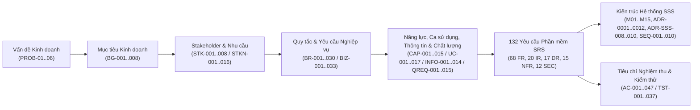

# MA TRẬN TRUY VẾT YÊU CẦU HAI CHIỀU TOÀN DIỆN (END-TO-END BIDIRECTIONAL REQUIREMENTS TRACEABILITY MATRIX)

- **Dự án:** AI-Assisted BizFlow Platform
- **Mã tài liệu:** `BIZFLOW-RDS-RTM-v1.2`
- **Phiên bản:** `1.2-DRAFT`
- **Ngày lập:** `2026-10-18` (Cập nhật đồng bộ v1.2: `2026-10-21`)
- **Trạng thái:** `DRAFT — 100% COVERAGE VERIFIED (128 RDS Catalog IDs + 47 AC <-> 132 SRS IDs + 37 TST <-> SSS M01..M15)`
- **Tài liệu liên quan:** [RDS_v1.0_DRAFT.md](./RDS_v1.0_DRAFT.md), [REQUIREMENTS_CATALOG.csv](./REQUIREMENTS_CATALOG.csv), [USE_CASES.md](./USE_CASES.md), [OPEN_DECISIONS.md](./OPEN_DECISIONS.md), [SOURCE_REGISTER.md](./SOURCE_REGISTER.md), [SRS_v1.0_DRAFT.md](../srs/SRS_v1.0_DRAFT.md), [SSS_v1.0_DRAFT.md](../../specifications/sss/SSS_v1.0_DRAFT.md)

---

## 1. Kiến trúc Truy vết Đa tầng (`RDS` $\leftrightarrow$ `SRS` $\leftrightarrow$ `SSS` $\leftrightarrow$ `AC/TST`)

Ma trận truy vết này đảm bảo không có bất kỳ mục tiêu kinh doanh nào bị bỏ rơi, không có yêu cầu nào không rõ nguồn gốc ("mồ côi" — orphan requirement) và mọi yêu cầu trong RDS đều kết nối hai chiều với toàn bộ **132 yêu cầu phần mềm nguyên tử** trong [SRS_v1.0_DRAFT.md](../srs/SRS_v1.0_DRAFT.md) cũng như **15 mô-đun kiến trúc (`M01`–`M15`)** trong [SSS_v1.0_DRAFT.md](../../specifications/sss/SSS_v1.0_DRAFT.md):

---

## 2. Ma trận Truy vết Xuôi Cấp 1: Từ Bài toán & Mục tiêu Kinh doanh tới Yêu cầu RDS (`PROB` $\rightarrow$ `BG` $\rightarrow$ `STKN` $\rightarrow$ `BR` / `BIZ` $\rightarrow$ `CAP` / `UC`)

| Mã Vấn đề | Mã Mục tiêu (`BG-*`) | Stakeholder & Nhu cầu (`STK-*` / `STKN-*`) | Quy tắc Nghiệp vụ (`BR-*`) | Yêu cầu Nghiệp vụ (`BIZ-*`) | Năng lực & Ca sử dụng (`CAP-*` / `UC-*`) | Yêu cầu Thông tin & Chất lượng (`INFO-*` / `QREQ-*`) |
|---|---|---|---|---|---|---|
| `PROB-01`, `PROB-02` | **`BG-001`** (Chuẩn hóa tiếp nhận & định tuyến yêu cầu) | `STK-003`..`006` `STKN-005`, `STKN-006` | `BR-004`, `BR-008`, `BR-009`, `BR-010`, `BR-011`, `BR-022` | `BIZ-007`, `BIZ-008`, `BIZ-012`, `BIZ-013`, `BIZ-014`, `BIZ-015` | `CAP-004`, `CAP-006` `UC-004`, `UC-005`, `UC-006` | `INFO-004`, `INFO-005` `QREQ-001`, `QREQ-010`, `QREQ-014` |
| `PROB-02`, `PROB-03` | **`BG-002`** (Minh bạch phân công, thực thi & nghiệm thu 2 mốc) | `STK-004`, `STK-006` `STKN-007`, `STKN-012` | `BR-004`, `BR-005`, `BR-006`, `BR-007`, `BR-020`, `BR-022` | `BIZ-009`, `BIZ-010`, `BIZ-011`, `BIZ-023` | `CAP-005`, `CAP-009`, `CAP-010` `UC-007`, `UC-008` | `INFO-006`, `INFO-009` `QREQ-001`, `QREQ-011`, `QREQ-012` |
| `PROB-04` | **`BG-003`** (Kiểm soát SLA, cảnh báo sớm, nhắc hạn đa kênh & leo thang) | `STK-003`, `STK-004`, `STK-006` `STKN-008`, `STKN-016` | `BR-014`, `BR-015`, `BR-016`, `BR-030` | `BIZ-018`, `BIZ-019`, `BIZ-020`, `BIZ-025`, `BIZ-033` | `CAP-008`, `CAP-009`, `CAP-011`, `CAP-015` `UC-004`, `UC-010`, `UC-012`, `UC-017` | `INFO-008`, `INFO-012`, `INFO-014` `QREQ-004`, `QREQ-007`, `QREQ-014` |
| `PROB-03`, `PROB-05` | **`BG-004`** (Tự động hóa quy trình & phê duyệt bất biến) | `STK-003`, `STK-004`, `STK-007` `STKN-009` | `BR-012`, `BR-013`, `BR-022` | `BIZ-007`, `BIZ-008`, `BIZ-016`, `BIZ-017` | `CAP-004`, `CAP-007` `UC-004`, `UC-009` | `INFO-004`, `INFO-007` `QREQ-007`, `QREQ-012` |
| `PROB-06` | **`BG-005`** (Tăng năng suất bằng AI tương tác có kiểm soát con người & Trợ lý Robot) | `STK-001`, `STK-003`..`007` `STKN-010`, `STKN-011`, `STKN-015` | `BR-017`, `BR-018`, `BR-019`, `BR-027`, `BR-028`, `BR-029` | `BIZ-021`, `BIZ-022`, `BIZ-031`, `BIZ-032` | `CAP-012`, `CAP-014` `UC-011`, `UC-015`, `UC-016` | `INFO-010`, `INFO-013`, `EXT-002` `QREQ-008`, `QREQ-009` |
| `PROB-05` | **`BG-006`** (Cách ly đa thuê bao, xác thực hợp nhất, tiếp nhận doanh nghiệp nguyên tử có hồ sơ pháp lý & phân quyền theo phạm vi) | `STK-001`..`007` `STKN-001`..`004` | `BR-001`, `BR-002`, `BR-003`, `BR-022`, `BR-023`, `BR-024`, `BR-025`, `BR-026` | `BIZ-001`, `BIZ-002`, `BIZ-003`, `BIZ-004`, `BIZ-005`, `BIZ-006`, `BIZ-027`, `BIZ-028`, `BIZ-029`, `BIZ-030` | `CAP-001`, `CAP-002`, `CAP-003` `UC-001`, `UC-002`, `UC-003`, `UC-013`, `UC-014` | `INFO-001`, `INFO-002`, `INFO-003`, `EXT-001`, `EXT-003` `QREQ-005`, `QREQ-006`, `QREQ-007` |
| `PROB-03`, `PROB-05` | **`BG-007`** (Tuân thủ kiểm toán & bảo toàn lịch sử bằng chứng) | `STK-001`..`003`, `STK-007` `STKN-012`, `STKN-014` | `BR-020`, `BR-021` | `BIZ-023`, `BIZ-024`, `BIZ-026` | `CAP-010`, `CAP-013` `UC-008`, `UC-012` | `INFO-009`, `INFO-011` `QREQ-007`, `QREQ-011`, `QREQ-015` |
| `PROB-04`, `PROB-06` | **`BG-008`** (Giám sát điều hành & báo cáo hiệu suất) | `STK-003`, `STK-004` `STKN-013` | `BR-002`, `BR-003` | `BIZ-021`, `BIZ-025` | `CAP-011`, `CAP-012` `UC-011`, `UC-012` | `INFO-012` `QREQ-002`, `QREQ-003`, `QREQ-013` |

---

## 3. Ma trận Truy vết Hai chiều Chi tiết: Từ 132 Yêu cầu Phần mềm SRS Ngược Lên RDS và Xuôi Sang SSS & Nghiệm thu

### 3.1. Truy vết 68 Yêu cầu Chức năng (`FR-*` $\leftrightarrow$ `RDS` $\leftrightarrow$ `SSS` $\leftrightarrow$ `AC/TST`)

| Mã SRS (`FR-*`) | Tên Yêu cầu Chức năng SRS | Yêu cầu Nghiệp vụ RDS (`BIZ-*`) | Nhu cầu & Quy tắc RDS (`STKN-*` / `BR-*`) | Năng lực & Ca sử dụng (`CAP-*` / `UC-*`) | Mô-đun SSS | Tiêu chí Nghiệm thu (`AC-*` / `TST-*`) | Trạng thái Code |
|---|---|---|---|---|---|---|---|
| `FR-AUTH-001` | Đăng nhập Doanh nghiệp bằng 3 Trường Bắt buộc (`ID/Username/Code`, `Password`, `WorkspaceKey`) | `BIZ-001`, `BIZ-029` | `STKN-003`, `BR-001`, `BR-025` | `CAP-001`, `UC-014` | `M01` | `AC-003`, `AC-033` / `TST-001`, `TST-032` | `PARTIAL` |
| `FR-AUTH-002` | Đăng nhập Quản trị viên Nền tảng (`PLATFORM_ADMIN`) | `BIZ-001` | `STKN-003`, `BR-001`, `ADR-0002` | `CAP-001`, `UC-002` | `M01` | `AC-003` / `TST-001` | `IMPLEMENTED` |
| `FR-AUTH-003` | Duy trì Phiên, Xoay vòng Refresh Token và Đăng xuất Thu hồi Phiên | `BIZ-001` | `STKN-003`, `ADR-0002` | `CAP-001`, `UC-002` | `M01` | `AC-003` / `TST-002` | `IMPLEMENTED` |
| `FR-AUTH-004` | Khôi phục Mật khẩu qua Email hoặc Mật khẩu Tạm thời do Admin Cấp | `BIZ-002` | `STKN-003`, `BR-001`, `OD-004`, `OD-007` | `CAP-001`, `UC-002` | `M01` | `AC-004` / `TST-003` | `PARTIAL` |
| `FR-AUTH-005` | Đăng nhập Không Mật khẩu qua Liên kết Email & Bộ chọn Workspace (`Workspace Selector`) | `BIZ-029` | `STKN-003`, `BR-025`, `OD-025` | `CAP-001`, `UC-014` | `M01` | `AC-034`, `AC-035` / `TST-032` | `NOT_IMPLEMENTED` |
| `FR-TEN-001` | Đăng ký Doanh nghiệp Công khai với 6 Trường Bắt buộc, Kiểm tra Mã Real-time, Tạo Mã Ngẫu nhiên & Tải Hồ sơ Pháp lý lên MinIO | `BIZ-003`, `BIZ-028`, `BIZ-030` | `STKN-001`, `BR-024`, `BR-026`, `OD-009`, `OD-022`, `OD-023`, `OD-026` | `CAP-002`, `UC-001` | `M01`, `M02`, `M10` | `AC-001`, `AC-036`, `AC-037` / `TST-004`, `TST-033` | `PARTIAL` |
| `FR-TEN-002` | Quản trị viên Nền tảng Thẩm định Hồ sơ, Tải Xem Tài liệu Pháp lý qua Presigned URL & Phê duyệt/Từ chối Khởi tạo Nguyên tử | `BIZ-003`, `BIZ-028`, `BIZ-030` | `STKN-001`, `BR-022`, `BR-023`, `BR-026`, `DEC-WS-001`, `OD-005`, `OD-024`, `OD-027` | `CAP-002`, `UC-001` | `M02`, `M03`, `M10` | `AC-001`, `AC-038`, `AC-039` / `TST-004`, `TST-033` | `NOT_IMPLEMENTED` |
| `FR-TEN-003` | Quản lý Trạng thái Hoạt động của Doanh nghiệp và Thuê bao | `BIZ-003` | `STKN-001` | `CAP-002`, `UC-001` | `M02` | `AC-001` / `TST-005` | `NOT_IMPLEMENTED` |
| `FR-TEN-004` | Thực thi Cách ly Dữ liệu Đa thuê bao Tuyệt đối theo `TenantId` | `BIZ-004` | `STKN-002`, `BR-002` | `CAP-002`, `UC-001`, `UC-013` | `M02` | `AC-002` / `TST-006` | `IMPLEMENTED` |
| `FR-TEN-005` | Tự đăng ký Doanh nghiệp (`Self-Service Onboarding`), Xác minh Email & Cấp phát Nguyên tử `Primary Tenant` + `COMPANY_ADMIN` (`PROPOSED`) | `BIZ-027`, `BIZ-028` | `STKN-001`, `BR-023`, `BR-024`, `DEC-WS-001`, `OD-021`..`024` | `CAP-002`, `UC-013` | `M01`, `M02`, `M03` | `AC-031`, `AC-032` / `TST-031` | `NOT_IMPLEMENTED` |
| `FR-ORG-001` | Tạo mới Tài khoản Người dùng trong Doanh nghiệp | `BIZ-005` | `STKN-004`, `BR-001`, `OD-004`, `OD-007` | `CAP-003`, `UC-003` | `M03` | `AC-005` / `TST-007` | `NOT_IMPLEMENTED` |
| `FR-ORG-002` | Cập nhật Thông tin Hồ sơ, Phòng ban và Vai trò của Người dùng | `BIZ-005` | `STKN-004` | `CAP-003`, `UC-003` | `M03` | `AC-005` / `TST-007` | `NOT_IMPLEMENTED` |
| `FR-ORG-003` | Vô hiệu hóa hoặc Kích hoạt lại Tài khoản Người dùng | `BIZ-005` | `STKN-004`, `BR-021` | `CAP-003`, `UC-003` | `M03` | `AC-005` / `TST-007` | `NOT_IMPLEMENTED` |
| `FR-ORG-004` | Quản lý Cơ cấu Phòng ban Phân cấp và Phạm vi Quản lý (`ManagementScope`) | `BIZ-006` | `STKN-004`, `BR-003`, `OD-006` | `CAP-003`, `UC-003` | `M03` | `AC-006` / `TST-007` | `PARTIAL` |
| `FR-ORG-005` | Tạo Vai trò Tùy chỉnh và Cấu hình Quyền hạn (`Custom Role`) | `BIZ-006` | `STKN-004`, `BR-003` | `CAP-003`, `UC-003` | `M03` | `AC-007` / `TST-008` | `IMPLEMENTED` |
| `FR-SVC-001` | Tạo và Quản lý Danh mục Dịch vụ Nội bộ và Phân loại Dịch vụ | `BIZ-007` | `STKN-005`, `ADR-0008`, `OD-020` | `CAP-004`, `UC-004` | `M04` | `AC-008` / `TST-009` | `IMPLEMENTED` |
| `FR-SVC-002` | Cấu hình Quy tắc Định tuyến Tự động cho Dịch vụ (`RoutingRule`) | `BIZ-008` | `STKN-005`, `BR-008` | `CAP-004`, `UC-004` | `M04` | `AC-009` / `TST-010` | `NOT_IMPLEMENTED` |
| `FR-SVC-003` | Gắn Phiên bản Quy trình và Hồ sơ SLA Mặc định cho Dịch vụ | `BIZ-007` | `STKN-005`, `BR-013`, `BR-014` | `CAP-004`, `UC-004` | `M04` | `AC-009` / `TST-010` | `NOT_IMPLEMENTED` |
| `FR-SVC-004` | Cấu hình Quy tắc Phê duyệt cho Dịch vụ (`ApprovalRule`) | `BIZ-008` | `STKN-005`, `BR-012`, `OD-011` | `CAP-004`, `UC-004` | `M04` | `AC-009` / `TST-010` | `NOT_IMPLEMENTED` |
| `FR-TASK-001` | Tạo mới Công việc Độc lập hoặc Liên kết Yêu cầu kèm `Checklist` | `BIZ-009` | `STKN-007`, `BR-004`, `ADR-0011`, `ADR-0012` | `CAP-005`, `UC-007` | `M05` | `AC-010`, `AC-030` / `TST-011` | `IMPLEMENTED` |
| `FR-TASK-002` | Giao Công việc cho Cá nhân hoặc Phòng ban | `BIZ-009` | `STKN-007`, `BR-005` | `CAP-005`, `UC-007` | `M05` | `AC-010` / `TST-012` | `IMPLEMENTED` |
| `FR-TASK-003` | Người được giao Xác nhận Nhận việc hoặc Từ chối (Kèm Claim Phòng ban) | `BIZ-009` | `STKN-007`, `BR-005`, `BR-006`, `BR-022`, `ADR-0010`, `OD-001` | `CAP-005`, `UC-007` | `M05` | `AC-010` / `TST-012` | `PARTIAL` |
| `FR-TASK-004` | Bắt đầu Thực hiện Công việc hoặc Tiếp tục Công việc Quá hạn | `BIZ-010` | `STKN-007`, `ADR-0003` | `CAP-005`, `UC-007`, `UC-008` | `M05` | `AC-011` / `TST-013` | `IMPLEMENTED` |
| `FR-TASK-005` | Cập nhật Trạng thái `Checklist` và Phần trăm Tiến độ Công việc | `BIZ-010` | `STKN-007`, `OD-002` | `CAP-005`, `UC-007` | `M05` | `AC-011` / `TST-014` | `PARTIAL` |
| `FR-TASK-006` | Gửi Báo cáo Tiến độ Định kỳ hoặc Phát sinh Vướng mắc (`TaskProgressReport`) | `BIZ-010` | `STKN-007`, `OD-002` | `CAP-005`, `UC-007` | `M05` | `AC-011` / `TST-014` | `PARTIAL` |
| `FR-TASK-007` | Nộp Kết quả Thực hiện Công việc (`TaskResult`) | `BIZ-010` | `STKN-007`, `BR-006`, `ADR-0003` | `CAP-005`, `UC-008` | `M05` | `AC-011` / `TST-013` | `IMPLEMENTED` |
| `FR-TASK-008` | Quản lý Nghiệm thu Kết quả Hoàn thành hoặc Từ chối Yêu cầu Làm lại | `BIZ-011` | `STKN-007`, `BR-006`, `BR-022`, `ADR-0003` | `CAP-005`, `UC-008` | `M05` | `AC-012` / `TST-013` | `IMPLEMENTED` |
| `FR-TASK-009` | Giao lại Công việc Đang thực hiện và Bảo toàn Lịch sử (`Reassign`) | `BIZ-011` | `STKN-007`, `BR-007`, `BR-022` | `CAP-005`, `UC-007` | `M05` | `AC-012` / `TST-014` | `NOT_IMPLEMENTED` |
| `FR-TASK-010` | Hủy Công việc Trước khi Hoàn thành (`Cancel Task`) | `BIZ-011` | `STKN-007`, `BR-022` | `CAP-005`, `UC-007` | `M05` | `AC-012` / `TST-014` | `NOT_IMPLEMENTED` |
| `FR-REQ-001` | Tạo Bản nháp và Gửi Yêu cầu Dịch vụ Nội bộ | `BIZ-012` | `STKN-005` | `CAP-006`, `UC-005` | `M06` | `AC-013` / `TST-015` | `IMPLEMENTED` |
| `FR-REQ-002` | Yêu cầu Người gửi Bổ sung Thông tin (`WAITING_FOR_INFO`) | `BIZ-013` | `STKN-006`, `BR-016`, `BR-022`, `OD-003` | `CAP-006`, `UC-005` | `M06` | `AC-015` / `TST-018` | `NOT_IMPLEMENTED` |
| `FR-REQ-003` | Định tuyến Tự động hoặc Thủ công Yêu cầu Dịch vụ (`Request Routing`) | `BIZ-012` | `STKN-005`, `BR-008` | `CAP-006`, `UC-005` | `M06` | `AC-013` / `TST-015` | `IMPLEMENTED` |
| `FR-REQ-004` | Bộ phận Phụ trách Xác nhận Tiếp nhận Yêu cầu (`Receive Request`) | `BIZ-012` | `STKN-006`, `BR-009` | `CAP-006`, `UC-005` | `M06` | `AC-014` / `TST-015` | `IMPLEMENTED` |
| `FR-REQ-005` | Bắt đầu Xử lý, Từ chối hoặc Hủy Yêu cầu Nội bộ | `BIZ-013` | `STKN-006`, `BR-022`, `ADR-0009`, `OD-003` | `CAP-006`, `UC-005` | `M06` | `AC-015` / `TST-015` | `PARTIAL` |
| `FR-REQ-006` | Tạo và Liên kết Công việc Thực thi (`Task`) từ Yêu cầu Đang xử lý | `BIZ-014` | `STKN-006`, `BR-004` | `CAP-006`, `UC-006` | `M06` | `AC-016` / `TST-016` | `IMPLEMENTED` |
| `FR-REQ-007` | Đánh dấu Yêu cầu Đã Giải quyết (`Resolve`) với Điều kiện Chặn `BR-011` | `BIZ-014` | `STKN-006`, `BR-011` | `CAP-006`, `UC-006` | `M06` | `AC-016` / `TST-016` | `IMPLEMENTED` |
| `FR-REQ-008` | Người gửi Xác nhận Đóng Yêu cầu hoặc Từ chối Kết quả để Xử lý lại | `BIZ-014` | `STKN-006`, `BR-010`, `BR-022`, `ADR-0009` | `CAP-006`, `UC-006` | `M06` | `AC-017` / `TST-017` | `IMPLEMENTED` |
| `FR-REQ-009` | Tạo Yêu cầu Sửa đổi Mới từ Yêu cầu Đã bị Từ chối (`Revise Request`) | `BIZ-015` | `STKN-006` | `CAP-006`, `UC-005` | `M06` | `AC-017` / `TST-017` | `IMPLEMENTED` |
| `FR-WF-001` | Thiết kế, Kiểm tra Hợp lệ và Phát hành Phiên bản Quy trình | `BIZ-016` | `STKN-009`, `BR-013`, `OD-008` | `CAP-007`, `UC-004` | `M07` | `AC-018` / `TST-019` | `PARTIAL` |
| `FR-WF-002` | Thực thi Chuyển Bước theo Phiên bản Quy trình Đã Ghim | `BIZ-016` | `STKN-009`, `BR-013`, `OD-008` | `CAP-007`, `UC-009` | `M07` | `AC-018` / `TST-019` | `NOT_IMPLEMENTED` |
| `FR-WF-003` | Khởi tạo Phiên Phê duyệt và Định tuyến tới Người có Thẩm quyền | `BIZ-017` | `STKN-009`, `BR-012`, `OD-011` | `CAP-007`, `UC-009` | `M07` | `AC-018` / `TST-019` | `NOT_IMPLEMENTED` |
| `FR-WF-004` | Ra Quyết định Chấp thuận hoặc Từ chối Phê duyệt | `BIZ-017` | `STKN-009`, `BR-012`, `BR-022`, `OD-011` | `CAP-007`, `UC-009` | `M07` | `AC-018` / `TST-019` | `NOT_IMPLEMENTED` |
| `FR-SLA-001` | Cấu hình Hồ sơ SLA, Phiên bản SLA Bất biến và Lịch làm việc | `BIZ-018` | `STKN-008`, `BR-014`, `ADR-0004`..`0007`, `OD-010` | `CAP-008`, `UC-004` | `M08` | `AC-019` / `TST-020` | `PARTIAL` |
| `FR-SLA-002` | Theo dõi Đồng hồ SLA theo Giờ làm việc và Phát Cảnh báo Sớm | `BIZ-019` | `STKN-008`, `BR-015`, `ADR-0005` | `CAP-008`, `UC-010` | `M08` | `AC-020` / `TST-021` | `NOT_IMPLEMENTED` |
| `FR-SLA-003` | Tự động Leo thang Thông báo theo Cấp khi Quá hạn | `BIZ-020` | `STKN-008`, `BR-015`, `ADR-0006` | `CAP-008`, `UC-010` | `M08` | `AC-020` / `TST-021` | `NOT_IMPLEMENTED` |
| `FR-SLA-004` | Tạm dừng và Tiếp tục Đồng hồ SLA ở các Trạng thái Chờ Hợp lệ | `BIZ-019` | `STKN-008`, `BR-016`, `OD-012` | `CAP-008`, `UC-010` | `M08` | `AC-020` / `TST-021` | `NOT_IMPLEMENTED` |
| `FR-COL-001` | Trao đổi Bình luận trên Công việc và Yêu cầu | `BIZ-023` | `STKN-012` | `CAP-009`, `UC-007`, `UC-008` | `M09`, `M10` | `AC-021` / `TST-022` | `IMPLEMENTED` |
| `FR-COL-002` | Đính kèm, Tải xuống và Quản lý Tệp Bằng chứng Dung lượng lớn tới 500 MB | `BIZ-023` | `STKN-012`, `BR-020` | `CAP-010`, `UC-008` | `M10` | `AC-021` / `TST-023` | `IMPLEMENTED` |
| `FR-COL-003` | Lưu trữ Hồ sơ Đã Hoàn tất (`Archive Completed / Closed Records`) | `BIZ-024` | `STKN-014`, `BR-021`, `OD-015` | `CAP-010`, `UC-012` | `M10` | `AC-025` / `TST-024` | `IMPLEMENTED` |
| `FR-COL-004` | Tìm kiếm và Lọc Hợp nhất trên Công việc và Yêu cầu (`Unified Search`) | `BIZ-024` | `STKN-012` | `CAP-010`, `UC-012` | `M10` | `AC-025` / `TST-024` | `IMPLEMENTED` |
| `FR-REP-001` | Bảng điều khiển Quản lý theo Phạm vi Phòng ban (`Scoped Manager Dashboard`) | `BIZ-025` | `STKN-013`, `BR-003` | `CAP-011`, `UC-012` | `M11` | `AC-026` / `TST-025` | `IMPLEMENTED` |
| `FR-REP-002` | Báo cáo Tổng hợp Vận hành Toàn Doanh nghiệp (`Company-Wide Summary`) | `BIZ-025` | `STKN-013` | `CAP-011`, `UC-012` | `M11` | `AC-026` / `TST-025` | `IMPLEMENTED` |
| `FR-REP-003` | Báo cáo Phân bổ Khối lượng Công việc theo Nhân sự và Phòng ban | `BIZ-025` | `STKN-013` | `CAP-011`, `UC-012` | `M11` | `AC-026` / `TST-025` | `IMPLEMENTED` |
| `FR-REP-004` | Báo cáo Tuân thủ Cam kết Mức dịch vụ (`SLA Compliance Report`) | `BIZ-025` | `STKN-008`, `STKN-013` | `CAP-011`, `UC-012` | `M11` | `AC-026` / `TST-025` | `IMPLEMENTED` |
| `FR-AI-001` | Hỗ trợ Soạn thảo Bản nháp Công việc từ Mô tả Ngôn ngữ Tự nhiên | `BIZ-021` | `STKN-010`, `BR-017`..`019` | `CAP-012`, `UC-011` | `M12` | `AC-022` / `TST-026` | `IMPLEMENTED` |
| `FR-AI-002` | Gợi ý Người hoặc Phòng ban Nhận việc Phù hợp | `BIZ-021` | `STKN-010`, `BR-017`..`019` | `CAP-012`, `UC-011` | `M12` | `AC-022` / `TST-026` | `IMPLEMENTED` |
| `FR-AI-003` | Tóm tắt Nội dung và Lịch sử Trao đổi của Công việc hoặc Yêu cầu | `BIZ-021` | `STKN-010`, `BR-017`..`019` | `CAP-012`, `UC-011` | `M12` | `AC-022` / `TST-026` | `IMPLEMENTED` |
| `FR-AI-004` | Đánh giá Chất lượng Kết quả Nộp và Độ đầy đủ Thông tin | `BIZ-021` | `STKN-010`, `BR-017`..`019` | `CAP-012`, `UC-011` | `M12` | `AC-022` / `TST-026` | `IMPLEMENTED` |
| `FR-AI-005` | Phân tích Rủi ro Trễ hạn và Điểm nghẽn Tiến độ | `BIZ-021` | `STKN-010`, `BR-017`..`019` | `CAP-012`, `UC-011` | `M12` | `AC-022` / `TST-026` | `IMPLEMENTED` |
| `FR-AI-006` | Phát hiện Bất thường trong Vận hành | `BIZ-021` | `STKN-010`, `BR-017`..`019` | `CAP-012`, `UC-011` | `M12` | `AC-022` / `TST-026` | `IMPLEMENTED` |
| `FR-AI-007` | Gợi ý Dịch vụ và Phân loại Dịch vụ cho Yêu cầu Mới | `BIZ-021` | `STKN-010`, `BR-017`..`019` | `CAP-012`, `UC-011` | `M12` | `AC-022` / `TST-026` | `IMPLEMENTED` |
| `FR-AI-008` | Kiểm tra Độ đầy đủ Thông tin trước khi Gửi Yêu cầu | `BIZ-021` | `STKN-010`, `BR-017`..`019` | `CAP-012`, `UC-011` | `M12` | `AC-022` / `TST-026` | `IMPLEMENTED` |
| `FR-AI-009` | Hỏi đáp Trạng thái Hồ sơ bằng Ngôn ngữ Tự nhiên | `BIZ-021` | `STKN-010`, `BR-017`..`019` | `CAP-012`, `UC-011` | `M12` | `AC-022`, `AC-024` / `TST-026`, `TST-027` | `IMPLEMENTED` |
| `FR-AI-010` | Tổng hợp Nhận định Thông minh trên Bảng điều khiển Quản lý | `BIZ-021` | `STKN-010`, `BR-017`..`019` | `CAP-012`, `UC-011` | `M12` | `AC-022` / `TST-026` | `IMPLEMENTED` |
| `FR-AI-011` | Trợ lý Robot Thông minh Nhúng UI, Trạng thái Mặc định Mở và Vòng đời Đóng theo Phiên (`sessionStorage`) | `BIZ-031` | `STKN-015`, `BR-029`, `OD-029` | `CAP-014`, `UC-015` | `M14` | `AC-040` / `TST-034` | `NOT_IMPLEMENTED` |
| `FR-AI-012` | Vấn tin Tiến độ & Báo cáo Tự nhiên Ràng buộc Theo Quyền Hạn Thực Tế (`RBAC` & `ManagementScope`) | `BIZ-031` | `STKN-015`, `BR-003`, `BR-027`, `OD-030` | `CAP-014`, `UC-015` | `M14` | `AC-041`, `AC-042` / `TST-034` | `NOT_IMPLEMENTED` |
| `FR-AI-013` | Bóc tách Đoạn văn thành Danh sách Việc Cần Làm với Xác nhận Người dùng Bắt buộc (`BR-028`) | `BIZ-032` | `STKN-015`, `BR-017`, `BR-028`, `OD-028` | `CAP-014`, `UC-016` | `M05`, `M06`, `M12`, `M14` | `AC-043`, `AC-044` / `TST-035` | `NOT_IMPLEMENTED` |
| `FR-NOTIF-003` | Cấu hình Lịch Nhắc Hạn Cá nhân hóa & Lệnh Điều khiển `/notifications` qua Chatbot | `BIZ-033` | `STKN-016`, `BR-030`, `OD-031` | `CAP-015`, `UC-015`, `UC-017` | `M14`, `M15` | `AC-045` / `TST-036` | `NOT_IMPLEMENTED` |
| `FR-NOTIF-004` | Phát Thông báo Nhắc Hạn Đa Kênh Tự động (In-App SignalR, Web Push VAPID & Fallback Email) | `BIZ-033` | `STKN-016`, `BR-030`, `OD-032` | `CAP-015`, `UC-017` | `M15` | `AC-046`, `AC-047` / `TST-037` | `NOT_IMPLEMENTED` |

---

### 3.2. Truy vết 20 Yêu cầu Giao diện (`IR-*`) và 17 Yêu cầu Dữ liệu (`DR-*`) Ngược Lên RDS

| Mã SRS (`IR-*` / `DR-*`) | Tên Yêu cầu Giao diện / Dữ liệu SRS | Yêu cầu RDS Liên kết | Quy tắc / ADR Liên kết | Tiêu chí Nghiệm thu | Trạng thái Code |
|---|---|---|---|---|---|
| `IR-UI-001` | Phân tách Giao diện Mặt phẳng Quản trị Nền tảng và Không gian làm việc Tenant | `EXT-001`, `BIZ-003`, `QREQ-010` | `BR-002`, `ADR-0001` | `AC-029` / `TST-029` | `IMPLEMENTED` (`UI-02` Read-only) |
| `IR-UI-002` | Đáp ứng 4 Trạng thái Hiển thị Bắt buộc trên Toàn bộ 16 Màn hình Chuẩn | `EXT-001`, `QREQ-010` | `ADR-0001` | `AC-029` / `TST-029` | `IMPLEMENTED` |
| `IR-UI-003` | Hiển thị Nhãn Nhận diện Đề xuất AI và Điều khiển Xác nhận của Con người | `EXT-001`, `BIZ-022`, `CAP-012` | `BR-017`, `BR-018` | `AC-022`, `AC-029` / `TST-026`, `TST-029` | `IMPLEMENTED` |
| `IR-UI-004` | Giao diện Điểm Vào Đăng ký Doanh nghiệp Công khai (`/register-company`), Liên kết CTA từ `/login` (`UI-01`) & Xác minh Email | `EXT-001`, `BIZ-027`, `BIZ-028`, `CAP-002` | `DEC-WS-001`, `BR-023`, `BR-024`, `OD-021`, `OD-022` | `AC-031`, `AC-032` / `TST-031` | `NOT_IMPLEMENTED` |
| `IR-UI-005` | Modal Chọn Không Gian Làm Việc (`Workspace Selector Modal`) cho Người dùng Nhiều Tenant | `EXT-001`, `BIZ-029`, `CAP-001` | `BR-025`, `OD-025` | `AC-035` / `TST-032` | `NOT_IMPLEMENTED` |
| `IR-UI-006` | Giao diện Thẩm định Hồ sơ Pháp lý và Xem Tài liệu Đính kèm cho Quản trị viên Nền tảng (`UI-02`) | `EXT-001`, `BIZ-030`, `CAP-002` | `BR-026`, `OD-027` | `AC-038`, `AC-039` / `TST-033` | `NOT_IMPLEMENTED` |
| `IR-API-001` | Giao thức RESTful JSON API Phiên bản hóa (`/api/v1/*`) và Cấu trúc Phản hồi Chuẩn | `EXT-001`, `QREQ-012` | `ADR-0008`, `ADR-0012` | `AC-003` / `TST-001` | `IMPLEMENTED` |
| `IR-API-002` | Kiểm soát Tương tranh Lạc quan (`ETag / If-Match`) và Khóa Chống Trùng lặp (`Idempotency-Key`) | `EXT-001`, `BIZ-007`, `QREQ-012` | `ADR-0008`, `ADR-0012` | `AC-008`, `AC-030` / `TST-009`, `TST-011` | `IMPLEMENTED` |
| `IR-API-003` | Chuẩn hóa Phân trang, Sắp xếp và Chống Lộ Thông tin trên Truy vấn Danh sách/Chi tiết | `EXT-001`, `BIZ-004`, `QREQ-006` | `BR-002`, `ADR-0012` | `AC-002` / `TST-006`, `TST-011` | `IMPLEMENTED` |
| `IR-API-004` | Bộ Giao diện API Xác thực Đa Chế độ Hợp nhất và Đăng nhập Không Mật khẩu qua Email | `EXT-001`, `BIZ-029`, `CAP-001` | `BR-025`, `OD-025` | `AC-033`, `AC-034`, `AC-035` / `TST-032` | `NOT_IMPLEMENTED` |
| `IR-API-005` | Bộ Giao diện API Kiểm tra Khả dụng Mã Workspace và Tạo Mã Tự động | `EXT-001`, `BIZ-030`, `CAP-002` | `BR-026`, `OD-026` | `AC-036`, `AC-037` / `TST-033` | `NOT_IMPLEMENTED` |
| `IR-API-006` | Giao diện API Phê chuẩn Hàng loạt Công việc Bóc tách từ AI (`Batch Confirm AI Tasks`) | `EXT-001`, `BIZ-032`, `CAP-014` | `BR-028`, `OD-028` | `AC-044` / `TST-035` | `NOT_IMPLEMENTED` |
| `IR-API-007` | Bộ Giao diện API Cấu hình Lịch Nhắc Hạn và Đăng ký Web Push Subscription | `EXT-001`, `BIZ-033`, `CAP-015` | `BR-030`, `OD-031`, `OD-032` | `AC-045`, `AC-046` / `TST-036`, `TST-037` | `NOT_IMPLEMENTED` |
| `IR-EXT-001` | Giao diện Tích hợp Nhà cung cấp Mô hình Ngôn ngữ Lớn (LLM Provider Adapter) | `EXT-002`, `BIZ-021`, `CAP-012` | `BR-019`, `OD-014` | `AC-022`, `AC-023` / `TST-026` | `IMPLEMENTED` |
| `IR-EXT-002` | Giao diện Dịch vụ Gửi Thư điện tử Giao dịch (Transactional Email / SMTP) | `EXT-003`, `BIZ-002`, `BIZ-027`, `BIZ-029` | `BR-001`, `BR-024`, `BR-025` | `AC-004`, `AC-034` / `TST-003`, `TST-032` | `PARTIAL` |
| `IR-EXT-003` | Giao diện Dịch vụ Thông báo Trình duyệt Chuẩn W3C Push Service & VAPID Provider | `EXT-003`, `BIZ-033`, `CAP-015` | `BR-030`, `OD-032` | `AC-046` / `TST-037` | `NOT_IMPLEMENTED` |
| `IR-FILE-001` | Giao diện Lưu trữ Đối tượng Tương thích S3/MinIO theo Phiên Tải lên 3 Bước | `EXT-004`, `BIZ-023`, `CAP-010` | `BR-020` | `AC-021` / `TST-023` | `IMPLEMENTED` |
| `IR-FILE-002` | Kiểm tra Kích thước 500 MB, Kiểu MIME, Toàn vẹn SHA-256 và Tải xuống Được Ủy quyền | `EXT-004`, `BIZ-023`, `CAP-010` | `BR-020` | `AC-021` / `TST-023` | `IMPLEMENTED` |
| `IR-NOTIF-001` | Giao diện Hộp thư Thông báo Nội bộ và Đẩy Tín hiệu Thời gian thực qua SignalR | `EXT-005`, `BIZ-023`, `CAP-009` | `OD-009` | `AC-021` / `TST-022` | `IMPLEMENTED` |
| `IR-NOTIF-002` | Giao diện Phát Thông báo Nhắc việc, Cảnh báo Sớm và Leo thang SLA từ Tác vụ Nền | `EXT-005`, `BIZ-019`, `BIZ-020`, `CAP-009` | `BR-015`, `ADR-0006` | `AC-020` / `TST-021` | `NOT_IMPLEMENTED` |
| `DR-001` | Định danh Thuê bao Bắt buộc (`TenantId`) và Cách ly Logic Toàn cục | `INFO-001`, `BIZ-004`, `STKN-002` | `BR-002`, `ADR-0002` | `AC-002` / `TST-006`, `TST-028` | `IMPLEMENTED` |
| `DR-002` | Dữ liệu Doanh nghiệp, Mã số thuế, Hồ sơ Pháp lý, `Primary Tenant` và Cấu hình Tenant | `INFO-001`, `BIZ-003`, `BIZ-030` | `DEC-WS-001`, `BR-023`, `BR-026`, `OD-026` | `AC-001`, `AC-036`, `AC-038` / `TST-004`, `TST-033` | `PARTIAL` |
| `DR-003` | Dữ liệu Cơ cấu Phòng ban Phân cấp, Người dùng và Phạm vi Quản lý | `INFO-002`, `BIZ-005`, `BIZ-006` | `BR-001`, `BR-003`, `OD-004`, `OD-006` | `AC-005`, `AC-006` / `TST-007` | `IMPLEMENTED` |
| `DR-004` | Dữ liệu Vai trò, Quyền hạn RBAC và Phiên Xác thực Có Thu hồi | `INFO-003`, `BIZ-001`, `BIZ-006` | `ADR-0002` | `AC-003`, `AC-007` / `TST-001`, `TST-002`, `TST-008` | `IMPLEMENTED` |
| `DR-005` | Dữ liệu Danh mục Dịch vụ Nội bộ, Phân loại và Quy tắc Định tuyến | `INFO-004`, `BIZ-007`, `BIZ-008` | `BR-008`, `ADR-0008` | `AC-008`, `AC-009` / `TST-009`, `TST-010` | `PARTIAL` |
| `DR-006` | Dữ liệu Yêu cầu Dịch vụ, Lịch sử Định tuyến và Kết quả Giải quyết | `INFO-005`, `BIZ-012`..`015` | `BR-008`..`011`, `ADR-0009` | `AC-013`..`017` / `TST-015`..`017` | `IMPLEMENTED` |
| `DR-007` | Dữ liệu Công việc, Phân công, Danh sách Kiểm tra, Báo cáo Tiến độ và Kết quả | `INFO-006`, `BIZ-009`..`011` | `BR-004`..`007`, `ADR-0010`, `ADR-0012` | `AC-010`..`012` / `TST-011`..`014` | `IMPLEMENTED` |
| `DR-008` | Dữ liệu Xác nhận Hai Mốc Nghiệp vụ (`Confirmation`) | `INFO-006`, `BIZ-009`, `BIZ-011`, `BIZ-014` | `BR-006`, `BR-010` | `AC-010`, `AC-012`, `AC-017` / `TST-012`, `TST-013`, `TST-017` | `IMPLEMENTED` |
| `DR-009` | Dữ liệu Quy trình Công việc, Phiên bản Quy trình và Phê duyệt | `INFO-007`, `BIZ-016`, `BIZ-017` | `BR-012`, `BR-013`, `OD-008`, `OD-011` | `AC-018` / `TST-019` | `PARTIAL` |
| `DR-010` | Dữ liệu Hồ sơ SLA, Phiên bản SLA Bất biến, Lịch làm việc và Đồng hồ SLA | `INFO-008`, `BIZ-018`..`020` | `BR-014`..`016`, `ADR-0004`..`0006` | `AC-019`, `AC-020` / `TST-020`, `TST-021` | `PARTIAL` |
| `DR-011` | Dữ liệu Bình luận, Tệp Bằng chứng Đính kèm và Thông báo | `INFO-009`, `BIZ-023` | `BR-020`, `OD-009` | `AC-021` / `TST-022`, `TST-023` | `IMPLEMENTED` |
| `DR-012` | Dữ liệu Tương tác AI, Đề xuất AI và Hành động Tác nhân AI | `INFO-010`, `BIZ-021`, `BIZ-022` | `BR-017`, `BR-018` | `AC-022` / `TST-026` | `IMPLEMENTED` |
| `DR-013` | Dữ liệu Nhật ký Kiểm toán Bất biến Toàn Hệ thống (`AuditLog`) | `INFO-011`, `BIZ-026`, `CAP-013` | `BR-021` | `AC-028` / `TST-028` | `IMPLEMENTED` |
| `DR-014` | Quy tắc Xóa mềm, Lưu trữ Hồ sơ và Cấm Xóa cứng Dữ liệu Lịch sử | `INFO-011`, `BIZ-024`, `CAP-013` | `BR-021`, `OD-015` | `AC-025`, `AC-028` / `TST-024`, `TST-028` | `IMPLEMENTED` |
| `DR-015` | Chuẩn hóa Kiểu dữ liệu Thời gian UTC, Định danh UUID và Mã hóa UTF-8 | `INFO-005`, `INFO-006`, `BIZ-009`, `QREQ-014` | `ADR-0012`, `OD-017` | `AC-030` / `TST-011` | `IMPLEMENTED` |
| `DR-016` | Dữ liệu Phiên Hội thoại Robot Chatbot, Ngữ cảnh Tương tác & Lịch sử Tin nhắn | `INFO-013`, `BIZ-031`, `CAP-014` | `BR-027`, `BR-029`, `OD-029` | `AC-040`, `AC-041` / `TST-034` | `NOT_IMPLEMENTED` |
| `DR-017` | Dữ liệu Cấu hình Lịch Nhắc Hạn, Đăng ký Web Push Subscription & Nhật ký Phát Đa Kênh | `INFO-014`, `BIZ-033`, `CAP-015` | `BR-030`, `OD-031`, `OD-032` | `AC-045`, `AC-046`, `AC-047` / `TST-036`, `TST-037` | `NOT_IMPLEMENTED` |

---

### 3.3. Truy vết 15 Yêu cầu Phi chức năng (`NFR-*`) và 12 Yêu cầu Bảo mật (`SEC-*`) Ngược Lên RDS

| Mã SRS (`NFR-*` / `SEC-*`) | Tên Yêu cầu Phi chức năng / Bảo mật SRS | Yêu cầu Chất lượng RDS (`QREQ-*`) | Yêu cầu Nghiệp vụ & Quy tắc (`BIZ-*` / `BR-*`) | Tiêu chí Nghiệm thu | Trạng thái Code |
|---|---|---|---|---|---|
| `NFR-PERF-001` | Độ trễ Phản hồi API Đọc/Ghi Nghiệp vụ Thông thường (`<= 500 ms`) | `QREQ-001` | `BIZ-009`, `BIZ-012`, `OD-013` | `AC-027` / `TST-030` | `PARTIAL` |
| `NFR-PERF-002` | Độ trễ Truy vấn Bảng điều khiển và Báo cáo Tổng hợp (`<= 2000 ms`) | `QREQ-002` | `BIZ-025`, `OD-013` | `AC-027` / `TST-025`, `TST-030` | `PARTIAL` |
| `NFR-SCAL-001` | Khả năng Chịu tải 100 Người dùng Đồng thời và Mở rộng Ngang Không Trạng thái | `QREQ-003` | `OD-013` | `AC-027` / `TST-030` | `IMPLEMENTED` |
| `NFR-REL-001` | Độ Sẵn sàng Dịch vụ và Khả năng Chịu lỗi Tác vụ Nền | `QREQ-004` | `BIZ-019`, `BIZ-020`, `OD-016` | `AC-020` / `TST-021`, `TST-030` | `IMPLEMENTED` |
| `NFR-SEC-001` | Bảo mật Mật khẩu, Vòng đời Token và Mã hóa Truyền tải | `QREQ-005` | `BIZ-001`, `ADR-0002` | `AC-003` / `TST-001`, `TST-002` | `IMPLEMENTED` |
| `NFR-SEC-002` | Bảo đảm Cách ly Đa thuê bao Tuyệt đối ở Mọi Tầng (`0% Cross-Tenant Leakage`) | `QREQ-006` | `BIZ-004`, `BR-002`, `STKN-002` | `AC-002` / `TST-006` | `IMPLEMENTED` |
| `NFR-DATA-001` | Tính Bất biến của Nhật ký Kiểm toán và Bản chụp Phiên bản Cấu hình | `QREQ-007` | `BIZ-018`, `BIZ-026`, `BR-013`, `BR-014`, `BR-021` | `AC-019`, `AC-028` / `TST-020`, `TST-028` | `IMPLEMENTED` |
| `NFR-AI-001` | Độ trễ Phản hồi AI, Suy giảm An toàn và An toàn Human-in-the-Loop | `QREQ-008` | `BIZ-022`, `BR-017`..`019`, `STKN-011` | `AC-022`, `AC-023` / `TST-026` | `IMPLEMENTED` |
| `NFR-FILE-001` | Năng lực Xử lý Tệp Đính kèm Dung lượng Lớn tới 500 MB | `QREQ-011` | `BIZ-023`, `BR-020`, `STKN-012` | `AC-021` / `TST-023` | `IMPLEMENTED` |
| `NFR-USAB-001` | Tính Nhất quán Giao diện GRID, Khả năng Tiếp cận và Phản hồi Trạng thái Rõ ràng | `QREQ-010` | `EXT-001`, `ADR-0001` | `AC-029` / `TST-029` | `IMPLEMENTED` |
| `NFR-MAINT-001` | Khả năng Bảo trì Kiến trúc Modular Monolith và Kiểm thử Tự động | `QREQ-012` | `ADR-0008`, `ADR-0012` | `AC-008`, `AC-030` / `TST-029` | `IMPLEMENTED` |
| `NFR-OBS-001` | Khả năng Quan sát Hệ thống, Nhật ký Có Cấu trúc và Mã Tương quan Truy vết | `QREQ-013` | `BIZ-026` | `AC-028` / `TST-028` | `IMPLEMENTED` |
| `NFR-AI-002` | Kiểm soát Chi phí, Giới hạn Tốc độ Gọi AI và Phòng chống Lạm dụng | `QREQ-009` | `BIZ-022`, `BR-019`, `STKN-011`, `OD-014` | `AC-023` / `TST-026` | `NOT_IMPLEMENTED` |
| `NFR-I18N-001` | Hỗ trợ Bảng mã Unicode Tiếng Việt / Tiếng Anh và Múi giờ Lịch làm việc | `QREQ-014` | `ADR-0005`, `OD-017` | `AC-019`, `AC-030` / `TST-020`, `TST-029` | `IMPLEMENTED` |
| `NFR-BCDR-001` | Sao lưu Dữ liệu, Mục tiêu Điểm Khôi phục (`RPO`) và Thời gian Khôi phục (`RTO`) | `QREQ-015` | `OD-016` | `AC-028` / `TST-028` | `NOT_IMPLEMENTED` |
| `SEC-001` | Xác thực Đa Chế độ Định danh và Chống Dò quét Tài khoản | `QREQ-005` | `BIZ-001`, `BIZ-002`, `BR-001`, `STKN-003` | `AC-003`, `AC-004` / `TST-001`, `TST-003` | `IMPLEMENTED` |
| `SEC-002` | Quản lý Vòng đời Refresh Token Xoay vòng và Phát hiện Tấn công Phát lại | `QREQ-005` | `BIZ-001`, `ADR-0002`, `STKN-003` | `AC-003` / `TST-002` | `IMPLEMENTED` |
| `SEC-003` | Ủy quyền RBAC Kết hợp Phạm vi Quản lý (`ManagementScope`) và Quyền Đọc Phân tầng | `QREQ-005` | `BIZ-006`, `BR-003`, `ADR-0011`, `STKN-004` | `AC-006`, `AC-007` / `TST-007`, `TST-008` | `IMPLEMENTED` |
| `SEC-004` | Thực thi Cách ly Tenant Tự động và Mặc định Đóng (`Fail-Closed`) tại Tầng Truy vấn DB | `QREQ-006` | `BIZ-004`, `BR-002`, `STKN-002` | `AC-002` / `TST-006` | `IMPLEMENTED` |
| `SEC-005` | Cách ly Tenant trên Bộ nhớ đệm, Tác vụ Nền và Kênh Thời gian thực SignalR | `QREQ-006` | `BIZ-004`, `BR-002`, `STKN-002` | `AC-002` / `TST-006`, `TST-022` | `IMPLEMENTED` |
| `SEC-006` | Cách ly Đường dẫn Lưu trữ Tệp Đối tượng và Kiểm tra Quyền Trước khi Tải xuống | `QREQ-006` | `BIZ-023`, `BR-002`, `BR-020` | `AC-021` / `TST-023` | `IMPLEMENTED` |
| `SEC-007` | Bảo vệ Tính Bất biến của Trường Định danh Sở hữu và Chặn Xóa cứng tại Tầng Lưu trữ | `QREQ-007` | `BIZ-026`, `BR-021`, `CAP-013`, `STKN-014` | `AC-028` / `TST-028` | `IMPLEMENTED` |
| `SEC-008` | Ranh giới Không Tự trị của Tác nhân AI (`AI Non-Autonomy Boundary`) | `QREQ-008` | `BIZ-022`, `BR-017`, `STKN-011` | `AC-022` / `TST-026` | `IMPLEMENTED` |
| `SEC-009` | Cách ly Ngữ cảnh Dữ liệu Đưa vào AI và Phòng chống Tiêm lệnh Gián tiếp | `QREQ-008` | `BIZ-022`, `BR-002`, `BR-017`, `STKN-011` | `AC-024` / `TST-027` | `IMPLEMENTED` |
| `SEC-010` | Quản lý Bí mật Cấu hình và Ẩn Thông tin Nhạy cảm trong Nhật ký | `QREQ-005`, `QREQ-013` | `BIZ-026` | `AC-028` / `TST-028` | `IMPLEMENTED` |
| `SEC-011` | Ghi nhận Nhật ký Kiểm toán Bắt buộc cho Mọi Sự kiện Bảo mật và Thay đổi Nghiệp vụ | `QREQ-007` | `BIZ-026`, `BR-021`, `CAP-013`, `STKN-014` | `AC-028` / `TST-001`, `TST-028` | `IMPLEMENTED` |
| `SEC-012` | Chính sách Phản hồi Không Tiết lộ (`Non-Revealing 404 Policy`) đối với Tài nguyên Ngoài Phạm vi | `QREQ-006` | `BIZ-004`, `BR-002`, `ADR-0012`, `STKN-002` | `AC-002` / `TST-006`, `TST-011` | `IMPLEMENTED` |

---

## 4. Báo cáo Kiểm toán Độ Phủ Truy vết (Traceability Coverage Audit Summary)

| Hạng mục Kiểm toán Truy vết | Tổng số Phần tử | Số Phần tử Đã Truy vết Hai chiều | Số Phần tử Mồ côi (`Orphans`) | Tỷ lệ Bao phủ |
|---|:---:|:---:|:---:|:---:|
| Vấn đề Kinh doanh (`PROB-01`..`06`) $\rightarrow$ Mục tiêu Kinh doanh (`BG-*`) | `6` | `6` | `0` | **100%** |
| Mục tiêu Kinh doanh (`BG-001`..`008`) $\rightarrow$ Nhu cầu & Yêu cầu Nghiệp vụ (`STKN-*`, `BIZ-*`) | `8` | `8` | `0` | **100%** |
| Bên liên quan (`STK-001`..`008`) $\rightarrow$ Nhu cầu Stakeholder (`STKN-001`..`016`) | `8 STK` / `16 STKN` | `8 STK` / `16 STKN` | `0` | **100%** |
| Quy tắc Nghiệp vụ (`BR-001`..`030`) $\rightarrow$ Yêu cầu Nghiệp vụ & Ca sử dụng (`BIZ-*`, `UC-*`) | `30` | `30` | `0` | **100%** |
| Yêu cầu Nghiệp vụ (`BIZ-001`..`033`) $\rightarrow$ Năng lực, Ca sử dụng, SRS & Tiêu chí Nghiệm thu (`AC-*`) | `33` | `33` | `0` | **100%** |
| Năng lực Sản phẩm (`CAP-001`..`015`) & Ca sử dụng (`UC-001`..`017`) | `15 CAP` / `17 UC` | `15 CAP` / `17 UC` | `0` | **100%** |
| Yêu cầu Thông tin (`INFO-001`..`014`), Tích hợp (`EXT-001`..`005`) & Chất lượng (`QREQ-001`..`015`) | `14 INFO` / `5 EXT` / `15 QREQ` | `14 INFO` / `5 EXT` / `15 QREQ` | `0` | **100%** |
| **Yêu cầu Phần mềm SRS (`68 FR + 20 IR + 17 DR + 15 NFR + 12 SEC`)** | **`132`** | **`132`** | **`0`** | **100%** |
| Tiêu chí Nghiệm thu RDS (`AC-001`..`047`) $\leftrightarrow$ Kịch bản Kiểm thử SRS (`TST-001`..`TST-037`) | `47 AC` / `37 TST` | `47 AC` / `37 TST` | `0` | **100%** |
