# ĐẶC TẢ CHI TIẾT CÁC CA SỬ DỤNG NGHIỆP VỤ (BUSINESS USE CASE SPECIFICATIONS)

- **Dự án:** AI-Assisted BizFlow Platform
- **Mã tài liệu:** `BIZFLOW-RDS-UC-v1.2`
- **Phiên bản:** `1.2-DRAFT`
- **Ngày lập:** `2026-10-18` (Cập nhật kiểm tra Review v1.2: `2026-10-21`)
- **Trạng thái:** `DRAFT — REQUIREMENTS BASELINE`
- **Tài liệu liên quan:** [RDS_v1.0_DRAFT.md](./RDS_v1.0_DRAFT.md), [REQUIREMENTS_CATALOG.csv](./REQUIREMENTS_CATALOG.csv), [REQUIREMENTS_TRACEABILITY.md](./REQUIREMENTS_TRACEABILITY.md), [OPEN_DECISIONS.md](./OPEN_DECISIONS.md), [SOURCE_REGISTER.md](./SOURCE_REGISTER.md)

---

## 1. Tổng quan Mô hình Ca Sử dụng (Use Case Model Overview)

Tài liệu này đặc tả chi tiết **17 Ca sử dụng nghiệp vụ đầu-cuối (`UC-001` đến `UC-017`)** của nền tảng **AI-Assisted BizFlow Platform** (bao gồm 16 ca sử dụng chuẩn đã xác nhận `UC-001`..`UC-012`, `UC-014`..`UC-017` và 01 ca sử dụng đề xuất cho mô hình Self-Service SaaS Onboarding `UC-013` gắn nhãn `PROPOSED — NOT APPROVED` tại `OD-021`). Mỗi Ca sử dụng mô tả cách các tác nhân con người (`A01`–`A04`) và tác nhân phần mềm (`A05` — Trợ lý AI Robot) tương tác với hệ thống để đạt được mục tiêu nghiệp vụ hoàn chỉnh, đồng thời làm rõ các nhánh thay thế, nhánh ngoại lệ, quy tắc nghiệp vụ (`BR-001`..`BR-030`), phạm vi phân quyền và điều kiện nghiệm thu (`AC-001`..`AC-047`).

```mermaid
flowchart TB
    subgraph Actors["Tác nhân (Actors)"]
        A01["A01: Platform Admin"]
        A02["A02: Company Admin (Initial Owner / Admin)"]
        A03["A03: Manager"]
        A04["A04: Employee (Requester / Assignee)"]
        A05["A05: AI Agent & Cute Robot Chatbot"]
    end

    subgraph PlatformPlane["Mặt phẳng Quản trị Nền tảng & Onboarding (Platform & Onboarding)"]
        UC01["UC-001: Đăng ký Doanh nghiệp (6 trường, MinIO Docs), Xét duyệt Platform Admin & Khởi tạo Workspace Chính"]
        UC13["UC-013: Tự Đăng ký Doanh nghiệp (Self-Service), Xác minh Email & Tự động Khởi tạo Workspace Chính (PROPOSED)"]
    end

    subgraph TenantPlane["Mặt phẳng Không gian Làm việc Doanh nghiệp (Tenant Workspace)"]
        UC02["UC-002: Quản lý Phiên & Khôi phục Mật khẩu Kép"]
        UC14["UC-014: Đăng nhập Thống nhất (ID 3 trường & Email-link kèm Chọn Workspace)"]
        UC03["UC-003: Thiết lập Cơ cấu Tổ chức, Phạm vi Quản lý & Vai trò"]
        UC04["UC-004: Cấu hình Danh mục Dịch vụ, Định tuyến, Quy trình & SLA"]
        UC05["UC-005: Gửi Yêu cầu Dịch vụ, Định tuyến, Tiếp nhận & Sửa đổi"]
        UC06["UC-006: Xử lý Yêu cầu, Liên kết Công việc, Giải quyết & Xác nhận Đóng"]
        UC07["UC-007: Giao việc (Cá nhân/Phòng ban), Nhận việc & Thực thi"]
        UC08["UC-008: Nộp Kết quả Công việc, Nghiệm thu hoặc Yêu cầu Làm lại"]
        UC09["UC-009: Thực thi Bước Phê duyệt trong Quy trình Công việc"]
        UC10["UC-010: Giám sát Đồng hồ SLA, Tạm dừng Hợp lệ & Leo thang Quá hạn"]
        UC11["UC-011: Hỗ trợ Tác nghiệp bằng AI Có Kiểm soát Con người"]
        UC12["UC-012: Giám sát Bảng điều khiển, Báo cáo, Tìm kiếm & Kiểm toán"]
        UC15["UC-015: Tương tác Trợ lý AI Robot Nhúng UI & Khẩu lệnh Điều khiển"]
        UC16["UC-016: Phân rã Công việc bằng AI với Bước Xác nhận Tường minh"]
        UC17["UC-017: Cấu hình & Chuyển phát Nhắc nhở Hạn chót Đa Kênh"]
    end

    A01 --> UC01
    A01 --> UC14
    A01 --> UC12

    A02 --> UC01
    A02 --> UC13
    A02 --> UC14
    A02 --> UC03
    A02 --> UC04
    A02 --> UC11
    A02 --> UC12
    A02 --> UC15

    A03 --> UC14
    A03 --> UC05
    A03 --> UC06
    A03 --> UC07
    A03 --> UC08
    A03 --> UC09
    A03 --> UC10
    A03 --> UC11
    A03 --> UC12
    A03 --> UC15
    A03 --> UC16
    A03 --> UC17

    A04 --> UC14
    A04 --> UC05
    A04 --> UC06
    A04 --> UC07
    A04 --> UC08
    A04 --> UC10
    A04 --> UC11
    A04 --> UC12
    A04 --> UC15
    A04 --> UC16
    A04 --> UC17

    UC15 <--> A05
    UC16 <--> A05
    UC11 <--> A05
```

---

## 2. Đặc tả Chi tiết Từng Ca Sử dụng (`UC-001` – `UC-013`)

### `UC-001`: Đăng ký Doanh nghiệp, Xét duyệt bởi Quản trị viên Nền tảng và Khởi tạo Không gian Làm việc Mặc định (Admin-Approved Company Registration, Tenant Onboarding & Primary Workspace Provisioning)

- **Use Case ID:** `UC-001`
- **Name:** Đăng ký Doanh nghiệp, Xét duyệt bởi Quản trị viên Nền tảng và Khởi tạo Không gian Làm việc Mặc định
- **Goal:** Cho phép đại diện một doanh nghiệp mới truy cập điểm vào đăng ký công khai, gửi hồ sơ đăng ký doanh nghiệp kèm thông tin tài khoản quản trị viên ban đầu, xác minh email liên hệ (`OD-022`), và cho phép Quản trị viên Nền tảng (`PLATFORM_ADMIN`) xét duyệt để khởi tạo nguyên tử đúng **01 Không gian làm việc / Thuê bao chính (`Primary Workspace / Tenant`)** hoàn toàn cách ly cùng quyền `COMPANY_ADMIN` ban đầu theo quyết định `DEC-WS-001` và `BR-023`. *(Lưu ý: Phương án đề xuất Tự đăng ký doanh nghiệp không chờ duyệt thủ công `Self-Service Company Registration` được đặc tả riêng tại `UC-013` theo `OD-021`).*
- **Primary Actor:** Đại diện Doanh nghiệp đăng ký (Prospective Company Representative), `A01` — Quản trị viên Nền tảng (`PLATFORM_ADMIN`).
- **Secondary Actors:** Dịch vụ gửi thư điện tử (Email Notification Service), `A02` — Quản trị viên Công ty ban đầu (`Initial Owner / COMPANY_ADMIN`).
- **Trigger:** Đại diện doanh nghiệp bấm liên kết đăng ký doanh nghiệp mới từ trang cổng vào / màn hình đăng nhập (`UI-01` $\rightarrow$ `/register-company`) và gửi biểu mẫu đăng ký công ty.
- **Preconditions:**
  1. Điểm vào đăng ký doanh nghiệp công khai (`/register-company`) đang hoạt động.
  2. Đối với bước xét duyệt: `A01` (`PLATFORM_ADMIN`) đã đăng nhập hợp lệ vào Mặt phẳng Quản trị Nền tảng (`Platform Governance Plane` — `/platform/companies` `UI-02`).
- **Main Success Scenario (Mô hình `CONFIRMED` — Có Bước Phê duyệt của `PLATFORM_ADMIN`):**
  1. **Truy cập điểm vào đăng ký & Khai báo 6 trường bắt buộc (`BR-027`):** Đại diện doanh nghiệp mở trang đăng ký doanh nghiệp mới (`/register-company` từ liên kết trên màn hình `/login` `UI-01`). Biểu mẫu yêu cầu bắt buộc đủ đúng 6 trường dữ liệu: (1) Mã số thuế (`TaxId`), (2) Tên công ty (`CompanyName`), (3) Mã workspace mong muốn (`DesiredWorkspaceCode`), (4) Tên người phụ trách công ty (`ContactPersonName`), (5) Email liên hệ (`ContactEmail`), (6) Số điện thoại liên hệ (`ContactPhone`).
  2. **Kiểm tra khả dụng hoặc tạo mã workspace ngẫu nhiên:** Người dùng có thể nhấn nút "Kiểm tra tính khả dụng" của mã workspace mong muốn; hệ thống gọi API xác thực tức thời và phản hồi kết quả. Người dùng cũng có thể bấm nút "Tạo mã ngẫu nhiên" để hệ thống tự động sinh một mã hợp lệ chưa bị chiếm dụng (`OD-026`).
  3. **Tải lên tài liệu chứng minh doanh nghiệp lên MinIO/S3 (`DR-017`, `OD-027`):** Người dùng tải lên các tệp tài liệu chứng minh doanh nghiệp (giấy phép kinh doanh, văn bản ủy quyền hợp lệ dạng PDF, JPG, PNG với dung lượng `<= 500 MB`). Tệp được tải lên và lưu trữ an toàn trên kho đối tượng MinIO/S3, đồng thời gắn siêu dữ liệu liên kết với hồ sơ đăng ký.
  4. **Kiểm tra hợp lệ & Ghi nhận hồ sơ `PENDING`:** Hệ thống kiểm tra tính hợp lệ toàn diện của 6 trường, kiểm tra lại tính khả dụng của mã workspace trên backend để chống race condition, lưu hồ sơ đăng ký doanh nghiệp ở trạng thái chờ duyệt (`PENDING`), ghi nhật ký kiểm toán (`COMPANY.REGISTRATION_SUBMITTED`) và gửi email xác minh địa chỉ thư điện tử cho người đăng ký (`OD-022`) đồng thời phát thông báo có đơn đăng ký mới cho `A01` (`OD-009`).
  5. **Xác minh Email liên hệ (`OD-022`):** Đại diện doanh nghiệp mở thư điện tử và xác nhận liên kết/mã xác minh email hợp lệ; hệ thống đánh dấu email của hồ sơ đăng ký đã được xác minh (`EmailVerified = true`).
  6. **Thẩm định tài liệu chứng minh và Phê duyệt (`Approve`):** `A01` (`PLATFORM_ADMIN`) mở hàng đợi quản trị đăng ký doanh nghiệp tại `/platform/companies` (`UI-02`), xem xét thông tin 6 trường, tải và thẩm định các tệp tài liệu chứng minh doanh nghiệp đính kèm, rồi chọn hành động **Phê duyệt (`Approve`)**.
  7. **Khởi tạo Nguyên tử Tenant, Không gian làm việc Chính và Cấp quyền `COMPANY_ADMIN` ban đầu (`BR-023`, `OD-005`, `OD-024`):** Trong **một giao dịch cơ sở dữ liệu nguyên tử duy nhất (Single ACID Transaction)**:
     - (7a) Chuyển trạng thái `Company` từ `PENDING` sang `ACTIVE`.
     - (7b) Khởi tạo đúng **01 Không gian làm việc chính (`Primary Tenant / Workspace`)** gắn với `CompanyId` (`Unique(CompanyId)` theo `DEC-WS-001`) ở trạng thái `ACTIVE` với `TenantKey` đã duyệt.
     - (7c) Khởi tạo dữ liệu cấu hình hạt giống mặc định cho Workspace (`TenantSettings`, `BusinessCalendar` mặc định).
     - (7d) Khởi tạo tài khoản người dùng đại diện đầu tiên (`UserAccount` gắn với `TenantId`, mật khẩu băm `Argon2id/BCrypt`, `Status = ACTIVE`).
     - (7e) Cấp quyền chủ sở hữu/quản trị ban đầu bằng cách gán vai trò hệ thống `COMPANY_ADMIN` (`UserRole`) cho tài khoản vừa tạo và kiểm tra bất biến đảm bảo Workspace có ít nhất 01 `COMPANY_ADMIN` hợp lệ.
  8. **Ghi kiểm toán & Thông báo hoàn tất:** Hệ thống ghi nhận sự kiện kiểm toán bất biến (`COMPANY.APPROVED`, `TENANT.PROVISIONED`, `USER.INITIAL_ADMIN_ASSIGNED`) và gửi email thông báo kích hoạt thành công để `A02` (`COMPANY_ADMIN`) đăng nhập vào Không gian làm việc chính của doanh nghiệp.
- **Alternative Flows:**
  - **A1 — Quản trị viên Nền tảng Từ chối Đơn đăng ký (`Reject`):** Tại bước 4, nếu hồ sơ không hợp lệ hoặc không đủ điều kiện, `A01` chọn **Từ chối (`Reject`)** và bắt buộc nhập lý do từ chối (`BR-022`). Hệ thống chuyển trạng thái đơn đăng ký sang `REJECTED` (`OD-023`), không khởi tạo Tenant/Workspace, ghi nhật ký kiểm toán và gửi thông báo kèm lý do từ chối cho người đăng ký.
  - **A2 — Quản trị viên Nền tảng Tạm ngưng hoặc Kích hoạt lại Doanh nghiệp (`FR-TEN-003`):** Sau khi doanh nghiệp đã `ACTIVE`, `A01` có thể chuyển trạng thái doanh nghiệp và Không gian làm việc chính sang `SUSPENDED` (kèm lý do bắt buộc) khi cần khóa quyền truy cập tạm thời, hoặc kích hoạt lại từ `SUSPENDED` sang `ACTIVE`.
  - **A3 — Phương án Đề xuất Tự Đăng ký Doanh nghiệp Không Chờ Duyệt Thủ công (`Self-Service Onboarding` — `PROPOSED — NOT APPROVED` tại `OD-021`):** Xem chi tiết tại ca sử dụng **`UC-013`** (ngay sau bước 3 xác minh email thành công, hệ thống tự động thực hiện bước 5 khởi tạo nguyên tử `Primary Tenant` và cấp quyền `COMPANY_ADMIN`).
- **Exception / Error Flows (Kiểm soát Đầy đủ 6 Tình huống Lỗi & Biên Trọng tâm):**
  - **E1 — Đăng ký Thất bại do Dữ liệu Không Hợp lệ hoặc Lỗi Giao dịch (`Registration Failure`):** Tại bước 1–2, nếu thiếu trường bắt buộc, sai định dạng email, mật khẩu yếu, `CompanyCode` / `TenantKey` sai quy ước ký tự hoặc kết nối lưu trữ gặp sự cố, hệ thống từ chối yêu cầu (`400 Bad Request` / `422 Unprocessable Entity` / `500`), **không lưu bản ghi doanh nghiệp/người dùng dở dang** và hiển thị thông báo lỗi cụ thể trên biểu mẫu để người dùng sửa và gửi lại.
  - **E2 — Trùng lặp Email, Mã Doanh nghiệp (`CompanyCode`) hoặc Khóa Thuê bao (`TenantKey`) (`Duplicate Email / Identifiers` — `BR-024`, `OD-023`):** Tại bước 2, nếu `Email`, `CompanyCode` hoặc `TenantKey` đã thuộc về một Doanh nghiệp/Tài khoản đang `ACTIVE`, `SUSPENDED` hoặc đang chờ duyệt `PENDING`, hệ thống từ chối tạo trùng (`409 Conflict` kèm mã lỗi tường minh) và không ghi đè hồ sơ hiện có. Nếu trùng với hồ sơ của chính người đó đang ở trạng thái chờ xác minh email (`UNVERIFIED` còn hạn), hệ thống hướng dẫn gửi lại thư xác minh thay vì tạo bản ghi trùng lặp.
  - **E3 — Email Chưa Xác minh hoặc Mã Xác minh Hết hạn (`Unverified Email` — `OD-022`):** Nếu người đăng ký cố gắng đăng nhập trước khi hoàn tất xác minh email (hoặc trước khi đơn được kích hoạt), hệ thống chặn đăng nhập với thông báo rõ trạng thái (`AUTH.EMAIL_NOT_VERIFIED` / `TENANT.NOT_ACTIVE`) và cho phép yêu cầu gửi lại liên kết xác minh mới (có giới hạn tần suất chống lạm dụng). Nếu mã xác minh đã quá hạn (đề xuất `24 giờ`), liên kết cũ bị vô hiệu hóa và người dùng phải yêu cầu cấp mã mới hoặc đăng ký lại.
  - **E4 — Người dùng Đăng ký Lại sau khi Đơn Cũ Bị Từ chối hoặc Hết hạn (`User Re-registration` — `BR-024`, `OD-023`):** Khi một đơn đăng ký trước đó đã chuyển sang trạng thái `REJECTED` (hoặc `EXPIRED` quá hạn xác minh email), hệ thống cho phép người đại diện **đăng ký lại (`Re-register`)** với cùng địa chỉ Email / `CompanyCode` sau khi đã bổ sung/sửa thông tin hợp lệ, đồng thời bảo toàn nguyên vẹn bản ghi lịch sử và nhật ký kiểm toán của lần từ chối trước đó (`BR-021` — cấm xóa cứng).
  - **E5 — Khởi tạo Tenant / Không gian Làm việc Chính Không Hoàn tất (`Incomplete Tenant/Workspace Provisioning` — `BR-023`, `OD-024`):** Tại bước 5, nếu quá trình tạo bản ghi `Primary Tenant`, khởi tạo cấu hình `TenantSettings` hoặc tạo `BusinessCalendar` mặc định gặp lỗi giữa chừng (ví dụ: vi phạm ràng buộc duy nhất `Unique(CompanyId)` hoặc lỗi cơ sở dữ liệu), hệ thống bắt buộc **Rollback 100% toàn bộ giao dịch** về trạng thái trước khi bấm duyệt (`PENDING`), tuyệt đối không để lại một `Company` ở trạng thái `ACTIVE` mà không có `Primary Tenant` hoặc một `Tenant` kẹt ở trạng thái `Provisioning` mồ côi.
  - **E6 — Cấp Quyền Chủ sở hữu / Quản trị Ban đầu (`COMPANY_ADMIN`) Không Thành công (`Failed Initial Owner/Admin Role Assignment` — `BR-023`, `OD-024`):** Tại bước 5d–5e, nếu việc tạo `UserAccount` đại diện ban đầu hoặc việc gán vai trò `COMPANY_ADMIN` (`UserRole`) thất bại (ví dụ: không tìm thấy vai trò hệ thống `COMPANY_ADMIN` hoặc lỗi ghi bảng phân quyền), hệ thống coi toàn bộ giao dịch khởi tạo là thất bại và **Rollback 100%** cả `Company`, `Tenant` và `UserAccount` vừa tạo trong giao dịch đó, ghi nhật ký lỗi hệ thống kèm `CorrelationId` và cho phép thử lại (`Idempotent Retry`) an toàn; tuyệt đối không cho phép tồn tại một Workspace `ACTIVE` mà không có tài khoản `COMPANY_ADMIN` nào có quyền quản trị.
  - **E7 — Từ chối Đơn đăng ký nhưng Không nhập Lý do (`BR-022`) hoặc Truy cập Chéo Giữa các Doanh nghiệp (`BR-002`):** Tại nhánh A1, nếu `A01` bỏ trống lý do từ chối thì hệ thống chặn thao tác (`400/422`). Sau khi khởi tạo, mọi truy cập chéo từ doanh nghiệp khác đều bị chặn và trả về `404 Not Found` (`ADR-0012`).
- **Business Rules:** `BR-002` (Cách ly đa thuê bao tuyệt đối), `BR-021` (Nhật ký kiểm toán bất biến & cấm xóa cứng), `BR-022` (Bắt buộc nhập lý do khi từ chối), `BR-023` (Khởi tạo nguyên tử 01 Workspace chính & cấp quyền `COMPANY_ADMIN` ban đầu), `BR-024` (Kiểm soát trùng lặp định danh, xác minh email & đăng ký lại), `BR-027` (Biểu mẫu đăng ký 6 trường bắt buộc, kiểm tra khả dụng/sinh mã ngẫu nhiên & tải tài liệu chứng minh MinIO/S3), `DEC-WS-001` (1 Công ty = 1 Không gian làm việc chính trong MVP), `DEC-WS-002` (Không bao gồm thanh toán/gói cước thương mại).
- **Permissions / Scope:**
  - Gửi đăng ký & Xác minh email: Công khai (`Public / Unauthenticated`).
  - Xem danh sách đăng ký, xét duyệt và quản lý trạng thái Tenant: Chỉ dành cho `A01` (`PLATFORM_ADMIN` với quyền `platform.company-registrations.read`, `platform.companies.approve`, `platform.tenants.manage` trong `Platform Scope`).
- **Postconditions:**
  - Khi thành công: Doanh nghiệp (`Company`), đúng **01 Không gian làm việc chính (`Primary Tenant`)** và tài khoản `COMPANY_ADMIN` đầu tiên cùng ở trạng thái `ACTIVE`, có đầy đủ vai trò quản trị và cách ly hoàn toàn theo `TenantId`.
  - Khi bị từ chối hoặc lỗi khởi tạo: Không có `Tenant` hay `UserAccount` mồ côi nào được sinh ra; dấu vết kiểm toán được ghi nhận đầy đủ.
- **Related Requirements:**
  - RDS: `STKN-001`, `STKN-002`, `BR-023`, `BR-024`, `BR-027`, `BIZ-003`, `BIZ-004`, `BIZ-027`, `BIZ-028`, `CAP-002`, `INFO-001`, `INFO-013`, `QREQ-006`.
  - SRS: `FR-TEN-001`, `FR-TEN-002`, `FR-TEN-003`, `FR-TEN-004`, `FR-TEN-005`, `IR-UI-001`, `IR-UI-004`, `DR-001`, `DR-002`, `DR-017`, `SEC-004`, `SEC-012`, `TST-004`, `TST-005`, `TST-034`.
- **Acceptance Criteria:** `AC-001`, `AC-002`, `AC-031`, `AC-032`, `AC-037`, `AC-038`, `AC-039`, `AC-040`.
- **Source:** `SRC-002`, `SRC-003`, `SRC-004`, `DEC-WS-001`, `DEC-WS-002`, `OD-005`, `OD-009`, `OD-018`, `OD-021`..`OD-024`.
- **Status:** `CONFIRMED` cho luồng `PLATFORM_ADMIN` xét duyệt (`BIZ-003`); các chính sách chi tiết về Self-Service, xác minh email, đăng ký lại và rollback nguyên tử tham chiếu `OD-005`, `OD-009`, `OD-021`..`OD-024`.
- **Current Implementation Reality Check (`Verified against Repo`):**
  - Giao diện `/platform/companies` (`UI-02`) và API `GET /api/v1/platform/company-registrations` đã được triển khai ở chế độ **chỉ đọc (`Read-Only`)**.
  - Tuyến đường công khai `/register-company`, nút liên kết trên `/login` (`UI-01`), luồng xác minh email và các API `POST /api/v1/company-registrations`, `approve`, `reject`, `provision` hiện ở trạng thái **`NOT_IMPLEMENTED`**.

---

### `UC-002`: Xác thực Người dùng, Quản lý Phiên và Khôi phục Mật khẩu (Authentication, Session Lifecycle & Password Recovery)

- **Use Case ID:** `UC-002`
- **Name:** Xác thực Người dùng, Quản lý Phiên và Khôi phục Mật khẩu
- **Goal:** Cho phép người dùng doanh nghiệp đăng nhập bằng Mã nhân viên (`EmployeeCode`) hoặc Email, cho phép `PLATFORM_ADMIN` đăng nhập vào mặt phẳng nền tảng, duy trì phiên làm việc an toàn có khả năng thu hồi tức thời và hỗ trợ khôi phục mật khẩu cho cả nhân viên có email lẫn nhân viên không có email.
- **Primary Actor:** `A01` (`PLATFORM_ADMIN`), `A02` (`COMPANY_ADMIN`), `A03` (`MANAGER`), `A04` (`EMPLOYEE`).
- **Secondary Actors:** Dịch vụ gửi thư điện tử (Email Service), `A02` (`COMPANY_ADMIN` trong luồng cấp mật khẩu tạm thời).
- **Trigger:** Người dùng truy cập màn hình đăng nhập, phiên làm việc hết hạn cần làm mới, người dùng bấm đăng xuất, hoặc người dùng yêu cầu đặt lại mật khẩu.
- **Preconditions:**
  1. Tài khoản người dùng đã được tạo và đang ở trạng thái hoạt động (`ACTIVE`).
  2. Đối với người dùng doanh nghiệp (`A02`, `A03`, `A04`): Không gian làm việc (`Tenant`) của doanh nghiệp đang ở trạng thái `ACTIVE`.
- **Main Success Scenario:**
  1. Người dùng nhập định danh đăng nhập (đối với người dùng doanh nghiệp: Mã doanh nghiệp + `EmployeeCode` hoặc `Email`; đối với `PLATFORM_ADMIN`: `Email`) cùng mật khẩu.
  2. Hệ thống kiểm tra trạng thái hoạt động của tài khoản và doanh nghiệp, đối chiếu mật khẩu đã băm, khởi tạo phiên xác thực (`AuthenticationSession`) và cấp quyền truy cập kèm danh sách vai trò, quyền hạn và phạm vi quản lý của người dùng.
  3. Hệ thống điều hướng người dùng tới đúng không gian làm việc tương ứng với vai trò (`Platform Governance Plane` cho `A01` hoặc `Tenant Workspace Plane` cho `A02/A03/A04`).
  4. Khi thời hạn phiên ngắn hạn sắp hết, hệ thống tự động xoay vòng mã làm mới phiên (`RefreshToken Rotation`) để duy trì trải nghiệm liền mạch.
  5. Khi người dùng chọn **Đăng xuất (`Logout`)**, hệ thống thu hồi ngay lập tức phiên xác thực hiện tại và ghi nhật ký kiểm toán.
- **Alternative Flows:**
  - **A1 — Khôi phục Mật khẩu qua Email (Dành cho Người dùng Có Email):** Người dùng chọn "Quên mật khẩu" và nhập địa chỉ Email. Hệ thống sinh mã đặt lại mật khẩu có thời hạn hiệu lực ngắn, gửi qua email; người dùng nhập mật khẩu mới hợp lệ, hệ thống cập nhật mật khẩu và thu hồi toàn bộ các phiên đăng nhập cũ.
  - **A2 — Cấp Mật khẩu Tạm thời cho Nhân viên Không có Email (`FR-AUTH-004`, `OD-004`, `OD-007`):** Đối với nhân viên chỉ dùng `EmployeeCode` và không có địa chỉ email, `A02` (`COMPANY_ADMIN`) thực hiện cấp mật khẩu tạm thời. Khi nhân viên đăng nhập bằng mật khẩu tạm thời, hệ thống yêu cầu đổi sang mật khẩu cá nhân mới trước khi sử dụng các chức năng nghiệp vụ.
- **Exception / Error Flows:**
  - **E1 — Sai Thông tin Đăng nhập hoặc Tài khoản/Doanh nghiệp Bị Khóa:** Hệ thống từ chối đăng nhập với thông báo lỗi chung không tiết lộ tài khoản có tồn tại hay không (chống dò quét định danh) và ghi nhận sự kiện đăng nhập thất bại vào nhật ký kiểm toán.
  - **E2 — Phát hiện Sử dụng Lại Mã Làm mới Phiên Cũ (Refresh Token Replay):** Nếu một mã làm mới phiên đã được xoay vòng bị gửi lại lần thứ hai, hệ thống lập tức thu hồi toàn bộ chuỗi phiên liên quan và buộc người dùng đăng nhập lại.
- **Business Rules:** `BR-001` (Định danh đăng nhập kép: Mã nhân viên hoặc Email), `BR-002` (Cách ly đa thuê bao), `BR-021` (Nhật ký kiểm toán bất biến), `ADR-0002` (Lưu trữ phiên xác thực và `TenantId = NULL` cho `PLATFORM_ADMIN`).
- **Permissions / Scope:** Mọi tác nhân `A01`..`A04`; thao tác cấp mật khẩu tạm thời yêu cầu quyền `users.manage` của `A02` trong cùng `Tenant`.
- **Postconditions:** Phiên xác thực hợp lệ được thiết lập đúng mặt phẳng và phạm vi dữ liệu, hoặc bị thu hồi an toàn khi đăng xuất/đổi mật khẩu.
- **Related Requirements:**
  - RDS: `STKN-003`, `BIZ-001`, `BIZ-002`, `CAP-001`, `INFO-002`, `INFO-003`, `QREQ-005`.
  - SRS: `FR-AUTH-001`, `FR-AUTH-002`, `FR-AUTH-003`, `FR-AUTH-004`, `DR-004`, `NFR-SEC-001`, `SEC-001`, `SEC-002`.
- **Acceptance Criteria:** `AC-003`, `AC-004`.
- **Source:** `SRC-002`, `ADR-0002`, `OD-004`, `OD-007`.
- **Status:** `CONFIRMED` (Luồng mật khẩu tạm cho nhân viên không có email tham chiếu `OD-004`, `OD-007`).

---

### `UC-003`: Thiết lập Cơ cấu Tổ chức, Phạm vi Quản lý và Vai trò Tùy chỉnh (Organization Structure, Management Scope & Custom Role Governance)

- **Use Case ID:** `UC-003`
- **Name:** Thiết lập Cơ cấu Tổ chức, Phạm vi Quản lý và Vai trò Tùy chỉnh
- **Goal:** Cho phép Quản trị viên Doanh nghiệp (`COMPANY_ADMIN`) xây dựng sơ đồ phòng ban phân cấp, quản lý vòng đời tài khoản nhân sự, thiết lập phạm vi quản lý (`ManagementScope`) cho các cấp Quản lý (`MANAGER`) và cấu hình ma trận quyền hạn theo vai trò tùy chỉnh.
- **Primary Actor:** `A02` — Quản trị viên Doanh nghiệp (`COMPANY_ADMIN`).
- **Secondary Actors:** `A03` (`MANAGER`), `A04` (`EMPLOYEE`) là đối tượng thụ hưởng cấu hình.
- **Trigger:** Doanh nghiệp mới khởi tạo xong không gian làm việc hoặc khi có sự thay đổi về cơ cấu phòng ban, nhân sự, chức vụ và phân quyền nội bộ.
- **Preconditions:** `A02` đã đăng nhập vào Không gian làm việc của doanh nghiệp và có các quyền quản trị tổ chức (`departments.manage`, `users.manage`, `roles.manage`).
- **Main Success Scenario:**
  1. `A02` tạo danh mục các Phòng ban (`Department`) theo cấu trúc phân cấp cha – con (mỗi phòng ban có Mã phòng ban `Code` và Tên phòng ban `Name` duy nhất trong doanh nghiệp).
  2. `A02` tạo hồ sơ tài khoản cho từng nhân viên (`User`), nhập Mã nhân viên (`EmployeeCode` duy nhất trong doanh nghiệp), Họ tên, Email (tùy chọn đối với nhân viên không có email theo `OD-004`), gắn phòng ban trực thuộc và gán một hoặc nhiều vai trò (`COMPANY_ADMIN`, `MANAGER`, `EMPLOYEE` hoặc vai trò tùy chỉnh).
  3. Đối với những người dùng giữ vai trò Quản lý (`MANAGER`), `A02` cấu hình **Phạm vi Quản lý (`ManagementScope`)** xác định rõ danh sách các phòng ban/đơn vị mà người quản lý đó có thẩm quyền điều phối yêu cầu, giao việc, nghiệm thu và xem báo cáo (`BR-003`).
  4. Khi cần phân quyền chuyên biệt, `A02` tạo Vai trò tùy chỉnh (`Custom Role`) và chọn tập quyền hạn hạt nhân từ danh mục quyền chuẩn của hệ thống.
  5. Hệ thống lưu toàn bộ cấu hình trong phạm vi `TenantId` của doanh nghiệp và ghi nhật ký kiểm toán cho từng thay đổi.
- **Alternative Flows:**
  - **A1 — Cập nhật Luân chuyển Phòng ban hoặc Thay đổi Phạm vi Quản lý (`FR-ORG-002`, `FR-ORG-004`):** `A02` chuyển nhân viên sang phòng ban mới hoặc thêm/bớt phòng ban trong `ManagementScope` của یک `MANAGER`. Quyền truy cập theo phạm vi mới có hiệu lực ngay lập tức mà không làm mất lịch sử các công việc/yêu cầu trước đó.
  - **A2 — Vô hiệu hóa Tài khoản Nhân viên Nghỉ việc (`FR-ORG-003`):** `A02` chuyển trạng thái tài khoản sang `INACTIVE`. Hệ thống lập tức thu hồi mọi phiên đăng nhập đang mở của tài khoản đó, chặn đăng nhập mới nhưng giữ nguyên toàn bộ lịch sử công việc, yêu cầu, bình luận và kiểm toán liên quan (`BR-021`).
- **Exception / Error Flows:**
  - **E1 — Trùng Mã Nhân viên, Email hoặc Mã/Tên Phòng ban trong cùng Doanh nghiệp:** Hệ thống từ chối lưu và thông báo trường bị trùng lặp.
  - **E2 — Cấu trúc Phòng ban Tạo Vòng lặp Cha – Con (Circular Hierarchy):** Nếu `A02` chọn phòng ban cha là chính nó hoặc là một phòng ban con của nó, hệ thống chặn thao tác để bảo vệ tính toàn vẹn của cây tổ chức.
  - **E3 — Xóa hoặc Sửa đổi Vai trò Hệ thống Gốc (`IsSystem = true`):** Hệ thống không cho phép xóa các vai trò chuẩn mặc định để tránh mất quyền quản trị doanh nghiệp.
- **Business Rules:** `BR-001` (Định danh Mã nhân viên/Email), `BR-002` (Cách ly đa thuê bao), `BR-003` (Ủy quyền kết hợp Vai trò RBAC và Phạm vi quản lý `ManagementScope`), `BR-021` (Nhật ký kiểm toán bất biến).
- **Permissions / Scope:** Yêu cầu quyền `departments.manage`, `users.manage`, `roles.manage` trong phạm vi `Tenant Scope`.
- **Postconditions:** Sơ đồ tổ chức, danh bạ nhân sự, phạm vi quản lý của từng `MANAGER` và ma trận quyền RBAC được thiết lập nhất quán và sẵn sàng cho vận hành.
- **Related Requirements:**
  - RDS: `STKN-003`, `STKN-004`, `BIZ-005`, `BIZ-006`, `CAP-003`, `INFO-002`, `INFO-003`.
  - SRS: `FR-ORG-001`, `FR-ORG-002`, `FR-ORG-003`, `FR-ORG-004`, `FR-ORG-005`, `DR-003`, `DR-004`, `SEC-003`.
- **Acceptance Criteria:** `AC-005`, `AC-006`, `AC-007`.
- **Source:** `SRC-002`, `SRC-003`, `SRC-008`, `OD-004`, `OD-006`, `OD-007`.
- **Status:** `CONFIRMED` (Ràng buộc email tùy chọn và duy nhất tên phòng ban tham chiếu `OD-004`, `OD-006`).

---

### `UC-004`: Cấu hình Danh mục Dịch vụ Nội bộ, Định tuyến, Quy trình và Cam kết Mức dịch vụ (Service Catalog, Routing, Workflow & SLA Configuration)

- **Use Case ID:** `UC-004`
- **Name:** Cấu hình Danh mục Dịch vụ Nội bộ, Định tuyến, Quy trình và Cam kết Mức dịch vụ
- **Goal:** Cho phép Quản trị viên Doanh nghiệp (`COMPANY_ADMIN`) chuẩn hóa các dịch vụ nội bộ thông qua việc thiết lập Hồ sơ SLA bất biến, Quy trình xử lý phiên bản hóa, Danh mục dịch vụ, Quy tắc định tuyến tự động và Quy tắc phê duyệt.
- **Primary Actor:** `A02` — Quản trị viên Doanh nghiệp (`COMPANY_ADMIN`).
- **Secondary Actors:** Không có.
- **Trigger:** Doanh nghiệp thiết lập mới hoặc cập nhật chính sách cung cấp dịch vụ nội bộ (ví dụ: Cấp quyền GitLab, Cấp thiết bị CNTT, Phê duyệt mua sắm, Xác nhận nhân sự).
- **Preconditions:** Cơ cấu phòng ban và tài khoản người dùng/quản lý đã được thiết lập trong doanh nghiệp (`UC-003`).
- **Main Success Scenario:**
  1. `A02` thiết lập Lịch làm việc của doanh nghiệp (`BusinessCalendar` gồm khung giờ làm việc các ngày trong tuần, múi giờ và danh sách ngày nghỉ lễ) và tạo Hồ sơ SLA (`SLAProfile`) kèm phiên bản SLA (`SLAVersion`) quy định Thời gian mục tiêu (`TargetMinutes`), Thời gian cảnh báo sớm (`WarningMinutes`, với `0 <= WarningMinutes < TargetMinutes` theo `ADR-0005`) và Quy tắc leo thang theo cấp (`EscalationRules` theo `ADR-0006`).
  2. `A02` tạo Quy trình công việc (`Workflow`), định nghĩa các bước xử lý/phê duyệt và điều kiện chuyển bước trên phiên bản nháp (`DRAFT`), kiểm tra tính hợp lệ và bấm **Phát hành (`Publish`)** để tạo phiên bản quy trình bất biến (`PUBLISHED WorkflowVersion`).
  3. `A02` tạo Phân loại dịch vụ (`ServiceCategory`) và Dịch vụ nội bộ (`Service`), mô tả thông tin cần thu thập từ người gửi yêu cầu.
  4. `A02` cấu hình Quy tắc định tuyến (`RoutingRule`) cho dịch vụ để chỉ định phòng ban hoặc người phụ trách mặc định sẽ nhận yêu cầu khi nhân viên gửi lên (`BR-008`).
  5. `A02` gắn phiên bản Quy trình (`WorkflowVersion`), phiên bản SLA (`SLAVersion`) và Quy tắc phê duyệt (`ApprovalRule`) mặc định cho Dịch vụ, sau đó kích hoạt Dịch vụ (`ACTIVE`).
- **Alternative Flows:**
  - **A1 — Nâng cấp Phiên bản Quy trình hoặc Phiên bản SLA Mới (`BR-013`, `BR-014`, `ADR-0004`, `ADR-0007`):** Khi doanh nghiệp thay đổi thời hạn SLA hoặc quy trình xử lý, `A02` phát hành một `SLAVersion` hoặc `WorkflowVersion` mới. Hệ thống áp dụng phiên bản mới cho các hồ sơ tạo sau thời điểm phát hành, đồng thời giữ nguyên bất biến phiên bản cũ trên toàn bộ các Công việc và Yêu cầu đang chạy hoặc đã đóng.
  - **A2 — Ngừng Kích hoạt Dịch vụ Nội bộ (`OD-020`):** `A02` chuyển trạng thái Dịch vụ sang `INACTIVE`. Hệ thống ẩn dịch vụ khỏi danh sách tạo yêu cầu mới của nhân viên nhưng vẫn cho phép các yêu cầu đang xử lý đi hết vòng đời.
- **Exception / Error Flows:**
  - **E1 — Cấu hình SLA Không Hợp lệ:** Nếu `WarningMinutes >= TargetMinutes` hoặc các cấp độ leo thang không có số phút tăng dần nghiêm ngặt sau mốc quá hạn, hệ thống từ chối lưu theo `ADR-0005` và `ADR-0006`.
  - **E2 — Quy trình Công việc Thiếu Bước Bắt đầu/Kết thúc hoặc Có Bước Cô lập:** Khi `A02` bấm phát hành phiên bản quy trình không liên thông, hệ thống báo lỗi kiểm tra cấu trúc và giữ phiên bản ở trạng thái `DRAFT`.
  - **E3 — Xung đột Chỉnh sửa Đồng thời trên Dịch vụ (`ADR-0008`):** Nếu hai quản trị viên cùng lưu đè một dịch vụ với phiên bản dữ liệu cũ, hệ thống từ chối ghi đè và yêu cầu tải lại bản mới nhất.
- **Business Rules:** `BR-008` (Định tuyến theo cấu hình dịch vụ), `BR-012` (Quy tắc phê duyệt), `BR-013` (Ghim phiên bản Workflow bất biến), `BR-014` (Ghim phiên bản SLA bất biến), `BR-021` (Nhật ký kiểm toán), `ADR-0004`, `ADR-0005`, `ADR-0006`, `ADR-0007`, `ADR-0008`.
- **Permissions / Scope:** Yêu cầu quyền `sla.manage`, `workflows.manage`, `service.create`, `service.update` trong phạm vi `Tenant Scope`.
- **Postconditions:** Dịch vụ nội bộ sẵn sàng tiếp nhận yêu cầu từ nhân viên với quy tắc định tuyến, quy trình và cam kết SLA rõ ràng, bất biến theo phiên bản.
- **Related Requirements:**
  - RDS: `STKN-005`, `STKN-008`, `STKN-009`, `BIZ-007`, `BIZ-008`, `BIZ-016`, `BIZ-018`, `CAP-004`, `CAP-007`, `CAP-008`, `INFO-004`, `INFO-007`, `INFO-008`.
  - SRS: `FR-SVC-001`..`004`, `FR-WF-001`, `FR-SLA-001`, `DR-005`, `DR-009`, `DR-010`, `IR-API-002`.
- **Acceptance Criteria:** `AC-008`, `AC-009`, `AC-019`.
- **Source:** `SRC-002`, `SRC-003`, `ADR-0004`..`0008`, `OD-008`, `OD-010`, `OD-011`, `OD-020`.
- **Status:** `CONFIRMED` (Chi tiết cập nhật nháp quy trình, lịch mặc định và ngừng kích hoạt dịch vụ tham chiếu `OD-008`, `OD-010`, `OD-020`).

---

### `UC-005`: Gửi Yêu cầu Dịch vụ Nội bộ, Định tuyến Tự động, Tiếp nhận và Sửa đổi Yêu cầu Bị Từ chối (Employee Request Submission, Routing, Intake & Rejected Request Revision)

- **Use Case ID:** `UC-005`
- **Name:** Gửi Yêu cầu Dịch vụ Nội bộ, Định tuyến Tự động, Tiếp nhận và Sửa đổi Yêu cầu Bị Từ chối
- **Goal:** Cho phép nhân viên gửi yêu cầu dịch vụ nội bộ theo danh mục chuẩn, tự động định tuyến yêu cầu tới đúng phòng ban/người phụ trách, đảm bảo bộ phận nhận xác nhận tiếp nhận trước khi xử lý, và cho phép người gửi tạo bản sửa đổi có liên kết truy vết khi yêu cầu bị từ chối.
- **Primary Actor:** `A04` — Nhân viên trong vai trò Người gửi yêu cầu (`Requester`), `A03`/`A04` — Quản lý hoặc Nhân viên bộ phận tiếp nhận (`Receiver / Processor`).
- **Secondary Actors:** `A05` — Trợ lý AI (`AI_AGENT` hỗ trợ gợi ý dịch vụ và kiểm tra độ đầy đủ thông tin).
- **Trigger:** Nhân viên phát sinh nhu cầu hỗ trợ dịch vụ nội bộ (ví dụ: xin cấp quyền truy cập, yêu cầu thiết bị, hỗ trợ hành chính/nhân sự).
- **Preconditions:**
  1. Người gửi đã đăng nhập và có quyền tạo yêu cầu (`requests.create`).
  2. Dịch vụ nội bộ được chọn đang ở trạng thái hoạt động (`ACTIVE`).
- **Main Success Scenario:**
  1. Người gửi khởi tạo yêu cầu mới, chọn Dịch vụ nội bộ phù hợp (hoặc nhập mô tả nhu cầu để Trợ lý AI gợi ý dịch vụ theo `UC-011`), nhập tiêu đề, mô tả chi tiết, mức độ ưu tiên và đính kèm tài liệu liên quan (nếu có).
  2. Người gửi bấm **Gửi yêu cầu (`Submit`)**. Hệ thống chuyển yêu cầu từ `DRAFT` (hoặc tạo trực tiếp) sang `SUBMITTED`, ghim phiên bản Quy trình (`WorkflowVersion`) và phiên bản SLA (`SLAVersion`) hiện hành của dịch vụ (`BR-013`, `BR-014`).
  3. Hệ thống đánh giá Quy tắc định tuyến (`RoutingRule`) của dịch vụ, tự động chuyển yêu cầu sang trạng thái `ROUTED`, ghi nhận lịch sử định tuyến (`RequestRouting`), kích hoạt đồng hồ SLA và gửi thông báo tới phòng ban/người phụ trách (`BR-008`).
  4. Người phụ trách hoặc Quản lý bộ phận nhận mở yêu cầu, kiểm tra nội dung và bấm **Xác nhận tiếp nhận (`Receive`)** để chuyển trạng thái từ `ROUTED` sang `RECEIVED` (`BR-009`).
  5. Người xử lý bấm **Bắt đầu xử lý (`Start Processing`)**, chuyển yêu cầu từ `RECEIVED` sang `IN_PROGRESS`.
- **Alternative Flows:**
  - **A1 — Lưu Bản nháp Yêu cầu (`DRAFT`):** Tại bước 2, người gửi có thể lưu yêu cầu ở trạng thái `DRAFT` để chỉnh sửa sau trước khi chính thức gửi đi (`SUBMITTED`).
  - **A2 — Định tuyến Thủ công hoặc Điều chuyển Bộ phận (`Manual Route / Re-route`):** Nếu dịch vụ chưa có quy tắc định tuyến tự động hoặc yêu cầu cần chuyển sang bộ phận chuyên môn khác, người có quyền điều phối (`requests.route`) thực hiện định tuyến thủ công và lưu lịch sử `RequestRouting`.
  - **A3 — Yêu cầu Người gửi Bổ sung Thông tin (`WAITING_FOR_INFO`, `FR-REQ-002`):** Sau khi tiếp nhận (`RECEIVED` hoặc `IN_PROGRESS`), nếu thông tin chưa đủ để xử lý, người xử lý chuyển yêu cầu sang `WAITING_FOR_INFO` kèm nội dung câu hỏi bắt buộc (`BR-022`). Hệ thống tạm dừng đồng hồ SLA (`BR-016`) và thông báo cho người gửi. Khi người gửi cung cấp thông tin bổ sung, yêu cầu quay lại xử lý và đồng hồ SLA tiếp tục chạy.
  - **A4 — Từ chối Yêu cầu và Luồng Tạo Yêu cầu Sửa đổi Mới (`REJECTED -> Revise Request`, `FR-REQ-005`, `FR-REQ-009`):** Nếu yêu cầu không hợp lệ hoặc không đủ điều kiện đáp ứng, bộ phận tiếp nhận/phê duyệt chuyển yêu cầu sang trạng thái kết thúc `REJECTED` kèm lý do bắt buộc (`BR-022`). Người gửi xem lý do từ chối và chọn **Tạo bản sửa đổi (`Revise Rejected Request`)**: hệ thống khởi tạo một bản ghi Yêu cầu mới (ở trạng thái `DRAFT` hoặc `SUBMITTED` mới) sao chép thông tin cần thiết và gắn liên kết truy vết ngược (`ParentRequestId / RevisedFromRequestId`) tới yêu cầu cũ đã bị từ chối, giữ nguyên yêu cầu cũ ở trạng thái `REJECTED` để bảo toàn lịch sử kiểm toán.
  - **A5 — Hủy Yêu cầu (`CANCELLED`):** Khi nhu cầu không còn cần thiết trước khi yêu cầu được đóng, người gửi hoặc người có thẩm quyền hủy yêu cầu kèm lý do bắt buộc (`BR-022`), chuyển yêu cầu sang trạng thái kết thúc `CANCELLED`.
- **Exception / Error Flows:**
  - **E1 — Bỏ qua Bước Xác nhận Tiếp nhận (`BR-009`):** Nếu người xử lý cố chuyển yêu cầu từ `ROUTED` thẳng sang `IN_PROGRESS` hoặc `RESOLVED` mà chưa qua `RECEIVED`, hệ thống từ chối thao tác.
  - **E2 — Từ chối, Hủy hoặc Yêu cầu Bổ sung Thông tin Không có Lý do (`BR-022`):** Hệ thống chặn thao tác nếu trường lý do để trống.
- **Business Rules:** `BR-008`, `BR-009`, `BR-013`, `BR-014`, `BR-016`, `BR-021`, `BR-022`, `ADR-0009`.
- **Permissions / Scope:**
  - Tạo/Gửi/Sửa đổi yêu cầu của mình: `requests.create` (`Own Scope`).
  - Định tuyến yêu cầu: `requests.route` (`Managed / Tenant Scope`).
  - Tiếp nhận và xử lý yêu cầu: `requests.process` trong phạm vi được giao hoặc phạm vi phòng ban quản lý (`Assigned / Managed Scope`).
- **Postconditions:** Yêu cầu dịch vụ được tiếp nhận chính xác vào luồng xử lý (`IN_PROGRESS`), hoặc được ghi nhận từ chối/hủy/sửa đổi với chuỗi liên kết truy vết đầy đủ.
- **Related Requirements:**
  - RDS: `STKN-005`, `STKN-006`, `BIZ-012`, `BIZ-013`, `BIZ-015`, `CAP-006`, `INFO-005`.
  - SRS: `FR-REQ-001`, `FR-REQ-002`, `FR-REQ-003`, `FR-REQ-004`, `FR-REQ-005`, `FR-REQ-009`, `DR-006`.
- **Acceptance Criteria:** `AC-013`, `AC-014`, `AC-015`, `AC-017`.
- **Source:** `SRC-002`, `SRC-025`, `ADR-0009`, `OD-003`.
- **Status:** `CONFIRMED` (Tập trạng thái hủy chi tiết tham chiếu `OD-003`).

---

### `UC-006`: Xử lý Yêu cầu, Tạo Công việc Liên kết, Giải quyết và Xác nhận Đóng (Request Fulfillment, Linked Task Execution, Resolution & Requester Confirmation)

- **Use Case ID:** `UC-006`
- **Name:** Xử lý Yêu cầu, Tạo Công việc Liên kết, Giải quyết và Xác nhận Đóng
- **Goal:** Cho phép bộ phận xử lý phân rã một Yêu cầu dịch vụ phức tạp thành các Công việc thực thi (`Linked Tasks`), kiểm soát chặt chẽ điều kiện hoàn tất toàn bộ công việc con trước khi đánh dấu Yêu cầu đã giải quyết (`RESOLVED`), và đảm bảo chính Người gửi yêu cầu xác nhận nghiệm thu kết quả trước khi đóng hồ sơ (`CONFIRMED -> CLOSED`).
- **Primary Actor:** `A03`/`A04` — Người xử lý yêu cầu (`Processor / Manager`), `A04` — Người gửi yêu cầu (`Requester`).
- **Secondary Actors:** Những nhân viên thực hiện các Công việc liên kết (`Task Assignees`).
- **Trigger:** Yêu cầu dịch vụ đã ở trạng thái đang xử lý (`IN_PROGRESS`).
- **Preconditions:** Yêu cầu đang ở trạng thái `IN_PROGRESS` (hoặc được khôi phục từ `OVERDUE` về `IN_PROGRESS` theo `ADR-0009`).
- **Main Success Scenario:**
  1. Trong quá trình xử lý yêu cầu, Người xử lý hoặc Quản lý khởi tạo một hoặc nhiều Công việc thực thi (`Task`) gắn liên kết trực tiếp với mã Yêu cầu hiện tại (`RequestId`, `BR-004`) để giao cho các cá nhân hoặc phòng ban chuyên môn thực hiện (theo `UC-007` và `UC-008`).
  2. Các Công việc liên kết được thực hiện và nghiệm thu cho đến khi đạt trạng thái kết thúc (`COMPLETED` hoặc `CANCELLED`).
  3. Khi toàn bộ Công việc liên kết đã hoàn tất (`BR-011`), Người xử lý nhập nội dung tóm tắt giải pháp thực hiện (`ResolutionSummary`) và bấm **Đánh dấu Đã giải quyết (`Resolve`)**.
  4. Hệ thống kiểm tra điều kiện chặn `BR-011` (xác nhận không còn bất kỳ `Task` liên kết nào ở trạng thái chưa kết thúc), lưu bản ghi kết quả giải quyết (`RequestResolution`), chuyển trạng thái Yêu cầu từ `IN_PROGRESS` sang `RESOLVED` và gửi thông báo cho Người gửi yêu cầu (`Requester`).
  5. Người gửi yêu cầu kiểm tra kết quả thực tế và bấm **Xác nhận Hoàn tất (`Confirm Resolution`)**.
  6. Hệ thống ghi nhận mốc xác nhận của người gửi (`Confirmation`), chuyển trạng thái Yêu cầu qua `CONFIRMED` sang trạng thái đóng hoàn toàn `CLOSED` (`ADR-0009`), dừng đồng hồ SLA và ghi nhật ký kiểm toán.
- **Alternative Flows:**
  - **A1 — Giải quyết Yêu cầu Đơn giản Không cần Tạo Công việc Con:** Nếu yêu cầu có thể được người xử lý thực hiện trực tiếp ngay tại chỗ, người xử lý bỏ qua bước 1–2 và chuyển thẳng sang bước 3 (`IN_PROGRESS -> RESOLVED`).
  - **A2 — Người gửi Từ chối Kết quả Giải quyết để Yêu cầu Xử lý lại (`RESOLVED -> IN_PROGRESS`, `BR-010`, `ADR-0009`):** Tại bước 5, nếu kết quả chưa đáp ứng đúng yêu cầu (ví dụ: cấp sai quyền truy cập GitLab), Người gửi chọn **Từ chối kết quả (`Reject Resolution`)** kèm lý do bắt buộc (`BR-022`). Hệ thống lưu vết từ chối và chuyển Yêu cầu từ `RESOLVED` quay về `IN_PROGRESS` để bộ phận phụ trách khắc phục.
  - **A3 — Tiếp tục Xử lý Yêu cầu Đã Quá hạn (`OVERDUE -> IN_PROGRESS`, `ADR-0009`):** Nếu Yêu cầu bị chuyển sang `OVERDUE` trước khi giải quyết xong, Người xử lý bấm tiếp tục xử lý để đưa Yêu cầu về `IN_PROGRESS` rồi mới thực hiện `Resolve`.
- **Exception / Error Flows:**
  - **E1 — Vi phạm Quy tắc Chặn Giải quyết Khi Còn Công việc Liên kết Chưa Hoàn tất (`BR-011`):** Tại bước 3, nếu vẫn còn ít nhất một `Task` gắn với `Request` đang ở trạng thái `DRAFT`, `ASSIGNED`, `ACCEPTED`, `IN_PROGRESS`, `SUBMITTED`, `CONFIRMED`, `OVERDUE` hoặc `REJECTED` (tức chưa đạt `COMPLETED` hoặc `CANCELLED`), hệ thống lập tức chặn thao tác `Resolve` và thông báo danh sách công việc chưa hoàn tất.
  - **E2 — Người Không phải Người gửi Cố gắng Xác nhận Đóng Yêu cầu:** Hệ thống từ chối thao tác xác nhận kết quả nếu người gọi không phải là `Requester` của yêu cầu đó (trừ quyền quản trị được ủy quyền hợp lệ).
- **Business Rules:** `BR-004` (Liên kết Task – Request), `BR-010` (Người gửi xác nhận kết quả giải quyết), `BR-011` (Chặn giải quyết Request khi còn Task liên kết chưa hoàn tất), `BR-021` (Nhật ký kiểm toán), `BR-022` (Bắt buộc nhập lý do khi từ chối kết quả), `ADR-0009`.
- **Permissions / Scope:**
  - Tạo Task liên kết và Giải quyết yêu cầu: `requests.process` / `tasks.create` (`Assigned / Managed Scope`).
  - Xác nhận hoặc Từ chối kết quả giải quyết: Người gửi yêu cầu (`Requester` trong `Own Scope`).
- **Postconditions:** Yêu cầu dịch vụ được giải quyết triệt để, mọi công việc con đều đã hoàn tất, có xác nhận hai chiều từ người thụ hưởng và đóng ở trạng thái `CLOSED`.
- **Related Requirements:**
  - RDS: `STKN-005`, `STKN-006`, `BIZ-014`, `CAP-006`, `INFO-005`, `INFO-006`.
  - SRS: `FR-REQ-006`, `FR-REQ-007`, `FR-REQ-008`, `DR-006`, `DR-008`.
- **Acceptance Criteria:** `AC-016`, `AC-017`.
- **Source:** `SRC-002`, `SRC-026`, `ADR-0009`.
- **Status:** `CONFIRMED`.

---

### `UC-007`: Giao việc Trực tiếp hoặc cho Phòng ban, Nhận việc và Thực thi (Manager Task Assignment, Department Claim & Task Execution)

- **Use Case ID:** `UC-007`
- **Name:** Giao việc Trực tiếp hoặc cho Phòng ban, Nhận việc và Thực thi
- **Goal:** Cho phép Quản lý (`MANAGER`) khởi tạo công việc kèm danh sách kiểm tra (`Checklist`), giao việc đích danh cho cá nhân hoặc giao cho hàng đợi chung của Phòng ban, đảm bảo cơ chế xác nhận nhận việc (`RECEIVE Confirmation` và chiếm quyền sở hữu nguyên tử theo `ADR-0010`), và theo dõi tiến độ thực hiện.
- **Primary Actor:** `A03` — Quản lý (`MANAGER`), `A04` — Nhân viên nhận việc (`EMPLOYEE / Assignee`).
- **Secondary Actors:** `A05` — Trợ lý AI (`AI_AGENT` hỗ trợ soạn thảo công việc và gợi ý người nhận phù hợp).
- **Trigger:** Quản lý cần giao một công việc vận hành độc lập hoặc công việc phát sinh từ một Yêu cầu dịch vụ nội bộ.
- **Preconditions:**
  1. Người tạo/giao việc có quyền `tasks.create` và `tasks.assign`.
  2. Cá nhân hoặc phòng ban được giao việc thuộc cùng doanh nghiệp (`Tenant`) và đang hoạt động (`ACTIVE`).
- **Main Success Scenario:**
  1. `A03` tạo Công việc mới (`Task`), nhập Tiêu đề, Mô tả, Mức độ ưu tiên, Hạn chót hoàn thành (`Deadline` bắt buộc ở tương lai theo `ADR-0012`) và thiết lập Danh sách mục kiểm tra (`Checklist Items`). (Có thể dùng AI hỗ trợ tạo bản nháp theo `UC-011`).
  2. `A03` thực hiện giao việc (`Assign`) cho một **Cá nhân cụ thể (`UserId`)** hoặc cho cả một **Phòng ban (`DepartmentId`)** trong phạm vi cho phép (`BR-005`). Hệ thống tạo bản ghi phân công đang hoạt động (`Active TaskAssignment`), chuyển trạng thái công việc sang `ASSIGNED` và gửi thông báo cho người/phòng ban nhận.
  3. `A04` mở chi tiết công việc và bấm **Xác nhận Nhận việc (`Accept Task`)**:
     - Nếu công việc được giao cho cả phòng ban (`DepartmentId != null, UserId == null`), hệ thống thực hiện **gán quyền sở hữu cá nhân nguyên tử một lần (`UserId = actorId`)** cho nhân viên đầu tiên bấm nhận theo `ADR-0010`.
     - Hệ thống ghi nhận mốc xác nhận thứ nhất (`Confirmation` loại `RECEIVE` theo `BR-006`) và chuyển trạng thái công việc từ `ASSIGNED` sang `ACCEPTED`.
  4. `A04` bấm **Bắt đầu thực hiện (`Start Work`)**, chuyển trạng thái từ `ACCEPTED` sang `IN_PROGRESS`.
  5. Trong quá trình thực hiện, `A04` tích hoàn thành từng mục trong `Checklist`, cập nhật tỷ lệ phần trăm tiến độ (`ProgressPercent`) và gửi các Báo cáo tiến độ (`TaskProgressReport`) hoặc trao đổi bình luận khi có vướng mắc.
- **Alternative Flows:**
  - **A1 — Người được giao Từ chối Nhận việc (`ASSIGNED -> REJECTED`, `FR-TASK-003`, `OD-001`):** Tại bước 3, nếu người được giao không thể nhận việc vì lý do chính đáng, người có thẩm quyền bấm **Từ chối nhận việc (`Reject Assignment`)** kèm lý do bắt buộc (`BR-022`). Hệ thống chuyển công việc sang `REJECTED` và thông báo cho Quản lý để xem xét giao lại (`REJECTED -> ASSIGNED`).
  - **A2 — Giao lại Công việc cho Người hoặc Phòng ban Khác (`Reassign`, `FR-TASK-009`, `BR-007`):** Khi cần điều phối lại nhân sự, `A03` thực hiện giao lại công việc kèm lý do bắt buộc (`BR-022`). Hệ thống đóng bản ghi phân công cũ (ghi nhận thời điểm kết thúc), tạo bản ghi `TaskAssignment` mới và **giữ nguyên toàn bộ lịch sử phân công, báo cáo tiến độ, bình luận và tệp đính kèm trước đó**.
  - **A3 — Hủy Công việc Trước khi Hoàn thành (`Cancel`, `FR-TASK-010`):** Khi công việc không còn cần thực hiện, `A03` hủy công việc kèm lý do bắt buộc (`BR-022`), chuyển trạng thái sang `CANCELLED`.
- **Exception / Error Flows:**
  - **E1 — Hai Nhân viên Cùng Phòng ban Bấm Nhận việc Đồng thời (`ADR-0010`):** Khi hai thành viên trong cùng phòng ban bấm nhận một công việc cấp phòng ban cùng lúc, hệ thống chỉ cho phép giao dịch đầu tiên thành công (`200 OK`) và từ chối giao dịch thứ hai với thông báo công việc đã có người nhận (`409 Conflict`).
  - **E2 — Xem Công việc Ngoài Phạm vi Quyền Đọc (`ADR-0011`, `ADR-0012`):** Nếu một nhân viên hoặc quản lý cố truy cập chi tiết một công việc không thuộc phạm vi quyền đọc của mình (`tenant`, `managed`, `own`, `assigned`), hệ thống trả về phản hồi không tiết lộ (`404 Not Found`).
- **Business Rules:** `BR-003`, `BR-004`, `BR-005`, `BR-006`, `BR-007`, `BR-021`, `BR-022`, `ADR-0010`, `ADR-0011`, `ADR-0012`.
- **Permissions / Scope:**
  - Tạo và giao việc: `tasks.create`, `tasks.assign`.
  - Nhận việc và cập nhật tiến độ: `tasks.update` (người được giao trực tiếp hoặc thành viên đang hoạt động của phòng ban được giao).
  - Xem danh sách và chi tiết công việc: Phân tầng theo `tasks.read.tenant`, `tasks.read.managed`, `tasks.read.own`, `tasks.read.assigned` (`ADR-0011`).
- **Postconditions:** Công việc được giao đúng đối tượng, có xác nhận tiếp nhận rõ ràng, quy trách nhiệm cá nhân minh bạch và theo dõi được tiến độ thực thi theo thời gian thực.
- **Related Requirements:**
  - RDS: `STKN-007`, `BIZ-009`, `BIZ-010`, `CAP-005`, `CAP-009`, `INFO-006`.
  - SRS: `FR-TASK-001`..`006`, `FR-TASK-009`, `FR-TASK-010`, `FR-COL-001`, `DR-007`, `DR-008`, `SEC-003`, `SEC-012`.
- **Acceptance Criteria:** `AC-010`, `AC-011`.
- **Source:** `SRC-002`, `ADR-0010`, `ADR-0011`, `ADR-0012`, `OD-001`, `OD-002`.
- **Status:** `CONFIRMED` (Thẩm quyền từ chối việc phòng ban và gửi báo cáo khi quá hạn tham chiếu `OD-001`, `OD-002`).

---

### `UC-008`: Nộp Kết quả Công việc, Đính kèm Bằng chứng và Quản lý Nghiệm thu (Task Result Submission, Evidence Attachment & Manager Confirmation / Rework)

- **Use Case ID:** `UC-008`
- **Name:** Nộp Kết quả Công việc, Đính kèm Bằng chứng và Quản lý Nghiệm thu
- **Goal:** Cho phép nhân viên đính kèm tệp bằng chứng dung lượng lớn (tới 500 MB), nộp báo cáo kết quả thực hiện công việc (`TaskResult`), và cho phép Quản lý kiểm tra, xác nhận nghiệm thu hoàn tất (`CONFIRMED -> COMPLETED`) hoặc từ chối kết quả để yêu cầu làm lại (`SUBMITTED -> IN_PROGRESS`).
- **Primary Actor:** `A04` — Nhân viên thực hiện (`Assignee`), `A03` — Quản lý nghiệm thu (`MANAGER`).
- **Secondary Actors:** `A05` — Trợ lý AI (`AI_AGENT` hỗ trợ đánh giá độ đầy đủ của kết quả nộp theo `FR-AI-004`).
- **Trigger:** Nhân viên hoàn thành nội dung công việc được giao và sẵn sàng nộp kết quả nghiệm thu.
- **Preconditions:** Công việc đang ở trạng thái `IN_PROGRESS` (nếu công việc đang ở trạng thái quá hạn `OVERDUE`, nhân viên bắt buộc phải thực hiện thao tác tiếp tục công việc `OVERDUE -> IN_PROGRESS` trước theo `ADR-0003`).
- **Main Success Scenario:**
  1. `A04` tải lên một hoặc nhiều tệp bằng chứng thực hiện công việc (tài liệu, hình ảnh, bản ghi log, video kiểm thử với dung lượng tối đa 500 MB/tệp theo `BR-020`). Hệ thống kiểm tra kiểu tệp, kích thước và mã băm toàn vẹn trước khi gắn tệp vào hồ sơ công việc.
  2. `A04` nhập nội dung tóm tắt kết quả thực hiện (`ResultSummary`) và bấm **Nộp kết quả (`Submit Result`)**.
  3. Hệ thống lưu bản ghi kết quả (`TaskResult`), chuyển trạng thái công việc từ `IN_PROGRESS` sang `SUBMITTED` và gửi thông báo chờ nghiệm thu cho `A03` (`MANAGER`).
  4. `A03` mở hồ sơ công việc, xem nội dung kết quả, tải tệp bằng chứng để kiểm tra (có thể tham khảo nhận xét đánh giá chất lượng của Trợ lý AI) và bấm **Xác nhận Hoàn thành (`Confirm Completion`)**.
  5. Hệ thống lưu bản ghi xác nhận mốc thứ hai (`Confirmation` loại `RESULT` theo `BR-006`), chuyển trạng thái công việc qua `CONFIRMED` sang trạng thái hoàn tất `COMPLETED`, dừng đồng hồ SLA và ghi nhật ký kiểm toán.
- **Alternative Flows:**
  - **A1 — Quản lý Từ chối Kết quả và Yêu cầu Làm lại (`SUBMITTED -> IN_PROGRESS`, `BR-006`, `ADR-0003`):** Tại bước 4, nếu kết quả nộp chưa đạt yêu cầu hoặc thiếu bằng chứng, `A03` chọn **Từ chối kết quả (`Reject Result / Request Rework`)** và bắt buộc nhập lý do từ chối (`BR-022`). Hệ thống lưu bản ghi đánh giá không đạt, giữ nguyên các bản ghi `TaskResult` cũ để làm lịch sử, chuyển trạng thái công việc từ `SUBMITTED` quay về `IN_PROGRESS` và thông báo cho `A04` bổ sung/làm lại.
  - **A2 — Tiếp tục Công việc Đã Quá hạn Trước khi Nộp Kết quả (`OVERDUE -> IN_PROGRESS -> SUBMITTED`, `ADR-0003`):** Nếu công việc đã bị đánh dấu `OVERDUE`, `A04` bấm **Tiếp tục thực hiện (`Resume`)** để chuyển trạng thái từ `OVERDUE` về `IN_PROGRESS`, sau đó mới thực hiện bước nộp kết quả sang `SUBMITTED`.
- **Exception / Error Flows:**
  - **E1 — Nộp Kết quả Trực tiếp từ Trạng thái `OVERDUE` (`ADR-0003`):** Nếu người dùng cố gọi thao tác nộp kết quả khi trạng thái đang là `OVERDUE` mà chưa chuyển về `IN_PROGRESS`, hệ thống từ chối chuyển trạng thái.
  - **E2 — Tệp Đính kèm Vượt Quá 500 MB hoặc Sai Mã Kiểm tra Toàn vẹn (`BR-020`):** Hệ thống từ chối hoàn tất phiên tải tệp và thông báo lỗi dung lượng/toàn vẹn rõ ràng.
  - **E3 — Từ chối Kết quả Không Nhập Lý do (`BR-022`):** Hệ thống chặn thao tác từ chối nghiệm thu nếu lý do bị bỏ trống.
- **Business Rules:** `BR-006` (Xác nhận hai mốc RECEIVE & RESULT), `BR-020` (Tệp đính kèm tối đa 500 MB), `BR-021` (Nhật ký kiểm toán), `BR-022` (Bắt buộc nhập lý do khi từ chối kết quả), `ADR-0003`.
- **Permissions / Scope:**
  - Đính kèm tệp và nộp kết quả: `tasks.update`, `attachments.upload` (`Assigned Scope`).
  - Nghiệm thu hoặc từ chối kết quả: `tasks.confirm` trong phạm vi quản lý (`Managed Scope`) hoặc người giao việc.
- **Postconditions:** Công việc kết thúc ở trạng thái `COMPLETED` với đầy đủ bằng chứng và xác nhận nghiệm thu, hoặc quay về `IN_PROGRESS` với lý do yêu cầu làm lại rõ ràng.
- **Related Requirements:**
  - RDS: `STKN-007`, `STKN-012`, `BIZ-010`, `BIZ-011`, `BIZ-023`, `CAP-005`, `CAP-010`, `INFO-006`, `INFO-009`.
  - SRS: `FR-TASK-004`, `FR-TASK-007`, `FR-TASK-008`, `FR-COL-002`, `IR-FILE-001`, `IR-FILE-002`, `DR-007`, `DR-008`, `DR-011`, `NFR-FILE-001`, `SEC-006`.
- **Acceptance Criteria:** `AC-011`, `AC-012`, `AC-021`.
- **Source:** `SRC-002`, `SRC-023`, `ADR-0003`.
- **Status:** `CONFIRMED`.

---

### `UC-009`: Thực thi Bước Phê duyệt trong Quy trình Công việc (Workflow Execution & Multi-Step Approval Decision)

- **Use Case ID:** `UC-009`
- **Name:** Thực thi Bước Phê duyệt trong Quy trình Công việc
- **Goal:** Đảm bảo các Yêu cầu hoặc Công việc gắn với quy trình có bước phê duyệt bắt buộc phải được định tuyến tới đúng người có thẩm quyền phê duyệt (`Approver`) và chỉ được phép chuyển sang bước thực thi tiếp theo sau khi có quyết định phê duyệt hợp lệ (`BR-012`).
- **Primary Actor:** `A03` / Người có thẩm quyền phê duyệt (`Approver`).
- **Secondary Actors:** `A04` (Người gửi yêu cầu), `A05` (Trợ lý AI hỗ trợ tóm tắt hồ sơ phục vụ phê duyệt).
- **Trigger:** Một Yêu cầu dịch vụ hoặc Công việc đi vào bước yêu cầu phê duyệt theo cấu hình của `WorkflowVersion` hoặc `ApprovalRule`.
- **Preconditions:**
  1. Hồ sơ có gắn `WorkflowVersion` và `ApprovalRule` đã phát hành.
  2. Hồ sơ chuyển sang trạng thái chờ phê duyệt (`WAITING_APPROVAL`).
- **Main Success Scenario:**
  1. Khi hồ sơ bước vào giai đoạn cần phê duyệt, hệ thống tự động khởi tạo phiên phê duyệt (`ApprovalInstance`) cùng các bước phê duyệt (`ApprovalStepInstance`), tạm dừng đồng hồ SLA của yêu cầu (`BR-016`) và gửi thông báo cho người phê duyệt của bước hiện hành (`FR-WF-003`).
  2. Người phê duyệt mở chi tiết hồ sơ, xem xét thông tin yêu cầu, lịch sử trao đổi và tài liệu đính kèm (có thể sử dụng tính năng AI tóm tắt nhanh nội dung theo `FR-AI-003`).
  3. Người phê duyệt chọn **Chấp thuận (`Approve`)** và nhập ghi chú phê duyệt (nếu có) (`FR-WF-004`).
  4. Hệ thống ghi nhận quyết định phê duyệt kèm dấu thời gian vào `ApprovalStepInstance` và `AuditLog`.
  5. Khi bước phê duyệt hiện tại đã hội tụ đủ điều kiện chấp thuận (và không còn bước phê duyệt tuần tự tiếp theo), hệ thống mở khóa tiến trình (`FR-WF-002`), chuyển hồ sơ sang bước xử lý tiếp theo (`ROUTED` / `IN_PROGRESS`) và kích hoạt lại đồng hồ SLA.
- **Alternative Flows:**
  - **A1 — Phê duyệt Nhiều Cấp Tuần tự (`Multi-Step Sequential Approval`):** Nếu quy tắc phê duyệt có nhiều bước liên tiếp (ví dụ: Bước 1 — Trưởng bộ phận duyệt; Bước 2 — Quản trị CNTT duyệt), sau khi Bước 1 được chấp thuận, hệ thống tự động kích hoạt và thông báo cho người phê duyệt của Bước 2.
  - **A2 — Người Phê duyệt Từ chối (`Reject Approval`, `FR-WF-004`, `BR-022`):** Tại bước 3, nếu người phê duyệt không đồng ý, họ chọn **Từ chối (`Reject`)** kèm lý do bắt buộc (`BR-022`). Hệ thống đánh dấu phiên phê duyệt là `REJECTED`, chuyển Yêu cầu sang trạng thái `REJECTED` (cho phép người gửi tạo bản sửa đổi theo `UC-005` Nhánh A4) và thông báo cho người gửi.
- **Exception / Error Flows:**
  - **E1 — Cố gắng Thực thi hoặc Giải quyết Hồ sơ Khi Chưa Hoàn tất Bước Phê duyệt (`BR-012`):** Hệ thống chặn mọi thao tác bỏ qua bước phê duyệt đang mở.
  - **E2 — Người Dùng Không Có Thẩm quyền Tại Bước Phê duyệt Hiện tại:** Nếu người gọi không phải là người phê duyệt được chỉ định cho bước hiện hành, hệ thống từ chối thao tác (`403 Forbidden`).
- **Business Rules:** `BR-012` (Bắt buộc hoàn tất phê duyệt trước khi đi tiếp), `BR-013` (Ghim phiên bản quy trình bất biến), `BR-016` (Tạm dừng SLA khi chờ phê duyệt), `BR-021` (Nhật ký kiểm toán), `BR-022` (Bắt buộc nhập lý do khi từ chối phê duyệt).
- **Permissions / Scope:** Yêu cầu quyền `requests.approve` / người được chỉ định trong `ApprovalStepInstance` trong cùng `Tenant`.
- **Postconditions:** Quyết định phê duyệt hoặc từ chối được ghi nhận bất biến; hồ sơ được phép đi tiếp đúng quy trình hoặc dừng lại an toàn.
- **Related Requirements:**
  - RDS: `STKN-009`, `BIZ-016`, `BIZ-017`, `CAP-007`, `INFO-007`.
  - SRS: `FR-SVC-004`, `FR-WF-002`, `FR-WF-003`, `FR-WF-004`, `DR-009`.
- **Acceptance Criteria:** `AC-018`.
- **Source:** `SRC-002`, `SRC-003`, `OD-008`, `OD-011`.
- **Status:** `CONFIRMED` (Quy tắc hội tụ nhiều người duyệt cùng một bước và ánh xạ bước quy trình tham chiếu `OD-008`, `OD-011`).

---

### `UC-010`: Theo dõi Đồng hồ SLA, Tạm dừng Hợp lệ và Leo thang Khi Quá hạn (SLA Clock Tracking, Valid Pause/Resume & Multi-Tier Escalation)

- **Use Case ID:** `UC-010`
- **Name:** Theo dõi Đồng hồ SLA, Tạm dừng Hợp lệ và Leo thang Khi Quá hạn
- **Goal:** Tự động đo lường thời gian xử lý Công việc và Yêu cầu theo đúng lịch làm việc hành chính đã ghim (`BusinessCalendar`), phát cảnh báo sớm trước khi trễ hạn, tạm dừng đồng hồ ở các trạng thái chờ hợp lệ và tự động leo thang thông báo theo cấp khi quá hạn.
- **Primary Actor:** Tiến trình Giám sát Thời gian Nền tảng (System SLA Background Monitor), `A03` (`MANAGER`), `A04` (`EMPLOYEE`).
- **Secondary Actors:** Hệ thống Thông báo Thời gian thực (Notification Service).
- **Trigger:** Hồ sơ Công việc (`Task`) hoặc Yêu cầu (`Request`) có gắn `SLAVersion` được khởi tạo hoặc thay đổi trạng thái, hoặc đến chu kỳ đánh giá của tiến trình giám sát SLA.
- **Preconditions:** Hồ sơ đang ở trạng thái hoạt động và tham chiếu tới một bản chụp `SLAVersion` và `BusinessCalendar` bất biến (`ADR-0004`).
- **Main Success Scenario:**
  1. Ngay khi hồ sơ bắt đầu tính SLA, hệ thống khởi tạo trạng thái theo dõi đồng hồ SLA (`SLAState`) dựa trên `TargetMinutes`, `WarningMinutes` và `BusinessCalendar` đã ghim (`BR-014`, `ADR-0004`).
  2. Hệ thống tính toán số phút làm việc thực tế đã trôi qua (chỉ tính thời gian nằm trong khung giờ làm việc và loại trừ các ngày nghỉ lễ được định nghĩa trong `BusinessCalendar`).
  3. Khi số phút làm việc đã trôi qua đạt ngưỡng `WarningMinutes` (`0 <= WarningMinutes < TargetMinutes` theo `ADR-0005`), hệ thống ghi nhận sự kiện `WARNING` (`SLAEvent`) và phát thông báo cảnh báo sớm tới người đang phụ trách xử lý và quản lý liên quan (`FR-SLA-002`, `BR-015`).
  4. Nếu hồ sơ được hoàn tất/giải quyết trước khi vượt quá `TargetMinutes`, hệ thống dừng đồng hồ SLA và ghi nhận hồ sơ **Đạt cam kết SLA (`SLA Met`)**.
- **Alternative Flows:**
  - **A1 — Tạm dừng và Tiếp tục Đồng hồ SLA ở Các Trạng thái Chờ Hợp lệ (`FR-SLA-004`, `BR-016`, `OD-012`):** Khi hồ sơ chuyển sang trạng thái chờ thông tin từ người gửi (`WAITING_FOR_INFO`) hoặc chờ phê duyệt (`WAITING_APPROVAL`), hệ thống chuyển đồng hồ SLA sang trạng thái tạm dừng (`PAUSED`) và ghi nhận sự kiện `PAUSED`. Khi hồ sơ quay trở lại trạng thái xử lý (`IN_PROGRESS`), hệ thống tiếp tục tính đồng hồ SLA (`RESUMED`) từ số phút đã tích lũy trước đó.
  - **A2 — Quá hạn (`OVERDUE`) và Leo thang Thông báo Nhiều Cấp (`FR-SLA-003`, `BR-015`, `ADR-0006`):** Nếu số phút làm việc tiêu thụ vượt quá `TargetMinutes` mà hồ sơ vẫn chưa hoàn tất, hệ thống tự động chuyển trạng thái hồ sơ sang `OVERDUE`, ghi nhận sự kiện `BREACHED` và kích hoạt các cấp leo thang (`level = 1..N`) theo số phút quá hạn tăng dần (`afterMinutes`) trong `EscalationRules`:
    - Mỗi cấp leo thang chỉ phát thông báo đúng một lần (idempotent).
    - Hệ thống gửi thông báo leo thang tới cấp quản lý tương ứng nhưng **giữ nguyên người sở hữu/phụ trách hiện tại của hồ sơ** (`ADR-0006`).
- **Exception / Error Flows:**
  - **E1 — Tiến trình Nền Chạy Lại Nhiều Lần Trên Cùng Một Hồ sơ Quá hạn:** Hệ thống kiểm tra lịch sử sự kiện `SLAEvent` đã phát để đảm bảo không gửi trùng lặp thông báo cảnh báo hoặc leo thang của cùng một cấp (`ADR-0006`).
- **Business Rules:** `BR-014` (Ghim SLAVersion bất biến), `BR-015` (Cảnh báo sớm và tự động quá hạn/leo thang), `BR-016` (Tạm dừng đồng hồ SLA ở trạng thái chờ), `ADR-0004`, `ADR-0005`, `ADR-0006`.
- **Permissions / Scope:** Tiến trình hệ thống thực thi tự động theo từng `TenantId`; thông báo cảnh báo/leo thang chỉ gửi tới người phụ trách và quản lý có thẩm quyền trong cùng `Tenant`.
- **Postconditions:** Trạng thái tuân thủ SLA, các mốc cảnh báo, tạm dừng, vi phạm và leo thang đều được ghi nhận chính xác phục vụ điều hành và báo cáo tuân thủ SLA.
- **Related Requirements:**
  - RDS: `STKN-008`, `BIZ-018`, `BIZ-019`, `BIZ-020`, `CAP-008`, `CAP-009`, `INFO-008`.
  - SRS: `FR-SLA-002`, `FR-SLA-003`, `FR-SLA-004`, `IR-NOTIF-001`, `IR-NOTIF-002`, `DR-010`.
- **Acceptance Criteria:** `AC-019`, `AC-020`.
- **Source:** `SRC-002`, `ADR-0004`, `ADR-0005`, `ADR-0006`, `OD-010`, `OD-012`.
- **Status:** `CONFIRMED` (Tính độc lập đồng hồ SLA giữa Request cha và Task con tham chiếu `OD-012`).

---

### `UC-011`: Tương tác Trợ lý AI Hỗ trợ Tác nghiệp Có Kiểm soát Con người (Human-in-the-Loop AI-Assisted Operations)

- **Use Case ID:** `UC-011`
- **Name:** Tương tác Trợ lý AI Hỗ trợ Tác nghiệp Có Kiểm soát Con người
- **Goal:** Cung cấp 10 năng lực hỗ trợ thông minh bằng AI giúp giảm thời gian nhập liệu, phân loại, tổng hợp thông tin và phát hiện rủi ro cho người dùng doanh nghiệp, đồng thời đảm bảo tuyệt đối nguyên tắc **Con người kiểm soát quyết định cuối cùng (Human-in-the-Loop — `BR-017`, `BR-018`, `BR-019`)**.
- **Primary Actor:** `A02` (`COMPANY_ADMIN`), `A03` (`MANAGER`), `A04` (`EMPLOYEE`).
- **Secondary Actors:** `A05` — Trợ lý Vận hành AI (`AI_AGENT`), Nhà cung cấp Mô hình Ngôn ngữ Lớn bên ngoài (External LLM Provider).
- **Trigger:** Người dùng kích hoạt một chức năng hỗ trợ AI trên giao diện trong quá trình tạo yêu cầu, giao việc, xử lý hồ sơ, nghiệm thu hoặc xem bảng điều khiển.
- **Preconditions:**
  1. Người dùng đã đăng nhập và có quyền sử dụng trợ lý AI (`ai.use`).
  2. Tính năng AI đang được bật trong cấu hình của doanh nghiệp (`TenantSetting` theo `BR-019`).
- **Main Success Scenario:**
  1. Người dùng yêu cầu một trong 10 năng lực hỗ trợ của `A05` (`AI_AGENT`):
     - **Soạn thảo bản nháp Công việc (`FR-AI-001`):** Sinh tiêu đề, mô tả, checklist và độ ưu tiên gợi ý từ mô tả ngôn ngữ tự nhiên.
     - **Gợi ý người hoặc phòng ban nhận việc (`FR-AI-002`):** Đề xuất ứng viên/phòng ban phù hợp dựa trên phạm vi và khối lượng công việc.
     - **Tóm tắt nội dung và lịch sử trao đổi (`FR-AI-003`):** Tóm tắt nhanh chuỗi bình luận và lịch sử xử lý dài của Task/Request.
     - **Đánh giá chất lượng kết quả nộp (`FR-AI-004`):** Kiểm tra mức độ khớp giữa kết quả nộp (`TaskResult`) với yêu cầu và checklist ban đầu.
     - **Phân tích rủi ro trễ hạn và điểm nghẽn (`FR-AI-005`):** Cảnh báo sớm nguy cơ vi phạm SLA và nguyên nhân tắc nghẽn.
     - **Phát hiện bất thường vận hành (`FR-AI-006`):** Nhận diện các mẫu bất thường (ví dụ: tỷ lệ từ chối/làm lại tăng đột biến).
     - **Gợi ý Dịch vụ và Phân loại cho Yêu cầu mới (`FR-AI-007`):** Đề xuất đúng `Service` và `ServiceCategory` từ mô tả vấn đề của nhân viên.
     - **Kiểm tra độ đầy đủ thông tin trước khi gửi Yêu cầu (`FR-AI-008`):** Phát hiện các thông tin còn thiếu trước khi nhân viên bấm gửi.
     - **Hỏi đáp trạng thái hồ sơ bằng ngôn ngữ tự nhiên (`FR-AI-009`):** Trả lời câu hỏi về tình trạng các hồ sơ trong phạm vi quyền đọc của người dùng.
     - **Tổng hợp nhận định thông minh trên Bảng điều khiển (`FR-AI-010`):** Tóm tắt xu hướng hiệu suất và điểm cần lưu ý cho Quản lý/Admin.
  2. Hệ thống kiểm tra quyền hạn và lọc ngữ cảnh dữ liệu **nghiêm ngặt trong phạm vi `TenantId` và phạm vi quyền đọc của chính người dùng đang gọi**, tuyệt đối không đưa dữ liệu ngoài phạm vi hoặc của doanh nghiệp khác vào ngữ cảnh AI (`BR-002`, `SEC-009`).
  3. Hệ thống gửi yêu cầu tới dịch vụ AI, nhận kết quả, lưu vết đầy đủ vào lịch sử tương tác và đề xuất AI (`AIInteraction`, `AIRecommendation`, `AIAgentAction`) và hiển thị cho người dùng kèm **nhãn nhận diện rõ ràng là "Đề xuất bởi AI (AI Suggestion)"** (`BR-018`).
  4. Hệ thống **không tự động ghi nhận thay đổi trạng thái nghiệp vụ** (`BR-017`). Người dùng xem xét đề xuất của AI và chủ động chọn một trong ba quyết định:
     - **Chấp nhận (`ACCEPT`):** Điền nội dung đề xuất vào biểu mẫu để người dùng xác nhận lưu.
     - **Chỉnh sửa (`EDIT`):** Sửa đổi nội dung gợi ý trước khi áp dụng.
     - **Bỏ qua (`IGNORE`):** Đóng gợi ý và thao tác thủ công.
  5. Hệ thống lưu quyết định của người dùng (`ACCEPT / EDIT / IGNORE`) vào hồ sơ đề xuất AI và nhật ký kiểm toán.
- **Alternative Flows:**
  - **A1 — Quản trị viên Doanh nghiệp Tắt Tính năng AI (`BR-019`):** `A02` tắt cấu hình AI của doanh nghiệp bất kỳ lúc nào; toàn bộ luồng công việc và yêu cầu vẫn vận hành bình thường 100% ở chế độ thủ công.
- **Exception / Error Flows:**
  - **E1 — Dịch vụ AI Bên ngoài Quá thời gian chờ (Timeout), Lỗi hoặc Vượt Giới hạn Tốc độ (`BR-019`, `OD-014`):** Hệ thống xử lý suy giảm an toàn (graceful degradation), hiển thị thông báo thân thiện rằng trợ lý AI tạm thời không khả dụng và giữ nguyên biểu mẫu để người dùng nhập liệu thủ công mà không làm gián đoạn công việc.
  - **E2 — Cố gắng Sử dụng AI để Truy vấn Dữ liệu Ngoài Phạm vi Quyền Đọc (Prompt Injection / Scope Bypass):** Do dữ liệu đầu vào đã được lọc cứng theo quyền đọc của người gọi tại tầng ứng dụng trước khi gọi AI, mọi câu hỏi vượt phạm vi đều không thể truy xuất dữ liệu trái phép.
- **Business Rules:** `BR-002` (Cách ly đa thuê bao), `BR-017` (AI không tự ý quyết định trạng thái cuối cùng), `BR-018` (Đánh dấu rõ nội dung AI), `BR-019` (Bật/tắt AI theo Tenant và suy giảm an toàn), `BR-021` (Nhật ký kiểm toán).
- **Permissions / Scope:** Quyền `ai.use`; ngữ cảnh dữ liệu bị giới hạn cứng bởi quyền đọc thực tế của người gọi (`Caller Scope`) trong cùng `TenantId`.
- **Postconditions:** Người dùng được hỗ trợ tăng tốc tác nghiệp trong khi quyền kiểm soát, tính an toàn dữ liệu và dấu vết kiểm toán được bảo toàn tuyệt đối.
- **Related Requirements:**
  - RDS: `STKN-010`, `STKN-011`, `BIZ-021`, `BIZ-022`, `CAP-012`, `INFO-010`, `QREQ-008`, `QREQ-009`, `EXT-002`.
  - SRS: `FR-AI-001`..`010`, `IR-UI-003`, `IR-EXT-001`, `DR-012`, `NFR-AI-001`, `NFR-AI-002`, `SEC-008`, `SEC-009`.
- **Acceptance Criteria:** `AC-022`, `AC-023`, `AC-024`.
- **Source:** `SRC-002`, `SRC-004`, `SRC-022`, `OD-014`.
- **Status:** `CONFIRMED` (Ngưỡng timeout và giới hạn tần suất gọi AI tham chiếu `OD-014`).

---

### `UC-012`: Tra cứu Bảng điều khiển, Báo cáo Vận hành, Tìm kiếm Hợp nhất, Lưu trữ và Kiểm toán (Dashboards, Operational Reporting, Unified Search, Archiving & Audit Inspection)

- **Use Case ID:** `UC-012`
- **Name:** Tra cứu Bảng điều khiển, Báo cáo Vận hành, Tìm kiếm Hợp nhất, Lưu trữ và Kiểm toán
- **Goal:** Cung cấp cho Quản lý và Quản trị viên cái nhìn tức thời về hiệu suất vận hành, khối lượng công việc và tỷ lệ tuân thủ SLA đúng theo phạm vi thẩm quyền; đồng thời hỗ trợ tìm kiếm hợp nhất, lưu trữ hồ sơ đã hoàn tất và tra cứu nhật ký kiểm toán bất biến.
- **Primary Actor:** `A01` (`PLATFORM_ADMIN`), `A02` (`COMPANY_ADMIN`), `A03` (`MANAGER`), `A04` (`EMPLOYEE`).
- **Secondary Actors:** Không có.
- **Trigger:** Người dùng mở Bảng điều khiển, truy xuất báo cáo định kỳ, tìm kiếm hồ sơ công việc/yêu cầu, đưa hồ sơ đã đóng vào kho lưu trữ hoặc kiểm tra lịch sử kiểm toán.
- **Preconditions:** Người dùng đã đăng nhập hợp lệ và có quyền xem báo cáo/tìm kiếm/kiểm toán tương ứng.
- **Main Success Scenario:**
  1. **Giám sát trên Bảng điều khiển Quản lý (`Scoped Manager Dashboard`, `FR-REP-001`):** `A03` (`MANAGER`) mở bảng điều khiển để theo dõi số lượng Công việc và Yêu cầu theo trạng thái, các hồ sơ sắp đến hạn hoặc đã quá hạn (`OVERDUE`) và các mục đang chờ mình phê duyệt/nghiệm thu **chỉ trong phạm vi các phòng ban thuộc `ManagementScope` của mình** (`BR-003`).
  2. **Xem Báo cáo Tổng hợp Toàn Doanh nghiệp, Phân bổ Khối lượng Công việc và Tuân thủ SLA (`FR-REP-002`, `FR-REP-003`, `FR-REP-004`):** `A02` (toàn doanh nghiệp) hoặc `A03` (trong phạm vi quản lý) lọc báo cáo theo khoảng thời gian và phòng ban để đánh giá khối lượng công việc theo nhân sự/phòng ban và tỷ lệ hoàn thành đúng hạn vs. trễ hạn SLA.
  3. **Tìm kiếm và Lọc Hợp nhất (`Unified Search`, `FR-COL-004`):** Người dùng (`A02`, `A03`, `A04`) tìm kiếm theo từ khóa, trạng thái, độ ưu tiên, phòng ban, người phụ trách hoặc khoảng thời gian trên cả `Task` và `Request` trong phạm vi quyền đọc được phép.
  4. **Lưu trữ Hồ sơ Đã Hoàn tất (`Archive`, `FR-COL-003`):** Đối với các Công việc đã `COMPLETED`/`CANCELLED` hoặc Yêu cầu đã `CLOSED`/`REJECTED`/`CANCELLED`, người có thẩm quyền thực hiện gắn cờ lưu trữ (`Archived`) để tách khỏi danh sách tác nghiệp hàng ngày nhưng vẫn giữ nguyên khả năng tra cứu lịch sử.
  5. **Tra cứu Nhật ký Kiểm toán Bất biến (`Audit Log Inspection`, `M13`):** `A02` tra cứu nhật ký kiểm toán trong phạm vi doanh nghiệp mình (hoặc `A01` tra cứu nhật ký kiểm toán cấp nền tảng) theo thời gian, tác nhân, loại hành động và mã đối tượng.
- **Alternative Flows:**
  - **A1 — Kết hợp Nhận định Thông minh của AI trên Bảng điều khiển (`FR-AI-010`):** Khi mở bảng điều khiển, `A02`/`A03` có thể yêu cầu AI tổng hợp nhận định ngắn gọn về các điểm nghẽn và xu hướng vận hành từ dữ liệu thống kê hiện tại.
- **Exception / Error Flows:**
  - **E1 — Cố gắng Lưu trữ Hồ sơ Đang Mở (`FR-COL-003`):** Nếu người dùng cố thực hiện lưu trữ (`Archive`) một Công việc hoặc Yêu cầu chưa ở trạng thái kết thúc, hệ thống từ chối thao tác.
  - **E2 — Cố gắng Xóa hoặc Sửa đổi Nhật ký Kiểm toán (`BR-021`):** Hệ thống chặn tuyệt đối mọi hành vi sửa đổi hoặc xóa bản ghi `AuditLog` ở mọi tầng.
  - **E3 — Truy vấn Báo cáo cho Phòng ban Ngoài `ManagementScope` (`BR-003`):** Nếu یک `MANAGER` truyền bộ lọc phòng ban không nằm trong `ManagementScope` của mình, hệ thống từ chối hoặc chỉ trả về dữ liệu thuộc phạm vi được cấp quyền.
- **Business Rules:** `BR-002` (Cách ly đa thuê bao), `BR-003` (Giới hạn theo `ManagementScope`), `BR-021` (Nhật ký kiểm toán bất biến và cấm xóa cứng).
- **Permissions / Scope:**
  - Báo cáo quản lý theo phạm vi: `reports.read.managed` (`A03`).
  - Báo cáo toàn doanh nghiệp & Kiểm toán Tenant: `reports.read.tenant`, `audit.read` (`A02`).
  - Kiểm toán Nền tảng: `platform.audit.read` (`A01`).
  - Tìm kiếm & Lưu trữ: Theo phạm vi quyền đọc/quản lý trên hồ sơ (`ADR-0011`).
- **Postconditions:** Thông tin điều hành, báo cáo hiệu suất, kết quả tìm kiếm và bằng chứng kiểm toán được cung cấp chính xác, trung thực và bảo mật theo đúng phạm vi quyền hạn.
- **Related Requirements:**
  - RDS: `STKN-012`, `STKN-013`, `STKN-014`, `BIZ-024`, `BIZ-025`, `BIZ-026`, `CAP-010`, `CAP-011`, `CAP-013`, `INFO-011`, `INFO-012`, `QREQ-002`, `QREQ-007`.
  - SRS: `FR-COL-003`, `FR-COL-004`, `FR-REP-001`..`004`, `DR-013`, `DR-014`, `NFR-PERF-002`, `NFR-DATA-001`, `SEC-007`, `SEC-011`.
- **Acceptance Criteria:** `AC-025`, `AC-026`, `AC-027`, `AC-028`.
- **Source:** `SRC-002`, `SRC-024`, `SRC-031`, `OD-013`, `OD-015`.
- **Status:** `CONFIRMED` (Chính sách lưu trữ dài hạn và tải chuẩn đo hiệu năng báo cáo tham chiếu `OD-013`, `OD-015`).

---

### UC-013 — Đăng ký Doanh nghiệp Tự phục vụ, Xác minh Email và Tự động Khởi tạo Không gian Làm việc Chính (Proposed Self-Service Onboarding Option)

- **Use Case ID:** `UC-013`
- **Name:** Đăng ký Doanh nghiệp Tự phục vụ, Xác minh Email và Tự động Khởi tạo Không gian Làm việc Chính (Self-Service Company Registration, Email Verification & Automated Primary Workspace Provisioning)
- **Goal:** Cho phép người đại diện doanh nghiệp mới tự đăng ký tài khoản chủ sở hữu và hồ sơ doanh nghiệp qua cổng công khai (`/register-company`), xác minh địa chỉ email công vụ qua mã xác nhận một lần có thời hạn, và tự động kích hoạt nguyên tử (`atomic`) Không gian làm việc chính duy nhất (`1 Company = 1 Primary Workspace/Tenant`) cùng quyền quản trị viên ban đầu (`COMPANY_ADMIN`) ngay sau khi xác minh email thành công mà không cần chờ `PLATFORM_ADMIN` phê duyệt thủ công từng bước.
- **Primary Actor:** Người đại diện doanh nghiệp đăng ký mới (Prospective Company Representative / Initial Owner).
- **Secondary Actors:**
  - Hệ thống Gửi Thư điện tử (Email Delivery Service — gửi email xác minh có chữ ký mật mã và thông báo hoàn tất kích hoạt).
  - `A02` (`COMPANY_ADMIN` — vai trò được cấp tự động cho chính người đại diện sau khi hoàn tất kích hoạt).
  - `A01` (`PLATFORM_ADMIN` — chỉ đóng vai trò giám sát hậu kiểm trên `/platform/companies` (`UI-02`), hỗ trợ xử lý sự cố hoặc đình chỉ (`Suspended`) khi phát hiện vi phạm, không chặn luồng kích hoạt ban đầu).
- **Trigger:** Người đại diện doanh nghiệp truy cập trang chủ/cổng đăng ký công khai (`/register-company`) hoặc nhấp vào liên kết kêu gọi hành động (*"Register your company"*) trên màn hình Đăng nhập (`/login`, `UI-01`).
- **Preconditions:**
  - Người dùng truy cập ứng dụng web qua kết nối bảo mật HTTPS.
  - Quản trị sản phẩm đã phê duyệt phương án Self-Service cho MVP trong quyết định mở `OD-021` (hiện tại `UC-013` mang trạng thái `PROPOSED — NOT APPROVED`, song hành cùng baseline đã xác nhận `UC-001`).
  - Mã doanh nghiệp (`CompanyCode`), Khóa định danh Không gian làm việc (`TenantKey`) và Email người đại diện chưa thuộc về bất kỳ doanh nghiệp/tài khoản đang hoạt động (`ACTIVE`) hoặc đang chờ kích hoạt hợp lệ nào (`BR-024`, `OD-023`).
- **Main Success Scenario (7 Điểm Kiểm soát Vòng đời Onboarding Tự phục vụ):**
  1. **Điểm kiểm soát 1 — Truy cập Điểm vào Đăng ký Công khai (`Landing Page / Registration Entry Point`, `IR-UI-004`):** Từ màn hình Đăng nhập (`/login`, `UI-01`) hoặc trang đích công khai, người đại diện chọn chức năng đăng ký doanh nghiệp mới để điều hướng tới biểu mẫu `/register-company`.
  2. **Điểm kiểm soát 2 & 3 — Đăng ký Tài khoản Người đại diện & Khởi tạo Hồ sơ Doanh nghiệp (`User Account & Company Registration`, `FR-TEN-005`):** Người đại diện nhập thông tin doanh nghiệp (`CompanyName`, `CompanyCode`, `TenantKey` đề xuất, `ContactEmail`, `TimeZone`) và thông tin tài khoản chủ sở hữu ban đầu (`FullName`, `Email`, `EmployeeCode`, `Password` thỏa mãn chính sách bảo mật).
  3. **Kiểm tra Tính Duy nhất & Khởi tạo Trạng thái Chờ Xác minh (`BR-024`, `OD-022`, `OD-023`):** Hệ thống kiểm tra cấu trúc và tính duy nhất không phân biệt hoa thường (`case-insensitive`) của `CompanyCode`, `TenantKey` và `Email`. Nếu hợp lệ, hệ thống ghi nhận hồ sơ đăng ký ở trạng thái chờ xác minh (`CompanyStatus = Pending`, `EmailVerified = false`) và sinh mã xác minh email một lần (`verification token` lưu dạng băm, có thời hạn hiệu lực theo `OD-022`, đề xuất 24 giờ).
  4. **Điểm kiểm soát 4 — Gửi & Xác minh Địa chỉ Email (`Email Verification`, `OD-022`):**
     - Hệ thống gửi email chứa liên kết/mã xác minh tới địa chỉ email của người đại diện và chuyển giao diện sang màn hình hướng dẫn kiểm tra hộp thư (kèm nút gửi lại mã xác minh có giới hạn tần suất `rate-limit`).
     - Người đại diện mở email và nhấp vào liên kết xác minh hợp lệ trước khi hết hạn. Hệ thống kiểm tra chữ ký/mã băm, đánh dấu `EmailVerified = true` và thu hồi hiệu lực của token vừa sử dụng.
  5. **Điểm kiểm soát 5, 6 & 7 — Giao dịch Nguyên tử Khởi tạo Tenant, Không gian Làm việc Chính Duy nhất & Cấp Quyền `COMPANY_ADMIN` Ban đầu (`Atomic Tenant, Primary Workspace & Initial Admin Provisioning`, `BR-001`, `BR-023`, `OD-024`):** Ngay khi xác minh email thành công, hệ thống thực thi một giao dịch cơ sở dữ liệu nguyên tử duy nhất (`single ACID database transaction`):
     - **(a) Kích hoạt Doanh nghiệp:** Chuyển `Company.Status = Active`.
     - **(b) Khởi tạo Tenant & Không gian Làm việc Chính (`Primary Workspace`):** Tạo duy nhất 01 bản ghi `Tenant` (`Status = Active`, gắn chỉ mục duy nhất `UNIQUE(CompanyId)` theo `DEC-WS-001`: `1 Company = 1 Primary Workspace/Tenant` trong MVP).
     - **(c) Kích hoạt Tài khoản Người dùng Đại diện:** Tạo hoặc kích hoạt bản ghi `UserAccount` thuộc `TenantId` vừa tạo (`Status = Active`, `EmailVerified = true`).
     - **(d) Cấp Quyền Chủ sở hữu / Quản trị viên Ban đầu (`Initial Owner/Admin Assignment`):** Tạo bản ghi `UserRole` gán vai trò `COMPANY_ADMIN` cho `UserAccount` trong `TenantId` đó.
     - **(e) Ghi Nhật ký Kiểm toán:** Tạo bản ghi `AuditLog` (`Action = CompanySelfServiceProvisioned`) trong cùng giao dịch.
  6. **Kiểm tra Bất biến Hậu Khởi tạo (`Post-Provisioning Invariant Check`, `BR-023`):** Trước khi `COMMIT`, hệ thống xác nhận bất biến: doanh nghiệp `Active` có đúng 01 `Tenant` chính `Active` và ít nhất 01 `UserAccount` `Active` giữ vai trò `COMPANY_ADMIN`.
  7. **Điều hướng vào Không gian Làm việc Chính:** Hệ thống hoàn tất giao dịch, thông báo kích hoạt thành công và chuyển hướng người đại diện tới màn hình đăng nhập (hoặc cấp phiên JWT hợp lệ chứa `tid = TenantId` và `role = COMPANY_ADMIN`) để bắt đầu thiết lập cơ cấu tổ chức (`UC-003`).
- **Alternative Flows:**
  - **A1 — Yêu cầu Gửi lại Email Xác minh (`Resend Verification Email`, `OD-022`):** Nếu người đại diện chưa nhận được email hoặc mã xác minh cũ đã hết hạn khi hồ sơ vẫn đang ở trạng thái `Pending`, người đại diện có thể yêu cầu gửi lại email xác minh (tuân thủ giới hạn tần suất chống lạm dụng). Hệ thống vô hiệu hóa token cũ và phát hành token mới.
  - **A2 — Chế độ Kết hợp (Xác minh Email Trước, Phê duyệt `PLATFORM_ADMIN` Sau — `OD-021`, `OD-022`):** Nếu stakeholder chọn phương án kết hợp trong `OD-021`/`OD-022`, sau bước 4 (`EmailVerified = true`), hồ sơ chuyển sang hàng đợi trên `/platform/companies` (`UI-02`) để `PLATFORM_ADMIN` phê duyệt trước khi chạy bước 5 (tương tự `UC-001`).
- **Exception / Error Flows (6 Trường hợp Lỗi & Biên Bắt buộc):**
  - **E1 — Đăng ký Thất bại do Dữ liệu Không Hợp lệ (`Registration Validation Failure`):** Nếu thiếu trường bắt buộc, sai định dạng email, mật khẩu yếu hoặc định dạng `CompanyCode`/`TenantKey` không hợp lệ, hệ thống từ chối ngay (`400 Bad Request`), trả về danh sách lỗi theo từng trường và không tạo bất kỳ bản ghi nào.
  - **E2 — Trùng lặp Email, Mã Doanh nghiệp hoặc Khóa Tenant (`Duplicate Email / CompanyCode / TenantKey`, `BR-024`, `OD-023`):** Nếu `Email`, `CompanyCode` hoặc `TenantKey` đã tồn tại trong một hồ sơ `Active` hoặc `Pending` còn hạn, hệ thống trả về `409 Conflict` với mã lỗi tường minh và gợi ý hành động phù hợp (đăng nhập, khôi phục mật khẩu hoặc gửi lại email xác minh).
  - **E3 — Email Chưa Xác minh hoặc Token Xác minh Hết hạn / Không Hợp lệ (`Unverified Email / Invalid or Expired Token`, `BR-024`, `OD-022`):**
    - Nếu người dùng cố đăng nhập hoặc truy cập API cấp Tenant khi `EmailVerified = false` (hoặc `Company.Status = Pending`), hệ thống chặn cấp phiên làm việc Tenant (`403 Forbidden`) và hiển thị trạng thái chờ xác minh email.
    - Nếu người dùng nhấp vào liên kết xác minh có token sai hoặc đã hết hạn, hệ thống từ chối kích hoạt, giữ nguyên `Company.Status = Pending` và cho phép yêu cầu gửi lại mã xác minh mới.
  - **E4 — Người dùng Đăng ký lại Sau khi Hồ sơ Bị Từ chối hoặc Hết hạn (`User Re-registration`, `BR-024`, `OD-023`):** Khi một hồ sơ đăng ký trước đó đã hết hạn xác minh (`EXPIRED`) hoặc bị từ chối (`REJECTED`), hệ thống áp dụng chính sách đăng ký lại theo `OD-023` (cho phép giải phóng/tái sử dụng `Email`, `CompanyCode`, `TenantKey` trong lượt đăng ký mới và lưu vết kiểm toán liên kết với hồ sơ cũ, không khóa vĩnh viễn định danh hợp lệ của khách hàng).
  - **E5 — Tạo Tenant / Không gian Làm việc Chính Không Hoàn tất (`Incomplete Tenant/Workspace Creation — Atomic Rollback`, `BR-023`, `OD-024`):** Nếu xảy ra lỗi cơ sở dữ liệu hoặc xung đột ràng buộc duy nhất trong quá trình tạo `Tenant` (Primary Workspace) hoặc `UserAccount`, toàn bộ giao dịch ở bước 5 bị `ROLLBACK` hoàn toàn; không để lại `Company` ở trạng thái `Active` mà thiếu `Tenant` hoặc thiếu tài khoản chủ sở hữu.
  - **E6 — Cấp Quyền Quản trị viên Ban đầu Không Thành công (`Failed Initial Owner/Admin Role Assignment — Atomic Rollback`, `BR-023`, `OD-024`):** Nếu bước gán vai trò `COMPANY_ADMIN` vào bảng `UserRole` thất bại (ví dụ: chưa seed vai trò `COMPANY_ADMIN` trong bảng `Role` hoặc lỗi ghi dữ liệu), toàn bộ giao dịch khởi tạo `Tenant` và kích hoạt `Company` bị `ROLLBACK` hoàn toàn; hệ thống tuyệt đối không tạo ra một Không gian làm việc mới không có quản trị viên (`headless workspace`).
- **Business Rules:** `BR-001` (Một doanh nghiệp tương ứng đúng một không gian làm việc chính trong MVP — `DEC-WS-001`; không đa workspace, không thanh toán/gói cước — `DEC-WS-002`), `BR-002` (Cách ly đa thuê bao), `BR-023` (Tính nguyên tử khi khởi tạo Không gian làm việc chính và cấp quyền `COMPANY_ADMIN` ban đầu), `BR-024` (Tính duy nhất của định danh đăng ký, bắt buộc xác minh email và chính sách đăng ký lại).
- **Permissions / Scope:**
  - Điểm vào đăng ký và xác minh email (`/register-company`, `POST /api/v1/public/company-registrations`, `POST /api/v1/public/company-registrations/verify-email`): Công khai (`Public / Anonymous`) có kiểm soát chống lạm dụng (`rate-limiting`).
  - Sau khi hoàn tất bước 5: Người đại diện nhận vai trò `COMPANY_ADMIN` (`A02`) chỉ trong phạm vi `TenantId` mới được tạo.
- **Postconditions:**
  - **Khi thành công:** `Company` (`Active`), đúng 01 `Tenant` chính (`Active`), 01 `UserAccount` (`Active`, `EmailVerified = true`) và 01 `UserRole` (`COMPANY_ADMIN`) cùng tồn tại nhất quán; bản ghi `AuditLog` được lưu vết đầy đủ.
  - **Khi thất bại ở bất kỳ bước khởi tạo nào:** Không có bản ghi mồ côi (`orphaned Tenant/UserAccount`) hoặc trạng thái nửa vời (`Active Company` không có `Tenant`/`COMPANY_ADMIN`); hồ sơ giữ nguyên trạng thái `Pending` để có thể thử lại an toàn.
- **Related Requirements:**
  - RDS: `STKN-001`, `BR-001`, `BR-002`, `BR-023`, `BR-024`, `BIZ-003`, `BIZ-004`, `BIZ-027`, `BIZ-028`, `CAP-002`, `INFO-001`, `INFO-002`, `EXT-001`, `EXT-003`, `QREQ-001`, `QREQ-007`.
  - SRS: `FR-TEN-001`, `FR-TEN-002`, `FR-TEN-005`, `IR-UI-001`, `IR-UI-004`, `IR-EXT-001`, `DR-002`, `SEC-008`, `TST-004`, `TST-031`.
- **Acceptance Criteria:** `AC-001`, `AC-002`, `AC-031`, `AC-032`.
- **Source:** `SRC-001`, `SRC-005`, `SRC-007`, `SRC-025`, `SRC-032`, `SRC-034`, `SRC-036`, `OD-005`, `OD-021`, `OD-022`, `OD-023`, `OD-024`.
- **Status:** `PROPOSED — NOT APPROVED` (Phương án đề xuất cho MVP dựa trên định hướng multi-tenant SaaS; cần phê duyệt chính thức tại `OD-021`..`OD-024`. Hiện trạng mã nguồn: `NOT_IMPLEMENTED` đối với tuyến `/register-company`, luồng xác minh email và giao dịch khởi tạo nguyên tử).

---

### `UC-014`: Đăng nhập Thống nhất với Hai Phương thức Độc lập (ID 3 Trường hoặc Liên kết Thư Điện tử kèm Chọn Workspace)

- **Use Case ID:** `UC-014`
- **Name:** Đăng nhập Thống nhất với Hai Phương thức Độc lập (ID 3 Trường hoặc Liên kết Thư Điện tử kèm Chọn Workspace)
- **Goal:** Cung cấp cho người dùng một trang đăng nhập duy nhất (`/login`) với hai lựa chọn đăng nhập hoàn toàn độc lập: (1) Đăng nhập bằng ID yêu cầu đủ 3 trường bắt buộc (`ID`, `Password`, `Workspace Key`); (2) Đăng nhập bằng Email-link (không yêu cầu mật khẩu hoặc workspace key) kèm cơ chế chọn workspace khi tài khoản thuộc nhiều doanh nghiệp/workspace (`BR-025`, `BR-026`).
- **Primary Actors:** `A01` (`PLATFORM_ADMIN`), `A02` (`COMPANY_ADMIN`), `A03` (`MANAGER`), `A04` (`EMPLOYEE`).
- **Secondary Actors:** Dịch vụ gửi thư điện tử giao dịch (Email Service).
- **Trigger:** Người dùng truy cập trang `/login` trên trình duyệt web.
- **Preconditions:**
  1. Người dùng có tài khoản hợp lệ trên hệ thống (đã kích hoạt).
  2. Trang web `/login` đang hoạt động.
- **Main Success Scenario — Phương thức 1: Đăng nhập bằng ID (3 trường bắt buộc):**
  1. Người dùng chọn tab/chế độ "Đăng nhập bằng ID" trên màn hình `/login`.
  2. Người dùng nhập đủ đúng 3 trường: Định danh tài khoản (`ID` / `EmployeeCode` / `Email`), Mật khẩu (`Password`), và Mã không gian làm việc (`Workspace Key`).
  3. Hệ thống kiểm tra tính hợp lệ phía client; nếu đủ 3 trường, gửi yêu cầu xác thực `POST /api/v1/auth/login-id` lên Backend.
  4. Backend băm mật khẩu, đối chiếu thông tin đăng nhập, xác minh người dùng thuộc `Workspace Key` tương ứng và tài khoản đang ở trạng thái `ACTIVE`.
  5. Backend cấp phát Access Token (JWT) và Refresh Token, lưu phiên xác thực, và trả về thông tin người dùng kèm workspace.
  6. Frontend lưu trữ token an toàn và điều hướng người dùng vào Không gian làm việc chính của Tenant.
- **Main Success Scenario — Phương thức 2: Đăng nhập bằng Liên kết Thư điện tử (Email-link):**
  1. Người dùng chọn tab/chế độ "Đăng nhập bằng liên kết thư điện tử" (`Email-link`) trên màn hình `/login`.
  2. Giao diện chỉ hiển thị duy nhất trường `Email` (tuyệt đối không hiển thị/không yêu cầu `Password` hay `Workspace Key`).
  3. Người dùng nhập địa chỉ `Email` và bấm "Gửi liên kết đăng nhập".
  4. Backend kiểm tra sự tồn tại của Email, sinh một mã Token dùng một lần (`TTL = 15 phút` theo `OD-025`), lưu hash token và gửi email chứa liên kết xác thực tới hòm thư của người dùng; giao diện hiển thị thông báo chờ xác thực.
  5. Người dùng mở email và nhấp vào liên kết xác thực (`/auth/verify-email-link?token=...`).
  6. Backend xác thực token hợp lệ và truy vấn danh sách các Workspace/Tenant mà địa chỉ email này có tư cách thành viên hợp lệ (`BR-026`):
     - **Nếu tài khoản chỉ thuộc đúng 01 Workspace:** Backend tự động cấp phát token cho Workspace đó và Frontend điều hướng thẳng vào hệ thống.
     - **Nếu tài khoản thuộc từ 02 Workspace trở lên:** Backend trả về danh sách các Workspace hợp lệ kèm tên công ty; Frontend hiển thị modal/màn hình **Chọn Không gian làm việc (`Workspace Selector`)** để người dùng chủ động chọn workspace muốn làm việc; sau khi chọn, hệ thống cấp token cho workspace đã chọn và điều hướng vào màn hình chính.
     - **Nếu tài khoản không thuộc Workspace nào:** Backend từ chối cấp quyền truy cập (`403 Forbidden`).
- **Alternative / Error Flows:**
  - **E1 — Thiếu trường khi đăng nhập bằng ID:** Nếu người dùng bỏ trống bất kỳ trường nào trong 3 trường (`ID`, `Password`, `Workspace Key`), hệ thống chặn gửi form ngay tại client và hiển thị thông báo lỗi cụ thể dưới trường bị thiếu (`AC-034`).
  - **E2 — Sai mật khẩu hoặc không thuộc Workspace:** Backend trả về lỗi `401 Unauthorized` chung ("Thông tin đăng nhập hoặc mã không gian làm việc không chính xác") để không để lộ sự tồn tại của tài khoản.
  - **E3 — Token Email-link hết hạn hoặc đã sử dụng:** Nếu token không hợp lệ, đã bị thu hồi hoặc đã quá 15 phút, hệ thống từ chối xác thực và hướng dẫn người dùng yêu cầu gửi lại liên kết mới.
  - **E4 — Giới hạn tần suất gửi email (Rate Limit):** Nếu người dùng yêu cầu gửi liên kết email vượt quá 5 lần/giờ, hệ thống từ chối (`429 Too Many Requests`) và hiển thị thời gian chờ.
- **Business Rules:** `BR-025` (Đăng nhập thống nhất với 2 lựa chọn độc lập), `BR-026` (Quy tắc chọn workspace sau xác thực email-link), `BR-001`, `BR-002`, `DEC-WS-001`.
- **Related Requirements:**
  - RDS: `STKN-003`, `STKN-015`, `BR-025`, `BR-026`, `BIZ-001`, `BIZ-029`, `CAP-001`, `INFO-003`, `OD-025`.
  - SRS: `FR-AUTH-001`, `FR-AUTH-005`, `IR-UI-001`, `DR-004`, `SEC-001`, `SEC-002`, `TST-001`, `TST-032`, `TST-033`.
- **Acceptance Criteria:** `AC-003`, `AC-033`, `AC-034`, `AC-035`, `AC-036`.
- **Status:** `CONFIRMED`. Hiện trạng mã nguồn: `PARTIAL` (đã có đăng nhập ID + Password, chưa có kiểm tra bắt buộc 3 trường và chưa có luồng Email-link).

---

### `UC-015`: Tương tác Trợ lý AI Robot Nhúng Giao diện và Khẩu lệnh Điều khiển (Interactive Embedded AI Robot Assistant & Command Dispatch)

- **Use Case ID:** `UC-015`
- **Name:** Tương tác Trợ lý AI Robot Nhúng Giao diện và Khẩu lệnh Điều khiển
- **Goal:** Cung cấp một widget Trợ lý AI Robot ngộ nghĩnh nhúng trực tiếp trên giao diện người dùng, tự động mở mỗi khi đăng nhập, đóng phiên qua nút X nhỏ, hỏi đáp tự nhiên về tiến độ/deadline theo phân quyền backend và tiếp nhận các khẩu lệnh điều khiển (`/task`, `/notifications`).
- **Primary Actors:** `A02` (`COMPANY_ADMIN`), `A03` (`MANAGER`), `A04` (`EMPLOYEE`).
- **Secondary Actors:** `A05` (Trợ lý AI / OpenAI Provider).
- **Trigger:** Người dùng đăng nhập vào hệ thống hoặc nhấp vào biểu tượng Trợ lý Robot trên màn hình.
- **Preconditions:**
  1. Người dùng đã đăng nhập thành công vào Mặt phẳng Doanh nghiệp.
  2. Tính năng AI của Tenant đang ở trạng thái Bật (`AIEnabled = true` theo `BR-019`).
- **Main Success Scenario:**
  1. **Tự động mở khi đăng nhập:** Khi người dùng đăng nhập thành công và giao diện tải xong, widget Trợ lý AI Robot ngộ nghĩnh tự động bung mở ở góc dưới bên phải màn hình (`AC-043`, `OD-029`).
  2. **Chào đón và hiển thị tóm tắt:** Robot hiển thị lời chào kèm số lượng công việc khẩn/deadline trong ngày của người dùng và các nút gợi ý câu hỏi nhanh.
  3. **Hỏi đáp bằng ngôn ngữ tự nhiên:** Người dùng nhập câu hỏi bằng văn bản (ví dụ: "Hôm nay tôi có deadline nào không?", "Có việc gì quá hạn không?", "Danh sách việc ưu tiên của tôi?").
  4. **Xác thực phân quyền và chống ảo giác:** Backend tiếp nhận câu hỏi, gọi các API truy vấn nghiệp vụ nội bộ theo đúng danh tính và `ManagementScope` của người dùng (`BR-029`). Hệ thống tổng hợp dữ liệu thực tế và chuyển tới mô hình AI để định dạng câu trả lời thân thiện kèm liên kết trực tiếp tới hồ sơ công việc liên quan.
  5. **Tiếp nhận khẩu lệnh `/task`:** Nếu người dùng gõ lệnh bắt đầu bằng `/task <mô tả>`, Robot kích hoạt luồng phân rã công việc có xác nhận (`UC-016`).
  6. **Tiếp nhận khẩu lệnh `/notifications`:** Nếu người dùng gõ lệnh bắt đầu bằng `/notifications <yêu cầu>`, Robot kích hoạt luồng cấu hình nhắc nhở hạn chót (`UC-017`).
  7. **Đóng widget trong phiên làm việc hiện tại:** Người dùng nhấp vào nút "X" nhỏ ở góc trên bên phải widget Robot. Hệ thống thu gọn widget và lưu trạng thái vào `sessionStorage`. Widget không tự mở lại trong suốt phiên làm việc hiện tại, nhưng sẽ tự động mở lại ở lần đăng nhập tiếp theo.
- **Alternative / Error Flows:**
  - **A1 — Người dùng chủ động mở lại Robot:** Trong cùng phiên làm việc sau khi đã bấm X, người dùng có thể nhấp vào biểu tượng Robot nổi nhỏ ở góc màn hình để mở lại bất cứ lúc nào.
  - **E1 — Người dùng hỏi dữ liệu ngoài phạm vi quyền hạn hoặc của doanh nghiệp khác:** Backend chặn truy xuất dữ liệu ngoài phạm vi (`BR-002`, `BR-029`); Robot phản hồi lịch sự: "Tôi chỉ có thể cung cấp thông tin trong phạm vi công việc bạn được phân quyền phụ trách." và tuyệt đối không tạo số liệu giả (`AC-044`).
  - **E2 — Dịch vụ AI bên ngoài gặp sự cố hoặc timeout:** Hệ thống chuyển sang chế độ suy giảm an toàn (`BR-019`), Robot hiển thị thông báo tạm thời không phản hồi bằng ngôn ngữ tự nhiên nhưng hiển thị danh sách công việc khẩn qua API truyền thống.
- **Business Rules:** `BR-019`, `BR-028`, `BR-029`, `BR-030`.
- **Related Requirements:**
  - RDS: `STKN-010`, `STKN-016`, `BR-029`, `BIZ-030`, `CAP-014`, `INFO-014`, `OD-029`, `OD-031`.
  - SRS: `FR-AI-011`, `FR-AI-012`, `IR-UI-005`, `DR-016`, `SEC-012`, `TST-036`.
- **Acceptance Criteria:** `AC-043`, `AC-044`.
- **Status:** `CONFIRMED`. Hiện trạng mã nguồn: `NOT_IMPLEMENTED`.

---

### `UC-016`: Phân rã Công việc Hỗ trợ bởi AI với Bước Xác nhận Tường minh (AI-Assisted Task Decomposition with Explicit User Confirmation)

- **Use Case ID:** `UC-016`
- **Name:** Phân rã Công việc Hỗ trợ bởi AI với Bước Xác nhận Tường minh
- **Goal:** Hỗ trợ người dùng nhập một đoạn mô tả công việc (trên màn hình AI hoặc qua lệnh `/task` trong Robot), AI tự động phân tích và đề xuất danh sách các công việc cụ thể (Task hoặc Request kèm phòng ban tiếp nhận), và **BẮT BUỘC người dùng phải nhấn nút xác nhận tường minh trước khi hệ thống thực sự tạo công việc trong cơ sở dữ liệu** (`BR-028`).
- **Primary Actors:** `A03` (`MANAGER`), `A04` (`EMPLOYEE`).
- **Secondary Actors:** `A05` (Trợ lý AI / OpenAI Provider).
- **Trigger:** Người dùng nhập yêu cầu phân rã việc trên màn hình AI hoặc gõ lệnh `/task <đoạn mô tả>` trong widget Trợ lý Robot.
- **Preconditions:**
  1. Người dùng đã đăng nhập và có quyền tạo công việc/yêu cầu (`tasks.create` hoặc `requests.create`).
  2. AI đang ở trạng thái Bật (`AIEnabled = true`).
- **Main Success Scenario:**
  1. **Nhập mô tả công việc:** Người dùng nhập một đoạn văn bản mô tả khối lượng công việc cần triển khai (ví dụ: "Chuẩn bị sự kiện khai trương văn phòng mới bao gồm thiết kế backdrop, thuê âm thanh ánh sáng và mời khách").
  2. **AI phân tích và sinh danh sách đề xuất:** AI bóc tách ngữ nghĩa thành danh sách các công việc cụ thể. Mỗi đề xuất bao gồm:
     - Tiêu đề công việc (`Title`).
     - Phân loại nghiệp vụ: Yêu cầu hỗ trợ nội bộ (`Request`) hoặc Giao việc vận hành (`Task Assignment`).
     - Phòng ban tiếp nhận đề xuất (`TargetDepartment`).
     - Mô tả chi tiết nội dung công việc (`Description`).
  3. **Hiển thị đề xuất kèm nhãn nhận diện:** Giao diện hiển thị danh sách đề xuất dạng thẻ/danh mục có nhãn rõ ràng `AI Suggestion` (`BR-018`).
  4. **Người dùng xem xét và tinh chỉnh:** Người dùng có quyền:
     - Chọn hoặc bỏ chọn từng công việc thông qua checkbox.
     - Chỉnh sửa trực tiếp tiêu đề, mô tả, phòng ban hoặc chuyển đổi qua lại giữa Task và Request.
     - Thêm thủ công công việc mới hoặc xóa đề xuất không phù hợp.
  5. **BƯỚC BẮT BUỘC — Người dùng bấm nút xác nhận tạo việc (`BR-028`, `AC-042`):** Hệ thống TUYỆT ĐỐI không tự động tạo dữ liệu trong DB. Người dùng phải chủ động nhấn nút **"Xác nhận tạo các công việc đã chọn"**.
  6. **Xác thực thẩm quyền và thực thi nguyên tử phía Backend:**
     - Backend tiếp nhận danh sách các công việc kèm mã chống gửi trùng (`Idempotency-Key` theo `OD-028`).
     - Kiểm tra quyền hạn của người dùng đối với từng loại công việc và phòng ban tiếp nhận.
     - Thực thi tạo các bản ghi `Task` và `Request` trong cơ sở dữ liệu theo một giao dịch nguyên tử.
  7. **Phản hồi kết quả:** Hệ thống hiển thị thông báo tạo thành công, kèm danh sách liên kết dẫn tới các công việc/yêu cầu vừa được khởi tạo.
- **Alternative / Error Flows:**
  - **A1 — Người dùng bấm Bỏ qua / Hủy:** Người dùng chọn nút "Hủy / Bỏ qua đề xuất". Hệ thống đóng giao diện đề xuất, giải phóng bộ nhớ tạm và tuyệt đối không tạo bất kỳ bản ghi nào trong DB.
  - **E1 — Lỗi xác thực quyền hạn trên một số đề xuất:** Nếu người dùng không có quyền giao việc cho một phòng ban cụ thể trong danh sách, Backend từ chối tạo công việc đó và báo lỗi rõ ràng theo từng dòng để người dùng sửa lại phòng ban.
  - **E2 — Mất kết nối khi đang gửi yêu cầu xác nhận:** Nhờ có `Idempotency-Key`, khi người dùng gửi lại yêu cầu, Backend phát hiện và không tạo trùng lặp công việc (`AC-030`).
- **Business Rules:** `BR-017` (AI không tự ý đổi trạng thái), `BR-018` (Gắn nhãn AI Suggestion), `BR-028` (Bắt buộc xác nhận tường minh trước khi tạo việc), `BR-002`.
- **Related Requirements:**
  - RDS: `STKN-010`, `STKN-016`, `BR-017`, `BR-018`, `BR-028`, `BIZ-021`, `BIZ-031`, `CAP-012`, `CAP-014`, `INFO-010`, `OD-028`.
  - SRS: `FR-AI-013`, `IR-UI-003`, `IR-UI-005`, `DR-012`, `SEC-008`, `TST-026`, `TST-035`.
- **Acceptance Criteria:** `AC-041`, `AC-042`, `AC-045`.
- **Status:** `CONFIRMED`. Hiện trạng mã nguồn: `NOT_IMPLEMENTED`.

---

### `UC-017`: Cấu hình và Chuyển phát Nhắc nhở Hạn chót Đa Kênh (Multi-Channel Deadline Reminder Lifecycle & Notification Dispatch)

- **Use Case ID:** `UC-017`
- **Name:** Cấu hình và Chuyển phát Nhắc nhở Hạn chót Đa Kênh
- **Goal:** Tiếp nhận cấu hình nhắc nhở hạn chót của người dùng qua lệnh `/notifications` bằng ngôn ngữ tự nhiên, lưu cấu hình có thẩm quyền phía server, tự động lập lịch và chuyển phát thông báo đa kênh (trong ứng dụng khi online, Web Push / Email khi không mở website) có khử trùng lặp (`BR-030`).
- **Primary Actors:** `A03` (`MANAGER`), `A04` (`EMPLOYEE`), Tiến trình Lập lịch Hệ thống (Reminder Scheduler Service).
- **Secondary Actors:** Dịch vụ Web Push Notification, Dịch vụ Thư điện tử (Email Service).
- **Trigger:** Người dùng nhập khẩu lệnh `/notifications` trong Trợ lý Robot, hoặc đến thời điểm kích hoạt nhắc nhở do tiến trình nền phát hiện.
- **Preconditions:**
  1. Người dùng có tài khoản đang hoạt động và có công việc/yêu cầu được giao hoặc đang theo dõi.
  2. Công việc có hạn chót (`Deadline`) hợp lệ ở tương lai.
- **Main Success Scenario — Giai đoạn 1: Thiết lập Cấu hình Nhắc nhở qua Chatbot:**
  1. Người dùng mở widget Trợ lý AI Robot và gõ khẩu lệnh: `/notifications nhắc tôi trước 2 tiếng khi có việc sắp hết hạn`.
  2. Robot phân tích cú pháp ngôn ngữ tự nhiên, trích xuất thông số thời gian báo trước (`leadMinutes = 120`) và phạm vi công việc.
  3. Robot phản hồi xác nhận: "Tôi đã lưu cấu hình: sẽ nhắc bạn trước 2 giờ đối với các công việc được giao sắp đến hạn. Bạn có muốn bật thêm thông báo đẩy khi không mở trình duyệt không?".
  4. Người dùng xác nhận; Backend lưu cấu hình nhắc nhở có thẩm quyền vào cơ sở dữ liệu (`INFO-014`). Nếu người dùng đồng ý Web Push, Frontend yêu cầu quyền thông báo trình duyệt và đăng ký Push Subscription lên Backend (`OD-030`).
- **Main Success Scenario — Giai đoạn 2: Lập lịch và Chuyển phát Thông báo Đa Kênh:**
  1. Tiến trình nền chạy ngầm định kỳ (mỗi 1 phút), quét các công việc đang mở (`Task.Status` thuộc `ASSIGNED`, `ACCEPTED`, `IN_PROGRESS`) có `Deadline` thỏa mãn: `Deadline - leadMinutes <= Now < Deadline`.
  2. Hệ thống kiểm tra bảng khử trùng lặp (`DeduplicationLog`). Nếu chưa từng phát thông báo cho mốc này:
  3. **Trường hợp Người dùng đang Mở Website (Online):** Hệ thống phát thông báo trong ứng dụng qua SignalR: popup thông báo, chuông thông báo tăng số lượng chưa đọc, và hiển thị tin nhắn nhắc nhở trực tiếp trong widget Robot.
  4. **Trường hợp Người dùng Không Mở Website (Offline):**
     - Hệ thống kiểm tra Push Subscription của người dùng. Nếu có, gửi Web Push Notification theo chuẩn W3C / VAPID tới trình duyệt/thiết bị của người dùng.
     - Nếu người dùng chưa cấp quyền Web Push hoặc gửi push thất bại, hệ thống tự động kích hoạt gửi Email cảnh báo nhắc nhở hạn chót tới hòm thư cá nhân (`Email Fallback` theo `OD-030`).
  5. Hệ thống ghi nhận mã băm khử trùng (`DeduplicationHash`) vào cơ sở dữ liệu để ngăn chặn gửi trùng lặp ở các chu kỳ quét sau (`BR-030`).
  6. Khi công việc được chuyển sang `COMPLETED`, `CANCELLED` hoặc khi hạn chót thay đổi: hệ thống tự động cập nhật hoặc vô hiệu hóa bản ghi nhắc nhở tương ứng.
- **Alternative / Error Flows:**
  - **A1 — Người dùng gõ câu lệnh cấu hình mơ hồ:** Nếu câu lệnh không nêu rõ thời gian hoặc điều kiện (ví dụ: "/notifications nhắc tôi nhé"), Robot yêu cầu người dùng làm rõ khoảng thời gian muốn được nhắc trước thay vì tự ý tạo cấu hình bừa bãi.
  - **E1 — Người dùng bị thu hồi quyền truy cập trên công việc:** Nếu người dùng bị chuyển phòng ban hoặc công việc được giao lại cho người khác, hệ thống tự động hủy toàn bộ các lịch nhắc nhở chưa phát của người dùng đó trên công việc này.
- **Business Rules:** `BR-030` (Vòng đời cấu hình nhắc nhở, lập lịch & chống gửi trùng), `BR-002` (Cách ly đa thuê bao).
- **Related Requirements:**
  - RDS: `STKN-008`, `STKN-016`, `BR-030`, `BIZ-032`, `BIZ-033`, `CAP-015`, `INFO-014`, `OD-030`, `OD-032`.
  - SRS: `FR-NOTIF-003`, `FR-NOTIF-004`, `IR-NOTIF-001`, `IR-EXT-002`, `IR-EXT-003`, `DR-010`, `DR-016`, `TST-037`.
- **Acceptance Criteria:** `AC-046`, `AC-047`.
- **Status:** `CONFIRMED`. Hiện trạng mã nguồn: `NOT_IMPLEMENTED`.

---

## 3. Bảng Ma trận Bao phủ giữa Tác nhân, Quy trình Nghiệp vụ và Ca Sử dụng (Actor – Process – Use Case Coverage Matrix)

| Mã UC | Tên Ca Sử dụng | Luồng Nghiệp vụ Liên quan (RDS Mục 6) | Tác nhân Chính | Tác nhân Phụ | Năng lực Sản phẩm (`CAP-*`) | Yêu cầu Nghiệp vụ (`BIZ-*`) |
|---|---|---|---|---|---|---|
| `UC-001` | Đăng ký doanh nghiệp (6 trường, MinIO Docs), xét duyệt bởi `PLATFORM_ADMIN` & khởi tạo Tenant chính | Flow D — Nhánh D1 (`PLATFORM_ADMIN`-Approved Onboarding) | `A01`, Đại diện công ty | `A02`, Email Service | `CAP-002`, `CAP-009`, `CAP-013` | `BIZ-003`, `BIZ-004`, `BIZ-028` |
| `UC-002` | Quản lý phiên & khôi phục mật khẩu kép | Nền tảng bảo mật cho Flow A, B, C, D, E | `A01`, `A02`, `A03`, `A04` | `A02`, Email Service | `CAP-001`, `CAP-013` | `BIZ-001`, `BIZ-002` |
| `UC-003` | Thiết lập cơ cấu tổ chức, phạm vi quản lý & vai trò | Flow D (Tenant Setup) & Quản trị tổ chức | `A02` | `A03`, `A04` | `CAP-003`, `CAP-013` | `BIZ-005`, `BIZ-006` |
| `UC-004` | Cấu hình danh mục dịch vụ, định tuyến, quy trình & SLA | Chuẩn bị cấu hình cho Flow A, B, C | `A02` | — | `CAP-004`, `CAP-007`, `CAP-008` | `BIZ-007`, `BIZ-008`, `BIZ-016`, `BIZ-018` |
| `UC-005` | Gửi yêu cầu dịch vụ, định tuyến, tiếp nhận & sửa đổi | Flow B (Request Processing) & Flow C (Rejected Request Revision) | `A04`, `A03` | `A05` | `CAP-006`, `CAP-009` | `BIZ-012`, `BIZ-013`, `BIZ-015` |
| `UC-006` | Xử lý yêu cầu, liên kết công việc, giải quyết & xác nhận đóng | Flow B (Request Processing & Resolution) | `A03`, `A04` | Assignees | `CAP-006`, `CAP-005` | `BIZ-014` |
| `UC-007` | Giao việc (cá nhân/phòng ban), nhận việc & thực thi | Flow A (Manager-Initiated Task Assignment) | `A03`, `A04` | `A05` | `CAP-005`, `CAP-009` | `BIZ-009`, `BIZ-010` |
| `UC-008` | Nộp kết quả công việc, nghiệm thu hoặc yêu cầu làm lại | Flow A (Task Submission, Confirmation & Rework) | `A04`, `A03` | `A05` | `CAP-005`, `CAP-010` | `BIZ-010`, `BIZ-011`, `BIZ-023` |
| `UC-009` | Thực thi bước phê duyệt trong quy trình công việc | Flow B (Workflow Approval Gate) | `A03` (Approver) | `A04`, `A05` | `CAP-007`, `CAP-009` | `BIZ-016`, `BIZ-017` |
| `UC-010` | Giám sát đồng hồ SLA, tạm dừng hợp lệ & leo thang quá hạn | Flow A & Flow B (SLA Governance) | System SLA Monitor, `A03`, `A04` | Notification Service | `CAP-008`, `CAP-009` | `BIZ-018`, `BIZ-019`, `BIZ-020` |
| `UC-011` | Hỗ trợ tác nghiệp bằng AI có kiểm soát con người | Flow E (Human-in-the-Loop AI Assistance) | `A02`, `A03`, `A04` | `A05`, LLM Provider | `CAP-012` | `BIZ-021`, `BIZ-022` |
| `UC-012` | Giám sát bảng điều khiển, báo cáo, tìm kiếm & kiểm toán | Giám sát điều hành & Tuân thủ xuyên suốt | `A01`, `A02`, `A03`, `A04` | `A05` | `CAP-010`, `CAP-011`, `CAP-013` | `BIZ-024`, `BIZ-025`, `BIZ-026` |
| `UC-013` | Đăng ký doanh nghiệp tự phục vụ, xác minh email & tự động khởi tạo Không gian làm việc chính (Proposed Self-Service Option) | Flow D — Nhánh D2 (`PROPOSED` Self-Service Onboarding) | Đại diện công ty (Initial Owner) | Email Service, `A02`, `A01` | `CAP-002`, `CAP-009`, `CAP-013` | `BIZ-003`, `BIZ-004`, `BIZ-027`, `BIZ-028` |
| `UC-014` | Đăng nhập thống nhất (ID 3 trường & Email-link kèm chọn workspace) | Nền tảng bảo mật cho Flow A, B, C, D, E | `A01`, `A02`, `A03`, `A04` | Email Service | `CAP-001` | `BIZ-001`, `BIZ-029` |
| `UC-015` | Tương tác Trợ lý AI Robot nhúng UI & khẩu lệnh điều khiển | Giao tiếp trợ lý ảo đồng hành & quản trị tác nghiệp | `A02`, `A03`, `A04` | `A05`, LLM Provider | `CAP-014` | `BIZ-030`, `BIZ-032` |
| `UC-016` | Phân rã công việc bằng AI với bước xác nhận tường minh | Tự động hóa phân rã công việc dưới sự kiểm soát của con người | `A03`, `A04` | `A05`, LLM Provider | `CAP-012`, `CAP-014` | `BIZ-031` |
| `UC-017` | Cấu hình & chuyển phát nhắc nhở hạn chót đa kênh | Quản lý hạn chót công việc & thông báo đa kênh | `A03`, `A04`, System Scheduler | Web Push, Email Service | `CAP-015` | `BIZ-032`, `BIZ-033` |

