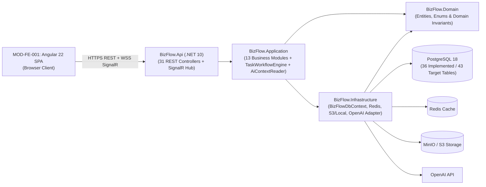
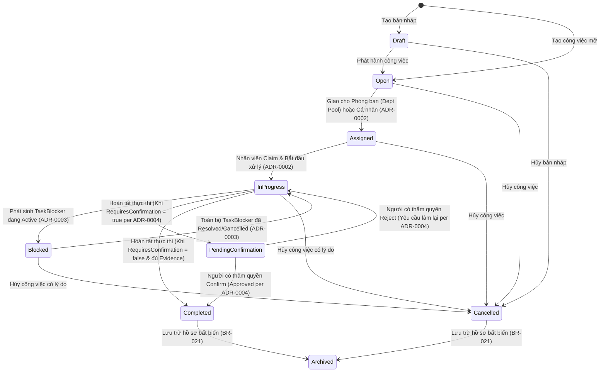

# ĐẶC TẢ HỆ THỐNG PHẦN MỀM (SOFTWARE SYSTEM SPECIFICATION — SSS)
## Dự án: AI-Assisted BizFlow Platform

---

## 0. Kiểm soát Tài liệu (Document Control)

| Thuộc tính | Giá trị |
| :--- | :--- |
| **Tên tài liệu** | Software System Specification (SSS) — AI-Assisted BizFlow Platform |
| **Mã tài liệu** | `BIZFLOW-SSS-v1.2` |
| **Phiên bản** | `1.2-DRAFT` |
| **Ngày phát hành** | `2026-10-18` (Cập nhật đồng bộ v1.2: `2026-10-21`) |
| **Trạng thái tài liệu** | `DRAFT — EVIDENCE-VERIFIED BASELINE (AWAITING OWNER SIGN-OFF ON 32 ODs)` |
| **Nhóm biên soạn** | Principal Software Architect, Senior Systems Analyst, Senior Technical Analyst, Senior Backend Architect, Senior Frontend Architect, Senior Security Architect, Senior AI Systems Architect, Senior QA & Reliability Engineer, Senior Technical Writer |
| **Tài liệu đầu vào trực tiếp** | [SRS_v1.0_DRAFT.md](../../requirements/srs/SRS_v1.0_DRAFT.md), [01-system-understanding.md](../../00-analysis/01-system-understanding.md), [02-architecture.md](../../00-analysis/02-architecture.md), [05-assumptions-and-ambiguities.md](../../00-analysis/05-assumptions-and-ambiguities.md), `ADR-0001` .. `ADR-0012`, `ADR-SSS-001` .. `ADR-SSS-010` |
| **Bộ tài liệu thành phần** | 1. [SSS_v1.0_DRAFT.md](SSS_v1.0_DRAFT.md) (Tài liệu chính) 2. [SOURCE_REGISTER.md](SOURCE_REGISTER.md) (`SRC-001..038`) 3. [MODULE_CATALOG.md](MODULE_CATALOG.md) (`MOD-001..015`, `MOD-FE-001`, `MOD-BG-001`) 4. [INTERFACE_CATALOG.md](INTERFACE_CATALOG.md) (`INT-001..032`) 5. [ARCHITECTURE_DECISIONS.md](ARCHITECTURE_DECISIONS.md) (`DEC-WS-001..002`, `ADR-0001..0012`, `ADR-SSS-001..010`) 6. [OPEN_DECISIONS.md](OPEN_DECISIONS.md) (`OD-001..032`) 7. [SSS_TRACEABILITY.md](SSS_TRACEABILITY.md) (Ma trận truy vết toàn diện) 8. [SSS_REVIEW_REPORT.md](SSS_REVIEW_REPORT.md) (Báo cáo kiểm định độc lập `BF-SSS-REV-2026-002`) 9. Thư mục sơ đồ: [01-system-context.md](diagrams/01-system-context.md), [02-container-runtime.md](diagrams/02-container-runtime.md), [03-module-dependencies.md](diagrams/03-module-dependencies.md), [04-sequence-workflows.md](diagrams/04-sequence-workflows.md) (`SEQ-001..010`), [05-deployment-view.md](diagrams/05-deployment-view.md), [06-data-and-integration-flow.md](diagrams/06-data-and-integration-flow.md) |

### Lịch sử Phiên bản (Revision History)

| Phiên bản | Ngày | Tác giả / Vai trò | Mô tả Thay đổi |
| :--- | :--- | :--- | :--- |
| `0.9-LEGACY` | `2026-10-17` | Nhóm Kiến trúc (Phiên trước tại `documents/SSS/`) | Bản thảo SSS đầu tiên; tuy nhiên tại thời điểm sinh `documents/SSS/IMPLEMENTATION_GAP_ANALYSIS.md`, môi trường chạy chưa truy cập được mã nguồn `.NET 10` / `Angular 22` nên đánh dấu `GAP-001..017` là `NOT VERIFIED`. |
| `1.0-DRAFT` | `2026-10-18` | Nhóm Chuyên gia Cấp Senior (`docs/specifications/sss/`) | Xây dựng bộ SSS chuẩn hóa dựa trên đối chiếu trực tiếp với [SRS_v1.0_DRAFT.md](../../requirements/srs/SRS_v1.0_DRAFT.md), 12 ADR (`ADR-0001..0012`), 19 REST Controllers, `Program.cs`, `BizFlowDbContext.cs` (36 bảng / 34 migrations), `frontend/src/app/app.routes.ts` (28 routes) và bộ kiểm thử tự động. |
| `1.1-DRAFT` | `2026-10-19` | Nhóm Chuyên gia Cấp Senior (`docs/specifications/sss/`) | Rà soát chuyên sâu Company Registration, Tenant Onboarding và Workspace Provisioning: Bổ sung `ADR-SSS-007` (khởi tạo nguyên tử & post-provisioning invariant guard), sơ đồ luồng `SEQ-007`, mở rộng `OD-021`..`OD-024`, làm rõ mô hình Self-Service Onboarding (`PROPOSED — NOT APPROVED`) song song với Admin-Approved Onboarding (`CONFIRMED`), cập nhật mã lỗi và ma trận truy vết 118 yêu cầu SRS. |
| `1.2-DRAFT` | `2026-10-21` | Nhóm Chuyên gia Cấp Senior (`docs/specifications/sss/`) | Đồng bộ hóa toàn diện 5 nhóm yêu cầu mới: Xác thực hợp nhất (Đăng nhập 3 trường & Email link), Workspace Selector modal (`IR-UI-005`), Đăng ký 6 trường + kiểm tra mã real-time + tải MinIO hồ sơ pháp lý, Thẩm định hồ sơ Platform Admin qua Presigned URL (`IR-UI-006`), Trợ lý Robot nhúng UI mặc định mở (`sessionStorage`), Vấn tin tự nhiên giới hạn quyền hạn & chống ảo giác (`BR-027`), Bóc tách việc AI có xác nhận con người bắt buộc (`BR-028`), Nhắc hạn đa kênh (In-app SignalR, Web Push VAPID, fallback Email) với bộ lọc chống trùng lặp (`OD-032`). Mở rộng 17 module (`MOD-001..015`, `MOD-FE-001`, `MOD-BG-001`), 32 giao diện (`INT-001..032`), 10 sequence workflows (`SEQ-001..010`), `ADR-SSS-008..010`, `OD-025..032` và ma trận truy vết 132 yêu cầu SRS. |

---

## 1. Giới thiệu (Introduction)

### 1.1. Mục đích của Tài liệu (Purpose)
Tài liệu **Software System Specification (SSS)** này đặc tả kiến trúc hệ thống, phân rã thành phần, ranh giới module, hợp đồng giao diện, cơ chế cô lập đa thuê bao (multi-tenant isolation), kiểm soát tích hợp AI, quản lý trạng thái quy trình, xử lý lỗi và kiến trúc kiểm thử cho nền tảng **AI-Assisted BizFlow Platform**.

SSS đóng vai trò là **cầu nối kỹ thuật trực tiếp** từ tài liệu Đặc tả Yêu cầu Phần mềm ([SRS_v1.0_DRAFT.md](../../requirements/srs/SRS_v1.0_DRAFT.md)) sang quá trình thiết kế chi tiết, lập trình, review code, kiểm thử tích hợp và triển khai vận hành.

### 1.2. Mối quan hệ với các Tài liệu Đặc tả Khác (Relationship to Other Specifications)

| Loại Tài liệu | Vị trí trong Workspace | Câu hỏi Trọng tâm | Vai trò so với SSS |
| :--- | :--- | :--- | :--- |
| **System Analysis & Scope Decisions** | [01-system-understanding.md](../../00-analysis/01-system-understanding.md), [05-assumptions-and-ambiguities.md](../../00-analysis/05-assumptions-and-ambiguities.md) | *Bài toán kinh doanh, quy tắc nghiệp vụ (`BR-001..030`) và phạm vi sản phẩm là gì?* | Cung cấp bối cảnh nghiệp vụ, mục tiêu kinh doanh (`BG-01..08`) và ràng buộc phạm vi MVP (`DEC-WS-001..002`). |
| **Software Requirements Specification (SRS)** | [SRS_v1.0_DRAFT.md](../../requirements/srs/SRS_v1.0_DRAFT.md) | *Hệ thống cần làm gì (`What`) và tiêu chí nghiệm thu là gì?* | Đầu vào trực tiếp của SSS (`132` yêu cầu nguyên tử: `68 FR`, `20 IR`, `17 DR`, `15 NFR`, `12 SEC`). |
| **Architecture Decision Records (ADRs)** | `docs/01-decisions/ADR-0001..0012` & [ARCHITECTURE_DECISIONS.md](ARCHITECTURE_DECISIONS.md) | *Tại sao hệ thống chọn giải pháp thiết kế này và các bất biến kiến trúc nào không được phép vi phạm?* | Định nghĩa các ranh giới thẩm quyền và quy tắc thiết kế bắt buộc mà SSS hiện thực hóa (`DEC-WS-001..002`, `ADR-0001..0012`, `ADR-SSS-001..010`). |
| **Software System Specification (SSS — Tài liệu này)** | [SSS_v1.0_DRAFT.md](SSS_v1.0_DRAFT.md) | *Hệ thống được cấu trúc, phân rã, giao tiếp, bảo vệ dữ liệu và vận hành như thế nào ở mức hệ thống (`System-Level How`)?* | Ánh xạ mọi yêu cầu SRS sang kiến trúc container, 17 module, 32 giao diện, 10 luồng tuần tự và chiến thuật chất lượng (`ARCH-*`). |
| **Database / API / Code Implementation** | `backend/` (`.NET 10`) & `frontend/` (`Angular 22`) | *Hệ thống được cài đặt cụ thể trong mã nguồn và lược đồ vật lý ra sao?* | Thực thi cụ thể các quy tắc của SSS và được kiểm chứng ngược lại qua [SSS_REVIEW_REPORT.md](SSS_REVIEW_REPORT.md). |

### 1.3. Quy ước Thuật ngữ và Nhãn Trạng thái (Definitions, Acronyms, and Status Labels)
Để không trộn lẫn giữa kế hoạch mục tiêu, đề xuất thiết kế và hiện trạng mã nguồn, tài liệu này sử dụng nhất quán bộ nhãn trạng thái sau:
- **`CONFIRMED`**: Quyết định hoặc cấu trúc kiến trúc đã được xác nhận trong các tài liệu có thẩm quyền (`ADR-0001..0012`, `ADR-SSS-008..010`, `DEC-WS-001..002`, `SRS_v1.0_DRAFT.md`).
- **`IMPLEMENTED`**: Thành phần đã được cài đặt và xác minh tồn tại thực tế trong mã nguồn `backend/` hoặc `frontend/` của repository hiện tại.
- **`PARTIAL`**: Thành phần đã được triển khai phần khung hoặc các luồng chính nhưng còn thiếu một số bảng dữ liệu hoặc tiến trình chạy ngầm so với kiến trúc mục tiêu.
- **`PROPOSED — NOT APPROVED`**: Phương án thiết kế hoặc khuyến nghị kiến trúc do nhóm biên soạn SSS đề xuất để giải quyết khoảng trống hoặc xung đột nguồn; **chưa được coi là quyết định đã phê duyệt**.
- **`OPEN`**: Vấn đề hoặc thông số vận hành còn mở, được theo dõi tại [OPEN_DECISIONS.md](OPEN_DECISIONS.md) (`OD-001..032`).

### 1.4. Cơ sở Nguồn Tham chiếu và Giả định Kỹ thuật (Source Basis and Assumptions)
Toàn bộ nội dung của SSS dựa trên `38` nguồn bằng chứng được kiểm kê tại [SOURCE_REGISTER.md](SOURCE_REGISTER.md) (`SRC-001..038`). Không có bất kỳ tính năng hay cam kết định lượng nào được tự suy diễn ngoài bằng chứng trong workspace.

---

## 2. Tổng quan Hệ thống (System Overview)

### 2.1. Tầm nhìn Sản phẩm và Bối cảnh Vận hành (Product Vision and Operational Context)
**AI-Assisted BizFlow Platform** là nền tảng phần mềm dạng dịch vụ đa thuê bao (**Multi-Tenant B2B SaaS**) giúp các doanh nghiệp chuẩn hóa và tập trung hóa quy trình tiếp nhận yêu cầu nội bộ (`Internal Service Requests`), điều phối phê duyệt (`Workflows & Approvals`), giao việc phòng ban/cá nhân (`WorkTasks`), theo dõi cam kết thời gian xử lý (`SLA`), lưu trữ bằng chứng hoàn thành (`CompletionEvidence`), hỗ trợ xử lý bằng trí tuệ nhân tạo có kiểm soát của con người (`Human-in-the-Loop AI Assistance`) và đảm bảo khả năng kiểm toán bất biến (`Immutable Auditability`).

### 2.2. Đường cơ sở Phạm vi MVP (Scope Baseline)
Tuân thủ tuyệt đối [05-assumptions-and-ambiguities.md](../../00-analysis/05-assumptions-and-ambiguities.md) và [SRS_v1.0_DRAFT.md](../../requirements/srs/SRS_v1.0_DRAFT.md):
1. **Mô hình Đa Thuê bao SaaS (`CONFIRMED`):** Phục vụ nhiều doanh nghiệp (`Company Tenants`) độc lập trên cùng hạ tầng triển khai; dữ liệu giữa các doanh nghiệp được cô lập nghiêm ngặt.
2. **Giới hạn Workspace trong MVP (`DEC-WS-001` — `CONFIRMED`):** Mỗi doanh nghiệp được phê duyệt trong MVP có **duy nhất 1 Workspace chính (`1 Company = 1 Primary Workspace`)**. Khả năng đa Workspace trong một doanh nghiệp là định hướng nâng cấp Enterprise trong tương lai.
3. **Loại trừ Thương mại & Thanh toán khỏi MVP (`DEC-WS-002` — `CONFIRMED`):** Billing, Payment Gateway, Subscription Management, Invoicing và Commercial Entitlements **không thuộc phạm vi MVP**.
4. **Mô hình Tiếp nhận Doanh nghiệp (Onboarding Model Baseline vs. Proposal):**
   - **Baseline Đã Xác nhận (`CONFIRMED` theo `FR-TEN-001`..`002`, `UC-001`):** Doanh nghiệp gửi đơn $\rightarrow$ đơn ở trạng thái `PENDING` $\rightarrow$ `PLATFORM_ADMIN` xem xét và phê duyệt thủ công tại `UI-02` $\rightarrow$ kích hoạt `Primary Tenant`.
   - **Phương án Đề xuất Multi-Tenant SaaS (`PROPOSED — NOT APPROVED` theo `FR-TEN-005`, `IR-UI-004`, `UC-013`, `ADR-SSS-007`, `OD-021`):** Điểm vào công khai `/register-company` (liên kết CTA từ `/login` `UI-01`); đại diện đăng ký thông tin công ty và tài khoản quản trị đầu tiên; sau khi hoàn tất **Xác minh Email (`Email Verification`, `OD-022`)**, hệ thống tự động khởi tạo nguyên tử **01 Primary Tenant (`DEC-WS-001`)** và gán vai trò `COMPANY_ADMIN` (hỗ trợ cờ cấu hình `Onboarding:ApprovalMode = "SelfService" | "PlatformAdminApproval"`).

### 2.3. Đối chiếu Kiến trúc Mục tiêu và Hiện trạng Triển khai trong Repository (Target vs. Current Implementation Summary)

| Khía cạnh Hệ thống | Kiến trúc Mục tiêu (`Target Architecture`) | Hiện trạng Mã nguồn (`Current Repository Implementation`) | Đánh giá Độ phủ |
| :--- | :--- | :--- | :--- |
| **Cấu trúc Solution & Phân tầng** | Modular Monolith trên `.NET 10` (`Api`, `Application`, `Domain`, `Infrastructure`) + `Angular 22` SPA | Đã triển khai đầy đủ 6 project trong [BizFlow.slnx](../../../BizFlow.slnx) (`BizFlow.Api`, `BizFlow.Application`, `BizFlow.Domain`, `BizFlow.Infrastructure`, `BizFlow.UnitTests`, `BizFlow.IntegrationTests`) và `frontend/`. | `IMPLEMENTED` (100% khung kiến trúc) |
| **Giao diện REST API & Real-Time** | Các nhóm endpoint nghiệp vụ + Kênh thông báo WebSocket thời gian thực | Đã triển khai **31 REST Controllers** trong `BizFlow.Api/Controllers/` và SignalR `NotificationHub` (`/hubs/notifications`). | `IMPLEMENTED` |
| **Giao diện Người dùng (Frontend)** | Ứng dụng SPA phân quyền theo vai trò và ngữ cảnh Tenant | Đã triển khai **28 định tuyến (`app.routes.ts`)** cùng `sessionGuard`, `tenantGuard`, `permissionGuard`. Tuyến `/register-company` và `/verify-email` đang ở mức đề xuất (`PROPOSED`). | `IMPLEMENTED` |
| **Cơ sở dữ liệu Quan hệ (PostgreSQL)** | 43 bảng thực thể nghiệp vụ mục tiêu (`SRC-001`) | `BizFlowDbContext.cs` đã triển khai **36 `DbSet<T>`** qua **34 bản EF Core Migrations**; còn thiếu **7 bảng** (`RoutingRule`, `ApprovalRule`, `ApprovalRuleVersion`, `ApprovalInstance`, `ApprovalStepInstance`, `SLAState`, `SLAEvent`). | `PARTIAL` (36/43 bảng đã có) |
| **Tiếp nhận & Cấp phát Tenant (`Onboarding`)** | Nộp đơn, xác minh email, cấp phát nguyên tử `Primary Tenant` + `COMPANY_ADMIN` kèm rollback (`ADR-SSS-007`) | Đã có thực thể `Company`, `Tenant`, cấu hình `HasIndex(CompanyId).IsUnique()` và `CompanyRegistrationsController` (`GET` queue); luồng tự động cấp phát và xác minh email đang ở mức đặc tả (`PROPOSED`). | `PARTIAL` (Schema `IMPLEMENTED`; Provisioning pipeline `PROPOSED`) |
| **Cô lập Đa Thuê bao & Bảo vệ Bất biến** | Cô lập 5 lớp, bộ lọc truy vấn tự động và chống xóa cứng/sửa lịch sử | Đã triển khai `ClaimsTenantContext`, `TenantMembershipAuthorizer`, `ConfigureTenantFilter<T>` (fail-closed) và chốt chặn trong `BizFlowDbContext.SaveChangesAsync`. | `IMPLEMENTED` |
| **Tích hợp AI có Kiểm soát (`ADR-0008`)** | 9 tính năng AI, lọc quyền qua `AiContextReader`, timeout `45s`, fallback an toàn, Human-in-the-Loop | Đã triển khai `AiAssistantService`, `AiContextReader`, `AiToolRegistry`, `AiActionDispatcher`, `OpenAiModelClient`. | `IMPLEMENTED` |
| **Tiến trình Xử lý Ngầm (`MOD-BG-001`)** | Hangfire Server / Background Workers quét SLA, gửi SMTP từ `EmailQueueItems`, xử lý `ReportExportJobs` | Các bảng hàng đợi (`EmailQueueItems`, `NotificationQueueItems`, `ReportExportJobs`) đã có trong DB, nhưng `Program.cs` **chưa đăng ký** Hangfire hoặc `BackgroundService`. | `PROPOSED` / `NOT YET WIRED` (`OD-020`) |

---

## 3. Các Động lực Kiến trúc (Architectural Drivers)

### 3.1. Động lực Kinh doanh (`Business Goals — BG-01 .. BG-08`)
Kiến trúc hệ thống được thiết kế để hiện thực hóa 8 mục tiêu kinh doanh cốt lõi từ [SRS_v1.0_DRAFT.md](../../requirements/srs/SRS_v1.0_DRAFT.md):
- **`BG-01` (Tập trung hóa tiếp nhận yêu cầu):** Thay thế trao đổi rời rạc bằng cổng dịch vụ có cấu trúc (`MOD-004`, `MOD-006`).
- **`BG-02` (Chuẩn hóa điều phối và phê duyệt):** Đảm bảo mọi yêu cầu và công việc đi qua bộ máy quy trình có kiểm soát (`MOD-007`, `ADR-0001`).
- **`BG-03` (Minh bạch hóa trách nhiệm và xác nhận hoàn thành):** Ràng buộc rõ người giao, người nhận (`Claim`), bằng chứng hoàn thành và người xác nhận (`MOD-005`, `MOD-010`, `ADR-0002`, `ADR-0004`).
- **`BG-04` (Kiểm soát thời hạn SLA):** Theo dõi hạn phản hồi và hạn giải quyết theo lịch làm việc doanh nghiệp (`MOD-008`).
- **`BG-05` (Tăng năng suất nhờ AI an toàn):** Giảm thao tác thủ công bằng 9 tính năng trợ lý AI nhưng giữ quyền quyết định cuối cùng cho con người (`MOD-012`, `ADR-0008`).
- **`BG-06` (Đảm bảo khả năng kiểm toán & tuân thủ):** Lưu vết bất biến mọi thay đổi trạng thái và quyền hạn (`MOD-013`, `ADR-0005`).
- **`BG-07` (Cung cấp góc nhìn quản trị theo phạm vi):** Báo cáo tức thời theo đúng cây phân cấp phòng ban (`MOD-011`, `BR-003`, `ADR-0011`).
- **`BG-08` (Vận hành SaaS đa doanh nghiệp an toàn):** Cô lập tuyệt đối dữ liệu giữa các công ty trên cùng hạ tầng (`MOD-002`, `ADR-0007`).

### 3.2. Động lực Chức năng Trọng yếu (Key Functional Drivers)
1. **Biểu mẫu động có phiên bản (`FR-SVC-002..004`):** Cấu trúc trường dữ liệu của từng loại dịch vụ thay đổi theo từng doanh nghiệp mà không cần sửa code hay tạo bảng DB mới.
2. **Máy trạng thái công việc nghiêm ngặt (`FR-TSK-001..008`, `ADR-0001..0004`, `ADR-0010`):** Hỗ trợ giao việc vào hàng đợi phòng ban (`Department Pool`), nhân viên nhận việc (`Claim`), báo cáo vướng mắc (`Blocked`), và vòng lặp xác nhận hoàn thành (`PendingConfirmation` $\leftrightarrow$ `InProgress` $\rightarrow$ `Completed`).
3. **Phân quyền đọc theo phạm vi phân cấp (`FR-ORG-001`, `FR-TSK-008`, `ADR-0011`):** Quyền truy cập không chỉ dựa trên vai trò tĩnh mà phụ thuộc vào vị trí của người dùng trên cây phòng ban (`ManagementScope`).

### 3.3. Động lực Thuộc tính Chất lượng (Quality Attribute Drivers)

| Mã Nhóm Chất lượng | Yêu cầu SRS Liên quan | Mục tiêu Kiến trúc Cốt lõi |
| :--- | :--- | :--- |
| **Cô lập Đa Thuê bao & Bảo mật (`Security & Multi-Tenancy`)** | `SEC-TEN-001..003`, `SEC-AUTH-001..002`, `SEC-AUTHZ-001..002`, `SEC-DATA-001..003`, `SEC-AI-001..002` | Không để xảy ra bất kỳ rò rỉ dữ liệu nào giữa các Tenant; trả về `404 Not Found` khi truy cập ngoài phạm vi (`ADR-0012`); lọc ngữ cảnh AI theo quyền người gọi (`AiContextReader`). |
| **Toàn vẹn Quy trình & Kiểm toán (`Integrity & Auditability`)** | `SEC-AUD-001..002`, `DR-008..009`, `DR-015`, `NFR-REL-001` | Cấm xóa cứng dữ liệu nghiệp vụ; cấm sửa đổi các bảng lịch sử/kiểm toán (`Append-Only`); ghi lịch sử và audit trong cùng transaction với thay đổi nghiệp vụ (`ADR-0005`). |
| **Độ tin cậy & Chịu lỗi Tích hợp Ngoài (`Reliability & Resilience`)** | `NFR-REL-002..003`, `NFR-AVAIL-001`, `IR-EXT-001..003` | Khi OpenAI API, Redis hoặc SMTP gặp sự cố, các luồng tạo/xử lý Request và Task cốt lõi vẫn phải hoạt động bình thường (`Graceful Degradation`). |
| **Khả năng Bảo trì & Tiến hóa (`Maintainability & Evolvability`)** | `NFR-MAINT-001..002`, `NFR-SCAL-001`, `DEC-WS-001` | Tách biệt rõ 13 module nghiệp vụ trong kiến trúc Modular Monolith; sẵn sàng mở rộng từ 1 Workspace lên đa Workspace hoặc tách worker độc lập khi quy mô tăng. |

### 3.4. Ràng buộc Kỹ thuật và Tổ chức (Technical and Organizational Constraints)
- **Công nghệ Cốt lõi (`CONFIRMED`):** Frontend `Angular 22` + `TypeScript`; Backend `ASP.NET Core .NET 10` (`C#`); CSDL chính `PostgreSQL 18`; Cache `Redis`; Lưu trữ tệp `MinIO / S3-compatible` (kèm `LocalStorageProvider` fallback); Nhà cung cấp AI `OpenAI API`.
- **Phong cách Kiến trúc (`CONFIRMED`):** **Modular Monolith** giao tiếp qua REST API và SignalR WebSocket (không phân mảnh thành Microservices trong giai đoạn hiện tại).

---

## 4. Tổng quan Kiến trúc Hệ thống (Architecture Overview)

### 4.1. Phong cách Kiến trúc Đã Chọn: Clean Modular Monolith (`CONFIRMED`)
Hệ thống áp dụng kiến trúc **Modular Monolith kết hợp phân lớp Clean Architecture**:
1. **Triển khai Đơn khối Hợp nhất (Unified Deployment Unit):** Toàn bộ 13 module nghiệp vụ Backend được biên dịch và đóng gói trong một giải pháp `.NET 10` thống nhất ([BizFlow.slnx](../../../BizFlow.slnx)), giúp đảm bảo tính nhất quán giao dịch ACID trên PostgreSQL 18 và loại bỏ độ trễ/độ phức tạp mạng nội bộ của Microservices.
2. **Phân rã Module Rõ ràng (Strict Logical Modularity):** Mỗi miền nghiệp vụ (`Auth`, `Tenant`, `Organization`, `ServiceCatalog`, `Tasks`, `Requests`, `Workflows`, `Sla`, `Notifications`, `Collaboration`, `Reports`, `Ai`, `Audit`) có ranh giới trách nhiệm, DTO, Application Service và quyền sở hữu bảng dữ liệu riêng biệt.

### 4.2. Cấu trúc Hệ thống Cấp Cao (High-Level System Structure)
Chi tiết sơ đồ kiến trúc Container và Runtime (bao gồm đối chiếu giữa **Target Architecture** và **Current Implementation**) được đặc tả tại [02-container-runtime.md](diagrams/02-container-runtime.md).

### 4.3. Các Nguyên tắc Kiến trúc Cốt lõi (Key Architectural Principles)
1. **Defense-in-Depth Multi-Tenancy (`ADR-0007`, `ADR-SSS-001`):** Không tin tưởng bất kỳ lớp đơn lẻ nào; cô lập Tenant được thực thi từ Route Guard $\rightarrow$ Middleware $\rightarrow$ Application Policy $\rightarrow$ EF Core Global Query Filter (Fail-Closed) $\rightarrow$ `SaveChangesAsync` Write Guard.
2. **Single Authority for Lifecycle Transitions (`ADR-0001`):** Mọi chuyển đổi trạng thái của `WorkTask` phải đi qua `IWorkflowEngine` (`TaskWorkflowEngine`); tầng DB Context chặn mọi nỗ lực ghi tắt.
3. **Human-in-the-Loop AI (`ADR-0008`):** AI chỉ đọc dữ liệu trong phạm vi quyền của người gọi (`AiContextReader`) và chỉ đưa ra đề xuất (`AiSuggestion`); mọi hành động thay đổi nghiệp vụ phải được con người xác nhận.
4. **Immutable History & Append-Only Audit (`ADR-0005`):** Không xóa cứng dữ liệu nghiệp vụ; mọi bảng lịch sử và kiểm toán chỉ cho phép ghi thêm (`Append-Only`).
5. **Non-Revealing Authorization Semantics (`ADR-0012`):** Khi truy vấn bản ghi cụ thể theo ID ngoài phạm vi quyền hoặc khác Tenant, luôn trả về `404 Not Found` để chống dò quét định danh.

---

## 5. Ngữ cảnh Hệ thống và Các Tác nhân Bên ngoài (System Context and External Actors)

Sơ đồ ngữ cảnh chi tiết được trình bày tại [01-system-context.md](diagrams/01-system-context.md).

### 5.1. Danh mục Tác nhân Con người (Human Actors)

| Mã Tác nhân | Tên Vai trò | Phạm vi Hoạt động | Trách nhiệm Chính trên Hệ thống |
| :--- | :--- | :--- | :--- |
| `ACT-ANON` | **Anonymous Visitor / Applicant** | Public (Chưa xác thực) | Gửi hồ sơ đăng ký doanh nghiệp mới (`CompanyRegistrationRequest`), đăng nhập, yêu cầu đặt lại mật khẩu. |
| `ACT-PA` | **Platform Super Admin** | Toàn nền tảng (`Platform Scope`) | Xét duyệt/từ chối hồ sơ đăng ký doanh nghiệp, tạm ngưng (`Suspend`) hoặc kích hoạt lại (`Activate`) Tenant, tra cứu Platform Audit Log. Không can thiệp vào xử lý công việc nội bộ hàng ngày của từng Tenant. |
| `ACT-CA` | **Company Admin / Owner** | Trong phạm vi 1 Tenant (`Tenant Scope`) | Thiết lập cơ cấu phòng ban, quản lý tài khoản nhân sự, cấu hình vai trò/quyền hạn (RBAC), định nghĩa danh mục dịch vụ & biểu mẫu động, cấu hình quy trình workflow, SLA, lịch làm việc và chính sách AI của công ty. |
| `ACT-MGR` | **Department Manager** | Phạm vi cây phòng ban quản lý (`ManagementScope` — `BR-003`) | Giám sát công việc của phòng ban mình và các phòng ban con, giao việc/điều phối lại công việc, xử lý vướng mắc (`TaskBlocker`), xác nhận hoàn thành (`Confirm`/`Reject`), xem báo cáo phòng ban và SLA. |
| `ACT-APR` | **Approver** | Theo quy tắc phê duyệt (`Approval Scope`) | Xem xét và đưa ra quyết định Phê duyệt (`Approve`), Từ chối (`Reject`) hoặc Yêu cầu bổ sung thông tin (`Return for Info`) đối với các `RequestRecord` cần phê duyệt. |
| `ACT-EMP` | **Staff / Employee (Requester & Assignee)** | Cá nhân & Hàng đợi phòng ban (`Own / Assigned / Dept Pool`) | Gửi yêu cầu dịch vụ nội bộ (`Request`), nhận việc từ hàng đợi phòng ban (`Claim`), thực thi `WorkTask`, đính kèm bằng chứng hoàn thành (`CompletionEvidence`), cộng tác qua bình luận và sử dụng trợ lý AI. |
| `ACT-AUD` | **Internal Auditor** | Chỉ đọc trong phạm vi Tenant (`Read-Only Tenant Audit Scope`) | Tra cứu nhật ký kiểm toán (`AuditLog`) và hồ sơ lưu trữ (`ArchivedRecordView`) phục vụ kiểm tra tuân thủ nội bộ. |

### 5.2. Tác nhân Hệ thống và Dịch vụ Bên ngoài (Internal & External System Actors)
1. **OpenAI API (`External AI Provider` — `INT-025`):** Cung cấp khả năng suy luận ngôn ngữ lớn qua HTTPS REST (`OpenAiModelClient`). Là thành phần tùy chọn/có thể suy giảm an toàn (`Optional / Fail-Safe Dependency`).
2. **MinIO / S3-Compatible Object Storage (`External Storage` — `INT-024`):** Lưu trữ luồng byte của `Attachment` và `CompletionEvidence` trong các bucket riêng tư phân vùng theo `{tenantId}/`.
3. **SMTP / Email Relay (`External Messaging` — `INT-026`):** Chuyển phát email thông báo ra ngoài dựa trên hàng đợi `EmailQueueItems`.
4. **Internal Timer / Background Worker (`MOD-BG-001` — `INT-020`, `INT-021`):** Tác nhân thời gian nội bộ chịu trách nhiệm đánh giá hạn SLA định kỳ, quét hàng đợi Outbox và thực thi các tác vụ xuất báo cáo/lưu trữ tự động.

### 5.3. Ranh giới Tin cậy (Trust Boundaries)
- **`TB-01` (Public Internet $\leftrightarrow$ BizFlow API Edge):** Mọi lưu lượng từ trình duyệt đều không được tin cậy; phải đi qua TLS, Rate Limiting, xác thực chữ ký JWT (`AddBizFlowAuthentication`), kiểm tra phiên và kiểm tra dữ liệu đầu vào.
- **`TB-02` (Tenant Context Boundary):** Ngữ cảnh `TenantId` chỉ được phép lấy từ JWT đã xác thực (`ClaimsTenantContext`) và phải vượt qua `TenantMembershipAuthorizer` trước khi chạm tới logic nghiệp vụ.
- **`TB-03` (Application $\leftrightarrow$ Persistence Boundary):** `BizFlowDbContext` đóng vai trò rào chắn cuối cùng với bộ lọc `HasQueryFilter` fail-closed và chốt chặn `SaveChangesAsync`.
- **`TB-04` (BizFlow $\leftrightarrow$ External OpenAI Boundary):** Dữ liệu gửi ra ngoài cho OpenAI phải được lọc qua `AiContextReader`; phản hồi từ OpenAI được coi là đầu vào không tin cậy (`Untrusted Output`), phải qua bước kiểm tra schema và chỉ được lưu làm đề xuất (`AiSuggestion`).

---

## 6. Phân rã Hệ thống con và Module (Subsystem and Module Decomposition)

Hệ thống được phân rã thành **17 module** (gồm 15 module nghiệp vụ Backend `MOD-001..015`, 1 module giao diện `MOD-FE-001` và 1 module xử lý ngầm `MOD-BG-001`). Đặc tả đầy đủ 13 thuộc tính của từng module (Mục đích, Trách nhiệm, Không chịu trách nhiệm, Đầu vào, Đầu ra, Sở hữu dữ liệu, Phụ thuộc, Giao diện, Bảo mật, Yêu cầu SRS, Kiểm thử, Trạng thái) được trình bày chi tiết tại [MODULE_CATALOG.md](MODULE_CATALOG.md).

| Mã Module | Tên Module | Các Lớp/Controller Đại diện trong Codebase | Bảng Dữ liệu Sở hữu Chính | Trạng thái |
| :--- | :--- | :--- | :--- | :--- |
| `MOD-001` | **Identity & Authentication** | `AuthController`, `EmailLinkAuthController`, `AccountController`, `SessionsController`, `ClaimsTenantContext` | `PasswordCredentials`, `UserSessions`, `RefreshTokens`, `PasswordResetTokens`, `EmailLoginTokens` | `PARTIAL` (ID login `IMPLEMENTED`; Email-link `NOT_IMPLEMENTED`) |
| `MOD-002` | **Tenant & Workspace Management** | `CompanyRegistrationsController`, `TenantCodeAndDocumentController`, `PlatformTenantsController`, `WorkspacesController`, `TenantSettingsController`, `TenantMembershipAuthorizer` | `Tenants`, `Workspaces`, `TenantSettings`, `CompanyRegistrationRequests` (`Companies`), `CompanyRegistrationDocuments` | `PARTIAL` (Read queue `IMPLEMENTED`; 6 fields + MinIO docs `NOT_IMPLEMENTED`) |
| `MOD-003` | **Organization & Access Control (RBAC)** | `OrganizationController`, `UsersController`, `DepartmentsController`, `RolesController`, `PermissionsController`, `MembershipsController` | `Users`, `Departments`, `Roles`, `Permissions`, `RolePermissions`, `UserRoles`, `DepartmentMemberships` | `IMPLEMENTED` |
| `MOD-004` | **Service Catalog & Form Builder** | `ServiceCategoriesController`, `ServicesController`, `FormsController` | `ServiceCategories`, `ServiceTypes`, `FormDefinitions`, `FormFields` | `IMPLEMENTED` |
| `MOD-005` | **Task Management & Execution** | `TasksController`, `TaskBlockersController`, `ConfirmationsController` | `WorkTasks`, `TaskAssignments`, `TaskBlockers`, `TaskHistories`, `Confirmations` | `IMPLEMENTED` |
| `MOD-006` | **Request Management** | `RequestsController`, `ApprovalsController` | `RequestRecords`, `RequestFieldValues`, `RequestHistories`, `RequestTaskLinks` | `IMPLEMENTED` |
| `MOD-007` | **Workflow, Routing & Approval Engine** | `WorkflowsController`, `TaskWorkflowEngine` | Đã có: `WorkflowDefinitions`, `WorkflowVersions`, `WorkflowSteps`, `WorkflowInstances`. Mục tiêu: `RoutingRules`, `ApprovalRules`, `ApprovalRuleVersions`, `ApprovalInstances`, `ApprovalStepInstances` | `PARTIAL` |
| `MOD-008` | **SLA & Calendar Management** | `SlaProfilesController`, `CalendarsController` | Đã có: `SlaProfiles`, `Holidays`, `WorkingHours`. Mục tiêu: `SLAStates`, `SLAEvents` | `PARTIAL` |
| `MOD-009` | **Notification & Real-Time Hub** | `NotificationsController`, `NotificationHub` | `Notifications`, `NotificationPreferences`, `NotificationQueueItems`, `EmailQueueItems`, `NotificationConnections` | `PARTIAL` |
| `MOD-010` | **Collaboration, Evidence & Archival** | `CommentsController`, `AttachmentsController`, `EvidenceController`, `RecordsController` | `Comments`, `Attachments`, `CompletionEvidences`, `ArchivedRecordViews` | `IMPLEMENTED` |
| `MOD-011` | **Reporting, Analytics & Dashboard** | `DashboardController`, `ReportsController`, `ReportExportsController` | `ReportExportJobs`, `ReportSnapshots` | `IMPLEMENTED` |
| `MOD-012` | **AI Assistant & Governance** | `AiAssistantController`, `AiGovernanceController`, `AiAssistantService`, `AiContextReader`, `OpenAiModelClient` | `AiSuggestions`, `AiConfigs`, `AiExecutionLogs` | `IMPLEMENTED` |
| `MOD-013` | **Audit & Security Compliance** | `AuditController`, `PlatformAuditController` | `AuditLogs`, `SecurityEvents` | `IMPLEMENTED` |
| `MOD-014` | **Robot Chatbot & Natural Language Assistance** | `RobotAssistantController`, `AiTaskDecompositionController` | `RobotConversations`, `RobotMessages` | `NOT_IMPLEMENTED` |
| `MOD-015` | **Deadline Reminder & Multi-Channel Dispatcher** | `DeadlineReminderController`, `DeadlineReminderWorker` | `DeadlineReminderSchedules`, `PushSubscriptions`, `NotificationLogs` | `NOT_IMPLEMENTED` |
| `MOD-FE-001` | **Frontend SPA (Angular 22)** | `frontend/src/app/` (28 routes, Guards, Interceptors, Feature Components, Robot Widget) | Client Session, View State & Robot State (`sessionStorage`) | `IMPLEMENTED` |
| `MOD-BG-001` | **Background Job & Timer Worker** | Dự kiến: Hangfire / `IHostedService` consumers (`DeadlineReminderWorker`, SLA Evaluator) | Tiêu thụ `EmailQueueItems`, `NotificationQueueItems`, `ReportExportJobs`, `DeadlineReminderSchedules` | `PROPOSED` (`ADR-SSS-002`) |

---

## 7. Quy tắc Phụ thuộc giữa các Module (Module Dependency Rules)

Sơ đồ phụ thuộc vật lý và logic giữa các module được minh họa tại [03-module-dependencies.md](diagrams/03-module-dependencies.md).

### 7.1. Quy tắc Phụ thuộc Phân tầng Bất biến (Acyclic Tier Dependency Rules)
1. **Quy tắc Assembly (.NET Projects):**
   - `BizFlow.Domain` không phụ thuộc vào bất kỳ project nào khác.
   - `BizFlow.Application` chỉ phụ thuộc vào `BizFlow.Domain`.
   - `BizFlow.Infrastructure` phụ thuộc vào `BizFlow.Application` và `BizFlow.Domain` để hiện thực hóa các interface (`ITenantContext`, `IObjectStorageProvider`, `IBizFlowCacheService`, `IAiModelClient`).
   - `BizFlow.Api` phụ thuộc vào `BizFlow.Application` và chỉ tham chiếu `BizFlow.Infrastructure` tại Composition Root (`Program.cs`) để đăng ký Dependency Injection.
2. **Quy tắc 4 Tầng Nghiệp vụ (Capability Tiers):**
   - **Tầng 1 (`Foundation`: `MOD-001`, `MOD-002`, `MOD-009`, `MOD-013`, `MOD-015`)** $\leftarrow$ **Tầng 2 (`Configuration`: `MOD-003`, `MOD-004`)** $\leftarrow$ **Tầng 3 (`Execution`: `MOD-005`, `MOD-006`, `MOD-007`, `MOD-008`, `MOD-010`)** $\leftarrow$ **Tầng 4 (`Intelligence & Analytics`: `MOD-011`, `MOD-012`, `MOD-014`)**.
   - Các module ở tầng thấp hơn **không bao giờ** được gọi trực tiếp dịch vụ của tầng cao hơn.

### 7.2. Quy tắc Sở hữu Ghi và Truy cập Dữ liệu Liên Module (Data Access & Mutation Rules)
- **Độc quyền Ghi Vòng đời Task (`ADR-0001`):** Chỉ `TaskWorkflowEngine` (`MOD-007`) được phép gọi `WorkTask.MarkWorkflowMutation()` để thay đổi các trường vòng đời của `WorkTask`.
- **Cấm AI Ghi Trực tiếp (`ADR-0008` & `ADR-SSS-009`):** `MOD-012` (`AI Assistant`) và `MOD-014` (`Robot Chatbot`) chỉ đọc qua `AiContextReader` và chỉ phát lệnh tạo việc sau khi có xác nhận rõ ràng của con người (`BR-028`).
- **Tích hợp Đồng bộ vs. Bất đồng bộ:**
  - *Trong cùng giao dịch ACID:* Cập nhật trạng thái `WorkTask`/`RequestRecord` + ghi `TaskHistory`/`RequestHistory` + ghi `AuditLog` + xếp hàng `NotificationQueueItem`/`EmailQueueItem` (`ADR-0005`).
  - *Tách rời bất đồng bộ (Outbox):* Việc gửi email qua SMTP bên ngoài hoặc đẩy thông báo/xuất báo cáo không được phép làm rollback giao dịch nghiệp vụ đã cam kết.

---

## 8. Kiến trúc Runtime và Các Luồng Nghiệp vụ Trọng yếu (Runtime Architecture and Important Workflows)

Toàn bộ 10 sơ đồ tuần tự chi tiết (`SEQ-001` .. `SEQ-010`) được đặc tả tại [04-sequence-workflows.md](diagrams/04-sequence-workflows.md):

| Mã Luồng | Tên Luồng Runtime | Các Thành phần Tham gia Chính | Yêu cầu & ADR Liên quan | Hiện trạng trong Codebase |
| :--- | :--- | :--- | :--- | :--- |
| `SEQ-001` | **Xác thực, Thiết lập Ngữ cảnh Tenant & Kiểm tra Quyền hạn** | `MOD-FE-001` $\rightarrow$ `AuthController` $\rightarrow$ `ClaimsTenantContext` $\rightarrow$ `TenantMembershipAuthorizer` $\rightarrow$ `BizFlowDbContext` | `FR-AUTH-001..005`, `ADR-0007`, `ADR-0009` | `IMPLEMENTED` |
| `SEQ-002` | **Tiếp nhận Yêu cầu Nội bộ, Kiểm tra Form Động & Định tuyến** | `RequestsController` $\rightarrow$ `RequestService` $\rightarrow$ `ServiceCatalog` $\rightarrow$ `Workflow/SLA` $\rightarrow$ `AuditLog` & `NotificationHub` | `FR-REQ-001..005`, `FR-SVC-003`, `FR-WF-003`, `FR-SLA-003` | `PARTIAL` (Intake, Form validation, Task link `IMPLEMENTED`; `RoutingRule`/`ApprovalInstance`/`SLAState` `PROPOSED`) |
| `SEQ-003` | **Hỗ trợ Xử lý bằng AI có Kiểm soát Con người (`Human-in-the-Loop`)** | `AiAssistantController` $\rightarrow$ `AiAssistantService` $\rightarrow$ `AiContextReader` $\rightarrow$ `OpenAiModelClient` $\rightarrow$ `AiActionDispatcher` | `FR-AI-001..009`, `ADR-0008`, `SEC-AI-001..002` | `IMPLEMENTED` |
| `SEQ-004` | **Giao việc Phòng ban, Nhân viên Nhận việc (`Claim`) & Xác nhận Hoàn thành** | `TasksController` $\rightarrow$ `TaskWorkflowEngine` $\rightarrow$ `EvidenceController` $\rightarrow$ `ConfirmationsController` $\rightarrow$ `BizFlowDbContext` | `FR-TSK-002..006`, `FR-COL-003`, `ADR-0001..0004`, `ADR-0010` | `IMPLEMENTED` |
| `SEQ-005` | **Ngăn chặn Truy cập Trái phép Liên Tenant (`Defense-in-Depth`)** | `TenantMembershipAuthorizer` $\rightarrow$ Scoped Read Policy $\rightarrow$ EF Core `HasQueryFilter` $\rightarrow$ `404 Not Found` | `SEC-TEN-001..003`, `ADR-0007`, `ADR-0011`, `ADR-0012` | `IMPLEMENTED` |
| `SEQ-006` | **Xử lý Lỗi Nhà cung cấp Bên ngoài & Chế độ Suy giảm An toàn** | `AiAssistantService` $\rightarrow$ `OpenAiModelClient` (Timeout `45s`) $\rightarrow$ `AiExecutionLog` $\rightarrow$ Deterministic Fallback | `NFR-REL-002..003`, `IR-EXT-001`, `ADR-0008` | `IMPLEMENTED` |
| `SEQ-007` | **Đăng ký Doanh nghiệp, Xác minh Email & Khởi tạo Nguyên tử Primary Tenant kèm Rollback** | `MOD-FE-001` (`/register-company`) $\rightarrow$ `BizFlow.Api` $\rightarrow$ `TenantOnboardingService` (`MOD-002`) $\rightarrow$ `BizFlowDbContext` (Unit of Work) $\rightarrow$ Post-Provisioning Invariant Guard $\rightarrow$ `EmailQueueItems` (`MOD-009`) | `FR-TEN-001..005`, `IR-UI-004`, `IR-EXT-002`, `BR-023`, `BR-024`, `DEC-WS-001`, `ADR-SSS-007`, `OD-021..024` | `PARTIAL` (Thực thể & DB Unique constraint `IMPLEMENTED`; Quy trình tự động cấp phát & kiểm tra bất biến `PROPOSED` per `ADR-SSS-007`) |
| `SEQ-008` | **Đăng nhập Hợp nhất & Đăng nhập Không Mật khẩu qua Email Link kèm Bộ chọn Workspace** | `MOD-FE-001` $\rightarrow$ `AuthController` / `EmailLinkAuthController` $\rightarrow$ `WorkspaceSelectorModal` (`IR-UI-005`) $\rightarrow$ `ClaimsTenantContext` | `FR-AUTH-001`, `FR-AUTH-005`, `IR-UI-005`, `IR-API-004`, `BR-025`, `ADR-SSS-008`, `OD-025` | `PARTIAL` (ID login `IMPLEMENTED`; Email link & selector `NOT_IMPLEMENTED`) |
| `SEQ-009` | **Trợ lý Robot Nhúng UI & Bóc tách Việc AI có Xác nhận Con người Bắt buộc** | `RobotWidget` $\rightarrow$ `AiAssistantController` $\rightarrow$ `AiContextReader` $\rightarrow$ `PreviewChecklistUI` $\rightarrow$ `TaskWorkflowEngine` $\rightarrow$ `BizFlowDbContext` | `FR-AI-011..013`, `IR-API-006`, `BR-027..029`, `ADR-SSS-009`, `OD-028..030` | `NOT_IMPLEMENTED` |
| `SEQ-010` | **Vòng đời Cấu hình & Phát Thông báo Nhắc Hạn Đa Kênh Tự động** | `DeadlineReminderController` $\rightarrow$ `DeadlineReminderWorker` $\rightarrow$ `NotificationHub` $\rightarrow$ W3C Web Push $\rightarrow$ SMTP Fallback | `FR-NOTIF-003..004`, `IR-API-007`, `IR-EXT-003`, `BR-030`, `ADR-SSS-010`, `OD-031..032` | `NOT_IMPLEMENTED` |

---

## 9. Kiến trúc API và Giao diện Tích hợp (API and Interface Architecture)

Danh mục đầy đủ `32` giao diện hệ thống (`INT-001` .. `INT-032`) được đặc tả tại [INTERFACE_CATALOG.md](INTERFACE_CATALOG.md).

### 9.1. Nguyên tắc Thiết kế REST API và Hợp đồng UI–Backend
1. **Định dạng và Giao thức:** Toàn bộ API nghiệp vụ sử dụng HTTPS REST với payload `application/json` (trừ endpoint tải tệp dùng `multipart/form-data` và tải xuống dùng luồng nhị phân / Presigned URL).
2. **Xác thực và Ngữ cảnh:** Mọi request bảo vệ phải truyền `Authorization: Bearer <AccessToken>`. Backend trích xuất `CurrentUserId`, `CurrentTenantId`, `CurrentWorkspaceId` trực tiếp từ các claim đã ký trong JWT qua `ClaimsTenantContext` (`INT-015`).
3. **Chuẩn hóa Phản hồi Lỗi (`ApiExceptionHandler.cs`):** Mọi lỗi đều trả về cấu trúc chuẩn `ProblemDetails` (RFC 7807/9457) chứa `status`, `title`, `detail`, `errorCode` (mã lỗi định danh máy đọc được) và `traceId` (khớp với nhật ký Serilog).
4. **Kiểm soát Tốc độ (`Rate Limiting`):** `Program.cs` kích hoạt `app.UseRateLimiter()` để bảo vệ các endpoint nhạy cảm (đăng nhập, đăng ký công ty, đặt lại mật khẩu, gọi AI Assistant) khỏi tấn công vét cạn hoặc lạm dụng tài nguyên.
5. **Giao tiếp Thời gian Thực (`SignalR`):** Kênh `/hubs/notifications` (`INT-012`) sử dụng WebSocket có xác thực JWT và bật `CloseOnAuthenticationExpiration = true` để tự động ngắt kết nối ngay khi phiên làm việc hết hạn.

---

## 10. Kiến trúc Dữ liệu và Quyền Sở hữu Dữ liệu (Data Architecture and Ownership)

Sơ đồ sở hữu dữ liệu và đối chiếu bảng được trình bày tại [06-data-and-integration-flow.md](diagrams/06-data-and-integration-flow.md).

### 10.1. Chiến lược Cơ sở Dữ liệu và Đối chiếu 36/43 Bảng (`Target vs. Current DB Schema`)
- **Hệ quản trị CSDL chính:** **PostgreSQL 18** được truy cập qua **Entity Framework Core 10 (`Npgsql`)**.
- **Hiện trạng trong `BizFlowDbContext.cs` (`SRC-025`):**
  - Đã triển khai **36 `DbSet<T>`** qua **34 bản migration** (`SRC-026`), bao phủ đầy đủ các phân hệ: Tenant/Workspace (4), Auth/Session (4), Organization/RBAC (7), Service Catalog/Form (4), Request (4), Task/Blocker/Confirmation (5), Workflow core (4), SLA config (3), Notification/Queue/Connection (5), Collaboration/Evidence/Archive (4), Reporting (2), AI (3), Audit/Security (2) *(Lưu ý: một số thực thể dùng chung hoặc mở rộng kỹ thuật nâng tổng số `DbSet` thực tế trong `BizFlowDbContext` lên đúng 36 bảng)*.
  - **7 bảng mục tiêu chưa được tạo trong `BizFlowDbContext` (`PARTIAL GAP`):**
    1. `RoutingRule` (`MOD-007` — `OD-001`)
    2. `ApprovalRule` (`MOD-007` — `OD-002`)
    3. `ApprovalRuleVersion` (`MOD-007` — `OD-002`)
    4. `ApprovalInstance` (`MOD-007` — `OD-002`)
    5. `ApprovalStepInstance` (`MOD-007` — `OD-002`)
    6. `SLAState` (`MOD-008` — `OD-003`)
    7. `SLAEvent` (`MOD-008` — `OD-003`)

### 10.2. Các Chốt chặn Bất biến ở Tầng Persistence (`BizFlowDbContext.SaveChangesAsync`)
Kiểm tra trực tiếp mã nguồn [BizFlowDbContext.cs](../../../backend/BizFlow.Infrastructure/Persistence/BizFlowDbContext.cs) xác nhận 5 cơ chế bảo vệ dữ liệu cốt lõi đã được cài đặt:
1. **Cấm Lưu Đồng bộ (`No Synchronous SaveChanges`):** Phương thức `SaveChanges(bool)` ném `NotSupportedException("Use SaveChangesAsync to enforce persistence guards.")`.
2. **Cấm Xóa Cứng (`No Hard Delete`):** Mọi thực thể ở trạng thái `EntityState.Deleted` đều bị chặn với ngoại lệ `PERSISTENCE.HARD_DELETE_DENIED`. Hệ thống chỉ cho phép xóa mềm (`Soft Delete`), hủy (`Cancelled`), vô hiệu hóa (`Inactive`) hoặc lưu trữ (`Archived`).
3. **Bảo vệ Cột Bất biến (`Immutable Columns Guard`):** Khi cập nhật (`EntityState.Modified`), nếu bất kỳ cột định danh sở hữu nào (`TenantId`, `WorkspaceId`, `CreatedBy`, `CreatedAt`, `RequesterUserId`...) bị thay đổi, hệ thống ném lỗi `PERSISTENCE.IMMUTABLE_FIELD`.
4. **Cưỡng chế Cổng Workflow cho `WorkTask` (`ValidateTaskWorkflowMutations`):** Nếu bất kỳ cột vòng đời nào của `WorkTask` (`Status`, `WorkflowInstanceId`, `WorkflowStepId`, `CompletedAt`, `CancelledAt`, `ArchivedAt`) bị sửa mà không có dấu xác nhận `HasWorkflowMutation` từ `TaskWorkflowEngine`, giao dịch bị hủy ngay lập tức.
5. **Cưỡng chế Bất biến Xác nhận Hoàn thành (`ValidateConfirmationInvariants`):** Đảm bảo không thể chuyển `WorkTask` có `RequiresConfirmation = true` sang `Completed` nếu thiếu bản ghi `Confirmation` hợp lệ (`ADR-0004`).

---

## 11. Kiến trúc SaaS Đa Thuê bao (Multi-Tenant SaaS Architecture)

### 11.1. Mô hình Thuê bao và Không gian Làm việc (`DEC-WS-001`)
- Mỗi doanh nghiệp khách hàng là một `Tenant` độc lập.
- Trong phạm vi MVP (`DEC-WS-001`), mỗi `Tenant` có **1 `Workspace` chính mặc định**. Tuy nhiên, các bảng dữ liệu nghiệp vụ đã được thiết kế sẵn cả `TenantId` và `WorkspaceId` để khi nâng cấp lên gói Enterprise (cho phép 1 công ty có nhiều Workspace độc lập theo chi nhánh/công ty thành viên), hệ thống không phải thay đổi cấu trúc khóa ngoại cốt lõi.

### 11.2. Chiến lược Cô lập Đa Thuê bao 5 Lớp (`5-Layer Defense-in-Depth Isolation`)
Chi tiết sơ đồ 5 lớp cô lập được minh họa tại [06-data-and-integration-flow.md](diagrams/06-data-and-integration-flow.md):
- **Lớp 1 — Giao diện & Cổng API (`Edge & Route Layer`):** Angular `tenantGuard` kiểm tra phía trình duyệt; Backend `ClaimsTenantContext` đọc `tenant_id` từ JWT và `TenantMembershipAuthorizer` xác minh người dùng thuộc Tenant đang ở trạng thái `Active`.
- **Lớp 2 — Chính sách Phạm vi Ứng dụng (`Application Scope Layer`):** Kiểm tra quyền đọc 4 cấp (`tenant`, `managed`, `assigned`, `own` theo `ADR-0011`) và trả về `404 Not Found` khi ngoài phạm vi (`ADR-0012`).
- **Lớp 3 — Bộ lọc Toàn cục EF Core Fail-Closed (`Global Query Filter Layer`):** `ConfigureTenantFilter<T>` áp dụng biểu thức `x => CurrentUserId != null && CurrentTenantId != null && x.TenantId == CurrentTenantId` cho toàn bộ các bảng dữ liệu thuộc Tenant. Nếu ngữ cảnh rỗng, truy vấn tự động trả về 0 dòng (**Fail-Closed**).
- **Lớp 4 — Chốt chặn Ghi (`Persistence Write Guard`):** `AssertTenant` và `EnforceModifyImmutability` trong `BizFlowDbContext.SaveChangesAsync` ngăn chặn việc tạo hoặc chuyển bản ghi sang `TenantId` khác.
- **Lớp 5 — Lưu trữ Tệp, Cache, SignalR & AI (`Infrastructure & AI Isolation`):** Khóa đối tượng S3/Local phân vùng theo `{tenantId}/...`; khóa Redis phân vùng theo `bizflow:{tenantId}:...`; kết nối SignalR định tuyến theo `TenantId` + `UserId`; `AiContextReader` chỉ nạp dữ liệu trong phạm vi `CurrentTenantId`.

---

## 12. Kiến trúc Bảo mật (Security Architecture)

### 12.1. Xác thực, Quản lý Phiên và Thu hồi Tức thời (`MOD-001`, `ADR-0009`)
- Mật khẩu được lưu trữ dưới dạng mã băm một chiều an toàn trong bảng `PasswordCredentials`.
- Mỗi lần đăng nhập thành công tạo một bản ghi `UserSession` và `RefreshToken` trong DB.
- `TenantMembershipAuthorizer` kiểm tra trạng thái hoạt động của `User`, `Tenant` và `UserSession` trên các yêu cầu bảo vệ, đảm bảo khi tài khoản bị khóa hoặc Tenant bị chuyển sang `Suspended`, quyền truy cập bị chặn ngay lập tức mà không cần chờ JWT hết hạn tự nhiên (`BR-001`).

### 12.2. Phân quyền RBAC kết hợp Phạm vi Cây Phòng ban (`MOD-003`, `BR-003`, `ADR-0011`)
Hệ thống kết hợp **Role-Based Access Control (RBAC)** với **Hierarchical Department Scope**:
- Một người dùng có thể đảm nhận một hoặc nhiều `Role` trong Tenant (`UserRole`), mỗi `Role` gồm tập các `Permission` (`RolePermission`).
- Đối với cấp quản lý (`Department Manager`), phạm vi quản lý (`ManagementScope`) được tính bằng hợp của các phòng ban mà người đó làm quản lý trực tiếp (`Department.ManagerUserId == userId`) cộng với toàn bộ các phòng ban con đệ quy bên dưới (`BR-003`).

> [!IMPORTANT]
> **Ghi nhận Đối chiếu Mã Quyền hạn (`ADR-SSS-006` & `OD-019`):**
> Qua đối chiếu trực tiếp `frontend/src/app/app.routes.ts` và Backend Seed với tài liệu nháp cũ, các mã quyền đang hoạt động thực tế trong codebase bao gồm: `roles.configure`, `workflows.read`, `platform.company-registrations.read`, `platform.audit.read`, `reports.manager`, `reports.company`, `reports.workload`, `reports.sla`. Bảng ánh xạ đầy đủ giữa toàn bộ 28 route Frontend, mã quyền thực tế và Controller Backend được cung cấp tại **Phụ lục B (Mục 24.2)**.

---

## 13. Kiến trúc Tích hợp Trí tuệ Nhân tạo (AI Integration Architecture)

Kiến trúc tích hợp AI của hệ thống tuân thủ nghiêm ngặt **`ADR-0008` (AI Integration Boundary and Human Control Contract)** và được hiện thực hóa tại module `MOD-012` (`AiAssistantService`, `AiContextReader`, `AiToolRegistry`, `AiActionDispatcher`, `OpenAiModelClient`).

### 13.1. Nguyên tắc Cốt lõi: Tư vấn có Kiểm soát của Con người (`Advisory / Human-in-the-Loop`)
1. **AI không có quyền tự quyết (`No Autonomous State Mutation`):** AI tuyệt đối không được phép tự động phê duyệt/từ chối `RequestRecord`, tự động giao việc, hay tự động chuyển trạng thái `WorkTask` sang `Completed`/`Cancelled`. Mọi đầu ra của AI chỉ được lưu dưới dạng bản ghi đề xuất (`AiSuggestion`).
2. **Đọc ngữ cảnh theo đúng quyền của người gọi (`Caller-Scoped Context Reading`):** `AiAssistantService` bắt buộc phải lấy dữ liệu đầu vào thông qua `AiContextReader` (`INT-017`). Nếu người dùng gọi AI không có quyền đọc một Request hoặc Task (theo `ADR-0011`), `AiContextReader` sẽ từ chối ngay từ đầu với ngữ nghĩa `404 Not Found` (`ADR-0012`) — ngăn chặn hoàn toàn việc dùng AI để khai thác trái phép dữ liệu nội bộ hoặc dữ liệu liên Tenant.
3. **Thực thi hành động qua danh sách trắng (`Allowlisted Action Dispatch`):** Chỉ khi người dùng xem xét đề xuất trên giao diện và bấm nút xác nhận áp dụng, `IAiActionDispatcher` (`INT-018`) mới gọi Use Case nghiệp vụ tương ứng dưới danh nghĩa, `CurrentUserId` và `CurrentTenantId` của chính người dùng đó, kèm theo bản ghi `AuditLog`.

### 13.2. Danh mục 9 Tính năng Trợ lý AI (`FR-AI-001` .. `FR-AI-009`)

| Mã Yêu cầu | Tên Tính năng AI | Đầu vào Ngữ cảnh (`AiContextReader`) | Đầu ra Đề xuất (`AiSuggestion`) | Ranh giới Kiểm soát Con người |
| :--- | :--- | :--- | :--- | :--- |
| `FR-AI-001` | **Hỗ trợ Tiếp nhận Yêu cầu (`Intake Assist`)** | Mô tả ngôn ngữ tự nhiên của người gửi + Danh mục `ServiceType` & `FormDefinition` của Tenant | Bản nháp các trường biểu mẫu động đã trích xuất | Người gửi phải kiểm tra, chỉnh sửa và tự bấm nút `Submit Request`. |
| `FR-AI-002` | **Gợi ý Phân loại & Độ ưu tiên (`Classification & Priority`)** | Tiêu đề, mô tả và trường dữ liệu của `RequestRecord` | Loại dịch vụ phù hợp nhất, mức độ ưu tiên (`Priority`) và lý do giải thích | Người dùng/Điều phối viên xác nhận trước khi áp dụng. |
| `FR-AI-003` | **Phát hiện Thông tin Còn thiếu (`Missing Info Detection`)** | Nội dung `RequestRecord` đối chiếu với `FormDefinition` và ngữ cảnh nghiệp vụ | Danh sách câu hỏi/thông tin cần bổ sung | Người duyệt/Người gửi xem xét và quyết định gửi yêu cầu bổ sung. |
| `FR-AI-004` | **Gợi ý Định tuyến & Giao việc (`Routing & Assignment`)** | Nội dung Request/Task + Danh sách `Department` trong Tenant | Phòng ban xử lý hoặc quy trình phù hợp | Người điều phối/Trưởng phòng xác nhận lệnh giao việc. |
| `FR-AI-005` | **Tóm tắt Ngữ cảnh & Lịch sử (`Contextual Summary`)** | Nội dung Request/Task, chuỗi `Comment`, `TaskHistory`, `TaskBlocker` | Bản tóm tắt ngắn gọn tình trạng hiện tại và các mốc chính | Chỉ hiển thị hỗ trợ đọc nhanh, không thay đổi dữ liệu. |
| `FR-AI-006` | **Đề xuất Hành động Tiếp theo (`Next-Best-Action`)** | Trạng thái hiện tại của `WorkTask`, hạn SLA, bằng chứng đã nộp | Danh sách bước hành động khuyến nghị từ `IAiToolRegistry` | Nhân viên xử lý chọn và xác nhận thực hiện. |
| `FR-AI-007` | **Phân tích Vướng mắc (`Blocker Analysis`)** | Nội dung `TaskBlocker` đang mở và lịch sử xử lý | Phân tích nguyên nhân gốc rễ và gợi ý hướng tháo gỡ | Trưởng phòng/Nhân viên quyết định phương án xử lý thực tế. |
| `FR-AI-008` | **Tóm tắt Nhận định Báo cáo (`Report Narrative Summary`)** | Số liệu tổng hợp đã lọc theo `ManagementScope` (`MOD-011`) | Bản nhận định xu hướng khối lượng công việc và điểm nghẽn SLA | Chỉ bao gồm dữ liệu trong phạm vi quyền báo cáo của người gọi. |
| `FR-AI-009` | **Quản trị Cấu hình AI cấp Tenant (`Tenant AI Governance`)** | Cấu hình `AiConfig` của Tenant | Trạng thái bật/tắt AI hoặc giới hạn tính năng theo từng doanh nghiệp | Chỉ `Company Admin` mới có quyền thay đổi `AiConfig`. |

### 13.3. Xử lý Lỗi Nhà cung cấp, Timeout và Nhật ký Thực thi (`OpenAiModelClient` & `AiExecutionLog`)
- **Timeout cứng:** `OpenAiModelClient` áp dụng thời gian chờ tối đa cấu hình qua `OpenAi:TimeoutSeconds` (mặc định `45 giây` trong `appsettings.json`).
- **Chế độ Suy giảm An toàn (`Graceful Fallback` — `SEQ-006`):** Nếu `OpenAi:ApiKey` chưa được cấu hình, hết thời gian chờ `45s`, hoặc OpenAI trả về lỗi `429`/`5xx`, hệ thống tự động chuyển sang bộ gợi ý quy tắc cục bộ (`Deterministic Fallback`) hoặc trả về thông báo trạng thái rõ ràng mà **không bao giờ chặn người dùng thực hiện quy trình thủ công**.
- **Nhật ký Thực thi AI (`AiExecutionLog`):** Mọi lời gọi AI đều được ghi vào bảng `AiExecutionLogs` (thuộc `MOD-012`) với thông tin: `TenantId`, `UserId`, `FeatureType`, `ModelName`, `LatencyMs`, `Status` (`Succeeded`/`Fallback`/`Failed`), `ErrorCode`.

---

## 14. Quản lý Trạng thái và Thực thi Quy trình (State Management and Workflow Execution)

### 14.1. Máy Trạng thái Chính tắc của Công việc (`WorkTask` — `ADR-0010`, `ADR-0001..0004`)
Theo `ADR-0010`, mọi `WorkTask` trong hệ thống chỉ sử dụng **9 trạng thái chính tắc** và được điều khiển độc quyền bởi `TaskWorkflowEngine`:

### 14.2. Máy Trạng thái của Yêu cầu Dịch vụ (`RequestRecord` Lifecycle)
Vòng đời của `RequestRecord` (`MOD-006`) vận hành đồng bộ với tiến trình phê duyệt và tiến trình thực thi các `WorkTask` liên kết (`RequestTaskLink`):
- Các trạng thái chính: `Draft` $\rightarrow$ `Submitted` $\rightarrow$ `InReview` (hoặc `WaitingForInfo` $\leftrightarrow$ `InReview`) $\rightarrow$ `Approved` / `Rejected` $\rightarrow$ `InExecution` $\rightarrow$ `Completed` $\rightarrow$ `Closed` $\rightarrow$ `Archived` (hoặc `Cancelled` trước khi hoàn tất).
- Khi toàn bộ các `WorkTask` bắt buộc gắn với `RequestRecord` đã chuyển sang `Completed`, `RequestRecord` được chuyển sang `Completed`/`Closed`.

### 14.3. Vòng đời Vướng mắc (`TaskBlocker` — `ADR-0003`) và Xác nhận (`Confirmation` — `ADR-0004`)
- **`TaskBlocker`:** Có 3 trạng thái `Active` $\rightarrow$ `Resolved` | `Cancelled`. Khi có ít nhất một `TaskBlocker` ở trạng thái `Active`, `WorkTask` không thể chuyển sang `PendingConfirmation` hoặc `Completed`.
- **`Confirmation`:** Có 3 trạng thái `Pending` $\rightarrow$ `Approved` | `Rejected`. `BizFlowDbContext.ValidateConfirmationInvariants()` kiểm tra ở mức giao dịch DB rằng một `WorkTask` có `RequiresConfirmation = true` chỉ có thể mang trạng thái `Completed` khi tồn tại bản ghi `Confirmation` đã `Approved`.

---

## 15. Xử lý Lỗi, Độ tin cậy và Tính Nhất quán (Error Handling, Reliability, and Consistency)

### 15.1. Kiến trúc Xử lý Ngoại lệ Tập trung (`ApiExceptionHandler.cs`)
Mọi ngoại lệ phát sinh trong pipeline xử lý HTTP đều được bắt bởi `ApiExceptionHandler` (`IExceptionHandler`) và chuyển đổi thành phản hồi chuẩn `application/problem+json` (chi tiết bảng mã lỗi tại **Phụ lục A — Mục 24.1**):
- Không bao giờ để lộ thông tin nhạy cảm của hạ tầng (như chuỗi kết nối DB hay stack trace chi tiết) ra phản hồi phía client.
- Luôn đính kèm `traceId` trùng khớp với bản ghi log trong Serilog để phục vụ điều tra sự cố.

### 15.2. Kiểm soát Đồng thời Lạc quan và Tính Lũy đẳng (`ADR-0006`)
- Các thực thể có tranh chấp cao (như `WorkTask` khi nhiều nhân viên trong phòng ban cùng bấm `Claim`, hoặc hai quản lý cùng duyệt/xác nhận) được bảo vệ bằng kiểm tra phiên bản đồng thời (`Optimistic Concurrency`).
- Nếu phiên bản dữ liệu đã thay đổi bởi một giao dịch khác, hệ thống từ chối ghi đè và trả về `409 Conflict` để client tải lại trạng thái mới nhất.

### 15.3. Ranh giới Giao dịch, Khởi tạo Thuê bao Nguyên tử và Hàng đợi Outbox (`Transaction Boundaries, Atomic Provisioning & Outbox`)
- **Giao dịch nguyên tử (`Atomic DB Transaction`):** Mọi thay đổi trạng thái nghiệp vụ + bản ghi lịch sử (`TaskHistory`/`RequestHistory`) + bản ghi kiểm toán (`AuditLog`) + bản ghi hàng đợi thông báo (`NotificationQueueItem`/`EmailQueueItem`) được cam kết trong **cùng một lần gọi `SaveChangesAsync()`** trên `BizFlowDbContext`.
- **Khởi tạo Thuê bao và Workspace Nguyên tử (`Atomic Tenant & Workspace Provisioning` per `BR-023`, `ADR-SSS-007`, `OD-024`):** Toàn bộ quy trình kích hoạt doanh nghiệp (chuyển `Company` sang `Active`, khởi tạo `Tenant`, tạo 1 `Workspace` chính duy nhất theo `DEC-WS-001`, và gán vai trò `COMPANY_ADMIN` cho tài khoản người dùng đại diện) phải được bọc trong một Database Transaction nguyên tử (`IDbContextTransaction`). Nếu bất kỳ thao tác nào gặp lỗi (DB deadlock, trùng khóa, gán quyền thất bại), toàn bộ giao dịch lập tức rollback 100%, không để lại dữ liệu rác hay tình trạng Tenant mồ côi không có Workspace/Admin.
- **Chốt chặn Bất biến Hậu Khởi tạo (`Post-Provisioning Invariant Guard` per `ADR-SSS-007`):** Trước khi `CommitTransactionAsync()`, hệ thống tự động kiểm tra điều kiện nghiệm thu: `Tenant` phải gắn với đúng 1 `Workspace` chính (`CompanyId` unique index) và có tối thiểu 1 người dùng sở hữu vai trò `COMPANY_ADMIN`. Nếu vi phạm bất biến, kích hoạt rollback và trả về lỗi `ONBOARDING.PROVISIONING_ROLLED_BACK`.
- **Chịu lỗi thành phần ngoài (`Fault Isolation`):** Lỗi từ OpenAI API (`OpenAiModelClient`), Redis (`BizFlowRedisCacheService`) hoặc SMTP không được phép làm hỏng giao dịch cơ sở dữ liệu cốt lõi.

---

## 16. Khả năng Quan sát và Kiểm toán Hệ thống (Observability and Auditability)

### 16.1. Nhật ký Cấu trúc JSON và Tương quan Truy vết (`Serilog & TraceId`)
Trong [Program.cs](../../../backend/BizFlow.Api/Program.cs):
- Hệ thống cấu hình **Serilog** xuất nhật ký ra `Console` bằng `RenderedCompactJsonFormatter()`.
- Lớp `TraceIdLogEventEnricher` tự động gắn thuộc tính `TraceId` của `HttpContext` vào mọi dòng log phát sinh trong suốt vòng đời request.
- Các trường nhạy cảm (`Password`, `AccessToken`, `RefreshToken`, `ApiKey`) không bao giờ được ghi vào log.

### 16.2. Điểm Kiểm tra Sức khỏe Vận hành (`Health Probes`)
- **`GET /health/live` (`INT-027`):** Trả về `200 OK` (`{ status: "Live", timestampUtc }`) xác nhận tiến trình web đang hoạt động.
- **`GET /health/ready` (`INT-027`):** Gọi `DatabaseReadinessProbe.CheckAsync()` để kiểm tra kết nối thực tế tới PostgreSQL; trả về `200 OK` khi sẵn sàng hoặc `503 Service Unavailable` khi cơ sở dữ liệu chưa sẵn sàng.

### 16.3. Ba Tầng Nhật ký Kiểm toán Bất biến (`Immutable Audit Trail`)
1. **Nhật ký Kiểm toán Nghiệp vụ & Nền tảng (`AuditLogs` — `MOD-013`):** Lưu vết người thực hiện (`ActorUserId`), hành động (`Action`), loại thực thể (`EntityType`), khóa thực thể (`EntityId`), dữ liệu trước/sau (`BeforeJson`/`AfterJson`), `TenantId` và `TraceId`.
2. **Nhật ký Sự kiện Bảo mật (`SecurityEvents` — `MOD-013`):** Lưu vết đăng nhập thành công/thất bại, thu hồi phiên, thay đổi mật khẩu, vi phạm ranh giới quyền/tenant.
3. **Nhật ký Thực thi AI (`AiExecutionLogs` — `MOD-012`):** Lưu vết toàn bộ các lệnh gọi mô hình AI, độ trễ, trạng thái thành công/fallback và lỗi.

---

## 17. Kiến trúc Triển khai và Hạ tầng (Deployment and Infrastructure View)

Chi tiết sơ đồ triển khai mục tiêu (`Target Production Topology`) và sơ đồ môi trường hiện tại (`Current Developer Topology`) được trình bày tại [05-deployment-view.md](diagrams/05-deployment-view.md).

| Thành phần Hạ tầng | Vai trò trong Kiến trúc Triển khai | Cấu hình Mục tiêu (`Production/Staging`) | Cấu hình Hiện tại (`Local Repo`) |
| :--- | :--- | :--- | :--- |
| **Ingress / Reverse Proxy** | Chấm dứt TLS (`HTTPS`/`WSS`), phân phối tải và phục vụ tài nguyên tĩnh | Nginx / Cloud Ingress Controller (TLS 1.2/1.3) | Chạy trực tiếp qua Kestrel (`localhost:5120`) và Angular Dev Server (`localhost:4200`) |
| **Application Host (`BizFlow.Api`)** | Thực thi REST API + SignalR `NotificationHub` | Container `.NET 10` không trạng thái (Stateless), có thể nhân bản nhiều instance | Tiến trình `dotnet run --project backend/BizFlow.Api` |
| **Background Worker (`MOD-BG-001`)** | Quét hạn SLA, gửi email từ `EmailQueueItems`, xử lý `ReportExportJobs` | Hangfire Server / Worker Container độc lập (`ADR-SSS-002`) | Chưa đăng ký trong `Program.cs` (`OD-020`) |
| **Primary Database (`PostgreSQL 18`)** | Lưu trữ dữ liệu giao dịch quan hệ có cô lập `TenantId` | Cụm PostgreSQL 18 có sao lưu định kỳ và kết nối nội bộ | PostgreSQL cục bộ (`localhost:5432`, DB `bizflow_db`, 34 migrations) |
| **Distributed Cache (`Redis`)** | Bộ nhớ đệm phân tán, bộ đếm Rate Limit, SignalR Backplane | Cụm Redis nội bộ có xác thực mật khẩu | Redis cục bộ (`localhost:6379`, prefix `bizflow:`) |
| **Object Storage (`MinIO / S3`)** | Lưu trữ tệp đính kèm và bằng chứng hoàn thành | Bucket riêng tư trên MinIO hoặc AWS S3 (`Storage:Provider = S3`) | `LocalStorageProvider` (`App_Data/storage` khi `Storage:Provider = Local`) |

---

## 18. Quản lý Cấu hình và Môi trường (Configuration and Environment Management)

Đối chiếu trực tiếp từ [appsettings.json](../../../backend/BizFlow.Api/appsettings.json) và [Program.cs](../../../backend/BizFlow.Api/Program.cs), hệ thống phân tách rõ cấu hình theo các nhóm khóa chuẩn:

| Nhóm Khóa Cấu hình | Các Tham số Chính | Nguồn Cấp phát ở Production | Hành vi Dự phòng / Bảo mật |
| :--- | :--- | :--- | :--- |
| `ConnectionStrings` | `DefaultConnection` (PostgreSQL), `Redis` | Biến môi trường / Secret Manager | Nếu thiếu kết nối DB, `/health/ready` báo `503`; nếu Redis lỗi, `BizFlowRedisCacheService` fallback an toàn. |
| `Jwt` | `Issuer`, `Audience`, `SigningKey`, `AccessTokenMinutes` (`30`), `RefreshTokenDays` (`14`) | Secret Manager (`Jwt__SigningKey`) | Tuyệt đối không dùng khóa ký mẫu của môi trường dev trên Production (`SEC-AUTH-002`). |
| `BootstrapAdmin` | `Email`, `FullName`, `Password` | Biến môi trường khởi tạo lần đầu | Dùng để khởi tạo tài khoản `Platform Super Admin` ban đầu. |
| `Storage` | `Provider` (`Local` \| `S3` \| `MinIO`), `LocalRootPath`, `BucketName`, `Endpoint`, `AccessKey`, `SecretKey` | Biến môi trường / IAM Role | Tự động chọn `S3CompatibleStorageProvider` hoặc `LocalStorageProvider` trong `Program.cs`. |
| `OpenAi` | `Enabled`, `BaseUrl`, `ApiKey`, `Model` (`gpt-4.1-mini`), `TimeoutSeconds` (`45`) | Secret Manager (`OpenAi__ApiKey`) | Nếu `ApiKey` rỗng hoặc `Enabled = false`, `AiAssistantService` chuyển sang chế độ fallback cục bộ mà không gây lỗi hệ thống. |
| `Cors` | `AllowedOrigins` | Biến môi trường theo tên miền | Chỉ cho phép các origin giao diện web hợp lệ gọi API và kết nối SignalR. |

---

## 19. Thuộc tính Chất lượng và Chiến thuật Kiến trúc (Quality Attributes and Architectural Tactics)

Bảng dưới đây định nghĩa các chiến thuật kiến trúc có mã định danh (`ARCH-*`) để đáp ứng toàn bộ các yêu cầu phi chức năng (`NFR-*`) và bảo mật (`SEC-*`) của SRS:

| Mã Chiến thuật | Lĩnh vực Chất lượng | Chiến thuật Kiến trúc Cụ thể (`Architectural Tactic`) | Thành phần Thực thi trong Hệ thống | Yêu cầu SRS Đáp ứng | Trạng thái |
| :--- | :--- | :--- | :--- | :--- | :--- |
| `ARCH-TEN-001` | **Multi-Tenant Isolation** | Cô lập đa thuê bao 5 lớp (`Route Guard` $\rightarrow$ `TenantMembershipAuthorizer` $\rightarrow$ `Scoped Policy` $\rightarrow$ `Fail-Closed EF Query Filter` $\rightarrow$ `SaveChangesAsync Write Guard`). | `TenantMembershipAuthorizer.cs`, `BizFlowDbContext.cs` | `SEC-TEN-001`, `SEC-TEN-002`, `SEC-TEN-003`, `DR-001` | `IMPLEMENTED` |
| `ARCH-SEC-001` | **Authentication & Session Control** | Xác thực JWT ngắn hạn kết hợp kiểm tra trạng thái phiên (`UserSession`) và trạng thái `Tenant` (`Active`) tức thời trên mỗi request và kết nối SignalR (`CloseOnAuthenticationExpiration`). | `AuthController.cs`, `ClaimsTenantContext.cs`, `NotificationHub.cs` | `SEC-AUTH-001`, `SEC-AUTH-002`, `FR-AUTH-001..005` | `IMPLEMENTED` |
| `ARCH-SEC-002` | **Scoped Authorization & Non-Revealing 404** | Phân quyền đọc 4 cấp (`tenant`, `managed`, `assigned`, `own`) kết hợp duyệt cây phòng ban (`BR-003`) và trả về `404 Not Found` khi truy cập ngoài phạm vi để chống dò quét ID (`ADR-0011`, `ADR-0012`). | `TaskService`, `RequestService`, `OrganizationService`, `ApiExceptionHandler.cs` | `SEC-AUTHZ-001`, `SEC-AUTHZ-002`, `FR-TSK-008` | `IMPLEMENTED` |
| `ARCH-SEC-003` | **Data & Object Storage Protection** | Cấm xóa cứng (`HARD_DELETE_DENIED`), khóa cột bất biến (`IMMUTABLE_FIELD`), cô lập khóa lưu trữ tệp theo `{tenantId}/` và kiểm soát quyền trước khi tải tệp. | `BizFlowDbContext.cs`, `S3CompatibleStorageProvider.cs`, `LocalStorageProvider.cs` | `SEC-DATA-001`, `SEC-DATA-002`, `SEC-DATA-003` | `IMPLEMENTED` |
| `ARCH-AI-001` | **Safe Human-in-the-Loop AI** | Đọc ngữ cảnh qua `AiContextReader` theo quyền người gọi, giới hạn công cụ qua `IAiToolRegistry`, áp dụng timeout `45s`, fallback an toàn và bắt buộc người dùng xác nhận qua `IAiActionDispatcher` (`ADR-0008`). | `AiAssistantService.cs`, `AiContextReader.cs`, `AiActionDispatcher.cs`, `OpenAiModelClient.cs` | `SEC-AI-001`, `SEC-AI-002`, `NFR-REL-003`, `FR-AI-001..009` | `IMPLEMENTED` |
| `ARCH-REL-001` | **Workflow State & Concurrency Integrity** | Tập trung toàn bộ quyền sửa vòng đời `WorkTask` về `TaskWorkflowEngine` (`ADR-0001`), kiểm tra bất biến xác nhận (`ADR-0004`) và kiểm soát đồng thời lạc quan (`ADR-0006`). | `TaskWorkflowEngine.cs`, `BizFlowDbContext.cs` | `NFR-REL-001`, `DR-008`, `DR-009` | `IMPLEMENTED` |
| `ARCH-REL-002` | **Transactional Outbox & Graceful Degradation** | Ghi hàng đợi `NotificationQueueItems` và `EmailQueueItems` trong cùng giao dịch DB; tách rời việc gửi SMTP/SignalR và bắt lỗi Redis/OpenAI để không làm gián đoạn luồng nghiệp vụ chính. | `BizFlowDbContext.cs`, `BizFlowRedisCacheService.cs`, `MOD-BG-001` | `NFR-REL-002`, `NFR-AVAIL-001` | `PARTIAL` (Outbox tables `IMPLEMENTED`; Worker `PROPOSED`) |
| `ARCH-PERF-001` | **Pagination, Indexing & Distributed Caching** | Phân trang bắt buộc trên toàn bộ truy vấn danh sách, đánh chỉ mục tổ hợp theo `(TenantId, Status, ...)` trên PostgreSQL và đệm dữ liệu cấu hình qua `BizFlowRedisCacheService`. | `BizFlowDbContext.cs`, `BizFlowRedisCacheService.cs`, Controllers | `NFR-PERF-001`, `NFR-PERF-002`, `NFR-PERF-003`, `NFR-SCAL-001` | `IMPLEMENTED` |
| `ARCH-OBS-001` | **Structured Observability & Immutable Audit** | Ghi log Serilog Compact JSON kèm `TraceId`, cung cấp `/health/live` & `/health/ready`, và cưỡng chế bảng `AuditLogs`, `SecurityEvents`, `TaskHistories`, `RequestHistories` ở chế độ chỉ ghi thêm (`Append-Only`). | `Program.cs`, `TraceIdLogEventEnricher.cs`, `DatabaseReadinessProbe.cs`, `BizFlowDbContext.cs` | `NFR-OBS-001`, `NFR-OBS-002`, `SEC-AUD-001`, `SEC-AUD-002`, `DR-015` | `IMPLEMENTED` |
| `ARCH-MNT-001` | **Clean Modular Monolith & Contract Standardization** | Phân tách 13 module nghiệp vụ trong 4 project `.NET 10` không phụ thuộc ngược chiều, chuẩn hóa phản hồi lỗi `ProblemDetails` và chuẩn bị sẵn cột `WorkspaceId` cho lộ trình nâng cấp Enterprise (`DEC-WS-001`). | `BizFlow.slnx`, `ApiExceptionHandler.cs`, `frontend/` | `NFR-MAINT-001`, `NFR-MAINT-002`, `NFR-PORT-001`, `NFR-USE-001..002` | `IMPLEMENTED` |

> **Lưu ý về các chỉ số định lượng (`Quantitative Metrics Note`):** Tuân thủ quy tắc không tự bịa số liệu cam kết khi chưa có phê duyệt chính thức, các thông số định lượng vận hành (như mục tiêu `p95`/`p99` ms cụ thể, `SLO %`, `RPO`/`RTO`, hạn mức token AI mỗi tháng và kích thước tệp tối đa) không bị gán cứng giả tạo làm cam kết thương mại mà được quản lý minh bạch tại [OPEN_DECISIONS.md](OPEN_DECISIONS.md) (`OD-006`, `OD-008..012`). Trong mã nguồn hiện tại, các thông số kỹ thuật đã có bằng chứng cấu hình cụ thể bao gồm: `Jwt:AccessTokenMinutes = 30`, `Jwt:RefreshTokenDays = 14`, `OpenAi:TimeoutSeconds = 45`.

---

## 20. Kiến trúc Kiểm thử và Xác minh Thiết kế (Testing and Verification Architecture)

Hệ thống sở hữu kiến trúc kiểm thử tự động 2 tầng trong [BizFlow.slnx](../../../BizFlow.slnx), ánh xạ trực tiếp tới 30 nhóm kịch bản kiểm thử (`TST-001..030`) của SRS:

1. **Tầng Kiểm thử Đơn vị (`backend/BizFlow.UnitTests/` — 10 test suites):**
   - Kiểm chứng độc lập các quy tắc miền và máy trạng thái trong `TaskWorkflowEngine`, `RequestService`, `OrganizationService`, `SlaService`, `ReportingService`, `AiAssistantService`.
2. **Tầng Kiểm thử Tích hợp và Bất biến Kiến trúc (`backend/BizFlow.IntegrationTests/` — 22 test suites):**
   - **Kiểm thử Cô lập Đa Thuê bao (`TenantIsolation`):** Xác minh người dùng của `Tenant A` không thể đọc, sửa, xóa hoặc dùng AI truy cập bất kỳ bản ghi nào của `Tenant B`.
   - **Kiểm thử Phân quyền Đọc theo Phạm vi & Ngữ nghĩa `404` (`ADR-0011` & `ADR-0012`):** Xác minh `tasks.read.tenant`, `tasks.read.managed` (cây phòng ban `BR-003`), `tasks.read.assigned`, `tasks.read.own` và phản hồi `404 Not Found` khi truy cập ngoài phạm vi.
   - **Kiểm thử Chốt chặn Persistence (`PersistenceGuards`):** Xác minh gọi `Remove()` bị chặn bởi `PERSISTENCE.HARD_DELETE_DENIED`, sửa `TenantId` bị chặn bởi `PERSISTENCE.IMMUTABLE_FIELD`, và sửa `WorkTask.Status` ngoài `TaskWorkflowEngine` bị chặn bởi `ValidateTaskWorkflowMutations`.
   - **Kiểm thử Ranh giới AI (`AiIntegrationBoundary`):** Xác minh `AiContextReader`, timeout/fallback và nguyên tắc không tự động sửa dữ liệu khi chưa có xác nhận của người dùng (`ADR-0008`).

---

## 21. Hồ sơ Quyết định Kiến trúc (Architecture Decision Records Summary)

Chi tiết đầy đủ của toàn bộ 21 quyết định kiến trúc được lưu tại [ARCHITECTURE_DECISIONS.md](ARCHITECTURE_DECISIONS.md):
- **2 Quyết định Phạm vi Đã Xác nhận (`CONFIRMED`):** `DEC-WS-001` (1 Company = 1 Primary Workspace trong MVP), `DEC-WS-002` (Loại trừ Billing/Payment/Subscription khỏi MVP).
- **12 Quyết định Kiến trúc Nền tảng Đã Xác nhận & Triển khai (`CONFIRMED` & `IMPLEMENTED`):** `ADR-0001` .. `ADR-0012`.
- **10 Quyết định Kiến trúc Cấp Hệ thống trong SSS (`ADR-SSS-001` .. `ADR-SSS-010`):**
  - `ADR-SSS-001` (`CONFIRMED` & `IMPLEMENTED`): Cô lập đa thuê bao 5 lớp và bộ lọc EF Core Fail-Closed.
  - `ADR-SSS-002` (`PROPOSED — NOT APPROVED`): Xử lý bất đồng bộ qua bảng Outbox và tiến trình Background Worker (`MOD-BG-001`).
  - `ADR-SSS-003` (`PROPOSED — NOT APPROVED`): Hoàn thiện 5 bảng định tuyến (`RoutingRule`) và phê duyệt đa bước (`Approval*`).
  - `ADR-SSS-004` (`PROPOSED — NOT APPROVED`): Hoàn thiện 2 bảng trạng thái đồng hồ SLA (`SLAState`, `SLAEvent`).
  - `ADR-SSS-005` (`CONFIRMED` & `IMPLEMENTED`): Trừu tượng hóa lưu trữ tệp qua `IObjectStorageProvider` (`S3`/`MinIO` + `Local` fallback).
  - `ADR-SSS-006` (`PROPOSED — NOT APPROVED`): Chuẩn hóa từ vựng mã quyền hạn giữa tài liệu đặc tả và mã nguồn thực tế (`OD-019`).
  - `ADR-SSS-007` (`PROPOSED — NOT APPROVED`): Khởi tạo Thuê bao và Workspace Nguyên tử kèm Chốt chặn Bất biến Hậu Khởi tạo (`OD-024`, `BR-023`).
  - `ADR-SSS-008` (`CONFIRMED`): Kiến trúc Xác thực Đa Chế độ Hợp nhất, Đăng nhập Không Mật khẩu qua Email Link & Bộ chọn Workspace (`BR-025`, `OD-025`).
  - `ADR-SSS-009` (`CONFIRMED`): Trợ lý Robot Thông minh Nhúng UI, Giới hạn Quyền Hạn Thực Tế và Quy trình Bóc tách Việc Có Xác nhận Con người Bắt buộc (`BR-027..029`, `OD-028..030`).
  - `ADR-SSS-010` (`CONFIRMED`): Kiến trúc Phát Thông báo Nhắc Hạn Đa Kênh: In-App SignalR, Web Push VAPID & Fallback Email Tự động với Bộ Lọc Chống Trùng lặp (`BR-030`, `OD-031..032`).

---

## 22. Rủi ro Kiến trúc, Ràng buộc và Quyết định Mở (Risks, Constraints, and Open Decisions)

### 22.1. Danh mục Rủi ro Kiến trúc Trọng yếu (`RSK-001` .. `RSK-007`)

| Mã Rủi ro | Mô tả Rủi ro Kiến trúc | Mức độ Ảnh hưởng | Biện pháp Giảm thiểu trong Kiến trúc (`Mitigation`) | Quyết định / Chiến thuật Liên quan |
| :--- | :--- | :--- | :--- | :--- |
| `RSK-001` | **Nguy cơ rò rỉ dữ liệu liên doanh nghiệp** nếu lập trình viên viết truy vấn mới quên điều kiện lọc `TenantId`. | `CRITICAL` | Cưỡng chế bộ lọc toàn cục Fail-Closed `ConfigureTenantFilter<T>` tại `BizFlowDbContext` và chốt chặn `AssertTenant` khi ghi. | `ADR-SSS-001`, `ARCH-TEN-001` |
| `RSK-002` | **Nguy cơ lộ dữ liệu qua Prompt AI** hoặc AI tự ý thay đổi trạng thái công việc sai quy định. | `HIGH` | Bắt buộc đi qua `AiContextReader` (áp dụng đúng quyền của người gọi) và cấm AI ghi trực tiếp vào bảng nghiệp vụ (`ADR-0008`, `BR-028`). | `ADR-0008`, `ADR-SSS-009`, `ARCH-AI-001` |
| `RSK-003` | **Chưa có tiến trình Background Worker chạy tự động trong `Program.cs`** khiến `EmailQueueItems`, `NotificationQueueItems`, `ReportExportJobs`, lịch nhắc hạn và cảnh báo quá hạn SLA chưa được quét định kỳ. | `HIGH` | Đã có sẵn các bảng hàng đợi trong PostgreSQL; cần phê duyệt và gắn `IHostedService` / Hangfire Server theo `ADR-SSS-002` và `OD-020`. | `ADR-SSS-002`, `ADR-SSS-010`, `OD-020`, `OD-032` |
| `RSK-004` | **Thiếu 7 bảng dữ liệu runtime của Routing, Approval và SLA** (`RoutingRule`, `Approval*`, `SLAState`, `SLAEvent`) trong `BizFlowDbContext`. | `MEDIUM` | Đã cô lập rõ phạm vi trong `MOD-007` và `MOD-008`; bổ sung migration theo thiết kế tại `ADR-SSS-003` và `ADR-SSS-004`. | `OD-001`, `OD-002`, `OD-003` |
| `RSK-005` | **Sự cố hoặc độ trễ cao từ OpenAI API bên ngoài** làm ảnh hưởng trải nghiệm người dùng. | `MEDIUM` | Áp dụng timeout cứng `45s` tại `OpenAiModelClient`, Rate Limiter riêng và cơ chế `Deterministic Fallback` không chặn luồng thủ công. | `ADR-0008`, `SEQ-006`, `ARCH-REL-002` |
| `RSK-006` | **Xung đột đồng thời khi nhiều nhân viên trong cùng phòng ban bấm `Claim` một công việc** cùng lúc. | `MEDIUM` | Áp dụng kiểm soát đồng thời lạc quan (`Optimistic Concurrency`) và kiểm tra trạng thái phân công hiện hành trong `TaskWorkflowEngine` (`ADR-0002`, `ADR-0006`). | `ADR-0002`, `ADR-0006`, `ARCH-REL-001` |
| `RSK-007` | **Khởi tạo Tenant/Workspace dở dang hoặc cấp quyền Admin ban đầu thất bại** dẫn đến Tenant mồ côi, không có Workspace chính hoặc quản trị viên không thể đăng nhập. | `HIGH` | Bọc toàn bộ quy trình kích hoạt/onboarding trong 1 Transaction nguyên tử duy nhất; áp dụng cơ chế tự động rollback và chốt chặn Post-Provisioning Invariant Guard. | `ADR-SSS-007`, `BR-023`, `OD-024` |

### 22.2. Tham chiếu Sổ đăng ký 32 Quyết định Mở (`OD-001` .. `OD-032`)
Toàn bộ 32 quyết định mở (`OD-001` .. `OD-032`), bao gồm các phương án lựa chọn, phương án khuyến nghị (`PROPOSED — NOT APPROVED`), tác động và người chịu trách nhiệm phê duyệt được đặc tả đầy đủ tại [OPEN_DECISIONS.md](OPEN_DECISIONS.md).

---

## 23. Truy vết và Liên kết Đặc tả (Traceability and Specification Links)

Ma trận truy vết hai chiều toàn diện từ **Mục tiêu Kinh doanh (`BG-01..08`) & Quy tắc Nghiệp vụ (`BR-001..030`)** $\rightarrow$ **132 Yêu cầu SRS (`68 FR`, `20 IR`, `17 DR`, `15 NFR`, `12 SEC`)** $\rightarrow$ **Thành phần Kiến trúc SSS (`MOD-001..015`, `INT-001..032`, `SEQ-001..010`, `ARCH-*`, `ADR-*`)** $\rightarrow$ **Phương pháp Xác minh & Kiểm thử (`TST-001..037`)** được lập tại tài liệu chuyên biệt [SSS_TRACEABILITY.md](SSS_TRACEABILITY.md).

---

## 24. Phụ lục (Appendices)

### 24.1. Phụ lục A: Chuẩn hóa Mã Lỗi HTTP và `ProblemDetails` (`ApiExceptionHandler.cs`)

| Mã HTTP | Ngữ nghĩa Chuẩn trong BizFlow | Mã Lỗi Điển hình (`errorCode`) | Quy tắc Bảo mật & Xử lý ở Client |
| :--- | :--- | :--- | :--- |
| `400 Bad Request` | Yêu cầu sai cú pháp hoặc tham số đầu vào không hợp lệ | `VALIDATION_ERROR`, `INVALID_REQUEST` | Hiển thị lỗi trường dữ liệu cho người dùng chỉnh sửa. |
| `401 Unauthorized` | Chưa đăng nhập, JWT hết hạn/không hợp lệ hoặc phiên `UserSession` đã bị thu hồi | `AUTH.UNAUTHORIZED`, `AUTH.SESSION_REVOKED` | Thử làm mới qua `/api/auth/refresh` hoặc điều hướng về `/login`. |
| `403 Forbidden` | Người dùng đã xác thực nhưng không có quyền truy cập chức năng/route, email chưa xác minh hoặc `Tenant` đang bị `Suspended` | `AUTHZ.FORBIDDEN`, `AUTH.EMAIL_NOT_VERIFIED`, `TENANT_ACCESS_DENIED` | Điều hướng tới `/access-denied` hoặc yêu cầu kiểm tra email xác minh; ghi nhận `SecurityEvent` nếu có dấu hiệu vượt ranh giới Tenant. |
| `404 Not Found` | Bản ghi không tồn tại **hoặc** nằm ngoài phạm vi quyền đọc / thuộc Tenant khác (`ADR-0012`) | `RESOURCE_NOT_FOUND` | Không tiết lộ liệu ID đó có tồn tại ở phòng ban/công ty khác hay không. |
| `409 Conflict` | Vi phạm máy trạng thái quy trình, xung đột đồng thời (`ADR-0006`) hoặc trùng lặp dữ liệu duy nhất (mã doanh nghiệp, tenant key, email) | `WORKFLOW.INVALID_TRANSITION`, `CONCURRENCY_CONFLICT`, `COMPANY.DUPLICATE_CODE_OR_KEY`, `IDENTITY.DUPLICATE_EMAIL`, `PERSISTENCE.HARD_DELETE_DENIED`, `PERSISTENCE.IMMUTABLE_FIELD` | Thông báo trạng thái đã thay đổi hoặc dữ liệu đã tồn tại; yêu cầu tải lại dữ liệu mới nhất (`BR-024`). |
| `422 Unprocessable Entity` | Vi phạm quy tắc nghiệp vụ miền (ví dụ: thiếu trường biểu mẫu động bắt buộc hoặc thiếu `CompletionEvidence`) | `DOMAIN.RULE_VIOLATION`, `FORM.VALIDATION_FAILED` | Hiển thị rõ điều kiện nghiệp vụ cần hoàn thiện (ví dụ: cần tải lên bằng chứng). |
| `429 Too Many Requests` | Vượt quá ngưỡng giới hạn tốc độ gọi API (`RateLimiter`) | `RATE_LIMIT_EXCEEDED` | Yêu cầu chờ theo thời gian `Retry-After`. |
| `500 Internal Server Error` | Lỗi nội bộ không mong đợi (đã ẩn chi tiết nhạy cảm) hoặc rollback giao dịch khởi tạo thuê bao | `INTERNAL_ERROR`, `ONBOARDING.PROVISIONING_ROLLED_BACK` | Hiển thị thông báo lỗi chung kèm `traceId` để hỗ trợ kỹ thuật tra cứu log Serilog (`BR-023`). |
| `503 Service Unavailable` | Cơ sở dữ liệu chưa sẵn sàng (`/health/ready`) hoặc nhà cung cấp ngoài tạm ngưng | `SERVICE_UNAVAILABLE`, `AI.PROVIDER_UNAVAILABLE` | Kích hoạt chế độ fallback hoặc thử lại sau. |

---

### 24.2. Phụ lục B: Ánh xạ Định tuyến Frontend (`app.routes.ts`), Quyền hạn (`Permissions`) và Backend Controllers

Bảng dưới đây được trích xuất trực tiếp từ [frontend/src/app/app.routes.ts](../../../frontend/src/app/app.routes.ts) và đối chiếu với các route mở rộng trong đặc tả:

| Đường dẫn Route (Frontend) | Guards Áp dụng | Quyền hạn Yêu cầu trong Code (`app.routes.ts`) | Giao diện & Backend Controller Tương ứng | Module Sở hữu |
| :--- | :--- | :--- | :--- | :--- |
| `/login`, `/forgot-password`, `/reset-password` | Public | Không yêu cầu (Public) | `INT-001` (`AuthController`, `AccountController`) | `MOD-001`, `MOD-FE-001` |
| `/register-company` | Public | Không yêu cầu (Public — `PROPOSED — NOT APPROVED`, `IR-UI-004`) | `INT-002` (`CompanyRegistrationsController`) | `MOD-002`, `MOD-FE-001` |
| `/verify-email` | Public | Không yêu cầu (Public token verification — `PROPOSED — NOT APPROVED`, `IR-UI-004`) | `INT-002` (`CompanyRegistrationsController`) | `MOD-001`, `MOD-002`, `MOD-FE-001` |
| `/workspace` | `sessionGuard` | Đã đăng nhập | `INT-002`, `INT-003` (`CompanyRegistrationsController`, `WorkspacesController`) | `MOD-002`, `MOD-FE-001` |
| `/access-denied` | `sessionGuard` | Đã đăng nhập | Màn hình thông báo từ chối truy cập | `MOD-FE-001` |
| `/platform/companies` | `sessionGuard`, `permissionGuard` | `platform.company-registrations.read` | `INT-002` (`CompanyRegistrationsController`, `PlatformTenantsController`) | `MOD-002` |
| `/platform/audit` | `sessionGuard`, `permissionGuard` | `platform.audit.read` | `INT-002` (`PlatformAuditController`) | `MOD-013`, `MOD-002` |
| `/requests`, `/requests/:id` | `sessionGuard`, `tenantGuard`, `permissionGuard` | `requests.read` | `INT-008`, `INT-010` (`RequestsController`, `ApprovalsController`, `CommentsController`, `AttachmentsController`) | `MOD-006`, `MOD-010` |
| `/requests/new` | `sessionGuard`, `tenantGuard`, `permissionGuard` | `requests.create` | `INT-005`, `INT-008` (`ServicesController`, `FormsController`, `RequestsController`) | `MOD-004`, `MOD-006` |
| `/tasks`, `/tasks/:id` | `sessionGuard`, `tenantGuard`, `permissionGuard` | `tasks.read.tenant` \| `tasks.read.managed` \| `tasks.read.assigned` \| `tasks.read.own` | `INT-009`, `INT-010` (`TasksController`, `TaskBlockersController`, `ConfirmationsController`, `EvidenceController`) | `MOD-005`, `MOD-007`, `MOD-010` |
| `/tasks/new` | `sessionGuard`, `tenantGuard`, `permissionGuard` | `tasks.create` | `INT-009` (`TasksController`) | `MOD-005` |
| `/records/search` | `sessionGuard`, `tenantGuard`, `permissionGuard` | `records.archive.read` | `INT-010` (`RecordsController`) | `MOD-010` |
| `/reports` | `sessionGuard`, `tenantGuard`, `permissionGuard` | `reports.manager` \| `reports.company` \| `reports.workload` \| `reports.sla` | `INT-013` (`ReportsController`, `ReportExportsController`) | `MOD-011` |
| `/dashboard` | `sessionGuard`, `tenantGuard` | Thành viên Tenant hợp lệ | `INT-013` (`DashboardController`) | `MOD-011` |
| `/settings` | `sessionGuard`, `tenantGuard`, `permissionGuard` | `settings.read` | `INT-003`, `INT-014` (`TenantSettingsController`, `AiGovernanceController`) | `MOD-002`, `MOD-012` |
| `/settings/services` | `sessionGuard`, `tenantGuard`, `permissionGuard` | `services.read` | `INT-005` (`ServiceCategoriesController`, `ServicesController`, `FormsController`) | `MOD-004` |
| `/settings/sla-profiles`, `/settings/sla-profiles/:id/versions` | `sessionGuard`, `tenantGuard`, `permissionGuard` | `sla.read` | `INT-007` (`SlaProfilesController`, `CalendarsController`) | `MOD-008` |
| `/settings/workflows`, `/settings/workflows/:id/versions/:v` | `sessionGuard`, `tenantGuard`, `permissionGuard` | `workflows.read` | `INT-006` (`WorkflowsController`) | `MOD-007` |
| `/settings/organization/users` | `sessionGuard`, `tenantGuard`, `permissionGuard` | `users.read` | `INT-004` (`UsersController`, `MembershipsController`) | `MOD-003` |
| `/settings/organization/roles` | `sessionGuard`, `tenantGuard`, `permissionGuard` | `roles.configure` | `INT-004` (`RolesController`, `PermissionsController`) | `MOD-003` |
| `/settings/organization/departments` | `sessionGuard`, `tenantGuard`, `permissionGuard` | `departments.read` | `INT-004` (`DepartmentsController`, `OrganizationController`) | `MOD-003` |
| `/notifications` | `sessionGuard`, `tenantGuard` | Thành viên Tenant hợp lệ | `INT-011`, `INT-012` (`NotificationsController`, `NotificationHub`) | `MOD-009` |
| `/audit` | `sessionGuard`, `tenantGuard`, `permissionGuard` | `audit.read` | `INT-014` (`AuditController`) | `MOD-013` |

---

### 24.3. Phụ lục C: Bảng Thuật ngữ Miền Nghiệp vụ và Kiến trúc (Glossary)

| Thuật ngữ | Định nghĩa Chuẩn trong AI-Assisted BizFlow Platform |
| :--- | :--- |
| **Tenant (Doanh nghiệp thuê bao)** | Một tổ chức/công ty độc lập đăng ký sử dụng nền tảng SaaS; đơn vị cô lập dữ liệu cao nhất thông qua `TenantId`. |
| **Primary Workspace (Không gian làm việc chính)** | Không gian làm việc duy nhất của mỗi Tenant trong phạm vi MVP (`DEC-WS-001`), được định danh bởi `WorkspaceId`. |
| **Service Type & Form Definition** | Loại dịch vụ nội bộ (ví dụ: Cấp quyền GitLab) và định nghĩa biểu mẫu trường dữ liệu động có quản lý phiên bản (`MOD-004`). |
| **RequestRecord (Yêu cầu nội bộ)** | Hồ sơ yêu cầu dịch vụ do nhân viên tạo và gửi để được xét duyệt và thực thi (`MOD-006`). |
| **WorkTask (Công việc thực thi)** | Đơn vị công việc cụ thể được giao cho phòng ban hoặc cá nhân xử lý, tuân thủ 9 trạng thái chính tắc của `ADR-0010` (`MOD-005`). |
| **Department Pool & Claim (`ADR-0002`)** | Cơ chế giao một `WorkTask` về hàng đợi chung của một phòng ban (`OwnerDepartmentId`) để một thành viên trong phòng ban đó chủ động nhận việc (`Claim`). |
| **TaskBlocker (`ADR-0003`)** | Bản ghi vướng mắc làm tạm dừng tiến độ của một `WorkTask` (chuyển sang `Blocked`) cho đến khi được tháo gỡ (`Resolved`/`Cancelled`). |
| **Confirmation (`ADR-0004`)** | Bước xác nhận chất lượng kết quả hoàn thành đối với các `WorkTask` có `RequiresConfirmation = true` trước khi đóng công việc. |
| **ManagementScope (`BR-003`, `ADR-0011`)** | Tập hợp các phòng ban do một người dùng làm quản lý trực tiếp cộng với toàn bộ các phòng ban con cấp dưới trên cây tổ chức. |
| **Human-in-the-Loop AI (`ADR-0008`)** | Kiến trúc tích hợp AI trong đó mô hình chỉ đọc dữ liệu trong phạm vi quyền của người gọi (`AiContextReader`) và chỉ sinh ra gợi ý (`AiSuggestion`), bắt buộc con người xác nhận trước khi thay đổi dữ liệu nghiệp vụ. |
| **Fail-Closed Query Filter (`ADR-SSS-001`)** | Bộ lọc tự động của EF Core trả về 0 bản ghi nếu ngữ cảnh `CurrentUserId` hoặc `CurrentTenantId` bị thiếu hoặc không khớp. |
