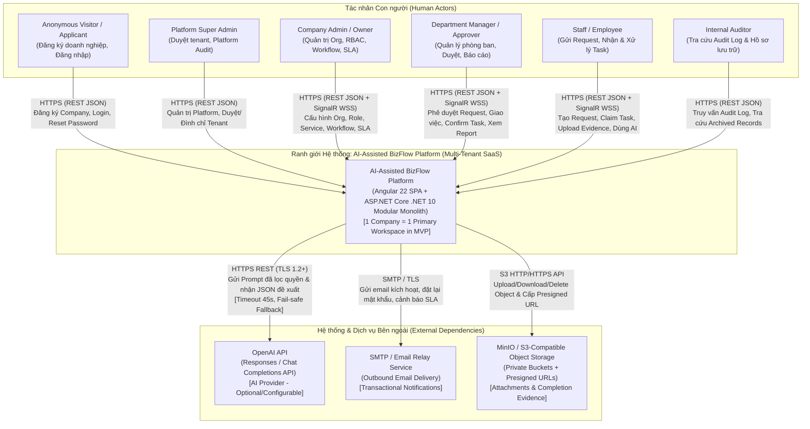

# View A: Sơ đồ Ngữ cảnh Hệ thống (System Context Diagram — C4 Level 1)

- **Mã tài liệu:** `SSS-DIAG-01`
- **Thuộc bộ tài liệu:** [SSS_v1.0_DRAFT.md](../SSS_v1.0_DRAFT.md) — Mục 4 & Mục 5
- **Trạng thái:** `CONFIRMED` (Baseline kiến trúc hệ thống; các ranh giới tích hợp ngoài tuân thủ `SRS_v1.0_DRAFT.md` và `ADR-0008`)

---

## 1. Sơ đồ Ngữ cảnh Hệ thống (System Context)

Sơ đồ dưới đây minh họa ranh giới hệ thống **AI-Assisted BizFlow Platform**, các nhóm tác nhân con người (Human Actors), tác nhân thời gian/hệ thống nội bộ (Internal Timer/Scheduler) và các hệ thống phụ trợ bên ngoài (External Systems).

---

## 2. Đặc tả Ranh giới Ngữ cảnh và Luồng Tương tác Chính

| Đối tượng / Hệ thống ngoài | Hướng giao tiếp | Giao thức & Định dạng | Dữ liệu trao đổi chính | Trạng thái Triển khai Hiện tại (`Current Repo`) | Truy vết Yêu cầu & Quyết định |
| :--- | :--- | :--- | :--- | :--- | :--- |
| **Anonymous Visitor / Applicant** | Inbound $\rightarrow$ BizFlow | HTTPS REST (`application/json`) | Hồ sơ đăng ký doanh nghiệp (`CompanyRegistrationRequest`), thông tin đăng nhập, yêu cầu đặt lại mật khẩu. | `IMPLEMENTED` (`CompanyRegistrationsController`, `AuthController`) | `FR-TEN-001`, `FR-AUTH-001`, `FR-AUTH-003`, `IR-UI-001` |
| **Platform Super Admin** | Inbound $\rightarrow$ BizFlow | HTTPS REST (`application/json`, Bearer JWT) | Quyết định duyệt/từ chối đăng ký tenant, tạm ngưng/kích hoạt lại tenant, truy vấn Platform Audit Log. | `IMPLEMENTED` (`CompanyRegistrationsController`, `PlatformTenantsController`, `PlatformAuditController`) | `FR-TEN-002..004`, `FR-AUD-003`, `SEC-AUTHZ-001` |
| **Company Admin / Owner** | Hai chiều (REST + SignalR WSS) | HTTPS REST + WebSocket (`NotificationHub`) | Cấu trúc phòng ban, người dùng, vai trò/quyền hạn, danh mục dịch vụ, quy trình workflow, cấu hình SLA, lịch làm việc. | `IMPLEMENTED` (`OrganizationController`, `RolesController`, `ServicesController`, `WorkflowsController`, `SlaProfilesController`, `TenantSettingsController`) | `FR-ORG-001..005`, `FR-SVC-001..004`, `FR-WF-001..002`, `FR-SLA-001..002`, `DEC-WS-001` |
| **Department Manager / Approver** | Hai chiều (REST + SignalR WSS) | HTTPS REST + WebSocket (`NotificationHub`) | Phê duyệt/từ chối/trả lại Request, giao việc phòng ban, xác nhận hoàn thành (`Confirm`/`Reject`), xem báo cáo quản lý và SLA. | **Triển khai một phần (`PARTIAL`)**: Task management, Confirmation, Reports đã có; Approval engine (`ApprovalInstance`) chưa có bảng DB. | `FR-REQ-004`, `FR-WF-004..005`, `FR-TSK-002..006`, `FR-RPT-001..004`, `BR-003`, `ADR-0004`, `ADR-0011` |
| **Staff / Employee** | Hai chiều (REST + SignalR WSS) | HTTPS REST + WebSocket (`NotificationHub`) | Tạo và gửi Request, nhận việc (`Claim`), cập nhật trạng thái Task, tải lên bằng chứng (`CompletionEvidence`), gọi AI Assistant. | `IMPLEMENTED` (`RequestsController`, `TasksController`, `AiAssistantController`, `NotificationsController`) | `FR-REQ-001..005`, `FR-TSK-001..005`, `FR-COL-001..003`, `FR-AI-001..009`, `ADR-0001..0003` |
| **Internal Auditor** | Inbound $\rightarrow$ BizFlow | HTTPS REST (`application/json`, Bearer JWT) | Truy vấn nhật ký kiểm toán (`AuditLog`) và hồ sơ lưu trữ (`ArchivedRecordView`). | `IMPLEMENTED` (`AuditController`, `RecordsController`) | `FR-AUD-001..002`, `FR-COL-004..005`, `SEC-AUD-001..002` |
| **OpenAI API** | Outbound BizFlow $\rightarrow$ OpenAI | HTTPS REST (`POST /v1/responses` hoặc `/v1/chat/completions`) | Ngữ cảnh nghiệp vụ đã được kiểm tra quyền đọc (`AiContextReader`) và cấu trúc công cụ (`IAiToolRegistry`); nhận phản hồi JSON có cấu trúc. | `IMPLEMENTED` (`OpenAiModelClient`, `AiAssistantService`, fallback an toàn khi thiếu `ApiKey` hoặc lỗi mạng) | `IR-EXT-001`, `FR-AI-001..009`, `NFR-REL-003`, `SEC-AI-001..002`, `ADR-0008` |
| **SMTP / Email Relay** | Outbound BizFlow $\rightarrow$ SMTP | SMTP over TLS | Email thông báo duyệt đăng ký tenant, mời nhân sự, khôi phục mật khẩu, thông báo công việc/SLA. | **Triển khai một phần (`PARTIAL`)**: `EmailQueueItem` được ghi vào PostgreSQL; tiến trình gửi SMTP thực tế phụ thuộc cấu hình worker (`OD-005`). | `IR-EXT-002`, `FR-NOT-002`, `NFR-REL-002` |
| **MinIO / S3 Object Storage** | Outbound BizFlow $\rightarrow$ S3 & Presigned URL tới Trình duyệt | S3 REST API (HTTP/HTTPS) | Lưu trữ tệp đính kèm (`Attachment`) và bằng chứng hoàn thành (`CompletionEvidence`) phân tách theo `TenantId`. | `IMPLEMENTED` (`S3CompatibleStorageProvider` + `LocalStorageProvider` fallback trong `BizFlow.Infrastructure`) | `IR-EXT-003`, `FR-COL-002..003`, `SEC-DATA-002` |

---

## 3. Các Hệ thống Ngoài Không Thuộc Phạm vi MVP (Explicit Exclusions)

Theo [SRS_v1.0_DRAFT.md](../../../requirements/srs/SRS_v1.0_DRAFT.md) và `DEC-WS-002`, hệ thống **không** kết nối với các hệ thống sau trong phạm vi MVP:
1. **Cổng thanh toán & Quản lý Thuê bao (Payment Gateways / Billing Engines như Stripe, PayOS):** Loại trừ hoàn toàn khỏi MVP (`DEC-WS-002`).
2. **Hệ thống Thực thi Hạ tầng Tự động Bên ngoài (GitLab API, Jira API, Active Directory / LDAP provisioning):** Các yêu cầu như "Cấp quyền GitLab" chỉ được điều phối quy trình phê duyệt và giao việc nội bộ trên BizFlow; việc cấp quyền kỹ thuật trên GitLab do nhân sự thực hiện và đính kèm bằng chứng (`CompletionEvidence`), hệ thống không tự động gọi API GitLab để cấp quyền.
3. **Enterprise SSO / SAML 2.0 / OIDC Federation:** Chưa thuộc phạm vi MVP; hệ thống hiện dùng xác thực nội bộ bằng Email/Password kết hợp JWT (`ADR-0009`).
