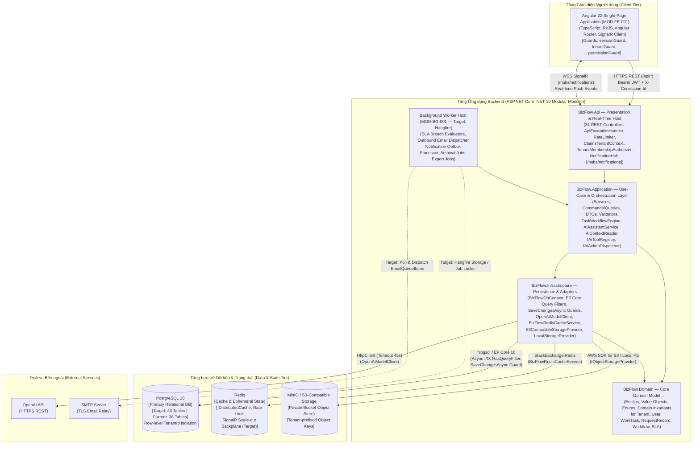
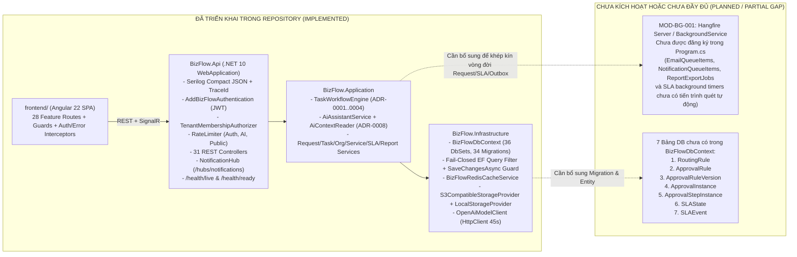

# View B: Sơ đồ Kiến trúc Container và Runtime (Container & Runtime Architecture — C4 Level 2)

- **Mã tài liệu:** `SSS-DIAG-02`
- **Thuộc bộ tài liệu:** [SSS_v1.0_DRAFT.md](../SSS_v1.0_DRAFT.md) — Mục 4, Mục 6 & Mục 8
- **Trạng thái:** Phân tách rõ **Kiến trúc Mục tiêu (`TARGET ARCHITECTURE`)** và **Triển khai Hiện tại trong Repository (`CURRENT IMPLEMENTATION`)**

---

## 1. Sơ đồ Container Kiến trúc Mục tiêu (Target Container Architecture)

Trong kiến trúc mục tiêu (`docs/00-analysis/bizflow-system-analysis.md`, `ADR-0001..0012`), hệ thống bao gồm ứng dụng Frontend SPA, khối Backend Modular Monolith, tiến trình Background Worker (Hangfire) chạy định kỳ/bất đồng bộ, cùng 3 dịch vụ lưu trữ dữ liệu (PostgreSQL 18, Redis, MinIO/S3).

---

## 2. Sơ đồ Container Triển khai Hiện tại trong Repository (Current Repository Implementation)

Đối chiếu với `backend/BizFlow.Api/Program.cs`, `BizFlow.slnx` và `backend/BizFlow.Infrastructure/Persistence/BizFlowDbContext.cs`, cấu trúc hiện tại đã hiện thực hóa đầy đủ 4 project (`BizFlow.Api`, `BizFlow.Application`, `BizFlow.Domain`, `BizFlow.Infrastructure`) và `frontend/`, nhưng **chưa đăng ký Hangfire Worker trong `Program.cs`** và **còn thiếu 7 bảng dữ liệu của Approval/Routing/SLA runtime**.

---

## 3. Bảng Đối chiếu Thành phần Container: Mục tiêu vs. Hiện trạng

| Thành phần Container | Công nghệ Mục tiêu | Hiện trạng trong Codebase (`d:\FA26\AI-Assisted-BizFlow-Platform`) | Trạng thái | Ghi chú Kiến trúc |
| :--- | :--- | :--- | :--- | :--- |
| **Frontend Web App (`MOD-FE-001`)** | Angular 22, TypeScript, TailwindCSS/SCSS, SignalR Client | Dự án `frontend/` có đầy đủ cấu trúc core (`auth`, `guards`, `interceptors`, `layout`, `notifications`) và các feature modules (`requests`, `tasks`, `settings`, `reports`, `dashboard`, `records`, `platform`, `audit`). | `IMPLEMENTED` | Có sự khác biệt nhỏ về tên chuỗi permission ở một số route so với tài liệu cũ (được ghi nhận tại `OD-019`). |
| **API & Real-Time Host (`BizFlow.Api`)** | ASP.NET Core .NET 10, REST Controllers, SignalR Hub | `Program.cs` cấu hình Serilog, JWT Auth, `ClaimsTenantContext`, `TenantMembershipAuthorizer`, Rate Limiting, `ApiExceptionHandler`, `/health/live`, `/health/ready`, `/hubs/notifications` và 31 Controllers. | `IMPLEMENTED` | Chạy trong một tiến trình web duy nhất. |
| **Application & Domain (`BizFlow.Application`, `BizFlow.Domain`)** | C# .NET 10, Clean/Layered Modular Monolith | Triển khai đầy đủ `TaskWorkflowEngine`, `AiAssistantService`, `AiContextReader`, `AiToolRegistry`, `AiActionDispatcher`, cùng các dịch vụ quản trị Tenant, Org, Service, Task, Request, Audit. | `IMPLEMENTED` (Core) / `PARTIAL` (Approval/SLA runtime) | Logic chuyển trạng thái Task và kiểm soát AI (`ADR-0001..0008`) đã có mặt và có Unit/Integration Tests. |
| **Persistence & Adapters (`BizFlow.Infrastructure`)** | EF Core 10 (Npgsql), StackExchange.Redis, AWS S3 SDK, HttpClient | `BizFlowDbContext` có 36 `DbSet`, 34 migrations, `HasQueryFilter` fail-closed theo `TenantId`, và `SaveChangesAsync` chặn xóa cứng / sửa cột bất biến. | `IMPLEMENTED` (36/43 bảng) | Còn thiếu 7 bảng (`RoutingRule`, `ApprovalRule*`, `Approval*Instance`, `SLAState`, `SLAEvent`). |
| **Background Worker (`MOD-BG-001`)** | Hangfire Server (PostgreSQL/Redis storage) hoặc `.NET BackgroundService` | Các bảng hàng đợi (`EmailQueueItems`, `NotificationQueueItems`, `ReportExportJobs`, `AiExecutionLogs`) đã có trong DB, nhưng `Program.cs` **chưa đăng ký** Hangfire hay `IHostedService` quét hàng đợi và kiểm tra vi phạm SLA. | `PROPOSED` / `NOT YET WIRED` | Được theo dõi tại quyết định mở `OD-020` và `ADR-SSS-002`. |
