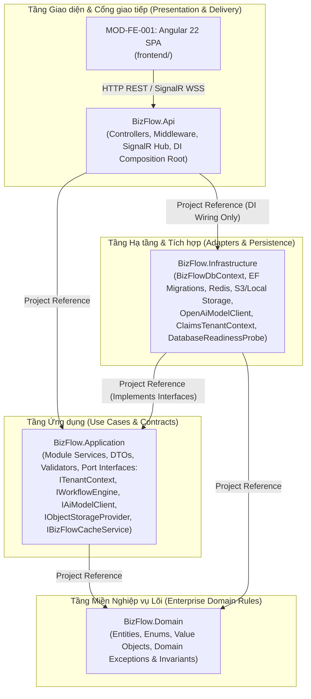
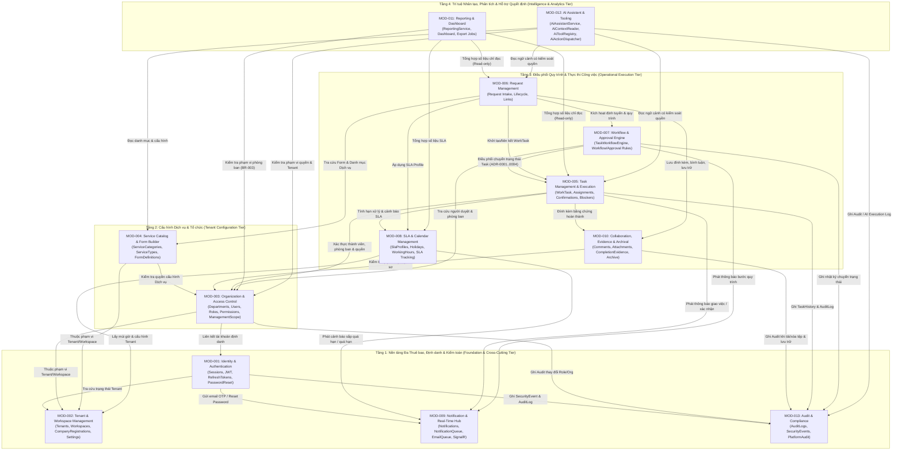

# View C: Sơ đồ Phụ thuộc Module và Phân lớp Kiến trúc (Module Dependency Diagram — C4 Level 3)

- **Mã tài liệu:** `SSS-DIAG-03`
- **Thuộc bộ tài liệu:** [SSS_v1.0_DRAFT.md](../SSS_v1.0_DRAFT.md) — Mục 6 & Mục 7; [MODULE_CATALOG.md](../MODULE_CATALOG.md)
- **Trạng thái:** `CONFIRMED` (Quy tắc phân lớp Clean Architecture kết hợp Modular Monolith không chu trình)

---

## 1. Sơ đồ Phân lớp Vật lý (.NET Assemblies & Frontend)

Ở mức độ biên dịch (Compile-time Assembly Dependencies), hệ thống tuân thủ nghiêm ngặt nguyên tắc **Dependency Inversion** của Clean Architecture: phụ thuộc luôn hướng vào trong về phía `BizFlow.Domain` và `BizFlow.Application`.

---

## 2. Sơ đồ Phụ thuộc Logic giữa 13 Module Nghiệp vụ Backend (Logical Module Dependencies)

Bên trong khối Modular Monolith, 13 module nghiệp vụ được phân chia thành **4 tầng khả năng (Capability Tiers)** tạo thành một đồ thị có hướng không chu trình (**Directed Acyclic Graph — DAG**). Không module nào ở tầng dưới được phép gọi ngược trực tiếp lên module ở tầng trên.

---

## 3. Các Quy tắc Kiến trúc Bất biến về Phụ thuộc Module (Architectural Dependency Rules)

1. **Cấm Phụ thuộc Ngược Chiều (No Upward Dependencies):**
   - Các module Tầng 1 (`MOD-001`, `MOD-002`, `MOD-009`, `MOD-013`) và Tầng 2 (`MOD-003`, `MOD-004`) **tuyệt đối không** được phụ thuộc vào logic nghiệp vụ của Tầng 3 (`Request`, `Task`, `Workflow`) hoặc Tầng 4 (`AI`, `Reporting`).
2. **Độc quyền Ghi Trạng thái Vòng đời Task (`ADR-0001` & `BizFlowDbContext.ValidateTaskWorkflowMutations`):**
   - Mọi thay đổi lên các trường điều khiển vòng đời của `WorkTask` (`Status`, `WorkflowInstanceId`, `WorkflowStepId`, `CompletedAt`, `CancelledAt`, `ArchivedAt`) bắt buộc phải đi qua `IWorkflowEngine` (`TaskWorkflowEngine` thuộc `MOD-007`). Nếu một service khác tự ý chỉnh sửa các cột này và gọi `SaveChangesAsync`, tầng Persistence sẽ ném lỗi `InvalidOperationException` (`WorkTask.ClearWorkflowMutationMarks`).
3. **Cô lập Tác động của AI (`ADR-0008`):**
   - `MOD-012` (`AI Assistant`) chỉ được phép đọc dữ liệu thông qua `AiContextReader` (đã áp dụng bộ lọc quyền của người gọi) và thực thi các đề xuất không phá hủy qua `IAiActionDispatcher`. `MOD-012` **không** được phép ghi trực tiếp vào các bảng nghiệp vụ lõi hay tự ý chuyển trạng thái `WorkTask` / `RequestRecord` khi chưa có xác nhận của người dùng (`Human-in-the-Loop`).
4. **Tính Độc lập của Kiểm toán (`MOD-013`):**
   - `AuditLog`, `SecurityEvent`, `TaskHistory` và `RequestHistory` là các bảng chỉ ghi thêm (`Append-Only`). Không module nào được phép gọi lệnh `Update` hoặc `Delete` lên các bảng này.
