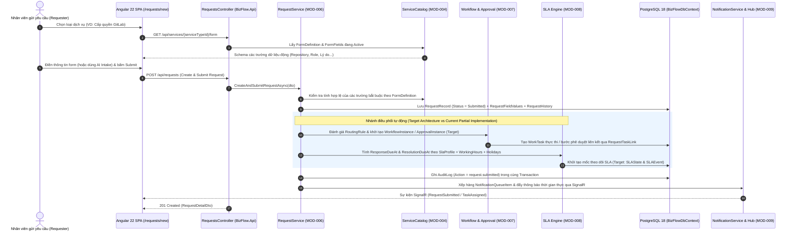
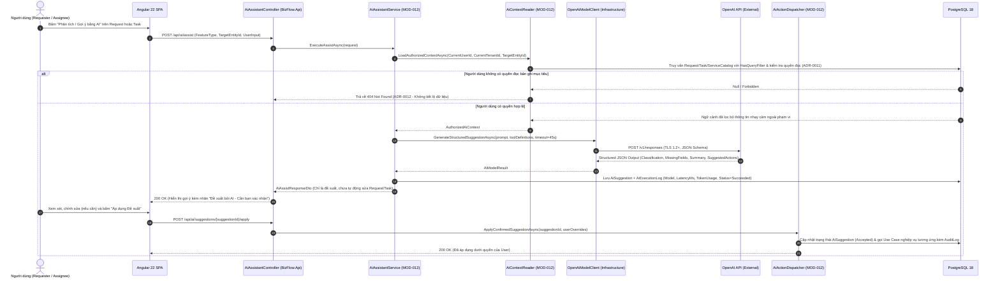
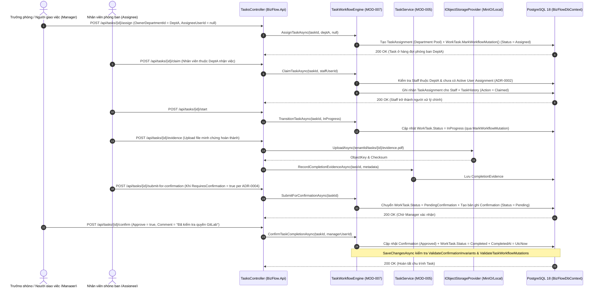
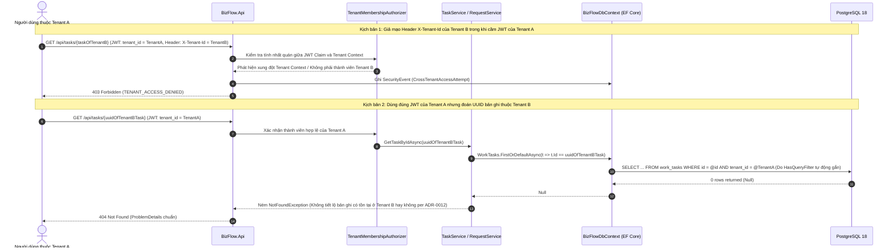
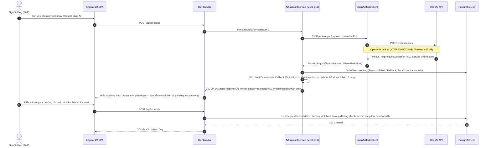
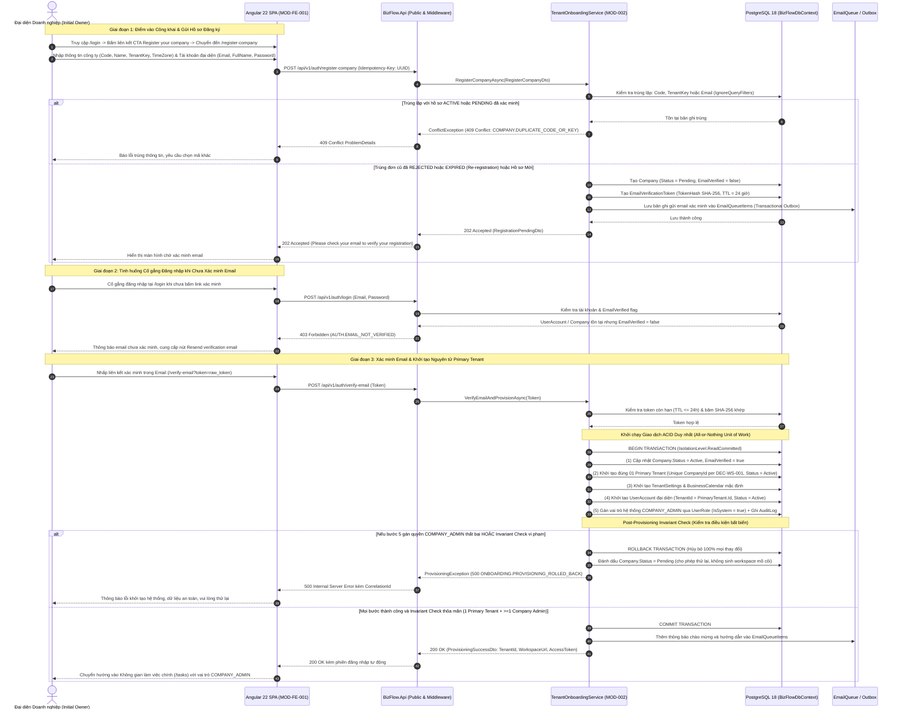

# View D: Sơ đồ Tuần tự các Luồng Nghiệp vụ và Kỹ thuật Trọng yếu (Key Sequence Diagrams)

- **Mã tài liệu:** `SSS-DIAG-04`
- **Phiên bản:** `1.1-DRAFT`
- **Thuộc bộ tài liệu:** [SSS_v1.0_DRAFT.md](../SSS_v1.0_DRAFT.md) — Mục 8, Mục 11, Mục 12, Mục 13 & Mục 15
- **Danh mục luồng (`SEQ-001` .. `SEQ-007`):**
  1. `SEQ-001`: Xác thực, Thiết lập Ngữ cảnh Tenant và Kiểm tra Quyền hạn (`Authentication & Tenant Context Resolution`)
  2. `SEQ-002`: Tiếp nhận Yêu cầu Nội bộ, Kiểm tra Form Động và Định tuyến Quy trình (`Request Intake, Validation & Routing`)
  3. `SEQ-003`: Hỗ trợ Xử lý bằng AI có Kiểm soát Con người (`AI-Assisted Request/Task Processing & Human-in-the-Loop`)
  4. `SEQ-004`: Giao việc Phòng ban, Nhân viên Nhận việc (`Claim`) và Xác nhận Hoàn thành (`Task Claim & Confirmation Lifecycle`)
  5. `SEQ-005`: Ngăn chặn Truy cập Trái phép Liên Tenant (`Cross-Tenant Resource Access Denial — Defense-in-Depth`)
  6. `SEQ-006`: Xử lý Lỗi Nhà cung cấp Bên ngoài và Chế độ Suy giảm An toàn (`External Provider Failure & Graceful Fallback`)
  7. `SEQ-007`: Đăng ký Doanh nghiệp, Xác minh Email và Khởi tạo Nguyên tử Primary Tenant kèm Rollback (`Company Registration, Email Verification & Atomic Provisioning Workflow`)

---

## 1. `SEQ-001`: Xác thực, Thiết lập Ngữ cảnh Tenant và Kiểm tra Quyền hạn

Luồng này mô tả cách người dùng đăng nhập, nhận JWT kèm `tenant_id` và `workspace_id`, và cách mọi request tiếp theo được kiểm tra qua chuỗi phòng vệ nhiều lớp (`sessionGuard` $\rightarrow$ `tenantGuard` $\rightarrow$ `JwtBearer` $\rightarrow$ `ClaimsTenantContext` $\rightarrow$ `TenantMembershipAuthorizer`).

```mermaid
sequenceDiagram
    autonumber
    actor User as Người dùng (Staff / Admin)
    participant SPA as Angular 22 SPA (MOD-FE-001)
    participant API as BizFlow.Api (Auth & Middleware)
    participant AuthSvc as AuthService (MOD-001)
    participant MemAuth as TenantMembershipAuthorizer (MOD-002/003)
    participant DB as PostgreSQL 18 (BizFlowDbContext)

    User->>SPA: Nhập Email & Mật khẩu tại /login
    SPA->>API: POST /api/auth/login (Email, Password)
    API->>AuthSvc: LoginAsync(LoginRequest)
    AuthSvc->>DB: Truy vấn User, PasswordCredential, Tenant, Workspace, UserRoles (IgnoreQueryFilters cho bước Login)
    DB-->>AuthSvc: Trả về thông tin User & Tenant (Status = Active)
    AuthSvc->>DB: Tạo UserSession & RefreshToken + Ghi SecurityEvent (LoginSuccess)
    AuthSvc-->>API: AccessToken (JWT chứa sub, tenant_id, workspace_id, session_id) + RefreshToken
    API-->>SPA: 200 OK (AuthSessionResponse)
    SPA->>SPA: Lưu trạng thái phiên; kích hoạt sessionGuard, tenantGuard, permissionGuard

    Note over User,DB: Request nghiệp vụ tiếp theo có đính kèm Bearer JWT

    User->>SPA: Mở danh sách công việc (/tasks)
    SPA->>API: GET /api/tasks (Authorization: Bearer <JWT>)
    API->>API: Xác thực chữ ký JWT & trích xuất ClaimsTenantContext (CurrentUserId, CurrentTenantId)
    API->>MemAuth: AuthorizeRequestAsync(HttpContext)
    MemAuth->>DB: Kiểm tra Tenant Active, User Active, Session chưa bị thu hồi & Permission hợp lệ
    DB-->>MemAuth: Hợp lệ (Authorized)
    MemAuth-->>API: Cho phép đi tiếp vào TasksController
    API->>DB: Truy vấn WorkTasks (Tự động áp dụng HasQueryFilter: x.TenantId == CurrentTenantId)
    DB-->>API: Danh sách WorkTask trong phạm vi quyền (Scoped Read per ADR-0011)
    API-->>SPA: 200 OK (PagedResult<TaskSummaryDto>)
```

---

## 2. `SEQ-002`: Tiếp nhận Yêu cầu Nội bộ, Kiểm tra Form Động và Định tuyến Quy trình

Luồng này minh họa quá trình nhân viên tạo và gửi một yêu cầu dịch vụ nội bộ (ví dụ: Yêu cầu cấp quyền GitLab), bao gồm cả phần đã triển khai (`RequestRecord`, `RequestFieldValue`, `WorkTask` liên kết) và phần mục tiêu (`RoutingRule`, `ApprovalInstance`, `SLAState`).



---

## 3. `SEQ-003`: Hỗ trợ Xử lý bằng AI có Kiểm soát Con người (`ADR-0008`)

Luồng này thể hiện kiến trúc tích hợp AI an toàn: mọi dữ liệu đưa vào prompt đều phải đi qua `AiContextReader` để kiểm tra quyền đọc của người dùng hiện tại, phản hồi được chuẩn hóa thành đề xuất (`AiSuggestion`), ghi nhật ký đầy đủ vào `AiExecutionLogs`, và **bắt buộc người dùng xác nhận** trước khi thay đổi dữ liệu nghiệp vụ.



---

## 4. `SEQ-004`: Giao việc Phòng ban, Nhân viên Nhận việc (`Claim`) và Xác nhận Hoàn thành (`ADR-0001..0004`)

Luồng này mô tả chính xác các quy tắc bất biến của `TaskWorkflowEngine` đã được triển khai và kiểm thử trong codebase: giao việc cho phòng ban (`Department Pool`), nhân viên nhận việc (`Claim`), hoàn thành công việc với bằng chứng (`CompletionEvidence`), và bước xác nhận hoàn thành (`Confirm` / `Reject`).



---

## 5. `SEQ-005`: Ngăn chặn Truy cập Trái phép Liên Tenant (`Defense-in-Depth` & `ADR-0012`)

Luồng này minh họa cách hệ thống bảo vệ cô lập dữ liệu giữa các doanh nghiệp (`Tenant A` và `Tenant B`) ở cả 4 lớp bảo vệ, đảm bảo trả về `404 Not Found` không rò rỉ thông tin tồn tại của bản ghi (`ADR-0012`).



---

## 6. `SEQ-006`: Xử lý Lỗi Nhà cung cấp Bên ngoài và Chế độ Suy giảm An toàn (`Graceful Degradation`)

Luồng này mô tả cách hệ thống duy trì hoạt động của các quy trình nghiệp vụ cốt lõi (`Request`, `Task`, `Approval`) ngay cả khi **OpenAI API**, **Redis** hoặc **SMTP** gặp sự cố hoặc hết thời gian chờ (`Timeout`).



---

## 7. `SEQ-007`: Đăng ký Doanh nghiệp, Xác minh Email và Khởi tạo Nguyên tử Primary Tenant kèm Rollback

Luồng này đặc tả toàn diện chuỗi tương tác từ điểm vào công khai (`/register-company`, liên kết CTA từ `/login`), kiểm tra trùng lặp, gửi token xác minh email, xử lý đăng nhập khi chưa xác minh, và giao dịch nguyên tử cấp phát Workspace chính (`Primary Tenant` duy nhất theo `DEC-WS-001`, `ADR-SSS-007`) kèm điều kiện kiểm tra bất biến sau khởi tạo (`Post-Provisioning Invariant Guard`) và cơ chế phục hồi khi cấp quyền `COMPANY_ADMIN` thất bại.



