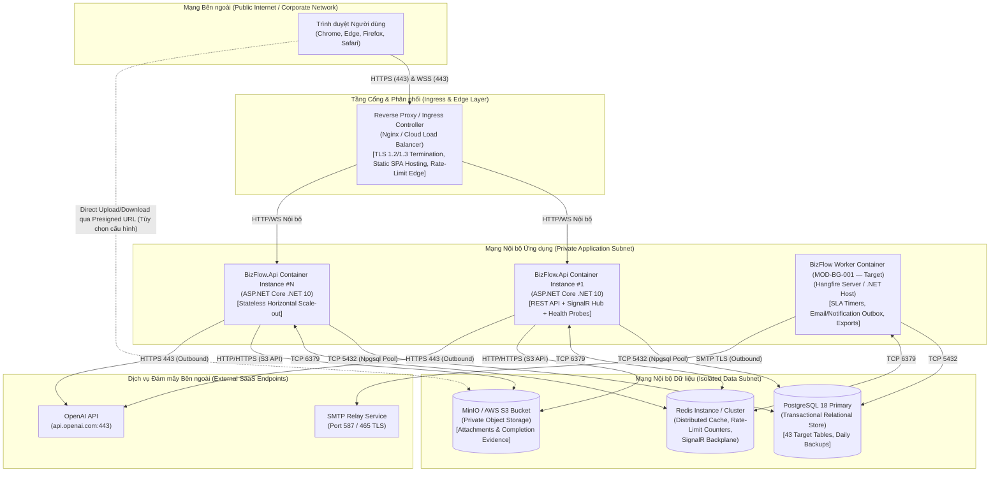
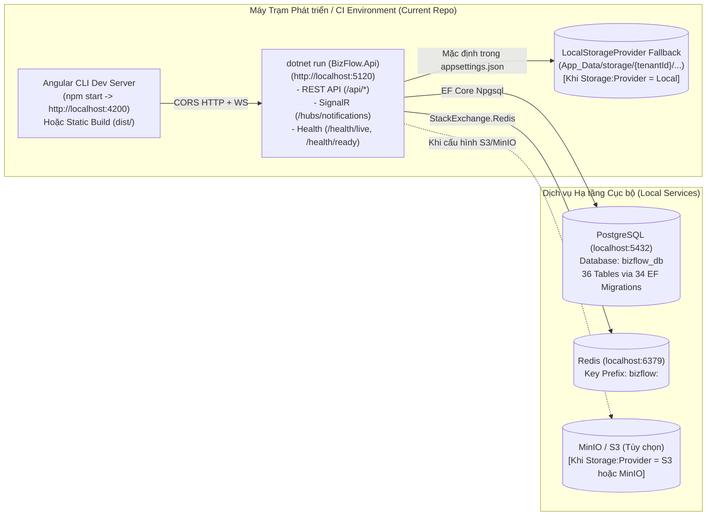

# View E: Sơ đồ Kiến trúc Triển khai và Hạ tầng (Deployment & Infrastructure View)

- **Mã tài liệu:** `SSS-DIAG-05`
- **Thuộc bộ tài liệu:** [SSS_v1.0_DRAFT.md](../SSS_v1.0_DRAFT.md) — Mục 17 & Mục 18
- **Trạng thái:** Phân biệt rõ **Môi trường Triển khai Mục tiêu (`TARGET PRODUCTION DEPLOYMENT`)** và **Môi trường Phát triển Hiện tại (`CURRENT LOCAL / REPO TOPOLOGY`)**

---

## 1. Sơ đồ Triển khai Mục tiêu cho Môi trường Production/Staging (`Target Deployment Topology`)

Kiến trúc triển khai mục tiêu sử dụng mô hình container hóa, đặt sau tầng Reverse Proxy / Ingress chấm dứt TLS (HTTPS/WSS), cho phép mở rộng ngang (Horizontal Scaling) đối với `BizFlow.Api` nhờ lưu trữ trạng thái phiên/cache trên Redis và dữ liệu bền vững trên PostgreSQL 18 cùng S3/MinIO.

---

## 2. Sơ đồ Triển khai Hiện tại trong Repository (`Current Local / Developer Topology`)

Trong kho mã nguồn hiện tại (`d:\FA26\AI-Assisted-BizFlow-Platform`), chưa có tệp `Dockerfile` hoặc `docker-compose.yml` được commit vào nhánh chính (theo dõi tại `OD-014`). Hệ thống được chạy trực tiếp trên máy trạm phát triển hoặc CI runner với cấu hình fallback linh hoạt trong `Program.cs` và `appsettings.json`.

---

## 3. Đặc tả Cổng Giao tiếp, Điểm Kiểm tra Sức khỏe (Health Probes) và Cơ chế Dự phòng

| Thành phần / Endpoint | Giao thức & Cổng Mặc định | Mục đích Vận hành | Hiện trạng trong `Program.cs` |
| :--- | :--- | :--- | :--- |
| **`GET /health/live`** | HTTP/HTTPS (`5120` local / `443` prod) | Kiểm tra tiến trình `BizFlow.Api` còn sống (Liveness Probe cho Kubernetes/Container orchestrator). Luôn trả về `200 OK` kèm `{ status: "Live", timestampUtc }` mà không phụ thuộc DB. | `IMPLEMENTED` (`Program.cs` dòng 120–125) |
| **`GET /health/ready`** | HTTP/HTTPS (`5120` local / `443` prod) | Kiểm tra hệ thống sẵn sàng nhận lưu lượng (Readiness Probe). Gọi `DatabaseReadinessProbe` kiểm tra kết nối PostgreSQL; trả về `200 OK` nếu sẵn sàng hoặc `503 Service Unavailable` nếu DB mất kết nối. | `IMPLEMENTED` (`Program.cs` dòng 127–148) |
| **`/hubs/notifications`** | WebSocket / SignalR (`WSS`) | Kênh đẩy thông báo thời gian thực tới trình duyệt; bật `CloseOnAuthenticationExpiration = true` để tự động ngắt kết nối khi JWT hết hạn. | `IMPLEMENTED` (`Program.cs` dòng 150–153) |
| **Chuyển đổi Lưu trữ Tệp (`Storage:Provider`)** | Cấu hình `Local` vs `S3` / `MinIO` | Cho phép phát triển và chạy kiểm thử tự động bằng `LocalStorageProvider` mà không bắt buộc dựng MinIO, đồng thời chuyển sang `S3CompatibleStorageProvider` trên Staging/Production chỉ bằng biến môi trường. | `IMPLEMENTED` (`Program.cs` dòng 65–72) |
