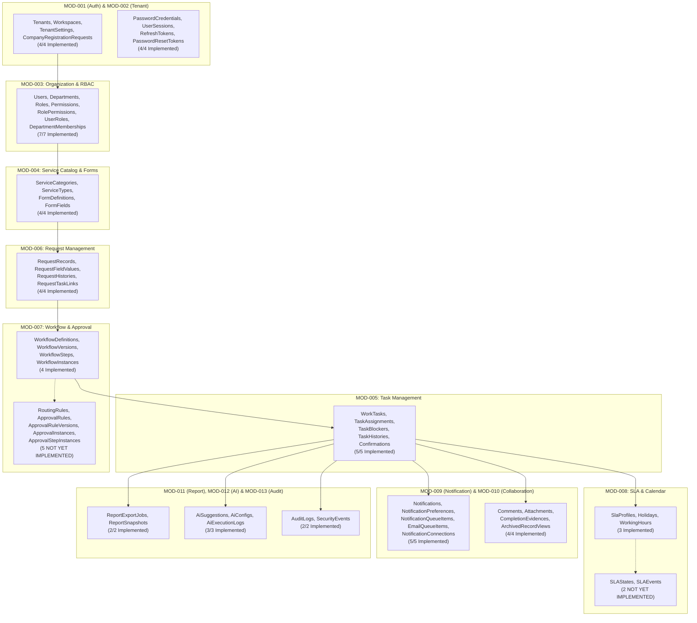
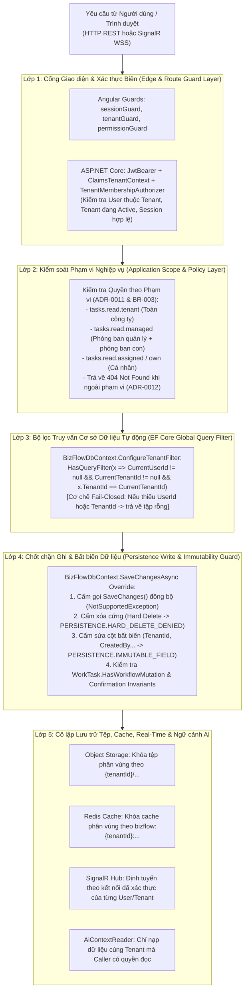

# View F: Sơ đồ Sở hữu Dữ liệu, Cô lập Đa Thuê bao và Luồng Tích hợp (Data Ownership, Isolation & Integration Flow)

- **Mã tài liệu:** `SSS-DIAG-06`
- **Thuộc bộ tài liệu:** [SSS_v1.0_DRAFT.md](../SSS_v1.0_DRAFT.md) — Mục 10, Mục 11, Mục 12 & Mục 13
- **Trạng thái:** Đối chiếu trực tiếp với `BizFlowDbContext.cs` (36 bảng đã triển khai / 43 bảng mục tiêu) và cơ chế phòng vệ đa lớp (`Defense-in-Depth`)

---

## 1. Sơ đồ Phân quyền Sở hữu Dữ liệu theo Module (Module Data Ownership Map)

Mỗi bảng dữ liệu trong PostgreSQL thuộc quyền sở hữu ghi (Write Ownership) của **một module duy nhất**. Các module khác chỉ được phép thay đổi dữ liệu thông qua Application Service / Domain Engine của module sở hữu hoặc đọc qua các truy vấn đã áp dụng bộ lọc `TenantId`.

> **Lưu ý kiểm kê bảng dữ liệu (`BizFlowDbContext.cs`):**
> - Trong `BizFlowDbContext.cs` hiện có **36 `DbSet<T>`** đã được triển khai (bao gồm các bảng mở rộng kỹ thuật như `NotificationConnections`, `ReportSnapshots`, `AiExecutionLogs`, `SecurityEvents` tương ứng với các thực thể vận hành trong hệ thống).
> - Có **7 thực thể nghiệp vụ mục tiêu** trong `docs/00-analysis/bizflow-system-analysis.md` chưa được tạo bảng và migration: `RoutingRule`, `ApprovalRule`, `ApprovalRuleVersion`, `ApprovalInstance`, `ApprovalStepInstance`, `SLAState`, `SLAEvent`.

---

## 2. Sơ đồ 5 Lớp Cô lập Đa Thuê bao và Bảo vệ Dữ liệu (`5-Layer Multi-Tenant Defense-in-Depth`)

