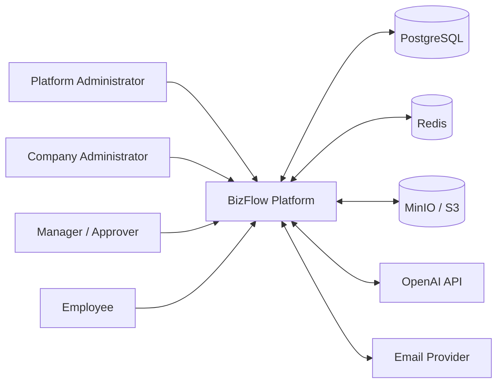
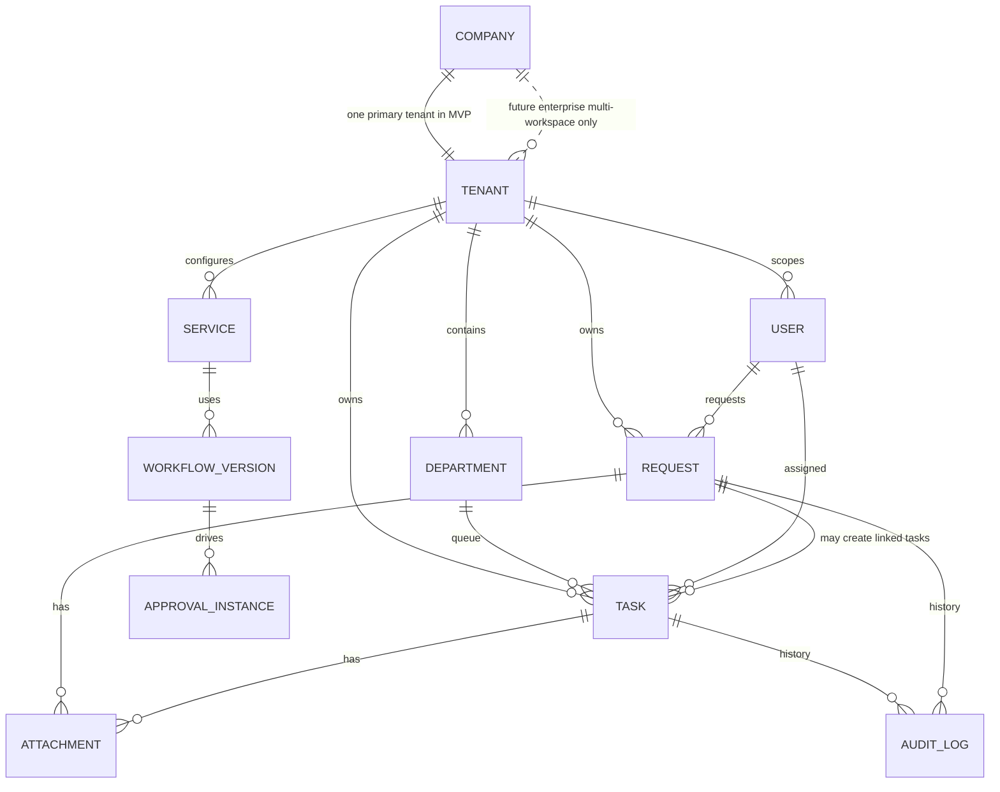
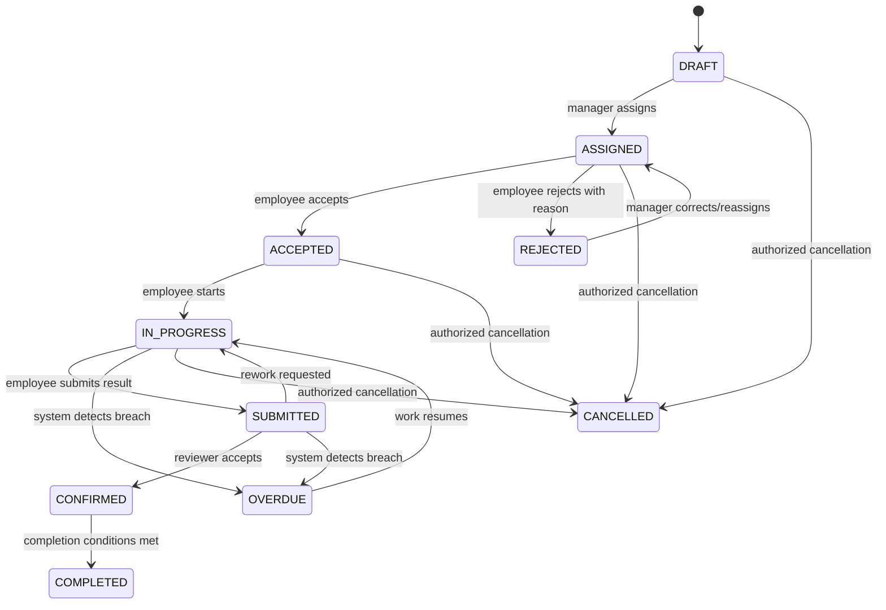
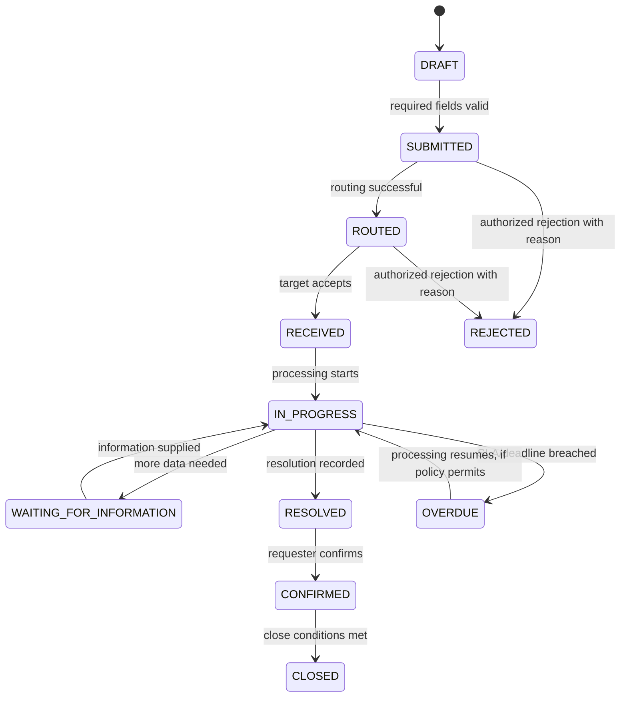

# Software Requirements Specification (SRS)

## AI-Assisted BizFlow Platform

| Document control | Value |
|---|---|
| Document ID | BIZFLOW-SRS |
| Version | 0.1 |
| Status | Draft — evidence-based, pending stakeholder review |
| Prepared date | 2026-10-16 |
| Prepared by | Requirements Engineering working draft |
| Intended audience | Product owner, BA/SA, frontend/backend developers, QA, security and operations |
| Approval | Not approved; reviewer/sign-off placeholders to be completed by stakeholders |
| Primary baseline | `AI-Assisted_BizFlow_Software_System_Specification_v1.2_FINAL.docx` (28 September 2026) |

> **Evidence limitation.** This SRS was derived from the SSS v1.2 baseline and decisions explicitly supplied in the current conversation. A matching BizFlow application repository and working tree were not available in the execution environment. The only GitHub repository returned by the connected account was `ThangHoQuoc/f`, whose root contains a Django `manage.py`, `ready2go` and `tourapp`; it does not match the stated Angular/.NET BizFlow baseline. Consequently, actual implementation status, current branch, local Git status, test results, migration state and implementation/API conformance are **NOT VERIFIED**. This draft must not be interpreted as proof that the system is implemented or production-ready.

## Revision history

| Version | Date | Change | Status |
|---|---|---|---|
| 0.1 | 2026-10-16 | Initial SRS draft synthesized from SSS v1.2 and current product decisions; repository implementation verification blocked. | Draft |

## Table of contents

1. [Introduction](#1-introduction)
2. [Overall description](#2-overall-description)
3. [System context and actors](#3-system-context-and-actors)
4. [Business requirements](#4-business-requirements)
5. [Functional requirements](#5-functional-requirements)
6. [Use cases and interaction scenarios](#6-use-cases-and-interaction-scenarios)
7. [Domain model and data requirements](#7-domain-model-and-data-requirements)
8. [State machines and lifecycle rules](#8-state-machines-and-lifecycle-rules)
9. [External interface requirements](#9-external-interface-requirements)
10. [Non-functional requirements](#10-non-functional-requirements)
11. [Security and threat requirements](#11-security-and-threat-requirements)
12. [AI-specific requirements and governance](#12-ai-specific-requirements-and-governance)
13. [Deployment and operational requirements](#13-deployment-and-operational-requirements)
14. [Acceptance criteria and verification](#14-acceptance-criteria-and-verification)
15. [Traceability](#15-traceability)
16. [Scope, prioritization and release planning](#16-scope-prioritization-and-release-planning)
17. [Risks, assumptions, dependencies and open questions](#17-risks-assumptions-dependencies-and-open-questions)
18. [Appendices](#18-appendices)

## 1. Introduction

### 1.1 Purpose

This SRS defines the intended functional behavior, business rules, data boundaries, interfaces, security controls, AI guardrails and verification conditions of the AI-Assisted BizFlow Platform. It is intended to support stakeholder review, implementation planning, testing and future maintenance. It is a requirements specification rather than an implementation report.

### 1.2 Scope

BizFlow is a configurable, multi-tenant SaaS platform focused on internal task coordination and request processing. It supports two primary business directions: manager-initiated task assignment and employee-initiated internal requests. Shared capabilities include organization management, service catalogues, workflow/approval configuration, SLA monitoring, evidence/attachments, notifications, audit, dashboards/reporting and AI-assisted operations.

The product is not intended to become a general ERP, CRM, marketplace or external customer-service/ticketing platform. Full accounting, payroll, inventory, full CRM, sales management, B2B marketplace/commerce, required enterprise SSO, and Kubernetes/microservices infrastructure are excluded from the current project baseline.

### 1.3 Product vision and objectives

BizFlow aims to turn fragmented internal work communications into traceable, role-controlled and workflow-driven processes. Approved objectives are enumerated in `REQUIREMENTS_TRACEABILITY.md` as OBJ-001 through OBJ-008. Quantitative business-success targets have not been approved.

### 1.4 Intended audience

Product owner and stakeholders; business analysts; software architects; frontend/backend developers; data engineers; QA and acceptance-test engineers; security reviewers; operations staff; and future enterprise product owners.

### 1.5 Definitions and abbreviations

| Term | Definition used in this SRS |
|---|---|
| Company / Organization | Business organization registered on BizFlow. |
| Tenant | Isolation and authorization boundary for tenant-owned data in the MVP baseline. |
| Workspace | User-facing work environment. For the MVP, one primary workspace is provisioned per company; multiple independent workspaces are a Future Enterprise upgrade. |
| User | Authenticated person interacting with the platform. |
| Membership | Relationship granting a user access to a tenant/workspace and relevant roles. The canonical detailed schema is not verified against source code. |
| Department | Organizational unit or queue/team scope inside a company tenant. |
| Task | Concrete unit of work with assignment, progress, result and completion history. |
| Request | Internal need or problem raised by an employee for triage and processing. |
| Workflow | Versioned set of processing steps and permitted state transitions. |
| Approval Rule | Versioned rule defining approvers and decision behavior. |
| SLA | Service-level target, calendar, warning and escalation policy. |
| Evidence | File or object associated with a task, request or result. |
| RBAC | Role-Based Access Control; in this system, complemented by tenant and resource scope. |
| SRS / SSS | Software Requirements Specification / Software System Specification. |
| AI Agent | Internal software actor using only registered, authorized application tools. |
| RPO / RTO | Recovery Point Objective / Recovery Time Objective. Values are unresolved. |

### 1.6 References

1. `AI-Assisted_BizFlow_Software_System_Specification_v1.2_FINAL.docx`, baseline v1.2, last updated 2026-09-28.
2. Product decision supplied in conversation on 2026-10-16: Option C for the MVP (one primary workspace per company) and a future paid upgrade for Option A (multiple independent workspaces).
3. Repository discovery observations recorded in `EVIDENCE_REGISTER.md`.
4. IEEE 29148 / ISO/IEC/IEEE 29148-inspired requirements engineering practices are used as guidance; this document does not claim certification or formal compliance.

### 1.7 Document conventions and status labels

- **Confirmed in SSS v1.2:** explicitly included in the baseline specification. This label does not prove code implementation.
- **Confirmed product decision:** explicitly supplied by the product owner in the conversation.
- **Proposed:** the source baseline itself labels the behavior proposed; approval has not been independently evidenced.
- **Unresolved:** a decision/evidence gap remains.
- **Not verified:** inspection or execution evidence is unavailable.
- **MVP / Post-MVP / Future Enterprise / Out of Scope:** release classification, not implementation status.
- Normative requirements use “shall.” Recommendations and unresolved thresholds are labeled as such.

### 1.8 Assumptions, dependencies and constraints

**Confirmed source constraints:** five-person student project team; Modular Monolith; development/demo may use simulated company and employee data; external AI and object storage introduce network/cost dependencies.

**Technology baseline (intended, not implementation-verified):** Angular 22 + TypeScript; ASP.NET Core on .NET 10 + C#; PostgreSQL 18; Redis; MinIO/S3-compatible storage; OpenAI API; REST API; Modular Monolith; Git/GitHub. The SSS additionally names Angular Material + Tailwind, EF Core 10/Npgsql 10, ASP.NET Core Identity + JWT, SignalR, Hangfire, Serilog and OpenTelemetry as the intended technical contract.

**Key assumption:** each user belongs to one tenant/company for the MVP. The newly confirmed future paid multi-workspace direction may require a revised membership model; this is not an MVP implementation requirement.

## 2. Overall description

### 2.1 Product perspective

BizFlow is a shared SaaS platform used by multiple companies. Each company is provisioned after manual platform-administrator approval and receives one primary tenant/workspace in the MVP. Within that environment, the company configures users, departments, roles, services, workflows, approval rules and SLA policies. The platform operator has a separate platform-administration scope.

### 2.2 Principal product functions

- Public company registration and manual approval before tenant/workspace provisioning.
- Authentication by employee code + password or company-provided email + password, with refresh and password-reset flows.
- Organization, department, user, role and permission management.
- Configurable internal services and routing defaults.
- Task creation, assignment, acceptance/rejection, execution, progress, result submission, review and cancellation.
- Internal request creation, routing, receipt, processing, request-to-task linkage, resolution, requester confirmation and revised-request creation.
- Versioned workflows, approval instances and decisions.
- SLA profiles, calendars, timers, warnings and escalations.
- Comments, attachment evidence, search/filter, archive and notifications.
- Manager/company dashboards and operational reports.
- AI-assisted task/request drafting, recommendation, decomposition, summarization and authorized tool actions.
- Tenant-aware audit and observability.

### 2.3 User classes

| Actor | Purpose and permitted scope |
|---|---|
| Platform Administrator | Manages company registration and tenant lifecycle at platform scope; privileged access must be explicit and auditable. |
| Company Administrator | Manages organizational/workflow configuration and tenant users within the company tenant. |
| Manager | Creates and coordinates tasks, handles/routs requests within management scope, reviews results and may approve configured steps. |
| Employee | Executes assigned work, creates requests, provides progress/evidence and confirms or responds within assigned scope. |
| AI Agent | Software actor that proposes or executes allowlisted operations only within the current user’s authority and tenant policy. |

### 2.4 Operating environment

The intended stack is listed in Section 1.8. Browser support, production hosting provider/region and exact deployment topology are not verified. Local Docker is identified by the SSS as the reference development/demo environment.

### 2.5 Constraints

- Maintain the Modular Monolith approach; microservices and Kubernetes are out of the current project scope.
- Backend services, not the frontend, are authoritative for identity, permissions, tenant boundaries and state transitions.
- Redis is a cache/coordination aid, not the source of transactional truth.
- AI-generated identifiers and business-state proposals must be validated by application/domain rules.
- Large file upload follows a direct object-storage pattern; the API must not proxy a 500 MB binary as a normal JSON body.

### 2.6 User documentation

The source baseline does not enumerate standalone end-user manuals as an approved release deliverable. Onboarding help and brief admin guidance are recommended, but approval and scope remain open.

### 2.7 External dependencies

OpenAI API for AI inference; MinIO/S3-compatible storage for attachments; email provider for reset and notification delivery; Redis for cache/transient coordination; PostgreSQL for persistent relational data; optional SignalR and background scheduling support as specified in the baseline. Failure/fallback expectations are captured in the requirements register.

### 2.8 Release scope

| Release class | Scope |
|---|---|
| MVP / P0 | Authentication, company registration and tenant isolation, organization and permissions, internal service basics, core task/request lifecycles, request-to-task linkage, workflow basics, audit, attachment handling and basic notifications. |
| MVP / P1 | Approval, SLA/escalation, dashboards/reports, realtime notifications where retained, AI task assistance, AI request analysis/routing/splitting and revised-request flow, subject to the confirmed demo plan. |
| Post-MVP / P2 | Advanced natural-language search, richer AI analytics, long-term memory/RAG, advanced calendars, advanced export/BI. |
| Future Enterprise | Paid upgrade enabling multiple independent workspaces per company (Option A), after separate entitlement, access-control and data-boundary design. Billing provider/pricing/quotas are not yet specified. |
| Out of Scope | Full ERP, full CRM/sales management, B2B marketplace/commerce, separate external customer-service portal, autonomous AI that bypasses policy, required enterprise SSO, Kubernetes/microservices for this project. |

The user-confirmed workspace decision dated 2026-10-16 selects Option C for the MVP. This clarifies the SSS baseline rather than expanding the MVP.

## 3. System context and actors

### 3.1 System context diagram

**Purpose:** identify human actors and declared external/system dependencies. This is a requirements context diagram, not a verified deployment topology.

### 3.2 Stakeholders

| ID | Stakeholder | Interest | Evidence status |
|---|---|---|---|
| STK-001 | Product owner/project lead | Product scope, workspace decision, demo readiness and future commercialization | Confirmed through conversation |
| STK-002 | Platform administrator | Company onboarding and platform lifecycle | Confirmed in SSS |
| STK-003 | Company administrator | Company configuration and membership | Confirmed in SSS |
| STK-004 | Managers/approvers | Task and request routing, approvals, progress and reports | Confirmed in SSS |
| STK-005 | Employees | Requests, assigned work, evidence and confirmation | Confirmed in SSS |
| STK-006 | Development/QA team | Implement and verify requirements under team constraints | SSS states a five-person team |
| STK-007 | Future enterprise customer | Multi-workspace upgrade | Future product direction, not an MVP actor capability |

### 3.3 Trust boundaries

The SRS identifies the following trust boundaries: browser/client to API; one tenant to another tenant; API/application service to PostgreSQL; application to Redis; application to object storage; application to external AI provider; and platform-administration scope versus tenant-administration scope. Actual enforcement mechanisms must be verified against the correct codebase.

### 3.4 External interfaces

Known API paths are listed in the SSS API catalogue. This SRS does not assert that those endpoints currently exist in the implementation. See Section 9 and `EVIDENCE_REGISTER.md`.

## 4. Business requirements

### 4.1 Business problem

The SSS identifies internal work as arriving through multiple channels (chat, email, spreadsheets and direct conversations), leading to fragmented information, unclear ownership, weak deadline visibility and limited auditability. This problem statement is inherited from the source baseline; market size and customer willingness-to-pay have not been independently researched for this SRS.

### 4.2 Business objectives

See OBJ-001 through OBJ-008 in `REQUIREMENTS_TRACEABILITY.md`. The primary outcomes are centralized work/request intake, clearer ownership/routing, configurable process controls, SLA visibility, auditable evidence and controlled AI assistance. Numeric success thresholds remain unapproved.

### 4.3 Business rules

The following 22 business rules are carried forward from SSS v1.2. The complete text is reproduced in `REQUIREMENTS_REGISTER.md`.

|Rule ID|Rule|Normative summary|
|---|---|---|
|BR-001|Tenant isolation|Every tenant-owned record has TenantId and every business query/action is evaluated against current tenant scope.|
|BR-002|Role boundary|System roles establish baseline capabilities; custom tenant roles can only grant allowed permission catalog items.|
|BR-003|Manager scope|A Manager can assign/reassign only within configured management scope.|
|BR-004|Department assignment|A task/request assigned to a department represents a department queue/team responsibility until a user accepts or is assigned.|
|BR-005|AI recommendation|AI recommendations are not final business decisions unless a tenant-configured policy explicitly permits automatic action.|
|BR-006|AI action authorization|Every AI tool call is evaluated using current user identity, tenant, permission, resource scope and business rules.|
|BR-007|AI direct DB access|AI never writes to the database directly; all mutations go through application services/tools.|
|BR-008|Request revision|REJECTED Request is immutable as a historical transaction; revision creates a new Request linked through RevisedFromRequestId.|
|BR-009|Workflow immutability|Published workflow versions cannot be edited in place when referenced by active transactions.|
|BR-010|SLA versioning|Active transactions use an SLA snapshot/version, so later configuration changes do not alter historical calculations.|
|BR-011|Approval audit|Approval decisions are append-only actions; no in-place overwrite.|
|BR-012|Critical confirmation|Two-sided confirmation is required only at configured critical milestones such as acceptance, result confirmation or request resolution confirmation.|
|BR-013|Evidence|Evidence attachment metadata is tenant-scoped; object storage keys include tenant context.|
|BR-014|File size|No uploaded file may exceed 500 MB.|
|BR-015|Soft delete|Business records use soft delete/deactivation where deletion is allowed; audit logs are immutable.|
|BR-016|Completion|A task cannot be COMPLETED before required result submission and configured confirmation.|
|BR-017|Request closure|A request cannot be CLOSED until resolution confirmation and required workflow conditions are satisfied.|
|BR-018|Overdue|OVERDUE is system-detected; users cannot manually mark a record overdue.|
|BR-019|Notification idempotency|Repeated scheduler runs must not duplicate the same notification/escalation event.|
|BR-020|Audit coverage|Security-sensitive and lifecycle-changing actions must create audit records.|
|BR-021|AI confidence|Confidence is advisory metadata; it cannot by itself override business rules.|
|BR-022|Missing information|When required data is missing and the workflow supports waiting, request may enter WAITING_FOR_INFORMATION; SLA pause follows tenant SLA policy.|

### 4.4 Business process A — Manager-initiated task assignment

1. Manager enters task details manually or requests optional AI assistance.
2. AI may propose structured task fields; the manager can edit, accept or override suggestions.
3. Server validates tenant, permissions, entity references and workflow constraints.
4. Manager assigns the task to an eligible employee or department queue.
5. Employee accepts or rejects the assignment with a reason.
6. Employee executes work and records progress/evidence.
7. Employee submits a result for review.
8. Manager confirms the result or requests rework under the configured workflow.
9. Completion and lifecycle milestones are audited; configured notifications are emitted.

### 4.5 Business process B — Employee-initiated internal request

1. Employee creates a request with structured fields or natural-language text.
2. Optional AI analysis extracts fields, detects missing information or multiple intents.
3. When multi-intent splitting is used, child request drafts are proposed and reviewed before dispatch unless an explicitly approved policy permits automatic action.
4. Routing rules and/or AI recommend a service, department or assignee; server validates the final route.
5. Assigned recipient receives the request and processes it, possibly creating linked tasks.
6. Resolution evidence and required approval conditions are checked.
7. Request becomes `RESOLVED`; the requester confirms or requests rework according to workflow.
8. Confirmed request closes; all important actions are traceable.

### 4.6 Rejected request revision

A rejected request remains `REJECTED`. If the requester reuses it, the system creates a distinct new request with `RevisedFromRequestId` pointing to the original. The new request has an independent lifecycle; the original is preserved for audit.

### 4.7 Business invariants

- All tenant-owned data and actions remain in the current authorized tenant scope.
- Published workflow versions cannot be edited in place when used by active transactions.
- Approval actions and audit history are append-only under the normal application path.
- AI output is not an authorization decision.
- A task is not completed before required result submission and configured confirmation.
- A request is not closed before required resolution confirmation/workflow conditions.
- Overdue is detected by system policy; it is not a user-assigned status.
- Notification/escalation retries shall not create duplicate events for the same policy level/trigger.

## 5. Functional requirements

The canonical source contains 62 functional requirements. The detailed requirement register—including source purpose, actor, preconditions, main/alternate/error behavior, validations, business rules, permission, dependencies and acceptance criteria—is in `REQUIREMENTS_REGISTER.md`. The tables below provide the normative summary. “Confirmed in SSS” refers to baseline status, not verified implementation.

### 5.1 Identity and tenant onboarding

|ID|Requirement|Normative summary|Priority|Release scope|Status|
|---|---|---|---|---|---|
|FR-AUTH-001|Authenticate with Employee Code|The system shall allow users to log in using their employee code and password.. Required behavior: Validate credentials; create authenticated session/token; resolve tenant|P0 / Must|MVP|Confirmed in SSS v1.2; implementation not verified|
|FR-AUTH-002|Authenticate with Company Email|The system shall allow company-provided email + password login.. Required behavior: Validate email and password; create session/token|P0 / Must|MVP|Confirmed in SSS v1.2; implementation not verified|
|FR-AUTH-003|Refresh Access Token|The system shall renew access token without re-entering credentials.. Required behavior: Validate and rotate refresh token; return access token|P0 / Must|MVP|Confirmed in SSS v1.2; implementation not verified|
|FR-AUTH-004|Reset Password|The system shall reset or administratively issue a new password.. Required behavior: Issue reset token via company email; or admin triggers temporary password flow|P0 / Must|MVP|Confirmed in SSS v1.2; implementation not verified|
|FR-TEN-001|Register Company|The system shall create a registration request for a new company.. Required behavior: Validate company data; create pending company registration|P0 / Must|MVP|Confirmed in SSS v1.2; implementation not verified|
|FR-TEN-002|Create Tenant for Approved Company|The system shall create isolated tenant/workspace after approval.. Required behavior: Create tenant; initialize default settings; create initial Company Admin|P0 / Must|MVP|Confirmed in SSS v1.2; implementation not verified|
|FR-TEN-003|Change Company Status|The system shall activate, suspend or deactivate company operations.. Required behavior: Validate transition; update company/tenant status; preserve history|P0 / Must|MVP|Confirmed in SSS v1.2; implementation not verified|
|FR-TEN-004|Enforce Tenant Data Isolation|The system shall restrict every business query/action to current tenant.. Required behavior: Resolve tenant; authorize resource; apply tenant filter; reject cross-tenant access|P0 / Must|MVP|Confirmed in SSS v1.2; implementation not verified|

### 5.2 Organization and permissions

|ID|Requirement|Normative summary|Priority|Release scope|Status|
|---|---|---|---|---|---|
|FR-ORG-001|Create User Account|The system shall create a user inside a company.. Required behavior: Validate identity; create user; assign department/role; activate or invite|P0 / Must|MVP|Confirmed in SSS v1.2; implementation not verified|
|FR-ORG-002|Update User Profile|The system shall update editable user information.. Required behavior: Validate allowed fields; persist; audit sensitive changes|P0 / Must|MVP|Confirmed in SSS v1.2; implementation not verified|
|FR-ORG-003|Deactivate User Account|The system shall disable a user without losing history.. Required behavior: Set inactive; revoke sessions; preserve historical ownership|P0 / Must|MVP|Confirmed in SSS v1.2; implementation not verified|
|FR-ORG-004|Create Department|The system shall create department within tenant.. Required behavior: Validate name/code; create; optionally assign manager|P0 / Must|MVP|Confirmed in SSS v1.2; implementation not verified|
|FR-ORG-005|Configure Role Permissions|The system shall create/update custom roles and permission assignments.. Required behavior: Validate permissions against allowed catalog; save version|P0 / Must|MVP|Confirmed in SSS v1.2; implementation not verified|

### 5.3 Service configuration

|ID|Requirement|Normative summary|Priority|Release scope|Status|
|---|---|---|---|---|---|
|FR-SVC-001|Create Internal Service|The system shall define a service offered to employees inside the company.. Required behavior: Create service and category metadata|P0 / Must|MVP|Confirmed in SSS v1.2; implementation not verified|
|FR-SVC-002|Configure Service Routing|The system shall define routing defaults/constraints for a service.. Required behavior: Set target department rules, allowed assignee scopes and fallback|P0 / Must|MVP|Confirmed in SSS v1.2; implementation not verified|
|FR-SVC-003|Configure Workflow for Service|The system shall associate a workflow version with a service.. Required behavior: Create/activate workflow version association|P1 / Should|MVP|Confirmed in SSS v1.2; implementation not verified|
|FR-SVC-004|Configure Approval Rule for Service|The system shall attach approval behavior to a service.. Required behavior: Define approver sequence/parallel groups and decision rules|P1 / Should|MVP|Confirmed in SSS v1.2; implementation not verified|

### 5.4 Task management

|ID|Requirement|Normative summary|Priority|Release scope|Status|
|---|---|---|---|---|---|
|FR-TASK-001|Create Task|The system shall create an internal task from structured or natural-language input.. Required behavior: Validate fields; create DRAFT or ASSIGNED task; optionally invoke AI assistance|P0 / Must|MVP|Confirmed in SSS v1.2; implementation not verified|
|FR-TASK-002|Assign Task|The system shall assign a task to employee or department.. Required behavior: Validate target scope; create assignment; change state to ASSIGNED|P0 / Must|MVP|Confirmed in SSS v1.2; implementation not verified|
|FR-TASK-003|Accept Task|The system shall employee confirms receipt of assigned task.. Required behavior: Create acceptance record; state ACCEPTED|P0 / Must|MVP|Confirmed in SSS v1.2; implementation not verified|
|FR-TASK-004|Execute Task|The system shall perform assigned task and record work.. Required behavior: Set IN_PROGRESS; allow progress actions|P0 / Must|MVP|Confirmed in SSS v1.2; implementation not verified|
|FR-TASK-005|Update Task Progress|The system shall record percentage/status/progress note.. Required behavior: Validate progress; store report; keep state IN_PROGRESS|P0 / Must|MVP|Confirmed in SSS v1.2; implementation not verified|
|FR-TASK-006|Submit Progress Report|The system shall submit a formal progress report.. Required behavior: Create report; notify manager; optionally attach evidence|P0 / Must|MVP|Confirmed in SSS v1.2; implementation not verified|
|FR-TASK-007|Submit Task Result|The system shall submit final result/evidence for review.. Required behavior: Store result; state SUBMITTED; start review milestone|P0 / Must|MVP|Confirmed in SSS v1.2; implementation not verified|
|FR-TASK-008|Confirm Task Result|The system shall manager confirms final submitted result.. Required behavior: Validate evidence; record confirmation; complete task|P0 / Must|MVP|Confirmed in SSS v1.2; implementation not verified|
|FR-TASK-009|Reassign Task|The system shall move responsibility to another employee/department.. Required behavior: Validate target; close old assignment; create new assignment; preserve history|P0 / Must|MVP|Confirmed in SSS v1.2; implementation not verified|
|FR-TASK-010|Cancel Task|The system shall cancel an active task with reason.. Required behavior: Validate authority; set CANCELLED; record reason|P0 / Must|MVP|Confirmed in SSS v1.2; implementation not verified|

### 5.5 Request management

|ID|Requirement|Normative summary|Priority|Release scope|Status|
|---|---|---|---|---|---|
|FR-REQ-001|Create Internal Request|The system shall create a request using structured form or natural language.. Required behavior: Validate service/category and content; create DRAFT or SUBMITTED|P0 / Must|MVP|Confirmed in SSS v1.2; implementation not verified|
|FR-REQ-002|Analyze Request for Routing|The system shall analyze request content for classification/routing.. Required behavior: Extract entities; classify service/category; detect missing information; recommend routing|P0 / Must|MVP|Confirmed in SSS v1.2; implementation not verified|
|FR-REQ-003|Route Request|The system shall route request to department/person.. Required behavior: Validate target; create routing record; move ROUTED|P0 / Must|MVP|Confirmed in SSS v1.2; implementation not verified|
|FR-REQ-004|Receive Request|The system shall assigned department/person accepts responsibility.. Required behavior: Record receipt; set RECEIVED; begin SLA if configured|P0 / Must|MVP|Confirmed in SSS v1.2; implementation not verified|
|FR-REQ-005|Process Assigned Request|The system shall work on a request directly or through generated tasks.. Required behavior: Create comments/progress; optionally create task; update state|P0 / Must|MVP|Confirmed in SSS v1.2; implementation not verified|
|FR-REQ-006|Create Task from Request|The system shall create a task linked to a request.. Required behavior: Create task with RequestId; route/assign; preserve parent relation|P0 / Must|MVP|Confirmed in SSS v1.2; implementation not verified|
|FR-REQ-007|Resolve Request|The system shall mark request resolution ready for requester confirmation.. Required behavior: Validate completion criteria; set RESOLVED; record resolution|P0 / Must|MVP|Confirmed in SSS v1.2; implementation not verified|
|FR-REQ-008|Confirm Request Resolution|The system shall requester confirms or rejects resolution.. Required behavior: Confirm -> CLOSED; reject -> configured rework path/IN_PROGRESS with reason|P0 / Must|MVP|Confirmed in SSS v1.2; implementation not verified|
|FR-REQ-009|Create Revised Request from Rejected Request|The system shall reuse a rejected request as the basis for a new submission.. Required behavior: Create new DRAFT request; copy safe fields; link RevisedFromRequestId; allow edits; submit separately|P1 / Should|MVP (priority P1)|Confirmed in SSS v1.2; implementation not verified|

### 5.6 Workflow and approval

|ID|Requirement|Normative summary|Priority|Release scope|Status|
|---|---|---|---|---|---|
|FR-WF-001|Define Workflow Version|The system shall create a versioned workflow with ordered steps/transitions.. Required behavior: Validate graph; create immutable version on publish|P0 / Must|MVP|Confirmed in SSS v1.2; implementation not verified|
|FR-WF-002|Execute Workflow Transition|The system shall move Task/Request to next valid state according to workflow.. Required behavior: Evaluate guards; record transition; trigger side effects|P0 / Must|MVP|Confirmed in SSS v1.2; implementation not verified|
|FR-WF-003|Create Approval Instance|The system shall start approval process for object.. Required behavior: Resolve approvers; create approval instance/steps; notify|P1 / Should|MVP (priority P1)|Confirmed in SSS v1.2; implementation not verified|
|FR-WF-004|Record Approval Decision|The system shall approver approves or rejects an approval step.. Required behavior: Validate decision; record; advance or reject workflow|P1 / Should|MVP (priority P1)|Confirmed in SSS v1.2; implementation not verified|

### 5.7 SLA and escalation

|ID|Requirement|Normative summary|Priority|Release scope|Status|
|---|---|---|---|---|---|
|FR-SLA-001|Configure SLA Profile|The system shall define processing target and warning/escalation rules.. Required behavior: Set duration, calendar, warning thresholds, escalation actions|P1 / Should|MVP (priority P1)|Confirmed in SSS v1.2; implementation not verified|
|FR-SLA-002|Monitor SLA Clock|The system shall track elapsed processing time.. Required behavior: Calculate elapsed time under tenant calendar; update SLA state|P1 / Should|MVP (priority P1)|Confirmed in SSS v1.2; implementation not verified|
|FR-SLA-003|Escalate Overdue Work|The system shall escalate when SLA/deadline is violated.. Required behavior: Create escalation event; notify target; preserve previous owner|P1 / Should|MVP (priority P1)|Confirmed in SSS v1.2; implementation not verified|
|FR-SLA-004|Pause SLA on Waiting for Information|The system shall pause SLA when workflow allows requester clarification state.. Required behavior: Freeze SLA clock; record pause reason/time; resume on response|P1 / Should|MVP (priority P1)|Confirmed in SSS v1.2; implementation not verified|

### 5.8 Collaboration, evidence and search

|ID|Requirement|Normative summary|Priority|Release scope|Status|
|---|---|---|---|---|---|
|FR-COL-001|Create Comment|The system shall add collaboration comment to Task/Request.. Required behavior: Store comment; attach optional files; notify relevant users|P0 / Must|MVP|Confirmed in SSS v1.2; implementation not verified|
|FR-COL-002|Upload Attachment|The system shall upload evidence file up to 500 MB.. Required behavior: Request signed upload; upload direct to object storage; finalize metadata|P0 / Must|MVP|Confirmed in SSS v1.2; implementation not verified|
|FR-COL-003|Archive Completed Record|The system shall move closed/completed records out of active views.. Required behavior: Set archived timestamp; remove from active lists; retain history|P0 / Must|MVP|Confirmed in SSS v1.2; implementation not verified|
|FR-COL-004|Search and Filter Records|The system shall search/filter Task and Request data in authorized scope.. Required behavior: Build scoped query; filter by status, service, department, assignee, dates, priority|P0 / Must|MVP|Confirmed in SSS v1.2; implementation not verified|

### 5.9 Dashboard and reporting

|ID|Requirement|Normative summary|Priority|Release scope|Status|
|---|---|---|---|---|---|
|FR-REP-001|View Manager Dashboard|The system shall show workload and task/request operational metrics.. Required behavior: Aggregate counts, workload, overdue, completion, SLA metrics|P1 / Should|MVP (priority P1)|Confirmed in SSS v1.2; implementation not verified|
|FR-REP-002|View Company Report|The system shall view company-level operational report.. Required behavior: Aggregate tenant-wide metrics within role|P1 / Should|MVP (priority P1)|Confirmed in SSS v1.2; implementation not verified|
|FR-REP-003|Generate Workload Report|The system shall calculate workload by user/department.. Required behavior: Aggregate active and recently completed tasks; configurable period|P1 / Should|MVP (priority P1)|Confirmed in SSS v1.2; implementation not verified|
|FR-REP-004|Generate SLA Performance Report|The system shall report on SLA compliance.. Required behavior: Compute compliance, overdue count, average elapsed/paused time|P1 / Should|MVP (priority P1)|Confirmed in SSS v1.2; implementation not verified|

### 5.10 AI-assisted operations

|ID|Requirement|Normative summary|Priority|Release scope|Status|
|---|---|---|---|---|---|
|FR-AI-001|Assist Task Creation|The system shall turn natural-language manager instruction into a structured draft.. Required behavior: Gather tenant context; call LLM; validate schema; show draft fields|P1 / Should|MVP (priority P1)|Confirmed in SSS v1.2; implementation not verified|
|FR-AI-002|Recommend Task Assignment|The system shall recommend department/assignee for a task.. Required behavior: Use task content + org responsibilities + workload + history; score candidates|P1 / Should|MVP (priority P1)|Confirmed in SSS v1.2; implementation not verified|
|FR-AI-003|Recommend Task Parameters|The system shall suggest priority, deadline, checklist, workflow and SLA.. Required behavior: Return structured suggestions grounded in service/workflow catalog|P1 / Should|MVP (priority P1)|Confirmed in SSS v1.2; implementation not verified|
|FR-AI-004|Break Down Task|The system shall propose subtasks for a complex task.. Required behavior: Generate ordered subtask draft list with dependencies|P1 / Should|MVP (priority P1)|Confirmed in SSS v1.2; implementation not verified|
|FR-AI-005|Monitor Task Risk|The system shall identify tasks at risk of missing deadline/SLA.. Required behavior: Analyze current progress against time remaining; produce risk and reasons|P1 / Should|MVP (priority P1)|Confirmed in SSS v1.2; implementation not verified|
|FR-AI-006|Summarize Task Progress|The system shall summarize progress/history into a concise update.. Required behavior: Gather task events/reports; summarize facts; cite relevant dates/actors|P1 / Should|MVP (priority P1)|Confirmed in SSS v1.2; implementation not verified|
|FR-AI-007|Analyze Multi-intent Request|The system shall detect multiple distinct business intents in one request.. Required behavior: Detect intents; propose split; preserve parent relation|P1 / Should|MVP (priority P1)|Confirmed in SSS v1.2; implementation not verified|
|FR-AI-008|Split Request into Child Requests|The system shall create proposed child requests for each intent.. Required behavior: Create child drafts linked to parent; copy only safe context|P1 / Should|MVP (priority P1)|Confirmed in SSS v1.2; implementation not verified|
|FR-AI-009|Recommend Request Routing|The system shall recommend service/category/department/person/priority/workflow/SLA.. Required behavior: Retrieve allowed candidates; generate structured recommendation; validate|P1 / Should|MVP (priority P1)|Confirmed in SSS v1.2; implementation not verified|
|FR-AI-010|Execute Authorized AI Action|The system shall allow AI to invoke a controlled business tool.. Required behavior: Validate tool schema; authorize current user/tenant; execute application service; log action|P1 / Should|MVP (priority P1)|Confirmed in SSS v1.2; implementation not verified|

### 5.11 Cross-cutting requirement interpretation

- Frontend validation supports usability; backend validation remains authoritative for security, permissions, business rules and state transitions.
- Client-supplied tenant/resource identifiers do not grant authority.
- The detailed API inventory in SSS v1.2 is a contract proposal/baseline, not proof of deployed routes.
- SSS identifies 62 canonical FRs; this draft retains their IDs. New future multi-workspace functions must use new IDs and change control rather than repurposing MVP IDs.

## 6. Use cases and interaction scenarios

|Use case|Name|Primary actors|Success scenario summary|Requirements|Scope|
|---|---|---|---|---|---|
|UC-001|Register and onboard a company|Public user / Platform Administrator|Register company in Pending state; platform administrator approves; provision one primary tenant/workspace and initial Company Administrator.|FR-TEN-001..004|MVP|
|UC-002|Configure organization and membership|Company Administrator|Create/deactivate users, manage departments and role permissions within the tenant; add users directly per latest decision.|FR-ORG-001..005|MVP|
|UC-003|Assign and complete a task|Manager / Employee|Manager creates and assigns work; employee accepts/rejects with reason, executes and submits result; manager confirms or requests rework.|FR-TASK-001..010|MVP|
|UC-004|Submit and process an internal request|Employee / Assigned Employee or Manager|Employee submits request; system/manager routes; target receives and processes it; resolution is confirmed before closure.|FR-REQ-001..008|MVP|
|UC-005|Create a task from a request|Authorized Manager / Employee|Create one or more linked tasks while keeping the request and task lifecycle independently traceable.|FR-REQ-006|MVP|
|UC-006|Revise a rejected request|Requester / Authorized user|Create a new draft linked to the rejected original; preserve original REJECTED status and audit trail.|FR-REQ-009; BR-008|MVP (P1)|
|UC-007|Configure workflow and approval|Company Administrator / Manager / Approver|Publish a versioned workflow and approval rule; execute valid transitions; preserve decision history.|FR-WF-001..004|MVP (P0/P1)|
|UC-008|Monitor SLA and workload|Manager / Company Administrator|View allowed dashboards/reports; alert or escalate when configured conditions are met.|FR-SLA-001..004; FR-REP-001..004|MVP (P1)|
|UC-009|Use AI assistance safely|Manager / Employee / AI Agent|Return schema-valid suggestions using authorized tenant context; user reviews or action policy authorizes execution; server enforces all business rules.|FR-AI-001..010; SEC-006..008|MVP (P1)|
|UC-010|Deny cross-tenant access|Any authenticated user attempting an out-of-scope resource|Reject request with safe 403/404 behavior and no cross-tenant data or side effect; record security event where applicable.|FR-TEN-004; SEC-001..004; TST-SEC-001|MVP|

### 6.1 UC-001 — Company onboarding

**Preconditions:** registration is submitted with required company/contact data.

**Main success scenario:** registration enters `Pending`; platform administrator reviews and approves; system provisions one primary tenant/workspace and initial Company Administrator; company administrator configures the environment and adds members.

**Alternate/error flows:** duplicate company identity is flagged for review; incomplete data is rejected with validation messages; provisioning failure can be safely retried without duplicate tenant creation; rejected registration communicates its status. The exact review policy and legal-identity evidence requirements are not further specified.

### 6.2 UC-003 — Task assignment and completion

**Preconditions:** tenant is active; manager is authenticated and authorized; selected assignee/department is active and within permitted scope.

**Success:** create task → assign → employee accepts → execute and update progress → submit result → manager confirms → completion.

**Alternate/error:** employee rejects with reason; manager reassigns; manager asks for rework; invalid transition or unauthorized target is rejected; optional AI failure falls back to manual entry.

### 6.3 UC-004 — Request processing and confirmation

**Preconditions:** user is active in tenant; service/category conditions are satisfied.

**Success:** submit request → route → recipient accepts → process (optionally create linked tasks) → resolve → requester confirms → close.

**Alternate/error:** missing data may move the request to `WAITING_FOR_INFORMATION`; low-confidence AI routing falls back to manual routing; rejection requires a reason; requester rework follows configured rules; duplicate submissions do not create unintended duplicate operations.

### 6.4 UC-009 — AI-assisted operation

**Preconditions:** AI capability is enabled; initiating user is authorized to access source context and target operation.

**Success:** context is minimized and tenant-scoped; AI returns schema-valid advisory output; server validates identifiers and rules; user confirms where policy requires it; execution uses an allowlisted application service; action outcome and relevant audit data are recorded.

**Failure:** provider timeout, invalid schema, untrusted instructions, stale state, invalid target or denied permission must not bypass business policy; safe fallback or a clear error is returned.

## 7. Domain model and data requirements

### 7.1 Conceptual model

The following is a conceptual relationship view based on SSS vocabulary and the latest workspace decision. It is not a verified physical database schema.

The dashed future relationship represents the direction confirmed on 2026-10-16, not an MVP requirement or an approved schema decision. When the paid multi-workspace capability is designed, Company/Tenant/Workspace/Membership semantics must be revisited explicitly.

### 7.2 Candidate domain concepts

The SSS appendix enumerates the following concepts: Company, Tenant, User, Department, Role, Permission, RolePermission, UserRole, Service, ServiceCategory, RoutingRule, Workflow, WorkflowVersion, WorkflowStep, WorkflowTransition, ApprovalRule, ApprovalRuleVersion, ApprovalInstance, ApprovalStepInstance, SLAProfile, SLAVersion, BusinessCalendar, Task, TaskAssignment, TaskChecklistItem, TaskProgressReport, TaskResult, Request, RequestRouting, RequestResolution, Comment, Attachment, Confirmation, Notification, AuditLog, AIInteraction, AIRecommendation and AIAgentAction. These are source-baseline concepts; the physical model/migrations have not been inspected.

### 7.3 Data requirements

- Tenant ownership must be defined for tenant-owned entities and propagated to query, mutation, background-job, cache, storage, search/report and AI retrieval paths.
- Foreign references shall be validated within the tenant unless a relationship is explicitly platform-global.
- Important lifecycle transitions, approvals, assignments, confirmations and security-sensitive actions require traceable history.
- Business records use soft delete/deactivation where deletion is permitted; audit logs are immutable through normal business APIs.
- Workflow, SLA and approval definitions are versioned; active transactions retain the configuration version/snapshot they began with.
- Attachment metadata resides in PostgreSQL; file bytes use MinIO/S3-compatible storage with tenant-scoped keys/access checks.
- Detailed data classification, retention, export and hard-deletion policy remain open decisions where not specified in the baseline.

## 8. State machines and lifecycle rules

### 8.1 Task states and transitions

| Current state | Transition | Authorized actor | Condition / note |
|---|---|---|---|
| DRAFT | ASSIGNED | Manager | Target validated |
| ASSIGNED | ACCEPTED | Assigned Employee | Actor is assigned target |
| ASSIGNED | REJECTED | Assigned Employee | Rejection reason required |
| REJECTED | ASSIGNED | Manager | Task corrected/reassigned |
| ACCEPTED | IN_PROGRESS | Employee | Employee starts work |
| IN_PROGRESS | SUBMITTED | Employee | Result submitted |
| OVERDUE | IN_PROGRESS | Employee | Work resumes; overdue is not terminal |
| SUBMITTED | CONFIRMED | Manager/reviewer | Result accepted |
| SUBMITTED | IN_PROGRESS | Manager/reviewer | Rework required by workflow |
| CONFIRMED | COMPLETED | System/Manager | Required confirmation milestone satisfied |
| Active state | CANCELLED | Authorized Manager/Admin | Reason required |
| IN_PROGRESS/SUBMITTED | OVERDUE | System | Deadline/SLA threshold crossed |

### 8.2 Request states and transitions

| Current state | Transition | Authorized actor | Condition / note |
|---|---|---|---|
| DRAFT | SUBMITTED | Employee | Required fields valid |
| SUBMITTED | ROUTED | System/Manager | Routing succeeds |
| ROUTED | RECEIVED | Assigned Employee/Manager | Recipient accepts |
| RECEIVED | IN_PROGRESS | Assigned Employee/Manager | Processing begins |
| IN_PROGRESS | WAITING_FOR_INFORMATION | Assigned Employee/System | More information required |
| WAITING_FOR_INFORMATION | IN_PROGRESS | Requester/Assigned Employee | Information supplied |
| IN_PROGRESS | RESOLVED | Employee/Manager | Resolution criteria met |
| RESOLVED | CONFIRMED | Requester | Resolution accepted |
| CONFIRMED | CLOSED | System | Close conditions met |
| SUBMITTED/ROUTED | REJECTED | Authorized approver/Manager | Rejection reason required |
| Active state | CANCELLED | Authorized actor | Cancellation allowed by workflow |
| Active state | OVERDUE | System | SLA/deadline exceeded |

`AI_ANALYZED` is explicitly not a Request business state. AI processing must be represented as internal AI-interaction/audit activity, while the Request lifecycle remains governed by the request state machine.

### 8.3 Workflow/approval/SLA state rules

- Published workflow versions cannot be edited in place when active transactions reference them.
- A transition must match the current state, exist in the selected workflow and be authorized; invalid transitions are rejected.
- Approval rules are versioned/snapshotted; each decision is append-only and cannot be silently overwritten.
- SLA starts/stops/pauses follow configured events, calendar and policy. Exact business-calendar configuration remains demo/configuration data.
- Scheduler retries must not duplicate the same warning/escalation for the same configured level.
- Concurrency behavior is specified in the source as optimistic concurrency for important aggregates; actual implementation remains unverified.

## 9. External interface requirements

### 9.1 User interface

The SSS identifies screens for login/onboarding, platform administration, user/department configuration, tasks, requests, workflow design, approval, SLA monitoring, notifications, audit and reports. UI- and screen-level implementation must be verified against the correct Angular repository. Forms should duplicate basic validation for user feedback while the backend remains authoritative; destructive/irreversible actions require confirmation and a reason where a business rule says so. Loading, empty, error, success and permission-denied states should be provided for core paths.

### 9.2 REST API

The source API catalog contains operation IDs, HTTP methods, paths and actor/scope summaries. The register does not prove that these routes are implemented. Representative catalog paths include: `POST /api/v1/platform/company-registrations`, `POST /api/v1/platform/tenants`, `POST /api/v1/auth/login`, `POST /api/v1/tasks`, `POST /api/v1/requests`, `POST /api/v1/requests/{id}/revise`, `POST /api/v1/workflows/{id}/publish`, `POST /api/v1/attachments/upload-session`, `POST /api/v1/attachments/finalize`, `POST /api/v1/ai/task-assistance` and `POST /api/v1/ai/request-routing`. See Appendix A of `REQUIREMENTS_REGISTER.md` for the extracted API inventory.

API error categories inherited from the SSS include: 401 authentication, 403 forbidden, 404 not found within scope (avoid leaking cross-tenant existence), 409 state/version conflict, 422 invalid transition/business validation (where configured), 429 rate limit, 502/503 dependency failure and 500 unexpected internal error with a trace/correlation identifier. Exact consistency of status-code choices across routes is not verified.

### 9.3 Database and supporting interfaces

- PostgreSQL is the intended source of persistent transactional truth.
- Redis is for cache/transient coordination; cache keys for tenant-dependent data must include tenant context.
- MinIO/S3-compatible storage holds attachment bytes; access uses server-authorized, time-limited upload/download capability as appropriate.
- OpenAI API receives minimized, authorized context. Provider/model selection is environment configuration; exact deployed model is unresolved.
- Email delivery supports password-reset and notification use cases; in-app notifications remain available as the platform interaction channel.

### 9.4 Large file uploads

For the 500 MB per-file limit in the SSS, the API shall create an upload session, the client shall upload directly to object storage (multipart/resumable behavior for large files), and the backend shall validate/finalize metadata. File type allowlists and validation hooks are specified in the source; malware-scanning capabilities beyond the baseline are not confirmed.

## 10. Non-functional requirements

The source-baseline NFRs are listed below. Items marked proposed by SSS remain proposals; they must not be treated as an approved SLA or release acceptance threshold until confirmed.

|ID|Category|Requirement as recorded in SSS|Status|
|---|---|---|---|
|NFR-PERF-001|API responsiveness|[PROPOSED] 95% of standard read/write API calls should complete within 2 seconds under demo-scale load, excluding external AI/file upload latency.|Proposed in SSS v1.2; approval not evidenced|
|NFR-PERF-002|AI latency|[PROPOSED] Show processing state for AI calls; define timeout and fallback rather than blocking indefinitely.|Proposed in SSS v1.2; approval not evidenced|
|NFR-SCAL-001|Tenant growth|[PROPOSED] Schema and services should support more tenants without tenant-specific code branches.|Proposed in SSS v1.2; approval not evidenced|
|NFR-SEC-001|Tenant isolation|Mandatory; no cross-tenant data access.|Confirmed in SSS v1.2|
|NFR-SEC-002|Least privilege|Mandatory; every sensitive action requires explicit permission.|Confirmed in SSS v1.2|
|NFR-REL-001|Idempotency|Required for finalization, confirmations, scheduler-triggered notifications and AI actions where duplicate execution is possible.|Confirmed in SSS v1.2|
|NFR-MAINT-001|Modularity|Modules must have clear application/domain boundaries even in monolith.|Confirmed in SSS v1.2|
|NFR-OBS-001|Observability|Structured logs with correlation IDs required; traces/metrics recommended.|Confirmed in SSS v1.2|
|NFR-USAB-001|Usability|Core task/request flows should be understandable without training documentation.|Confirmed in SSS v1.2|
|NFR-DATA-001|Auditability|Critical lifecycle/security events are queryable and immutable.|Confirmed in SSS v1.2|
|NFR-FILE-001|Attachment|Support files up to 500 MB using direct object storage upload.|Confirmed in SSS v1.2|

### 10.1 Measurement and unresolved thresholds

- `NFR-PERF-001` proposes p95 of standard read/write calls under 2 seconds at demo scale, excluding external AI and file-upload latency. The target is **proposed**, and the workload/measurement environment is not specified; approval and a benchmark protocol are needed.
- `NFR-PERF-002` proposes visible AI processing state, timeout and fallback. Exact timeout/retry thresholds are unresolved.
- `NFR-SCAL-001` proposes tenant growth without tenant-specific code branches; no tenant count or workload target is approved.
- Availability, RPO/RTO, concurrency, retention periods, supported browser matrix and accessibility conformance targets are not specified and must remain open rather than invented.

## 11. Security and threat requirements

The following security requirements are derived from explicitly stated SSS rules and are listed in detail in the register.

|ID|Requirement|Normative statement|Source|Release|
|---|---|---|---|---|
|SEC-001|Enforce tenant scope on business access|Every tenant-owned read or mutation shall resolve the authenticated user’s current tenant scope and reject cross-tenant access.|BR-001; FR-TEN-004; NFR-SEC-001|MVP|
|SEC-002|Authorize each protected action on the server|The backend shall evaluate action-level and resource-level permission for every protected operation; frontend visibility alone shall not authorize access.|BR-002; Role & Permission Matrix; SSS Security Specification|MVP|
|SEC-003|Constrain relational references to the same tenant|Tenant-owned foreign references shall be validated to belong to the same tenant unless the relationship is explicitly platform-global.|SSS Validation Rules; BR-001|MVP|
|SEC-004|Restrict platform-administration scope|Platform-wide access shall be explicitly scoped to platform-admin capabilities; tenant administrators shall remain tenant-scoped and administrative access shall be auditable.|Actor model; FR-TEN-003; BR-020|MVP|
|SEC-005|Protect attachment objects and downloads|Attachment metadata and object access shall be authorized against the associated tenant and business record before upload finalization or download.|BR-013; FR-COL-002; SSS Security Specification|MVP|
|SEC-006|Isolate AI context by tenant and user permissions|AI retrieval and prompts shall include only context the initiating user is authorized to access within the active tenant.|BR-006; AI Context; AI Guardrails|MVP|
|SEC-007|Execute AI actions through allowlisted application services|AI shall not access or write directly to the database; all actions shall pass through registered tools/application services and normal authorization/business validation.|BR-007; FR-AI-010; Implementation Contract|MVP|
|SEC-008|Validate AI-generated values before use|Server-side handlers shall validate model-generated IDs, enums, dates, states and permission-sensitive arguments against current tenant data and business rules.|AI Input/Output Rules; BR-005/006/021|MVP|
|SEC-009|Preserve audit history integrity|Critical lifecycle and security events shall be queryable within authorized scope; audit records shall be append-only through normal business APIs.|BR-015; BR-020; NFR-DATA-001|MVP|
|SEC-010|Protect identity and session lifecycle|Authentication shall reject inactive/locked accounts; refresh/reset credentials shall be validated, revocable where specified, and one-time reset tokens shall not be reusable.|FR-AUTH-001..004; SSS Security Specification|MVP|
|SEC-011|Validate and isolate uploaded files|Uploads shall enforce the documented 500 MB per-file limit, allowed content types and tenant-scoped object keys; failures shall not expose unauthorized stored objects.|BR-013/014; FR-COL-002; NFR-FILE-001|MVP|
|SEC-012|Prevent ID-based access-control bypass|A client-supplied resource identifier shall not, by itself, grant access; the server shall verify tenant ownership and the actor’s authorization for the identified resource.|FR-TEN-004; Security Specification; TST-SEC-001|MVP|

### 11.1 Principal threat scenarios

| Threat | Example | Required control | Verification status |
|---|---|---|---|
| Cross-tenant IDOR | Tenant A user substitutes an object ID owned by Tenant B | Resource lookup and authorization in active tenant scope; safe 403/404 behavior | Requirements specified; code/tests not verified |
| Privilege escalation | Company Administrator grants platform-level permission to a custom role | Enforce allowlisted permission catalogue and platform/tenant boundary | Requirements specified; code/tests not verified |
| Stale tenant context | Cached/request/background-job tenant scope persists from prior operation | Resolve scope per job/request; tenant-aware keys and explicit job context | Requirements specified at policy level; code/tests not verified |
| Unsafe file access | Guessed object key or signed URL retrieves another tenant’s evidence | Check resource/tenant authorization; scoped keys and controlled signed URL issuance | Requirements specified; code/tests not verified |
| Prompt injection / tool misuse | User content instructs AI to reveal other-tenant data or call disallowed tool | Treat retrieved/user content as untrusted; whitelist tools; authorize server-side; validate output | Requirements specified; code/tests not verified |
| Duplicate side effects | Scheduler retry sends duplicate escalation or a retried request repeats mutation | Idempotency keys/guards for defined duplicate-prone operations | Requirements specified; code/tests not verified |
| Audit tampering | Business code updates or deletes prior decision events | Append-only audit path and restrictive access | Requirements specified; code/tests not verified |

### 11.2 Security acceptance baseline

At minimum, integration tests must show that a user in Tenant A cannot read or modify Tenant B tasks, requests, attachments, reports, AI context or audit records by substituting identifiers. No failed attempt may cause cross-tenant side effects. A globally unique ID must not be treated as an authorization control.

## 12. AI-specific requirements and governance

### 12.1 Approved use-case baseline

The SSS defines ten functional AI requirements: AI-assisted task drafting; task assignment recommendation; task parameter recommendation; task breakdown; task-risk monitoring; task-progress summarization; multi-intent request analysis; child-request draft creation; request-routing recommendation; and execution of authorized actions through allowlisted tools. Additional P2 possibilities include advanced search, richer analytics and RAG/long-term memory, which are not MVP obligations.

### 12.2 Mandatory guardrails

- AI operates as an assistant, not as an authorization authority or business-rule engine.
- Context is minimized to data needed for the requested use case and the current user’s access scope.
- Tenant context is explicit and must never mix across tenants.
- Use structured output/JSON Schema for actions and structured business data; validate every ID, enum, date, workflow and permission-sensitive field server-side.
- AI may propose only entities/options that exist in the authorized tenant catalogue, or clearly mark the item as requiring manual resolution.
- Recommendations are advisory by default; human review is required where the approved action policy says so. Assignment, routing, priority/deadline and other consequential changes must not persist solely because a model proposed them.
- All action execution goes through allowlisted application tools/services. The model has no direct database/SQL access.
- Tool handlers re-check current permissions, tenant scope, entity state, workflow/SLA/approval conditions and idempotency.
- Model/provider errors, schema mismatch, stale IDs, low confidence and invalid actions must produce a safe fallback or explicit failure; they must not bypass required business controls.
- Relevant AI interaction/action metadata is auditable; unnecessary sensitive prompt content should not be retained unless required by an approved policy.
- Long-term memory/RAG is not in P0/P1 under the SSS baseline.

### 12.3 AI quality and verification

Tests should cover schema validity, missing fields, invented/nonexistent IDs, low-confidence fallback, prompt-injection fixtures, cross-tenant context attempts, denied tools, stale state, provider timeout and the ability for users to review/override recommendations. Confidence scores are advisory metadata and must not be treated as calibrated proof of correctness.

## 13. Deployment and operational requirements

The SSS identifies local Docker as a reference development/demo environment and permits optional cloud deployment. It does not establish a production provider or region. Required operational concerns include environment-separated configuration, secrets management, database migrations, Redis/object-storage/AI connectivity, health checks, structured logging, correlation IDs, audit review, backup/restore and safe recovery.

| Topic | Baseline requirement | Status / gap |
|---|---|---|
| Deployment | Use the agreed Modular Monolith and existing stack; Docker for local/demo is the baseline. | Actual manifests/runtime not inspected. |
| Configuration/secrets | Provider keys and credentials must not be committed as source; configure per environment. | Implementation not verified. |
| Migrations | Persistent schema changes need controlled migrations and safe rollout. | Migration set not available for inspection. |
| Health/observability | Structured logs with correlation IDs required; traces/metrics recommended by SSS. | Not verified in application. |
| Background jobs | SLA monitoring/escalation and other scheduled operations require idempotent handlers. | Job host/configuration not inspected. |
| Backup/recovery | A backup/restore plan is needed before production; RPO/RTO are open decisions. | No operational evidence supplied. |
| Incident response | Logs and audit events must support investigation with authorized access. | Runbook not supplied. |

## 14. Acceptance criteria and verification

### 14.1 Verification methods

Use Test, Inspection, Analysis or Demonstration per requirement. Presence of acceptance criteria does not mean a test passed. Current verification state for application behavior is not verified because the matching source repository and executable environment were unavailable.

### 14.2 Mandatory scenarios inherited from SSS

| Test ID | Scenario | Expected result |
|---|---|---|
| TST-SEC-001 | Tenant A accesses Tenant B object | 403/404; no data disclosure or side effect. |
| TST-AUTH-001 | Login by employee code/password | Correct authenticated tenant/session context. |
| TST-TASK-001 | Manager assigns; employee accepts | `ASSIGNED` → `ACCEPTED`. |
| TST-TASK-002 | Employee rejects assignment | Task is `REJECTED`; reason/history retained. |
| TST-TASK-003 | Progress/result submission | Progress history is retained and task enters submission state. |
| TST-TASK-004 | Manager confirms task result | Confirmation/completion conditions are enforced. |
| TST-REQ-001 | Create/route/receive request | `SUBMITTED` → `ROUTED` → `RECEIVED`. |
| TST-REQ-002 | Create task from request | Task is linked to source Request within the same tenant. |
| TST-REQ-003 | Resolve/confirm request | `RESOLVED` → `CONFIRMED` → `CLOSED` when conditions are met. |
| TST-REQ-008 | Revise rejected request | Original remains `REJECTED`; new request references original via `RevisedFromRequestId`. |
| TST-WF-001 | Invalid transition | Server rejects transition with defined error semantics. |
| TST-WF-004 | Approval rejection | Workflow follows configured rejection path; decision is audited. |
| TST-SLA-001 | SLA warning job repeats | Warning is emitted once per applicable event/policy. |
| TST-SLA-002 | SLA overdue and escalation | Overdue is detected and escalation is not duplicated. |
| TST-FILE-001 | Upload 500 MB file | Upload can complete and metadata finalize. |
| TST-FILE-002 | Upload over 500 MB | Upload is rejected before finalization. |
| TST-AI-003 | Task recommendation | Schema-valid suggestion with valid candidate references. |
| TST-AI-006 | AI tries unauthorized tool | Tool call denied and relevant event logged. |
| TST-AI-008 | Multi-intent request | Child drafts retain parent relation and are not dispatched without required review/policy. |
| TST-AI-009 | Low-confidence request | Manual routing/review fallback. |

### 14.3 Demo focus for 19 October 2026

Given the user-confirmed demo date and incomplete implementation evidence, the recommended demonstration slice is: manual company approval → provision one primary workspace → Company Administrator adds users and assigns roles → manager assigns a task → employee records progress/result → manager confirms; plus employee creates an internal request → routing/processing → resolution confirmation. Show cross-tenant denial with two isolated demo tenants if the implementation is ready. Optional AI should be demonstrated only if the path works end-to-end and failure fallback is available. This is a release recommendation, not proof that these flows currently pass.

## 15. Traceability

The supporting `REQUIREMENTS_TRACEABILITY.md` maps business objectives, use cases, requirement IDs, source evidence and verification scenarios. `REQUIREMENTS_REGISTER.md` is the canonical list of requirement summaries and detailed fields. `EVIDENCE_REGISTER.md` identifies source provenance and inspection limitations. Any requirement without a source or explicit proposal status is a documentation defect and must be corrected before approval.

## 16. Scope, prioritization and release planning

The SSS uses implementation priorities P0/P1/P2. For planning, the SRS uses the following release interpretation while retaining the source priority: P0 = Must/MVP; P1 = Should/important MVP scope, sequence subject to available time and stakeholder demo plan; P2 = enhancement/Post-MVP. Scope classification is not implementation status.

### 16.1 Current workspace decision

**DEC-WS-001 — Confirmed on 2026-10-16:** use Option C in the MVP: one primary workspace per company. After validating product value, allow organizations to register for a paid Future Enterprise upgrade for Option A: multiple independent workspaces under one company. This is a product-direction decision; pricing, billing, entitlements, quotas, membership sharing, owner-level permissions and workspace-to-tenant data model are not specified and must be decided before that future capability is implemented.

### 16.2 Change control

No new feature may silently change tenant boundaries, Task/Request states, workflow authority, role/permission scope, entity relationships or API contract. Future multi-workspace requirements must receive new IDs, be classified Future Enterprise, and be traced through domain, authorization, APIs, data, tests and UI before implementation.

## 17. Risks, assumptions, dependencies and open questions

### 17.1 Primary risks

| Risk ID | Risk | Impact | Mitigation / next action |
|---|---|---|---|
| RISK-001 | Wrong or unavailable source repository means implementation status cannot be validated. | High for implementation readiness. | Obtain the actual BizFlow repo URL/clone and re-run Stage 1 discovery; do not infer test status. |
| RISK-002 | Cross-tenant data leakage through API, background jobs, cache, file storage, search/report or AI. | Critical. | Enforce tenant/resource authorization server-side and add negative integration tests. |
| RISK-003 | Scope expansion close to 2026-10-19 demo. | High. | Keep MVP at one primary workspace and focus on end-to-end core flows. |
| RISK-004 | AI hallucinated routing or tool misuse. | High. | Structured outputs, tenant-scoped candidate lookup, authorization, human review and manual fallback. |
| RISK-005 | Large uploads fail or leak due incorrect signed URL/object authorization. | High. | Direct multipart upload, file validation, scoped keys and finalize/download authorization. |
| RISK-006 | Workflow/config changes affect active records. | High. | Immutable published versions and snapshots referenced by active instances. |
| RISK-007 | Notification/escalation/background retries duplicate side effects. | Medium/High. | Idempotency keys/unique event guards and integration tests. |
| RISK-008 | Future paid multi-workspace requires data/permission changes not yet specified. | Medium for MVP; high for future enterprise. | Keep out of MVP; design future owner/membership semantics before implementing upgrade. |

### 17.2 Assumptions

- Each MVP user belongs to one tenant/company, per SSS v1.2.
- One primary workspace per company is retained in MVP per the 2026-10-16 decision.
- Platform administrator manually approves company registration before provisioning.
- Company Administrator adds members directly, per the latest user decision; exact account activation/reset mechanics follow approved identity requirements.
- OpenAI and S3-compatible storage are external dependencies; failures must have safe fallbacks.

### 17.3 Open questions

See `OPEN_QUESTIONS.md` for stable IDs, impact, options and recommended defaults. The main blockers to validating implementation are repository access and confirmation of the exact canonical documentation baseline. Future enterprise billing/multi-workspace semantics are intentionally deferred.

## 18. Appendices

### Appendix A — Requirement identifier prefixes

| Prefix | Purpose |
|---|---|
| OBJ | Business objective |
| BR | Business rule |
| STK | Stakeholder |
| UC | Use case |
| FR | Functional requirement |
| NFR | Non-functional requirement |
| SEC | Security requirement |
| RISK | Risk |
| ASM | Assumption |
| DEP | Dependency |
| OQ | Open question |
| DEC | Decision |
| EVD | Evidence record |
| TST | Test scenario inherited from source baseline |

### Appendix B — Canonical state vocabulary

Task: `DRAFT`, `ASSIGNED`, `ACCEPTED`, `IN_PROGRESS`, `SUBMITTED`, `CONFIRMED`, `COMPLETED`, plus `REJECTED`, `CANCELLED`, `OVERDUE`. Request: `DRAFT`, `SUBMITTED`, `ROUTED`, `RECEIVED`, `IN_PROGRESS`, `RESOLVED`, `CONFIRMED`, `CLOSED`, plus `REJECTED`, `CANCELLED`, `WAITING_FOR_INFORMATION`, `OVERDUE`. The server-side workflow/domain layer is authoritative; no ad-hoc state values should be introduced.

### Appendix C — Future Enterprise note

The paid multi-workspace upgrade is a confirmed future product direction, not an MVP requirement. Do not add checkout, subscription billing, quotas or separate workspace provisioning to the current MVP solely on the basis of this roadmap decision. Define them in a future approved SRS change set.
