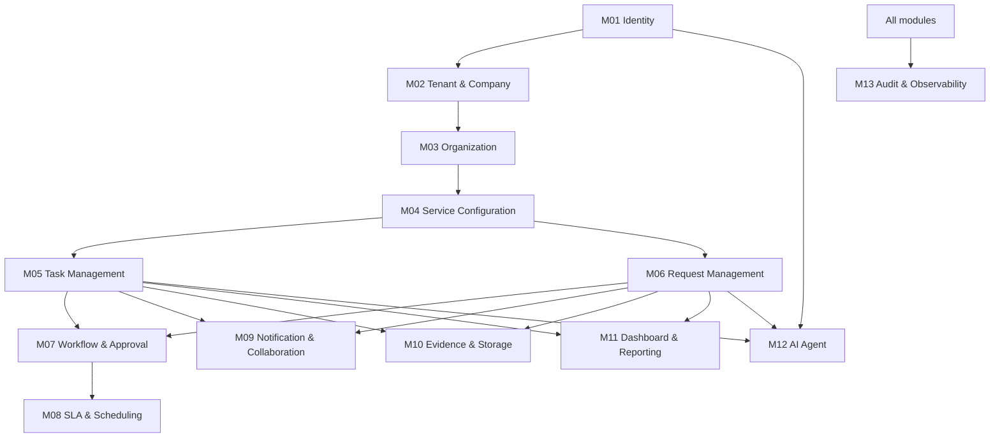

# BizFlow Module Specifications

| Field | Value |
|---|---|
| Version | 0.1-draft |
| Date | 2026-10-17 |
| Source | SSS v1.2 sections 4–6, 17 and 24 |
| Status | Source-derived target module map; implementation NOT VERIFIED |

This catalog preserves the 13 baseline module IDs. It describes intended ownership and contracts, not observed source-code classes, projects, folders or database tables. See the primary [`SSS.md`](../specifications/SSS.md#6-module-and-component-specification).

## Module catalog

| ID | Module | Owns / coordinates | Does not own | Primary dependencies | Required verification |
|---|---|---|---|---|---|
| M01 | Authentication & Identity | Credentials, account/session lifecycle, authenticated identity | Business authorization of every resource; tenant provisioning policy | Tenant context, M02 | Active/inactive account; invalid login; refresh rotation/revocation; reset-token expiry; tenant context correctness |
| M02 | Tenant & Company | Company registration, approval workflow, tenant status/provisioning | User's detailed work records | M01, M13 | Pending registration; authorized approval; safe provisioning retry; suspension enforcement and audit |
| M03 | Organization | Members, departments, roles, permission catalog assignments | Task/request state | M01, M02 | Same-tenant reference checks; permission boundary; deactivation preserving history |
| M04 | Service Configuration | Internal services/categories, routing defaults, links to workflow/approval policies | Live task/request execution state | M03, M07 | Duplicate code validation; no cross-tenant reference; active policy version consistency |
| M05 | Task Management | Task, assignment history, progress, result, confirmation lifecycle | Workflow definition and authorization catalog | M03, M04, M07, M09, M10, M12, M13 | State transitions; assignment/reassignment authorization; stale version conflict; confirmation and audit |
| M06 | Request Management | Request, routing/processing/resolution, revision chain, links to tasks | Task lifecycle rules | M03, M04, M05, M07, M08, M09, M10, M12, M13 | Route within tenant; linked tasks; original rejected request immutable; revised request distinct |
| M07 | Workflow & Approval | Workflow versions/instances and approval decisions | User/department definitions, task/request records themselves | M04, M05, M06, M13 | Invalid transitions rejected; version immutability; approval record and separation-of-authority rules where defined |
| M08 | SLA & Scheduling | SLA profiles/runtime, calendar calculations, warning and escalation events | Arbitrary task/request status bypass | M05, M06, M07, M09, M13 | Pause/resume policy; timezone/calendar; duplicate scheduler run; escalation idempotency |
| M09 | Notification & Collaboration | Comments, notification intent/delivery tracking, collaboration history | Authorization decisions about target object | M05, M06, M08, M10, M13 | Authorized recipients; tenant-safe real-time delivery; email failure does not misrepresent business result |
| M10 | Evidence & Storage | Attachment metadata, upload session/finalization and access coordination | Object-storage provider internals; business object's lifecycle | M03, M05, M06, M09 | Type/size validation; signed URL access; another tenant cannot retrieve object; partial upload cleanup |
| M11 | Dashboard & Reporting | Operational reports and summaries | Ownership of the raw business state being aggregated | M05, M06, M08, M13 | Tenant/resource scope on filters, aggregates and exports; reproducible metric definitions |
| M12 | AI Agent | Use-case orchestration, context assembly, schema validation, recommendations and whitelisted tool requests | Identity authority, permission policy, direct database mutation | M01–M11 as use case needs; OpenAI adapter | Prompt injection; invalid IDs; tool authorization; confirmation; timeout/fallback; safe context minimization |
| M13 | Audit & Observability | Business audit integration, technical logs/traces/metrics and security activity | The business mutation itself | All modules | Required event coverage; no secrets in logs; audit access restriction; correlation and failure policy |

## Public interface principles

1. A module must expose business capabilities via named application-level operations; consumers must not modify its owned data store directly.
2. Every cross-module command must carry enough context to revalidate caller, tenant, target resource and business state. Propagated context is not automatically trusted if it can be influenced by a client.
3. Do not pass ORM entities across module boundaries as an implicit API contract. Use purposeful inputs/results or query projections where appropriate; exact patterns await code review.
4. Avoid circular dependencies. If Task and Request both need a common cross-cutting capability, document an owning module or explicit orchestrator rather than creating mutual direct calls.
5. Side effects such as email, external AI calls, object storage and scheduler execution are not part of a PostgreSQL transaction. Define retry/idempotency and partial-failure behavior per operation.
6. Audit business mutations at the application-service boundary or another consistent mechanism so UI actions, API calls and AI tools are treated alike.
7. Keep the backend authoritative for validation, permissions, tenant isolation and state transitions.

## Suggested module dependency rule

This diagram is conceptual and must be revisited against actual implementation. `M12` can call owning application services only through permitted contracts; it is not allowed to become an unrestricted shared repository.

## Implementation status

All 13 modules are present in the SSS source baseline. No matching Angular/.NET BizFlow source repository was verified. Therefore all module implementation states are **Unknown / Not Verified**. Do not promote a module to “Implemented” until source code and tests establish its behavior.
